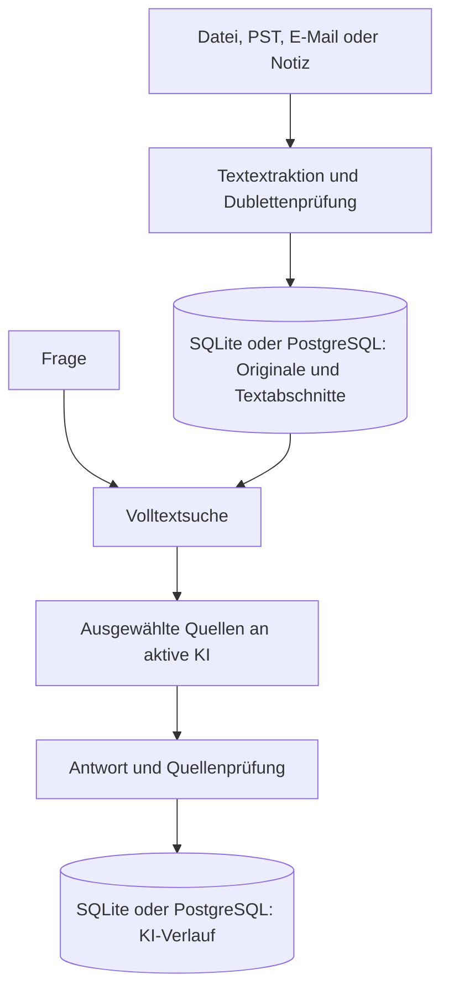

# Wissensraum AI – KI-gestütztes Wissensmanagement mit SQL

Arbeitsstand 1.9-dev · Basisversion 1.8.1 · 19.10.2026 · lokale Einzelplatzanwendung · Python 3.11 bis 3.13

Dokumente, Notizen, Originaldateien und KI-Verlauf werden wahlweise in einer lokalen SQLite- oder einer PostgreSQL-Datenbank gespeichert. Die Anwendung bietet eine deutschsprachige Desktop-Oberfläche und eine Kommandozeilenschnittstelle. Es wird kein Webserver benötigt.

## Masterplan und Roadmap

Der verbindliche [Masterplan mit Release-Roadmap](docs/masterplan.md) trennt den bestätigten Stand 1.8.1 von geplanten Arbeiten. Dieses Repository befindet sich im Entwicklungsstand **1.9-dev**: Die unten beschriebene Startdiagnose ist bereits implementiert und getestet, die übrigen Release-1.9-Arbeitspakete sind dadurch nicht automatisch abgeschlossen.

### Startdiagnose (Release 1.9)

Ausführen: `python cli.py doctor`.

- **Prüfungen:** Python 3.11 bis 3.13, Tcl/Tk, Pillow, sicherer Betriebssystem-Schlüsselspeicher, aktive SQLite-/PostgreSQL-Datenbank und Schreibrechte im Anwendungsdatenverzeichnis.
- **Ergebnis:** Die Ausgabe hat eine feste Reihenfolge. Sobald eine erforderliche Prüfung fehlschlägt, endet der Befehl mit einem Exit-Code ungleich null.
- **Keine Datenänderung:** Die Datenbankprüfung kontrolliert Tabellen, Spalten sowie Primär- und Fremdschlüssel, Eindeutigkeits- und Volltextobjekte. Eine Schreibprobe wird zurückgerollt; die Diagnose initialisiert und migriert kein Schema und ändert keine Benutzerdaten. Eine fehlende, am exakten Ziel anlegbare SQLite-Datei bleibt beim ersten Start eine Warnung; ein unbrauchbarer Zielpfad ist ein erforderlicher Fehler. Details zur späteren Migration älterer SQLite-Schemata stehen unter **Einstellungen: KI auswählen und Schlüssel verwalten**.
- **Desktop-Start:** Diagnose und GUI-Verfügbarkeitsprüfung laufen vor dem Öffnen oder Initialisieren der Datenbank. Bei einem erforderlichen Fehler wird keine Import-/Bearbeitungsoberfläche erstellt. Stattdessen erscheint ein redigierter, handlungsorientierter Dialog oder, wenn Tk beziehungsweise eine grafische Anzeige fehlt, eine Konsolenausgabe mit Exit-Code ungleich null. Es gibt keinen flüchtigen Ersatzspeicher.

## Start unter Windows

1. ZIP vollständig in einen beschreibbaren Ordner entpacken, beispielsweise `H:\Wissensraum`. Nicht direkt aus der ZIP starten und nicht unter `Programme` ablegen.
2. Python 3.11 bis 3.13 von https://www.python.org/downloads/ mit Tcl/Tk installieren.
3. `start_windows.bat` doppelt anklicken. Beim ersten Start werden die erforderlichen Python-Bibliotheken installiert; dafür ist Internetzugang erforderlich.
4. **Einstellungen** öffnen. Vorhandene Schlüssel aus Umgebung und `.env.local`/`.env` werden automatisch maskiert angezeigt. Anbieter auswählen, Modell prüfen und **Als aktive KI verwenden** anklicken. Neue Schlüssel im maskierten Eingabefeld hinterlegen oder über **Schlüsseldatei importieren** übernehmen.
5. **Import** öffnen. Dort einzelne Dokumente, vollständige Ordner einschließlich Unterordnern, Outlook-PST-Dateien oder konfigurierte E-Mail-Konten einlesen. E-Mail-Konten werden unter **Einstellungen → E-Mail-Konten** gepflegt.
6. **Dokumente & Suche** durchsuchen. Unter **Wissen befragen** eine Frage eingeben; **Quellen suchen & antworten** startet die KI-Anfrage.

Zum Prüfen kann `beispiele/Freigabeprozess.md` importiert werden. Die Inhalte sind ausdrücklich fiktiv. Beispielfrage: „Wer gibt Beschaffungsanträge über 500 Euro frei?“

API-Zugangsdaten bleiben außerhalb der Versionsverwaltung. Die Anwendung lädt einen vorhandenen API-Schlüssel lokal. Datenbanken sowie typische Schlüsseldateien mit den Endungen `.pem` und `.key` und `.env*`-Dateien sind über `.gitignore` ausgeschlossen. Anders benannte importierte Schlüsseldateien sind nicht automatisch ausgeschlossen und dürfen nicht im Repository abgelegt werden.

## Linux und macOS

Python 3.11 bis 3.13 mit Tkinter voraussetzen, anschließend `sh start.sh` ausführen. Unter Linux können zusätzlich die Betriebssystempakete für `python3-tk` und `python3-venv` erforderlich sein. Auf einem Rechner ohne grafische Anzeige die CLI verwenden.

## Funktionen und Grenzen

| Bereich | Implementiert |
|---|---|
| Datenbank | Lokales SQLite oder aktivierbares PostgreSQL auf einem VPS; Fremdschlüssel, Transaktionen und Volltextsuche |
| Dokumente | TXT, Markdown, textbasierte PDF, DOCX einschließlich Tabellen; Einzeldateien oder rekursiver Ordnerimport |
| E-Mail | Gmail und sonstige IMAP-Konten im Nur-Lesen-Modus; Microsoft 365/Outlook über OAuth 2.0 und Microsoft Graph |
| Outlook-Archive | Lokaler PST-Import über die optionale `libratom`-Erweiterung |
| Originale | Binärdateien als BLOB in SQL; Export über die Oberfläche |
| Notizen | Titel, frei wählbarer Bereich, Inhalt |
| Dubletten | SHA-256 über den extrahierten, außen getrimmten Text; identischer Text wird einmal gespeichert |
| Suche | Volltext über Titel, Bereich und Abschnitte; SQLite mit BM25-Rangfolge, PostgreSQL mit `ts_rank_cd` |
| KI-Fragen | Höchstens acht passende Textabschnitte, Antwort mit [Q1]-Quellenverweisen |
| Zusammenfassung | Ausgewähltes Dokument bis 24.000 Zeichen |
| Verlauf | Erfolgreiche KI-Antworten und unveränderliche Quellenkopien in SQL |
| Sicherung | Konsistente SQLite-Sicherung über die Backup-API |
| Automatisierung | CLI für Import, Suche, Fragen, Zusammenfassung, Sicherung |
| Design | Telekom-Magenta als Akzentfarbe, Hell-/Dunkelmodus und eigenes Logo im Kopfbereich |

Die Suche ist lexikalisch: Begriffe müssen im Dokument vorkommen. Synonyme, echte semantische Suche und Vektor-Embeddings sind in Version 1 nicht implementiert. Bei Mehrwortfragen werden Suchbegriffe mit ODER verknüpft. Häufige Wörter können dadurch irrelevante Treffer erzeugen. Höchstens 30 Texttreffer werden in der Dokumentensuche angezeigt; mehrere Treffer aus demselben Dokument werden zusammengeführt.

Die KI erhält die acht bestbewerteten Abschnitte, keine vollständige Gesamtauswertung des Bestands. Ein relevanter Abschnitt kann außerhalb dieser Auswahl liegen. Quellenverweise werden auf gültige Nummern geprüft; das prüft nicht, ob die Aussage tatsächlich aus der Quelle folgt. Antworten ohne Quellenmarkierung erhalten einen ausdrücklichen Prüfhinweis. Aussagen müssen anhand der angezeigten Textstellen geprüft werden.

Grenzen: 20 MB lokale Originaldatei, 25 MB je abgerufener IMAP-Nachricht, 2 Millionen extrahierte Zeichen pro Dokument, 4.000 Zeichen pro Frage, 24.000 Zeichen für eine Zusammenfassung. OCR für Scans, E-Mail-Anhänge, Audio, Web-Crawling, Benutzerverwaltung, Rechtevergabe, Wissensgraph und Mehrbenutzerbetrieb sind nicht enthalten. PostgreSQL ist als aktivierbare Alternative zu SQLite enthalten, setzt aber einen separat betriebenen PostgreSQL-Server voraus. Ein Importlauf verarbeitet maximal 2.000 IMAP-, 1.000 Microsoft- oder 10.000 PST-Nachrichten. Importierte Dokumente sind unveränderlich; korrigierte Inhalte werden als neues Dokument importiert. Beim Löschen eines Dokuments bleiben Quellenkopien im KI-Verlauf erhalten und können weiter sensible Inhalte enthalten.

## Datenmodell

| Tabelle/Objekt | Zweck |
|---|---|
| `documents` | Titel, Bereich, Originalname, Original-BLOB, extrahierter Text, Hash, Erfassungszeit |
| `chunks` | Nummerierte Textabschnitte mit Fremdschlüssel auf das Dokument |
| Volltextindex | SQLite: FTS5-Tabelle `search_index` mit Sicht `chunks_search`; PostgreSQL: GIN-Index und Volltextfunktionen |
| `ai_runs` | Anfrageart, Frage, Antwort, Quellen-Snapshot als JSON, Modell, Zeit |
| `settings` | Nicht geheime Anwendungseinstellungen |
| `email_accounts` | Kontoname, Anbieter, Adresse, Serverparameter und OAuth-Anwendungskennung; keine Kennwörter oder Token |
| `email_imports` | Dauerhafte Zuordnung importierter Nachrichten zu Konto, Postfachordner und Dokument |

`schema.sql` dokumentiert das SQLite-Schema. Die Anwendung initialisiert SQLite aus `SCHEMA` und PostgreSQL aus `POSTGRES_SCHEMA` in `core.py`; beide Backends haben denselben fachlichen Speicherumfang, verwenden aber unterschiedliche Volltexttechnik. SQL-Werte werden parametrisiert gebunden. KI-Ausgaben werden niemals als SQL oder Programmcode ausgeführt.



## Datenspeicherung und Betrieb

Standarddatei: `data/wissen.db` im Programmordner. Alternativer Pfad über `WISSEN_DB`. Unter **Einstellungen → Datenbank** kann eine TLS-geschützte PostgreSQL-Verbindung gespeichert, getestet und für den nächsten Programmstart aktiviert werden. **Anwendungsschema zurücksetzen** löscht nach Eingabe des Datenbanknamens ausschließlich das PostgreSQL-Schema `wissensraum` und legt dessen sechs Tabellen neu an; andere Schemas bleiben erhalten. Neu über die Oberfläche eingegebene PostgreSQL-Kennwörter werden im Betriebssystem-Schlüsselspeicher abgelegt; alternativ kann ein Kennwort aus `DB_PASSWORD` verwendet werden, ohne es in den Schlüsselspeicher zu kopieren. `data/database.json` enthält nur Server, Port, Datenbankname, Benutzer, TLS-Modus und die aktive Datenquelle. Eine Aktivierung überträgt vorhandene SQLite-Daten nicht automatisch. Das Modell kann über `OPENAI_MODEL` konfiguriert werden; Standard ist `gpt-4.1-mini`. Der Schlüssel wird aus `OPENAI_API_KEY`, `.env.local` oder `.env` im Programmordner sowie `.env.local` im übergeordneten Ordner geladen. Die Oberfläche zeigt Anbieter und Schlüsselstatus im Bereich **Einstellungen**; neue Schlüssel werden im Betriebssystem-Schlüsselspeicher abgelegt. Es gibt keinen Dialog, der einen Schlüssel im Klartext anzeigt.

### Operative Logs (Release 1.9)

Desktop und normale CLI-Befehle schreiben lokale, UTF-8-kodierte JSON-Lines nach `data/logs/wissensraum.jsonl` im Programmordner; jede Zeile ist genau ein JSON-Objekt. `python cli.py doctor` initialisiert das Logging ausdrücklich nicht und erzeugt weder Logdatei noch Logordner. Das feste Schema enthält Zeitstempel, Standard-Schweregrad, stabile Ereignis-, Komponenten- und Laufkennungen sowie ausschließlich freigegebene skalare Betriebsmetadaten wie Backend, Operation, Status, Zähler, Dauer und Erfolg. Dokumentinhalte, Fragen, Antworten, Dateinamen, Pfade, Header, Verbindungszeichenfolgen und Ausnahmemeldungen gehören nicht in das Schema; bei Fehlern werden nur eine Ausnahmeklasse und ein stabiler Fehlercode protokolliert.

Bei 5 MiB wird rotiert. Es bleiben höchstens fünf nummerierte Sicherungsdateien zusätzlich zur aktiven Datei erhalten, also maximal sechs Logdateien. Bei weiterer Rotation wird jeweils die älteste Sicherung verworfen; die Begrenzung ist eine dateibasierte Größenaufbewahrung, keine zeitbasierte Archivierung. Genau ein Prozess darf das Ziel gleichzeitig schreiben; auch Pfad- und Hardlink-Aliasse desselben vorhandenen Ziels werden als dasselbe Ziel behandelt.

Kann das Logging nicht eingerichtet, beschrieben, rotiert oder geschlossen werden, erscheint nur die generische Warnung `Warnung: Operatives Logging ist nicht verfügbar.`. Der eigentliche Anwendungsablauf, sein Ergebnis und seine Fehlerbehandlung werden dadurch nicht verändert. Die Logs sind eine lokale Betriebsdiagnose und kein vollständiger Audit-Verlauf.

Die Geheimnisfilterung ist mehrschichtig: Das öffentliche Ereignisschema ist eng freigegeben, Kennungs- und Metadatentypen werden exakt geprüft, typische Zugangsdatenformen werden unmittelbar vor der JSON-Ausgabe redigiert und bereits im geöffneten PostgreSQL-Store vorhandene Kennwortwerte werden als bekannte Werte an den finalen Filter übergeben. Für das Logging werden keine zusätzlichen Zugangsdaten aus Schlüsselbund, Umgebung oder Dateien gelesen oder gespeichert. Diese Filterung ist Defense-in-Depth, keine Garantie, beliebige oder neuartige Geheimnisdarstellungen zu erkennen; insbesondere können unbekannte Werte ohne erkennbare Zugangsdatenform nicht zuverlässig erraten werden. Logdateien müssen deshalb weiterhin durch Betriebssystemkonto, restriktive Dateirechte und gegebenenfalls Laufwerksverschlüsselung geschützt und vor Supportweitergabe geprüft werden.

Das Erscheinungsbild wird lokal und unabhängig von der aktiven SQL-Datenbank gespeichert. `data/design.json` enthält den gewählten Hell-/Dunkelmodus; ein hinterlegtes Logo wird normalisiert unter `data/branding/logo.png` abgelegt. Dadurch bleiben Design und Logo bei einem Datenbankwechsel oder Schema-Reset erhalten. Das Logo ist auf 5 MB Quelldateigröße und 20 Millionen Bildpunkte begrenzt und wird auf maximal 320 × 96 Pixel skaliert.

Dokumentimport und Suche benötigen keine API. Bei Fragen werden Frage und ausgewählte Textabschnitte an den gewählten KI-Anbieter gesendet; bei Zusammenfassungen der vollständige unterstützte Dokumenttext. Die Anwendung setzt `store=false` bei OpenAI-Responses-Anfragen. Dies ersetzt keine Prüfung der geltenden Datenverarbeitung und ist keine Zusage vollständiger Speicherfreiheit beim Anbieter. Die API-Nutzung wird separat abgerechnet.

Die SQLite-Datei ist nicht durch die Anwendung verschlüsselt. Sie enthält auch importierte E-Mail-Texte und die jeweiligen Originalnachrichten. Betriebssystemkonto und Laufwerksverschlüsselung schützen lokale Daten. PostgreSQL verwendet das getrennte Schema `wissensraum`. Für entfernte PostgreSQL-Verbindungen erzwingt die Anwendung TLS; nur lokale Verbindungen zu `localhost` oder `127.0.0.1` dürfen ausdrücklich mit `sslmode=disable` betrieben werden. Die Anwendung bleibt eine Einzelplatzanwendung und enthält keine Benutzer- oder Mandantentrennung.

**Sicherung:** Bei SQLite erstellt „Datenbank sichern“ eine vollständige Datenbankkopie einschließlich Originalen und KI-Verlauf. **Wiederherstellung:** Anwendung beenden, bestehende `data/wissen.db` samt eventuell vorhandenen `wissen.db-wal` und `wissen.db-shm` gemeinsam in einen anderen Ordner verschieben, Sicherungsdatei als `data/wissen.db` einsetzen, Anwendung starten. Bei aktivem PostgreSQL öffnet die lokale Sicherungsschaltfläche derzeit noch den Dateidialog und meldet anschließend, dass diese Sicherungsart nicht unterstützt wird; PostgreSQL muss außerhalb der Anwendung mit `pg_dump` von einem erreichbaren Client gesichert werden. Schlüsseldatei separat sichern. Im Betriebssystem-Schlüsselspeicher verwaltete Schlüssel sind nicht in der SQL-Sicherung enthalten und müssen auf einem anderen Rechner erneut eingerichtet werden.

## CLI

Im Programmordner, nach Installation der Abhängigkeiten:

```bash
python cli.py import beispiele/Freigabeprozess.md --category Prozesse
python cli.py list
python cli.py search "Freigabe"
python cli.py ask "Wer gibt Beschaffungsanträge frei?"
python cli.py summarize 1
python cli.py backup sicherung.db
python cli.py config-export wissensraum-konfiguration.json
python cli.py config-import wissensraum-konfiguration.json
python cli.py config-sync
```

Für eine andere Datenbank das globale Argument vor dem Unterbefehl setzen:

```bash
python cli.py --db data/test.db list
```

### Konfiguration sicher übertragen (Release 1.9)

Unter **Einstellungen → Konfiguration** oder mit `config-export` und `config-import` lässt sich die unterstützte Konfiguration als versionierte JSON-Datei übertragen. Enthalten sind ausschließlich die aktive KI, Modell-IDs und Deaktivierungsstatus, das Datenbankprofil ohne Kennwort, der Designmodus sowie E-Mail-Kontometadaten. Nicht enthalten sind API-Schlüssel, Datenbank- und E-Mail-Kennwörter, OAuth-Token, Schlüsselbundinhalte, Umgebungswerte und Schlüsseldateien, Logo-Dateien, Dokumente, KI-Verläufe oder Logs. Zugangsdaten müssen auf dem Zielsystem separat eingerichtet werden; bereits dort gespeicherte Zugangsdaten bleiben beim Import unverändert.

`data/configuration-authority.json` ist die backendunabhängige, nicht geheime Quelle für die übertragbaren KI-Einstellungen und E-Mail-Kontometadaten. Normale Änderungen über die Anwendung aktualisieren sie atomar zusammen mit dem SQL-Vertrag. Die Desktop-Anwendung synchronisiert sie nach dem authentifizierten Öffnen der aktiven Datenbank. Für bestehende Installationen kann derselbe Schritt ausdrücklich mit `python cli.py config-sync` ausgeführt werden; erst danach ist ein rein lokaler CLI-Export möglich. `config-export` öffnet keine SQL-Datenbank und liest weder Schlüsselbund noch Kennwortquelle. Fehlt die Quelle oder gehört sie zu einer anderen aktiven Datenbank, bricht der Export mit einem festen Hinweis ab, statt ersatzweise möglicherweise veraltete SQLite-Metadaten auszugeben.

Der Import akzeptiert nur Format `wissensraum-configuration`, Version `1` und die dokumentierten Felder mit gültigen Typen und Wertebereichen. Unbekannte, geheimnisverdächtige, zu große oder zu tief verschachtelte Eingaben brechen den Import ab, bevor Werte geändert werden. SQL-Einstellungen, die vollständige Liste der E-Mail-Kontometadaten, Datenbankprofil, Designmodus und lokale Autoritätsdatei werden als ein Vorgang angewendet. Das Wiederherstellungsjournal enthält die validierte, nicht geheime Identität der exakt beteiligten SQLite-Datei beziehungsweise des PostgreSQL-Profils. Beim nächsten Desktop- oder CLI-Start wird dieser Ursprung vor Auswahl des inzwischen gespeicherten Zielprofils wieder geöffnet. Schlägt die Verbindung fehl, bleibt das Journal erhalten und der normale Betrieb wird mit einer festen, redigierten Meldung blockiert. Eine bereits bestätigte SQL-Übernahme wird fertiggestellt und als Erfolg behandelt; nur eine verifiziert zurückgerollte Übernahme meldet „nichts geändert“. Jede Änderung des gespeicherten Datenbankprofils – auch Server- oder Datenbankänderungen innerhalb von PostgreSQL – erfordert einen Programmneustart; es findet keine Datenmigration statt.

## Prüfung dieser Auslieferung

- 274 automatisierte Tests prüfen Speicherung, BLOB-Erhalt, Dubletten, Suche, Sicherung, Dokumentextraktion, rekursiven Ordnerimport, Designpersistenz, Logo-Normalisierung, Hell-/Dunkelmodus, KI-Adapter, Schlüsselspeicherung, Schema-Migration, Datenbankprofile, sicheren Konfigurationstransfer, Startdiagnose, strukturiertes Logging einschließlich Rotation, Zielbesitz und Geheimnisfilterung, Reset-Bestätigung, TLS-Verbindungskonfiguration, E-Mail-Auswahlfreigabe, Anwendungsende, IMAP-Nur-Lesen-Import, PST-Import und Microsoft-Graph-Import. Der aktuelle lokale Windows-Gesamtlauf besteht mit 274 Tests und fünf plattform-/dienstbedingten Übersprüngen: drei auf Windows nicht ausführbare Dateisystemfälle und zwei mangels lokalem PostgreSQL-Dienst übersprungene PostgreSQL-Vertragstests. Ein echter PostgreSQL-18-Dienst ist in der CI-Konfiguration verdrahtet; ein erfolgreicher Live-CI-Lauf dieses erweiterten Vertrags ist noch nicht beobachtet und bleibt ein externes Abschluss-Gate.
- KI-Vertrag mit simulierten API-Antworten geprüft. Live-Test mit synthetischen Testdaten durchgeführt; die API antwortete mit HTTP 429. Live-Antwortqualität ist deshalb nicht bestätigt.
- Die Desktop-Oberfläche wird unter Linux mit virtuellem Bildschirm gestartet und automatisiert geprüft. GitHub Actions erzeugt zusätzlich Vorschauen der Einstellungen und des Importbereichs. Die Windows-Matrix kompiliert die Python-Dateien und prüft den Inhalt von `start_windows.bat` automatisiert auf die unterstützte Versionslogik; die Batchdatei selbst wird in CI nicht ausgeführt oder kompiliert.
- GitHub Actions prüft Python 3.11 und 3.13 auf Windows und Linux, einschließlich grafischer Oberflächentests. Der aktuelle Status ist im Actions-Tab sichtbar.

Tests ausführen:

```bash
python -m unittest discover -s tests -v
```

## Fehlerbehandlung

**HTTP 429:** API-Guthaben, Abrechnung und Projektlimits prüfen. Der Test dieser Auslieferung ist daran gescheitert. Die Anwendung stellt API-Limits nicht selbst um und wiederholt kostenpflichtige Anfragen nicht automatisch.

**Keine Treffer:** Konkrete Begriffe aus dem Dokument verwenden. Diese Version enthält keine semantische Suche.

**PDF ohne Text:** OCR ist erforderlich und nicht Bestandteil dieser Version.

**Startfehler `PIL._imaging uses unknown slot ID`:** Eine vorhandene virtuelle Umgebung enthält inkompatible Pillow-Dateien. Der aktuelle Windows-Starter erkennt diesen Zustand, löscht ausschließlich den lokalen Ordner `.venv`, installiert alle Abhängigkeiten neu und startet danach die Anwendung. Anwendungsdaten unter `data` bleiben erhalten.

**Kein Tkinter / keine Anzeige:** Python mit Tcl/Tk auf einem Desktop installieren oder die CLI verwenden.

**Kein API-Schlüssel:** Unter „Einstellungen“ den Schlüssel des gewünschten Anbieters hinterlegen oder eine vorhandene Schlüsseldatei importieren. Keine Zugangsdaten in Notizen oder Dokumente importieren.

## Entwicklung

Die CI-Tests rufen keine kostenpflichtige KI-, Microsoft- oder E-Mail-API auf. API-Verträge werden mit kontrollierten Testantworten geprüft. Änderungen an Datenmodellen benötigen eine passende Migration. Die aktuelle Version initialisiert für SQLite Schema 4 und lehnt neuere SQLite-Schemata ab. PostgreSQL wird aus der separaten Backend-Definition in `core.py` mit `CREATE … IF NOT EXISTS` initialisiert; eine Schema-Versionierung und Migration bereits vorhandener PostgreSQL-Tabellen ist derzeit noch nicht implementiert.


## Einstellungen: KI auswählen und Schlüssel verwalten

1. Reiter **Einstellungen** öffnen oder die gleichnamige Schaltfläche oben anklicken.
2. In der Tabelle OpenAI, Claude, Gemini oder Ollama auswählen. Dies allein ändert die aktive KI noch nicht.
3. Die Modell-ID kann aus Vorschlägen gewählt oder direkt eingegeben werden. Der Anbieter muss das Modell für den verwendeten API-Zugang freigeschaltet haben.
4. Vorhandene Schlüssel sind maskiert vorausgefüllt. Die Übersicht zeigt nur die letzten vier Zeichen bei längeren Schlüsseln sowie die Herkunft. Neue Schlüssel ersetzen den bisherigen Wert im Eingabefeld.
5. **Einstellungen speichern** speichert Modell und einen neu eingegebenen Schlüssel, ohne die aktive KI zu wechseln.
6. **Als aktive KI verwenden** speichert die Formwerte und setzt den Anbieter für Fragen, Zusammenfassungen und CLI. Die Spalte **Verwendung** markiert ihn mit **AKTIV**; eine abweichende Auswahl in der Tabelle ist nur eine Bearbeitungsauswahl.
7. **Verbindung testen** prüft die ausgewählten Formwerte ohne Dokumente zu senden und ohne automatisch zu speichern oder den Anbieter zu wechseln. Der Test kann API-Kosten verursachen.

| Anbieter | Erkannte Schlüsselvariablen | Ausführung |
|---|---|---|
| OpenAI | `OPENAI_API_KEY` | OpenAI Responses API |
| Claude | `ANTHROPIC_API_KEY` | Anthropic Messages API |
| Gemini | `GEMINI_API_KEY`, alternativ `GOOGLE_API_KEY` | Google Gemini GenerateContent |
| Ollama | Kein API-Schlüssel | Lokaler Dienst unter `127.0.0.1:11434`; Modell muss installiert sein |

**Priorität:** Betriebssystem-Schlüsselspeicher → Umgebungsvariable → `.env.local` im Programmordner → `.env` im Programmordner → `.env.local` im übergeordneten Ordner. Ein in der Anwendung deaktivierter Schlüssel wird aus keiner dieser Quellen verwendet. Bereits vorhandene Datei-/Umgebungsschlüssel werden beim Start nicht kopiert oder verändert. Das Speichern unveränderter Schlüssel erfordert keine neue Ablage.

Neu eingegebene Schlüssel werden mit `keyring` in einem nativen Betriebssystem-Speicher verwaltet: Windows-Anmeldeinformationsverwaltung, macOS-Schlüsselbund oder ein unterstützter Linux-Secret-Service. Plaintext-Dateibackends werden abgelehnt. Ohne funktionierenden sicheren Speicher schlägt das Speichern eines neuen Schlüssels ausdrücklich fehl; vorhandene Datei-/Umgebungsschlüssel bleiben für normale CLI-Aufrufe nutzbar. Der Desktop-Start ist im Entwicklungsstand 1.9-dev jedoch fail-closed und wird durch die erforderliche Schlüsselspeicher-Diagnose blockiert, bis ein sicherer Speicher verfügbar ist. Die SQL-Datenbank speichert nur aktive KI, Modell-IDs und Deaktivierungsstatus. Die OS-Schlüssel gelten für das aktuelle Betriebssystemkonto und die Anwendung, auch bei Verwendung mehrerer Wissensdatenbanken.

**Schlüssel entfernen** löscht den von der Anwendung verwalteten Schlüssel und deaktiviert den Anbieter auch für extern vorhandene Schlüssel. Umgebungsvariablen und ursprüngliche Dateien bleiben erhalten. Das entfernt keine Zugangsdaten beim Anbieter und widerruft keinen API-Schlüssel. Einen neuen Wert eingeben und speichern, um den Anbieter wieder zu aktivieren.

SQLite-Schemata 1 bis 3 werden beim Öffnen automatisch auf SQLite-Schema 4 erweitert; vorhandene Dokumente, Suchindex und KI-Verlauf bleiben erhalten. Alte Programmversionen können eine auf Version 4 aktualisierte SQLite-Datenbank nicht mehr öffnen. Vor einem Programm-Downgrade die frühere Datenbanksicherung verwenden. Diese Versionsangabe beschreibt nicht das separat definierte PostgreSQL-Schema.

Die Anbieteradapter werden mit kontrollierten API-Antworten getestet. Claude, Gemini und Ollama wurden in dieser Entwicklungsumgebung nicht mit echten Zugängen bzw. einem lokalen Modell live geprüft. Der vorherige OpenAI-Live-Test erhielt HTTP 429. Modellvorschläge sind konfigurierbare Vorgaben und keine Zusicherung der Verfügbarkeit.

## Import und E-Mail-Konten

Der Reiter **Import** trennt drei Quellen: lokale Dokumente, Outlook-PST-Dateien und E-Mail-Postfächer. **Postfach importieren** lädt zunächst nur Datum, Absender und Betreff in eine Auswahlliste. Alle neuen Nachrichten sind standardmäßig deaktiviert. Bereits importierte E-Mails tragen dauerhaft den grünen Status **✓ Importiert** und können nicht erneut aktiviert werden. Erst **Aktivierte E-Mails importieren** autorisiert das Laden und Speichern der ausgewählten vollständigen Nachrichten. Der Import liest das Postfach ohne Nachrichten zu löschen oder als gelesen zu markieren. E-Mails werden mit Betreff, Absender, Empfänger, Datum, Nachrichten-ID und Nachrichtentext gespeichert. Anhänge werden noch nicht extrahiert. Identischer extrahierter Inhalt wird nicht doppelt gespeichert. Wird das zugehörige Dokument gelöscht, wird auch die Importkennzeichnung entfernt.

### Gmail

1. Google-Konto mit Bestätigung in zwei Schritten absichern und ein App-Passwort für Wissensraum erzeugen.
2. **Einstellungen → E-Mail-Konten → Neues Konto** öffnen und **Gmail** wählen.
3. Kontoname, E-Mail-Adresse und Benutzername eintragen. Server `imap.gmail.com` und Port `993` werden automatisch gesetzt.
4. Das App-Passwort unter **Kennwort / App-Passwort** eintragen und speichern.

### Microsoft 365 und Outlook.com

Microsoft-Konten verwenden OAuth 2.0 und Microsoft Graph. Dafür wird einmalig eine eigene öffentliche Anwendung in Microsoft Entra benötigt:

1. Entra App-Registrierung anlegen, den passenden Kontotyp wählen und **Flows für öffentliche Clients zulassen** aktivieren.
2. Delegierte Microsoft-Graph-Berechtigung `Mail.Read` eintragen.
3. Anwendungs-ID als **Microsoft Client-ID** eintragen. Für Organisations- und Privatkonten kann der Mandant `common` verwendet werden; sonst die Verzeichnis-ID eintragen.
4. Konto speichern, **Microsoft verbinden** anklicken und den angezeigten Gerätecode im Microsoft-Anmeldefenster bestätigen.

### Sonstige E-Mail-Anbieter

**Sonstiges IMAP-Konto** wählen und IMAP-Server, TLS-Port, Benutzername sowie Anbieterkennwort oder App-Passwort eintragen. Die Anwendung verwendet ausschließlich IMAP über TLS. Serverseitige Ordnernamen unterscheiden sich; Standard ist `INBOX`.

### Outlook-PST

PST-Verarbeitung benötigt `libratom` und dessen lokale C-Bibliothek. Unter Windows einmal `install-pst-support.bat` ausführen. Falls die Installation scheitert, die **C++ Build Tools für Visual Studio** installieren und das Skript erneut starten. Anschließend im Reiter **Import** die PST-Datei auswählen. Die Verarbeitung erfolgt lokal; Outlook selbst ist nicht erforderlich.

Kontokennwörter, App-Passwörter und Microsoft-Token werden im nativen Betriebssystem-Schlüsselspeicher verwaltet. SQLite enthält nur Kontometadaten. Beim Entfernen eines Kontos werden dessen gespeicherte Zugangsdaten entfernt; bereits importierte E-Mails bleiben in der Wissensdatenbank.
