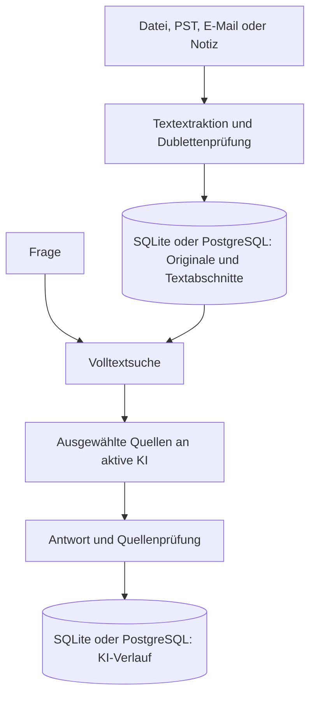

# Wissensraum AI – KI-gestütztes Wissensmanagement mit SQL

Version 1.9 · freigegeben am 23.10.2026 · lokale Einzelplatzanwendung · Python 3.11 bis 3.13

Dokumente, Notizen, Originaldateien und KI-Verlauf werden wahlweise in einer lokalen SQLite- oder einer PostgreSQL-Datenbank gespeichert. Die Anwendung bietet eine deutschsprachige Desktop-Oberfläche und eine Kommandozeilenschnittstelle. Es wird kein Webserver benötigt.

## Masterplan und Roadmap

Der verbindliche [Masterplan mit Release-Roadmap](masterplan.md) beschreibt freigegebene Stände und geplante Arbeiten. Release **1.9 – Stabilisierung und Betriebsfähigkeit** ist freigegeben: Startdiagnose, operative Logs, versionierte Schema-Migrationen bis Schema 5 mit Quellenmodell, Konfigurationstransfer, geführte SQLite-Wiederherstellung, dokumentierte PostgreSQL-Sicherung und Systemstatus. Nachweis: CI-Matrix aus sieben Jobs und das Release-Gate-Protokoll `release-gate-20261022-184843.md`.

### Startdiagnose (Release 1.9)

Ausführen: `python cli.py doctor`.

- **Prüfungen:** Python 3.11 bis 3.13, Tcl/Tk, Pillow, sicherer Betriebssystem-Schlüsselspeicher, aktive SQLite-/PostgreSQL-Datenbank und Schreibrechte im Anwendungsdatenverzeichnis.
- **Ergebnis:** Die Ausgabe hat eine feste Reihenfolge. Sobald eine erforderliche Prüfung fehlschlägt, endet der Befehl mit einem Exit-Code ungleich null.
- **Keine Datenänderung:** Die Datenbankprüfung kontrolliert Tabellen, Spalten sowie Primär- und Fremdschlüssel, Eindeutigkeits- und Volltextobjekte. Eine Schreibprobe wird zurückgerollt; die Diagnose initialisiert und migriert kein Schema, spielt keine ausstehende Konfigurationswiederherstellung ein und ändert keine Benutzerdaten. Ein vorhandenes Wiederherstellungsjournal wird als redigierter erforderlicher Fehler gemeldet. Eine fehlende, am exakten Ziel anlegbare SQLite-Datei bleibt beim ersten Start eine Warnung; ein unbrauchbarer Zielpfad ist ein erforderlicher Fehler. Details zu Schema-Migrationen stehen unter **Einstellungen: KI auswählen und Schlüssel verwalten**.
- **Desktop-Start:** Zuerst laufen Startdiagnose und GUI-Verfügbarkeitsprüfung. Nur nach erfolgreicher Diagnose wird eine ausstehende Konfigurationswiederherstellung verarbeitet; erst danach öffnet und migriert die Anwendung den normalen aktiven Store. Bei einem erforderlichen Fehler wird keine Import-/Bearbeitungsoberfläche erstellt. Stattdessen erscheint ein redigierter, handlungsorientierter Dialog oder, wenn Tk beziehungsweise eine grafische Anzeige fehlt, eine Konsolenausgabe mit Exit-Code ungleich null. Es gibt keinen flüchtigen Ersatzspeicher.

**Systemstatus im laufenden Betrieb:** Die Schaltfläche „Systemstatus prüfen“ unter **Einstellungen → Datenbank** beziehungsweise `python cli.py status` zeigt, ob die aktive Datenbank antwortet (mit Dokumentanzahl), welche KI aktiv ist und woher ihr Schlüssel stammt, und welche E-Mail-Konten keine gespeicherten Zugangsdaten haben. Geprüft wird nur der lokale Zustand. Es wird keine Verbindung zu KI-Anbietern oder Postfächern aufgebaut und kein Schlüssel angezeigt. Die tatsächliche Erreichbarkeit eines Anbieters prüft weiterhin „Verbindung testen“. Anders als `doctor` öffnet `status` den Store wie jeder normale Befehl.

## Start unter Windows

1. ZIP vollständig in einen beschreibbaren Ordner entpacken, beispielsweise `H:\Wissensraum`. Nicht direkt aus der ZIP starten und nicht unter `Programme` ablegen.
2. Python 3.11 bis 3.13 von https://www.python.org/downloads/ mit Tcl/Tk installieren.
3. `start_windows.bat` doppelt anklicken. Beim ersten Start werden die erforderlichen Python-Bibliotheken installiert; dafür ist Internetzugang erforderlich.
4. **Einstellungen** öffnen. Vorhandene Schlüssel aus Umgebung und `.env.local`/`.env` werden automatisch maskiert angezeigt. Anbieter auswählen, Modell prüfen und **Als aktive KI verwenden** anklicken. Neue Schlüssel im maskierten Eingabefeld hinterlegen oder über **Schlüsseldatei importieren** übernehmen.
5. **Import** öffnen. Dort einzelne Dokumente, vollständige Ordner einschließlich Unterordnern, Outlook-PST-Dateien oder konfigurierte E-Mail-Konten einlesen. E-Mail-Konten werden unter **Einstellungen → E-Mail-Konten** gepflegt.
6. **Dokumente & Suche** durchsuchen. Unter **Wissen befragen** eine Frage eingeben; **Quellen suchen & antworten** startet die KI-Anfrage.

Zum Prüfen kann `beispiele/Freigabeprozess.md` importiert werden. Die Inhalte sind ausdrücklich fiktiv. Beispielfrage: „Wer gibt Beschaffungsanträge über 500 Euro frei?“

API-Zugangsdaten bleiben außerhalb der Versionsverwaltung. Die Anwendung lädt einen vorhandenen API-Schlüssel lokal. Datenbanken sowie typische Schlüsseldateien mit den Endungen `.pem` und `.key` und `.env*`-Dateien sind über `.gitignore` ausgeschlossen. Anders benannte importierte Schlüsseldateien sind nicht automatisch ausgeschlossen und dürfen nicht im Repository abgelegt werden.

## Linux und macOS

Python 3.11 bis 3.13 mit Tkinter voraussetzen, anschließend `sh start.sh` ausführen. Unter Linux können zusätzlich die Betriebssystempakete für `python3-tk` und `python3-venv` erforderlich sein. Auf einem Rechner ohne grafische Anzeige die CLI verwenden.

## Funktionen und Grenzen

| Bereich | Implementiert |
|---|---|
| Datenbank | Lokales SQLite oder aktivierbares PostgreSQL auf einem VPS; Fremdschlüssel, Transaktionen und Volltextsuche |
| Dokumente | TXT, Markdown, textbasierte PDF, DOCX einschließlich Tabellen; mit optionaler lokaler Texterkennung auch Bilder und gescannte PDFs; Einzeldateien oder rekursiver Ordnerimport |
| E-Mail | Gmail und sonstige IMAP-Konten im Nur-Lesen-Modus; Microsoft 365/Outlook über OAuth 2.0 und Microsoft Graph |
| Outlook-Archive | Lokaler PST-Import über die optionale `libratom`-Erweiterung |
| Originale | Binärdateien als BLOB in SQL; Export über die Oberfläche |
| Herkunft | Tabelle `sources` mit genau einer Quelle je Dokument: Quelltyp (`note`, `file`, `pst`, `imap`, `graph`), Konto-ID bei IMAP/Graph und Fundort (relativer Pfad, PST-Name, `imap:<Ordner>:<UID>`, `graph:<ID>`). Bei Dubletten bleibt die erste Quelle erhalten. |
| Notizen | Titel, frei wählbarer Bereich, Inhalt |
| Dubletten | SHA-256 über den extrahierten, außen getrimmten Text; identischer Text wird einmal gespeichert |
| Suche | Volltext über Titel, Bereich und Abschnitte; SQLite mit BM25-Rangfolge, PostgreSQL mit `ts_rank_cd` |
| KI-Fragen | Höchstens acht passende Textabschnitte, Antwort mit [Q1]-Quellenverweisen |
| Zusammenfassung | Ausgewähltes Dokument bis 24.000 Zeichen |
| Verlauf | Erfolgreiche KI-Antworten und unveränderliche Quellenkopien in SQL |
| Sicherung | Konsistente SQLite-Sicherung über die Backup-API |
| Automatisierung | CLI für Import, Suche, Fragen, Zusammenfassung, Sicherung |
| Design | Telekom-Magenta als Akzentfarbe, Hell-/Dunkelmodus und eigenes Logo im Kopfbereich |

Die Suche ist lexikalisch: Begriffe müssen im Dokument vorkommen. Synonyme, echte semantische Suche und Vektor-Embeddings sind in Version 1 nicht implementiert. Bei Mehrwortfragen werden Suchbegriffe mit ODER verknüpft. Häufige Wörter können dadurch irrelevante Treffer erzeugen. Höchstens 30 Texttreffer werden in der Dokumentensuche angezeigt; mehrere Treffer aus demselben Dokument werden zusammengeführt.

Die KI erhält die acht bestbewerteten Abschnitte, keine vollständige Gesamtauswertung des Bestands. Ein relevanter Abschnitt kann außerhalb dieser Auswahl liegen. Quellenverweise werden auf gültige Nummern geprüft; das prüft nicht, ob die Aussage tatsächlich aus der Quelle folgt. Antworten ohne Quellenmarkierung erhalten einen ausdrücklichen Prüfhinweis. Aussagen müssen anhand der angezeigten Textstellen geprüft werden.

Grenzen: 20 MB lokale Originaldatei, Dateiinhalt passend zur Endung, DOCX höchstens 10.000 Archiveinträge, 200 MB entpackt und Entpackverhältnis 100, PDF höchstens 2.000 Seiten, 25 MB je abgerufener IMAP-Nachricht, 2 Millionen extrahierte Zeichen pro Dokument, 4.000 Zeichen pro Frage, 24.000 Zeichen für eine Zusammenfassung; mit OCR höchstens 200 Seiten, 2 Minuten je Seite und 60 Millionen Bildpunkte je Seite. Audio, Web-Crawling, Benutzerverwaltung, Rechtevergabe, Wissensgraph und Mehrbenutzerbetrieb sind nicht enthalten. PostgreSQL ist als aktivierbare Alternative zu SQLite enthalten, setzt aber einen separat betriebenen PostgreSQL-Server voraus. Ein Importlauf verarbeitet maximal 2.000 IMAP-, 1.000 Microsoft- oder 10.000 PST-Nachrichten. Importierte Dokumente sind unveränderlich. Eine geänderte Datei am selben Ort wird beim erneuten Import als neue Version gespeichert; die älteren Versionen bleiben erhalten. Beim Löschen eines Dokuments bleiben Quellenkopien im KI-Verlauf erhalten und können weiter sensible Inhalte enthalten.

## Datenmodell

| Tabelle/Objekt | Zweck |
|---|---|
| `documents` | Titel, Bereich, Originalname, Original-BLOB, extrahierter Text, Hash, Erfassungszeit |
| `chunks` | Nummerierte Textabschnitte mit Fremdschlüssel auf das Dokument |
| Volltextindex | SQLite: FTS5-Tabelle `search_index` mit Sicht `chunks_search`; PostgreSQL: GIN-Index und Volltextfunktionen |
| `ai_runs` | Anfrageart, Frage, Antwort, Quellen-Snapshot als JSON, Modell, Zeit |
| `settings` | Nicht geheime Anwendungseinstellungen |
| `email_accounts` | Kontoname, Anbieter, Adresse, Serverparameter und OAuth-Anwendungskennung; keine Kennwörter oder Token |
| `email_imports` | Dauerhafte Zuordnung importierter Nachrichten zu Konto, Postfachordner und Dokument |

`schema.sql` dokumentiert das SQLite-Schema. Die ausführbare Schema-Historie liegt in den geordneten, versionierten SQLite- und PostgreSQL-Migrationen in `migrations.py`. SQLite speichert die Version in `PRAGMA user_version`, PostgreSQL in `wissensraum.schema_migrations`. Beide Backends haben denselben fachlichen Speicherumfang, verwenden aber unterschiedliche Volltexttechnik. SQL-Werte werden parametrisiert gebunden. KI-Ausgaben werden niemals als SQL oder Programmcode ausgeführt.



## Datenspeicherung und Betrieb

Standarddatei: `data/wissen.db` im Programmordner. Alternativer Pfad über `WISSEN_DB`. Unter **Einstellungen → Datenbank** kann eine TLS-geschützte PostgreSQL-Verbindung gespeichert, getestet und für den nächsten Programmstart aktiviert werden. **Anwendungsschema zurücksetzen** löscht nach Eingabe des Datenbanknamens ausschließlich das PostgreSQL-Schema `wissensraum` und baut es innerhalb einer Transaktion über die versionierten Migrationen bis zur aktuellen Version neu auf; andere Schemas bleiben erhalten. Neu über die Oberfläche eingegebene PostgreSQL-Kennwörter werden im Betriebssystem-Schlüsselspeicher abgelegt; alternativ kann ein Kennwort aus `DB_PASSWORD` verwendet werden, ohne es in den Schlüsselspeicher zu kopieren. `data/database.json` enthält nur Server, Port, Datenbankname, Benutzer, TLS-Modus und die aktive Datenquelle. Eine Aktivierung überträgt vorhandene SQLite-Daten nicht automatisch. Das Modell kann über `OPENAI_MODEL` konfiguriert werden; Standard ist `gpt-4.1-mini`. Der Schlüssel wird aus `OPENAI_API_KEY`, `.env.local` oder `.env` im Programmordner sowie `.env.local` im übergeordneten Ordner geladen. Die Oberfläche zeigt Anbieter und Schlüsselstatus im Bereich **Einstellungen**; neue Schlüssel werden im Betriebssystem-Schlüsselspeicher abgelegt. Es gibt keinen Dialog, der einen Schlüssel im Klartext anzeigt.

### Operative Logs (Release 1.9)

Desktop und normale CLI-Befehle schreiben lokale, UTF-8-kodierte JSON-Lines nach `data/logs/wissensraum.jsonl` im Programmordner; jede Zeile ist genau ein JSON-Objekt. `python cli.py doctor` initialisiert das Logging ausdrücklich nicht und erzeugt weder Logdatei noch Logordner. Das feste Schema enthält Zeitstempel, Standard-Schweregrad, stabile Ereignis-, Komponenten- und Laufkennungen sowie ausschließlich freigegebene skalare Betriebsmetadaten wie Backend, Operation, Status, Zähler, Dauer und Erfolg. Dokumentinhalte, Fragen, Antworten, Dateinamen, Pfade, Header, Verbindungszeichenfolgen und Ausnahmemeldungen gehören nicht in das Schema; bei Fehlern werden nur eine Ausnahmeklasse und ein stabiler Fehlercode protokolliert.

Bei 5 MiB wird rotiert. Es bleiben höchstens fünf nummerierte Sicherungsdateien zusätzlich zur aktiven Datei erhalten, also maximal sechs Logdateien. Bei weiterer Rotation wird jeweils die älteste Sicherung verworfen; die Begrenzung ist eine dateibasierte Größenaufbewahrung, keine zeitbasierte Archivierung. Genau ein Prozess darf das Ziel gleichzeitig schreiben; auch Pfad- und Hardlink-Aliasse desselben vorhandenen Ziels werden als dasselbe Ziel behandelt.

Kann das Logging nicht eingerichtet, beschrieben, rotiert oder geschlossen werden, erscheint nur die generische Warnung `Warnung: Operatives Logging ist nicht verfügbar.`. Der eigentliche Anwendungsablauf, sein Ergebnis und seine Fehlerbehandlung werden dadurch nicht verändert. Die Logs sind eine lokale Betriebsdiagnose und kein vollständiger Audit-Verlauf.

Die Geheimnisfilterung ist mehrschichtig: Das öffentliche Ereignisschema ist eng freigegeben, Kennungs- und Metadatentypen werden exakt geprüft, typische Zugangsdatenformen werden unmittelbar vor der JSON-Ausgabe redigiert und bereits im geöffneten PostgreSQL-Store vorhandene Kennwortwerte werden als bekannte Werte an den finalen Filter übergeben. Für das Logging werden keine zusätzlichen Zugangsdaten aus Schlüsselbund, Umgebung oder Dateien gelesen oder gespeichert. Diese Filterung ist Defense-in-Depth, keine Garantie, beliebige oder neuartige Geheimnisdarstellungen zu erkennen; insbesondere können unbekannte Werte ohne erkennbare Zugangsdatenform nicht zuverlässig erraten werden. Logdateien müssen deshalb weiterhin durch Betriebssystemkonto, restriktive Dateirechte und gegebenenfalls Laufwerksverschlüsselung geschützt und vor Supportweitergabe geprüft werden.

Das Erscheinungsbild wird lokal und unabhängig von der aktiven SQL-Datenbank gespeichert. `data/design.json` enthält den gewählten Hell-/Dunkelmodus; ein hinterlegtes Logo wird normalisiert unter `data/branding/logo.png` abgelegt. Dadurch bleiben Design und Logo bei einem Datenbankwechsel oder Schema-Reset erhalten. Das Logo ist auf 5 MB Quelldateigröße und 20 Millionen Bildpunkte begrenzt und wird auf maximal 320 × 96 Pixel skaliert.

Dokumentimport und Suche benötigen keine API. Bei Fragen werden Frage und ausgewählte Textabschnitte an den gewählten KI-Anbieter gesendet; bei Zusammenfassungen der vollständige unterstützte Dokumenttext. Die Anwendung setzt `store=false` bei OpenAI-Responses-Anfragen. Dies ersetzt keine Prüfung der geltenden Datenverarbeitung und ist keine Zusage vollständiger Speicherfreiheit beim Anbieter. Die API-Nutzung wird separat abgerechnet.

Die SQLite-Datei ist nicht durch die Anwendung verschlüsselt. Sie enthält auch importierte E-Mail-Texte und die jeweiligen Originalnachrichten. Betriebssystemkonto und Laufwerksverschlüsselung schützen lokale Daten. PostgreSQL verwendet das getrennte Schema `wissensraum`. Für entfernte PostgreSQL-Verbindungen erzwingt die Anwendung TLS; nur lokale Verbindungen zu `localhost` oder `127.0.0.1` dürfen ausdrücklich mit `sslmode=disable` betrieben werden. Die Anwendung bleibt eine Einzelplatzanwendung und enthält keine Benutzer- oder Mandantentrennung.

**Sicherung:** Bei SQLite erstellt „Datenbank sichern“ eine vollständige Datenbankkopie einschließlich Originalen und KI-Verlauf. **Wiederherstellung (SQLite):** „Sicherung wiederherstellen“ unter **Einstellungen → Datenbank** wählt eine Sicherungsdatei und verlangt zur Bestätigung den exakten Dateinamen der aktiven Datenbank. Die Sicherung wird nur gelesen. Ihre Kopie wird vorab auf Integrität, unterstützte Schemaversion (1 bis 5) und exakte Schemastruktur geprüft. Danach legt die Anwendung den aktuellen Stand als geprüfte Datei `wissen.db.pre-restore-<Zeitstempel>-<Kennung>.bak` ab und spielt die Sicherung unter der Migrationssperre über die SQLite-Backup-API ein. Anschließend werden Integrität, Schema und alle Dokument-Prüfsummen mit der Sicherung verglichen. Bei einer Abweichung wird der vorherige Stand automatisch zurückgespielt. Ältere Schemaversionen werden danach regulär auf Schema 5 migriert. Ist die aktuelle Datenbank selbst nicht lesbar, wird sie nicht überschrieben: Datei samt `-wal`/`-shm` umbenennen und die Wiederherstellung erneut ausführen. Gleiches über die CLI: `python cli.py restore sicherung.db --confirm wissen.db`. Bei aktivem PostgreSQL öffnet die lokale Sicherungsschaltfläche derzeit noch den Dateidialog und meldet anschließend, dass diese Sicherungsart nicht unterstützt wird. PostgreSQL wird außerhalb der Anwendung gesichert, siehe **PostgreSQL-Sicherung und -Wiederherstellung**. Schlüsseldatei separat sichern.

### PostgreSQL-Sicherung und -Wiederherstellung

Gesichert wird nur das Anwendungsschema `wissensraum`. Voraussetzung sind `pg_dump`, `pg_restore` und `psql` in mindestens der Hauptversion des Servers. Das Kennwort fragen die Werkzeuge interaktiv ab; es gehört nicht in die Befehlszeile. Für den VPS vorher `PGSSLMODE=verify-full` setzen (Windows: `set PGSSLMODE=verify-full`). Platzhalter in spitzen Klammern ersetzen.

Sichern und Sicherung prüfen:

```bash
pg_dump --host <server> --port 5432 --username <benutzer> --dbname <datenbank> --schema=wissensraum --format=custom --file wissensraum-JJJJ-MM-TT.dump
pg_restore --list wissensraum-JJJJ-MM-TT.dump
```

Die Liste muss unter anderem `TABLE DATA wissensraum documents` und `TABLE DATA wissensraum sources` enthalten.

Wiederherstellen:

1. Wissensraum auf allen Rechnern beenden, die diese Datenbank nutzen.
2. Den aktuellen Stand mit `pg_dump` wie oben in eine eigene Datei sichern.
3. Das Anwendungsschema entfernen: `psql --host <server> --port 5432 --username <benutzer> --dbname <datenbank> -c "DROP SCHEMA wissensraum CASCADE"`. Das löscht alle Wissensraum-Daten dieser Datenbank, nichts außerhalb des Schemas.
4. Einspielen: `pg_restore --host <server> --port 5432 --username <benutzer> --dbname <datenbank> --single-transaction --exit-on-error --no-owner wissensraum-JJJJ-MM-TT.dump`. Bei einem Fehler wird nichts eingespielt.
5. Wissensraum starten. Die Anwendung prüft Schema und Migrationshistorie; ältere Sicherungen werden regulär auf das aktuelle Schema migriert.

Der Test `test_documented_pg_dump_restore_round_trip_preserves_knowledge_base` führt genau diese Befehle gegen die Wegwerf-Testdatenbank aus und vergleicht Dokument-Prüfsummen, Originale, Abschnitte, Quellen, KI-Verlauf, Einstellungen und Migrationshistorie vor und nach der Wiederherstellung. Im Betriebssystem-Schlüsselspeicher verwaltete Schlüssel sind nicht in der SQL-Sicherung enthalten und müssen auf einem anderen Rechner erneut eingerichtet werden.

## CLI

Im Programmordner, nach Installation der Abhängigkeiten:

```bash
python cli.py import beispiele/Freigabeprozess.md --category Prozesse
python cli.py import-folder Dokumente --category Prozesse
python cli.py jobs
python cli.py job-resume 3
python cli.py job-report 3 importbericht.csv
python cli.py preview Dokumente
python cli.py list
python cli.py list --all-versions
python cli.py strip-mail-attachments --dry-run
python cli.py ocr-status
python cli.py retry-no-text
python cli.py versions 12
python cli.py search "Freigabe"
python cli.py ask "Wer gibt Beschaffungsanträge frei?"
python cli.py summarize 1
python cli.py backup sicherung.db
python cli.py restore sicherung.db --confirm wissen.db
python cli.py status
python cli.py config-export wissensraum-konfiguration.json
python cli.py config-import wissensraum-konfiguration.json
python cli.py config-sync
```

Für eine andere Datenbank das globale Argument vor dem Unterbefehl setzen:

```bash
python cli.py --db data/test.db list
```

### Konfiguration sicher übertragen (Release 1.9)

Unter **Einstellungen → Konfiguration** oder mit `config-export` und `config-import` lässt sich die unterstützte Konfiguration als versionierte JSON-Datei übertragen. Enthalten sind ausschließlich die aktive KI, Modell-IDs und Deaktivierungsstatus, das Datenbankprofil ohne Kennwort, der Designmodus sowie E-Mail-Kontometadaten. Nicht enthalten sind API-Schlüssel, Datenbank- und E-Mail-Kennwörter, OAuth-Token, Schlüsselbundinhalte, Umgebungswerte und Schlüsseldateien, Logo-Dateien, Dokumente, KI-Verläufe oder Logs. Zugangsdaten müssen auf dem Zielsystem separat eingerichtet werden; bereits dort gespeicherte Zugangsdaten bleiben beim Import unverändert.

`data/configuration-authority.json` ist die backendunabhängige, nicht geheime Quelle für die übertragbaren KI-Einstellungen und E-Mail-Kontometadaten. Normale Änderungen über die Anwendung aktualisieren sie atomar zusammen mit dem SQL-Vertrag. Die Desktop-Anwendung synchronisiert sie nach dem authentifizierten Öffnen der aktiven Datenbank. Für bestehende Installationen kann derselbe Schritt ausdrücklich mit `python cli.py config-sync` ausgeführt werden; erst danach ist ein rein lokaler CLI-Export möglich. `config-export` öffnet keine SQL-Datenbank und liest weder Schlüsselbund noch Kennwortquelle. Fehlt die Quelle oder gehört sie zu einer anderen aktiven Datenbank, bricht der Export mit einem festen Hinweis ab, statt ersatzweise möglicherweise veraltete SQLite-Metadaten auszugeben.

Der Import akzeptiert nur Format `wissensraum-configuration`, Version `1` und die dokumentierten Felder mit gültigen Typen und Wertebereichen. Unbekannte, geheimnisverdächtige, zu große oder zu tief verschachtelte Eingaben brechen den Import ab, bevor Werte geändert werden. SQL-Einstellungen, die vollständige Liste der E-Mail-Kontometadaten, Datenbankprofil, Designmodus und lokale Autoritätsdatei werden als ein Vorgang angewendet. Das Wiederherstellungsjournal enthält die validierte, nicht geheime Identität der exakt beteiligten SQLite-Datei beziehungsweise des PostgreSQL-Profils. Beim nächsten normalen Desktop- oder CLI-Start wird dieser Ursprung vor Auswahl des inzwischen gespeicherten Zielprofils wieder geöffnet. `doctor` bleibt dagegen strikt read-only: Der Befehl führt die Wiederherstellung nicht aus, sondern meldet das ausstehende Journal redigiert als Fehler. Schlägt die Verbindung beim normalen Start fehl, bleibt das Journal erhalten und der normale Betrieb wird mit einer festen, redigierten Meldung blockiert. Eine bereits bestätigte SQL-Übernahme wird fertiggestellt und als Erfolg behandelt; nur eine verifiziert zurückgerollte Übernahme meldet „nichts geändert“. Jede Änderung des gespeicherten Datenbankprofils – auch Server- oder Datenbankänderungen innerhalb von PostgreSQL – erfordert einen Programmneustart; es findet keine Datenmigration statt.

## Prüfung dieser Auslieferung

- 440 automatisierte Tests prüfen Speicherung, BLOB-Erhalt, Dubletten, Suche, Sicherung, Dokumentextraktion, rekursiven Ordnerimport, Designpersistenz, Logo-Normalisierung, Hell-/Dunkelmodus, KI-Adapter, Schlüsselspeicherung, geordnete SQLite-/PostgreSQL-Schema-Migrationen einschließlich Sperren, Sicherung, Validierung und Rollback, Datenbankprofile, sicheren Konfigurationstransfer, Startdiagnose, strukturiertes Logging einschließlich Rotation, Zielbesitz und Geheimnisfilterung, atomaren PostgreSQL-Reset, TLS-Verbindungskonfiguration, E-Mail-Auswahlfreigabe, Anwendungsende, IMAP-Nur-Lesen-Import, PST-Import und Microsoft-Graph-Import sowie beschädigte Konfigurationsdateien und abgebrochene Schreibvorgänge. Dazu kommen Importaufträge (Abbruch, Fortsetzung, Absturz zwischen Dokument und Statuseintrag, Quarantänegründe, Importbericht) ein Referenzbestand aus 1.000 gemischten Dateien sowie Dokumentversionen, Importvorschau und die Freigabe von E-Mail-Anhängen mit aufgezeichneten IMAP-, Graph- und PST-Abrufen, E-Mail- und PST-Aufträge die Bereinigung alter IMAP-Originale sowie die Texterkennung mit echtem Tesseract. Stand 25.10.2026: 440 Tests. Linux mit Python 3.11, 3.12 und 3.13, lokalem PostgreSQL 16, Tesseract 4.1 mit Deutsch und Englisch und virtuellem Bildschirm: je 438 bestanden, zwei übersprungen (Windows-Pfadfälle). Windows mit Python 3.12 ohne OCR-Pakete: 409 bestanden, 28 übersprungen; die OCR-Tests liefen zusätzlich unter Windows mit Python 3.13 und Tesseract 5.5 erfolgreich (PostgreSQL ohne Testdienst, POSIX-Logging, `start.sh` ohne `sh`). Windows mit Python 3.11 und 3.13 auf dem Entwicklungsrechner: ebenso, bis auf zwei bis zehn umgebungsbedingte Fehler beim Löschen von Temp-Ordnern nach bestandenem Test (WinError 145), jedes Mal in anderen Tests; in der CI tritt das nicht auf. Ein echter PostgreSQL-18-Dienst ist in der CI-Konfiguration verdrahtet; der erfolgreiche entfernte CI-Lauf von `test_configuration_transfer_contract_on_real_postgresql` ist noch nicht nachgewiesen und bleibt das externe Abschluss-Gate für den Konfigurationstransfer.
- KI-Vertrag mit simulierten API-Antworten geprüft. Live-Test mit synthetischen Testdaten durchgeführt; die API antwortete mit HTTP 429. Live-Antwortqualität ist deshalb nicht bestätigt.
- Die Desktop-Oberfläche wird unter Linux mit virtuellem Bildschirm gestartet und automatisiert geprüft. GitHub Actions erzeugt zusätzlich Vorschauen der Einstellungen und des Importbereichs. Die Windows-Matrix kompiliert die Python-Dateien und prüft den Inhalt von `start_windows.bat` automatisiert auf die unterstützte Versionslogik; die Batchdatei selbst wird in CI nicht ausgeführt oder kompiliert.
- GitHub Actions prüft Python 3.11, 3.12 und 3.13 auf Windows und Linux, einschließlich grafischer Oberflächentests, und führt die PostgreSQL-Verträge gegen PostgreSQL 18 aus. Der aktuelle Status ist im Actions-Tab sichtbar.

Tests ausführen:

```bash
python -m unittest discover -s tests -v
```

Release-Gate-Protokoll für die manuellen Migrations- und Wiederherstellungsschritte aus `masterplan.md`:

```bash
python tests/release_gate.py
python tests/release_gate.py --sqlite C:\Pfad\zu\einer\Kopie\wissen.db
```

Das Skript migriert Testdatenbanken der Schemaversionen 1 bis 4, bricht eine Migration absichtlich ab, startet zwei Prozesse gleichzeitig, prüft die geführte SQLite-Wiederherstellung und, mit gesetzten `PGTEST_*`-Variablen, die PostgreSQL-Verträge gegen eine `*_test`-Datenbank. Alles läuft an Kopien in einem temporären Ordner; `data/wissen.db` wird nie geöffnet und eine mit `--sqlite` angegebene Datei nur gelesen. Ergebnis ist `release-gate-<Zeitstempel>.md` mit Nachweisen je Schritt und einer Checkliste der Prüfungen, die nur ein Mensch durchführen kann (Neuinstallation, Oberfläche in Hell- und Dunkelmodus, CI-Lauf). Exit-Code 1 bei einem Fehlschlag; SKIP gilt nicht als bestanden.

## Fehlerbehandlung

**HTTP 429:** API-Guthaben, Abrechnung und Projektlimits prüfen. Der Test dieser Auslieferung ist daran gescheitert. Die Anwendung stellt API-Limits nicht selbst um und wiederholt kostenpflichtige Anfragen nicht automatisch.

**Keine Treffer:** Konkrete Begriffe aus dem Dokument verwenden. Diese Version enthält keine semantische Suche.

**PDF ohne Text oder Bild:** Dafür ist die optionale Texterkennung nötig (siehe „Texterkennung (OCR)“). Ohne sie landet die Datei als „kein lesbarer Text“ in Quarantäne.

**Startfehler `PIL._imaging uses unknown slot ID`:** Eine vorhandene virtuelle Umgebung enthält inkompatible Pillow-Dateien. Der aktuelle Windows-Starter erkennt diesen Zustand, löscht ausschließlich den lokalen Ordner `.venv`, installiert alle Abhängigkeiten neu und startet danach die Anwendung. Anwendungsdaten unter `data` bleiben erhalten.

**Kein Tkinter / keine Anzeige:** Python mit Tcl/Tk auf einem Desktop installieren oder die CLI verwenden.

**Kein API-Schlüssel:** Unter „Einstellungen“ den Schlüssel des gewünschten Anbieters hinterlegen oder eine vorhandene Schlüsseldatei importieren. Keine Zugangsdaten in Notizen oder Dokumente importieren.

## Entwicklung

Die CI-Tests rufen keine kostenpflichtige KI-, Microsoft- oder E-Mail-API auf. API-Verträge werden mit kontrollierten Testantworten geprüft. Änderungen an Datenmodellen benötigen eine neue geordnete Vorwärtsmigration in `migrations.py`. SQLite und PostgreSQL werden über denselben versionierten Migrationsrahmen bis Schema 8 aufgebaut beziehungsweise aktualisiert; neuere unbekannte Versionen und strukturell unvereinbare Bestandsdatenbanken werden abgelehnt. Migrationen laufen unter backendgerechten Sperren, prüfen das resultierende Schema und rollen bei Fehlern zurück. SQLite erzeugt vor einem Upgrade zusätzlich eine validierte Sicherung. Der PostgreSQL-Schema-Reset verwendet ebenfalls den Migrationsrahmen und ist atomar.


## Einstellungen: KI auswählen und Schlüssel verwalten

1. Reiter **Einstellungen** öffnen oder die gleichnamige Schaltfläche oben anklicken.
2. In der Tabelle OpenAI, Claude, Gemini oder Ollama auswählen. Dies allein ändert die aktive KI noch nicht.
3. Die Modell-ID kann aus Vorschlägen gewählt oder direkt eingegeben werden. Der Anbieter muss das Modell für den verwendeten API-Zugang freigeschaltet haben.
4. Vorhandene Schlüssel sind maskiert vorausgefüllt. Die Übersicht zeigt nur die letzten vier Zeichen bei längeren Schlüsseln sowie die Herkunft. Neue Schlüssel ersetzen den bisherigen Wert im Eingabefeld.
5. **Einstellungen speichern** speichert Modell und einen neu eingegebenen Schlüssel, ohne die aktive KI zu wechseln.
6. **Als aktive KI verwenden** speichert die Formwerte und setzt den Anbieter für Fragen, Zusammenfassungen und CLI. Die Spalte **Verwendung** markiert ihn mit **AKTIV**; eine abweichende Auswahl in der Tabelle ist nur eine Bearbeitungsauswahl.
7. **Verbindung testen** prüft die ausgewählten Formwerte ohne Dokumente zu senden und ohne automatisch zu speichern oder den Anbieter zu wechseln. Der Test kann API-Kosten verursachen.

| Anbieter | Erkannte Schlüsselvariablen | Ausführung |
|---|---|---|
| OpenAI | `OPENAI_API_KEY` | OpenAI Responses API |
| Claude | `ANTHROPIC_API_KEY` | Anthropic Messages API |
| Gemini | `GEMINI_API_KEY`, alternativ `GOOGLE_API_KEY` | Google Gemini GenerateContent |
| Ollama | Kein API-Schlüssel | Lokaler Dienst unter `127.0.0.1:11434`; Modell muss installiert sein |

**Priorität:** Betriebssystem-Schlüsselspeicher → Umgebungsvariable → `.env.local` im Programmordner → `.env` im Programmordner → `.env.local` im übergeordneten Ordner. Ein in der Anwendung deaktivierter Schlüssel wird aus keiner dieser Quellen verwendet. Bereits vorhandene Datei-/Umgebungsschlüssel werden beim Start nicht kopiert oder verändert. Das Speichern unveränderter Schlüssel erfordert keine neue Ablage.

Neu eingegebene Schlüssel werden mit `keyring` in einem nativen Betriebssystem-Speicher verwaltet: Windows-Anmeldeinformationsverwaltung, macOS-Schlüsselbund oder ein unterstützter Linux-Secret-Service. Plaintext-Dateibackends werden abgelehnt. Ohne funktionierenden sicheren Speicher schlägt das Speichern eines neuen Schlüssels ausdrücklich fehl; vorhandene Datei-/Umgebungsschlüssel bleiben für normale CLI-Aufrufe nutzbar. Der Desktop-Start ist seit Version 1.9 jedoch fail-closed und wird durch die erforderliche Schlüsselspeicher-Diagnose blockiert, bis ein sicherer Speicher verfügbar ist. Die SQL-Datenbank speichert nur aktive KI, Modell-IDs und Deaktivierungsstatus. Die OS-Schlüssel gelten für das aktuelle Betriebssystemkonto und die Anwendung, auch bei Verwendung mehrerer Wissensdatenbanken.

**Schlüssel entfernen** löscht den von der Anwendung verwalteten Schlüssel und deaktiviert den Anbieter auch für extern vorhandene Schlüssel. Umgebungsvariablen und ursprüngliche Dateien bleiben erhalten. Das entfernt keine Zugangsdaten beim Anbieter und widerruft keinen API-Schlüssel. Einen neuen Wert eingeben und speichern, um den Anbieter wieder zu aktivieren.

SQLite- und PostgreSQL-Schemata 1 bis 7 werden beim Öffnen über geordnete Migrationen auf Schema 8 erweitert; vorhandene Dokumente, Suchindex und KI-Verlauf bleiben erhalten. Ein kompatibles älteres PostgreSQL-Bestandsschema ohne Versionsmetadaten wird erst nach vollständiger Strukturprüfung als Version 4 übernommen und danach auf 8 migriert. Alte Programmversionen können eine auf Version 5 bis 8 aktualisierte Datenbank nicht mehr öffnen. Migration 5 legt `sources` an und leitet die Herkunft vorhandener Dokumente ab: ohne Dateinamen `note`, mit Eintrag in `email_imports` `imap` bzw. `graph` (bei mehreren Einträgen der früheste), Bereich „E-Mail · PST · …“ `pst`, übrige E-Mails nach Endung `.json` `graph`, sonst `imap` (dann ohne Konto und Fundort), alles andere `file` mit dem gespeicherten Dateinamen. Migration 6 legt die leeren Tabellen `import_jobs`, `import_items` und `import_item_errors` an; vorhandene Daten werden nicht verändert. Migration 7 legt `document_versions` an und trägt jedes vorhandene Dokument als Version 1 einer eigenen Versionskette ein. Migration 8 legt die leere Tabelle `email_attachments` an. Vor einem SQLite-Downgrade die validierte Vor-Migrationssicherung verwenden; für PostgreSQL ist weiterhin ein externer, geprüfter Backup-/Restore-Prozess erforderlich.

Die Anbieteradapter werden mit kontrollierten API-Antworten getestet. Claude, Gemini und Ollama wurden in dieser Entwicklungsumgebung nicht mit echten Zugängen bzw. einem lokalen Modell live geprüft. Der vorherige OpenAI-Live-Test erhielt HTTP 429. Modellvorschläge sind konfigurierbare Vorgaben und keine Zusicherung der Verfügbarkeit.

## Import und E-Mail-Konten

Der Reiter **Import** trennt drei Quellen: lokale Dokumente, Outlook-PST-Dateien und E-Mail-Postfächer. **Postfach importieren** lädt zunächst nur Datum, Absender und Betreff in eine Auswahlliste. Alle neuen Nachrichten sind standardmäßig deaktiviert. Bereits importierte E-Mails tragen dauerhaft den grünen Status **✓ Importiert** und können nicht erneut aktiviert werden. Erst **Aktivierte E-Mails importieren** autorisiert das Laden und Speichern der ausgewählten vollständigen Nachrichten. Der Import liest das Postfach ohne Nachrichten zu löschen oder als gelesen zu markieren. E-Mails werden mit Betreff, Absender, Empfänger, Datum, Nachrichten-ID, Nachrichtentext und den Namen ihrer Anhänge gespeichert. Anhangsinhalte werden nur nach ausdrücklicher Freigabe geladen (siehe unten). Identischer extrahierter Inhalt wird nicht doppelt gespeichert. Wird das zugehörige Dokument gelöscht, wird auch die Importkennzeichnung entfernt.

### Importaufträge für lokale Dokumente (Release 2.0, Schritt 6.1)

**Dokumente auswählen** und **Ordner inkl. Unterordner** legen einen dauerhaften Importauftrag an. Jede gefundene Datei wird eine Einheit mit Fundort, Größe, SHA-256-Prüfsumme der Originaldatei, Status, Versuchszahl und Fehlerhistorie. Beim Ordnerimport werden auch nicht unterstützte Dateien aufgeführt, damit sie im Bericht erscheinen. Der Fortschritt steht im Importbereich; **Import abbrechen** hält nach der aktuellen Datei an, **Auftrag fortsetzen** setzt den jüngsten offenen Auftrag fort. Bereits angelegte Dokumente werden dabei nicht ein zweites Mal gespeichert, auch nicht nach einem Absturz zwischen Speichern und Statuseintrag.

| Status | Bedeutung | Bei Fortsetzung |
|---|---|---|
| importiert | neues Dokument angelegt | fertig |
| bereits vorhanden | gleicher Inhalt war schon gespeichert | fertig |
| Quarantäne | Inhaltsproblem, Grund im Bericht | fertig, kein erneuter Versuch |
| fehlgeschlagen | vorübergehendes Problem, etwa gesperrte Datei | wird erneut versucht |

Quarantänegründe: Dateityp nicht unterstützt, Datei zu groß, Inhalt passt nicht zur Dateiendung, Entpack- oder Seitengrenze überschritten, verschlüsselt, beschädigt, kein lesbarer Text (zum Beispiel ein Scan ohne Textebene), Datei oder Ordner nicht lesbar. Quarantäne ist nur ein Status: Die Originaldatei bleibt unverändert an ihrem Ort und wird nicht kopiert. **Bericht speichern** schreibt den jüngsten Auftrag als CSV-Datei (Semikolon, UTF-8 mit BOM, direkt in Excel lesbar). PST- und E-Mail-Importe laufen noch nicht über Aufträge; das folgt mit Schritt 6.3.

### Vorschau und Versionen (Release 2.0, Schritt 6.2)

Vor jedem Import aus **Dokumente auswählen** oder **Ordner inkl. Unterordner** liest die Anwendung die Dateien und zeigt eine **Importvorschau**: Datei, Typ, Größe, erkannter Titel, erwartetes Ergebnis (neu, neue Version, bereits vorhanden, Quarantäne mit Grund) und den Textanfang der markierten Datei. Zu Beginn sind alle Dateien ausgewählt. Doppelklick, **Markierte umschalten**, **Alle auswählen** und **Keine auswählen** ändern die Auswahl. Die Vorschau schreibt nichts in die Datenbank. Erst **Importieren** legt den Auftrag für die ausgewählten Dateien an. **Import abbrechen** beendet auch eine laufende Vorschau. Liegt eine Datei am selben Ort (gleicher absoluter Pfad) und hat sich ihr Inhalt geändert, wird sie als nächste Version derselben Kette gespeichert. Unveränderter Inhalt bleibt „bereits vorhanden“. Dokumentliste, Suche und Fragen verwenden nur die jeweils aktuelle Version. Im Bibliotheksbereich zeigt die Detailansicht „Version n von m“, **Versionen** öffnet alle Fassungen mit ihrem Text. Wird die aktuelle Version gelöscht, gilt wieder die vorherige.

Grenzen: Der Ort ist der absolute Pfad. Wird ein Ordner verschoben oder umbenannt, beginnen dort neue Ketten. Einzelimporte über `python cli.py import` und Dokumente aus Version 1.9 und älter (gespeichert nur mit Dateinamen) werden nicht zu Versionen verbunden. Kehrt eine Datei zu einem früher gespeicherten Inhalt zurück, meldet der Import „bereits vorhanden“, die Kette behält die neuere Version als aktuelle.

### E-Mail-Anhänge (Release 2.0, Schritt 6.3a)

Die E-Mail-Auswahl zeigt unter jeder Nachricht ihre Anhänge mit Name, Typ und Größe. Diese Angaben stammen aus der Nachrichtenstruktur (IMAP `BODYSTRUCTURE`) beziehungsweise aus den Anhangsmetadaten (Microsoft Graph). Der Inhalt wird dafür nicht geladen. Jeder Anhang ist zunächst nicht freigegeben. **Alle aktivieren** wählt nur E-Mails, nie Anhänge. Ein Anhang wird nur geladen und gespeichert, wenn du ihn einzeln markierst und umschaltest. Die zugehörige E-Mail wird dabei mit ausgewählt. Anhänge bereits importierter E-Mails lassen sich später nachholen. Ein freigegebener Anhang wird ein eigenes Dokument im Bereich „E-Mail · Konto · Anhang“ mit Verweis auf seine E-Mail. Es gelten dieselben Grenzen und Quarantänegründe wie für lokale Dateien. Bilder werden mit der optionalen Texterkennung gelesen, ohne sie landen sie als „kein lesbarer Text“ in Quarantäne, weitergeleitete Nachrichten (Microsoft „Element“-Anhänge) als „nicht unterstützt“. Wird die E-Mail gelöscht, bleibt der Anhang erhalten. Der Verweis wird geleert.

IMAP lädt eine Nachricht nicht mehr vollständig. Es werden nur Kopfzeilen und Textteile abgerufen. Das gespeicherte Original enthält deshalb keine Anhänge, die Kopfzeile `X-Wissensraum-Anhaenge-nicht-gespeichert` nennt deren Anzahl. **PST-Datei importieren** zeigt jetzt ebenfalls zuerst eine Auswahl mit Nachrichten und Anhängen (Name, Typ, Größe aus den Archivmetadaten). Nachrichten werden aktiviert, Anhänge einzeln freigegeben. Erst dann liest die Anwendung den Inhalt eines Anhangs aus dem Archiv. Microsoft zeigt Anhänge nur bei Nachrichten mit gesetztem `hasAttachments`. Rein eingebettete Bilder, etwa in Signaturen, erscheinen dort nicht.

Hinweis zu älteren IMAP-Importen: Bis einschließlich Schritt 6.2 lud der IMAP-Import die vollständige Nachricht und speicherte sie als Original. Bereits importierte IMAP-E-Mails können deshalb Anhangsinhalte im gespeicherten Original enthalten. **Einstellungen → Datenbank → Anhänge aus alten E-Mails entfernen** (oder `python cli.py strip-mail-attachments`, mit `--dry-run` nur zählen) zeigt zuerst, wie viele E-Mails betroffen sind, und entfernt die Anhänge erst nach Bestätigung. Nachrichtentext, Suche und Prüfsumme bleiben unverändert. Eine E-Mail, deren Text sich dabei ändern würde, wird übersprungen. Unter SQLite wird vorher eine geprüfte Sicherung `wissen.db.vor-anhangsbereinigung-<Zeitpunkt>.bak` neben der Datenbank abgelegt. Diese Sicherung enthält die Anhänge weiterhin. Lösche sie, sobald du sie nicht mehr brauchst. Danach wird die Datenbank verdichtet, damit die entfernten Bytes auch aus der Datei verschwinden. Unter PostgreSQL ist vorher eine pg_dump-Sicherung zu erstellen und zu bestätigen (`--backup-confirmed`). Die alten Zeilenversionen entfernt dort der automatische VACUUM-Lauf des Servers.

### E-Mail- und PST-Importe als Aufträge (Release 2.0, Schritt 6.3b)

**Aktivierte E-Mails importieren** legt einen Importauftrag an, für Postfächer wie für PST-Dateien. Jede Nachricht und jeder freigegebene Anhang ist ein Eintrag mit Status, Quarantänegrund, Prüfsumme und Fehlerverlauf. Fortschritt, **Import abbrechen**, **Auftrag fortsetzen** und **Bericht speichern** funktionieren wie beim Dateiimport. Nach einem Absturz zwischen Speichern und Statuseintrag entsteht beim Fortsetzen kein zweites Dokument. Schlägt die Anmeldung am Postfach fehl, bleibt der Auftrag offen und lässt sich später fortsetzen. Eine E-Mail ohne Text und ohne Anhänge landet als „kein lesbarer Text“ in Quarantäne.

### Texterkennung (OCR, Release 2.0, Schritt 6.4)

Die Texterkennung ist optional und läuft vollständig auf diesem Computer mit Tesseract. Es wird kein Bild an einen Dienst im Netz geschickt. Ist sie eingerichtet, liest der Import PNG, JPG, TIFF (auch mehrseitig), BMP, GIF und WebP sowie PDFs ohne Textebene, etwa Scans. Das gilt für Dateien, Ordner und freigegebene E-Mail-Anhänge. Erkannter Text beginnt mit `[OCR · Tesseract]`, mehrseitige Dokumente sind in `[Seite n]` gegliedert. Leere Scans bleiben als „kein lesbarer Text“ in Quarantäne. Grenzen: höchstens 200 Seiten, 2 Minuten je Seite, 60 Millionen Bildpunkte je Seite. Größere Bilder werden vor dem Dekodieren abgewiesen.

Einrichtung unter Windows: `install-ocr-support.bat` ausführen. Das Skript installiert die Python-Pakete (`requirements-ocr.txt`) und prüft das Tesseract-Programm. Fehlt es, zeigt das Skript den Befehl `winget install --id UB-Mannheim.TesseractOCR`. Im Tesseract-Installer unter „Additional language data“ Deutsch auswählen. Ein anderer Installationsort lässt sich mit der Umgebungsvariable `WISSENSRAUM_TESSERACT` angeben, `WISSENSRAUM_OCR=0` schaltet die Texterkennung ab. Unter Linux: `sudo apt install tesseract-ocr tesseract-ocr-deu` und `pip install -r requirements-ocr.txt`.

**Einstellungen → Systemstatus prüfen** und `python cli.py ocr-status` zeigen, ob OCR verfügbar ist, mit Tesseract-Version und Sprachen. Fehlt Deutsch oder Englisch, erscheint eine Warnung. Dateien, die vor der Einrichtung in Quarantäne gelandet sind, holt **Import → Quarantäne erneut verarbeiten** (oder `python cli.py retry-no-text`) nach. Jede Datei und jeder Anhang wird dabei einmal erneut versucht. Bereits erfolgreich nachgeholte Einträge werden nicht wieder angefasst.

Qualität: Der Testbestand aus sauberen, erzeugten Seiten in 300 dpi mit deutschem und englischem Text wird ohne Zeichenfehler erkannt. Echte Scans mit Schräglage, Flecken, kleiner Schrift oder Handschrift erreichen das nicht. Erkannte Texte sind deshalb vor einer Verwendung zu prüfen.

### Gmail

1. Google-Konto mit Bestätigung in zwei Schritten absichern und ein App-Passwort für Wissensraum erzeugen.
2. **Einstellungen → E-Mail-Konten → Neues Konto** öffnen und **Gmail** wählen.
3. Kontoname und E-Mail-Adresse eintragen. Benutzername ist bei Gmail immer die E-Mail-Adresse und wird automatisch übernommen. Server `imap.gmail.com` und Port `993` werden automatisch gesetzt.
4. Das App-Passwort unter **Kennwort / App-Passwort** eintragen und speichern. Ein Google-App-Passwort besteht aus 16 Kleinbuchstaben. Leerzeichen aus der Anzeige bei Google dürfen mitkopiert werden. Das normale Google-Passwort lehnt die Anwendung beim Speichern ab, weil Gmail es für IMAP nicht annimmt.

Lehnt der Server die Anmeldung ab, nennt die Fehlermeldung den Grund (Zugangsdaten abgelehnt, App-Passwort verlangt, Anmeldung im Browser verlangt, Server vorübergehend nicht verfügbar), ohne Benutzername, Passwort oder den Wortlaut der Serverantwort zu wiederholen.

### Microsoft 365 und Outlook.com

Microsoft-Konten verwenden OAuth 2.0 und Microsoft Graph. Dafür wird einmalig eine eigene öffentliche Anwendung in Microsoft Entra benötigt:

1. Entra App-Registrierung anlegen, den passenden Kontotyp wählen und **Flows für öffentliche Clients zulassen** aktivieren.
2. Delegierte Microsoft-Graph-Berechtigung `Mail.Read` eintragen.
3. Anwendungs-ID als **Microsoft Client-ID** eintragen. Für Organisations- und Privatkonten kann der Mandant `common` verwendet werden; sonst die Verzeichnis-ID eintragen.
4. Konto speichern, **Microsoft verbinden** anklicken und den angezeigten Gerätecode im Microsoft-Anmeldefenster bestätigen.

### Sonstige E-Mail-Anbieter

**Sonstiges IMAP-Konto** wählen und IMAP-Server, TLS-Port, Benutzername sowie Anbieterkennwort oder App-Passwort eintragen. Die Anwendung verwendet ausschließlich IMAP über TLS. Serverseitige Ordnernamen unterscheiden sich; Standard ist `INBOX`.

### Outlook-PST

PST-Verarbeitung benötigt `libratom` und dessen lokale C-Bibliothek. Unter Windows einmal `install-pst-support.bat` ausführen. Falls die Installation scheitert, die **C++ Build Tools für Visual Studio** installieren und das Skript erneut starten. Anschließend im Reiter **Import** die PST-Datei auswählen. Die Verarbeitung erfolgt lokal; Outlook selbst ist nicht erforderlich.

Kontokennwörter, App-Passwörter und Microsoft-Token werden im nativen Betriebssystem-Schlüsselspeicher verwaltet. SQLite enthält nur Kontometadaten. Beim Entfernen eines Kontos werden dessen gespeicherte Zugangsdaten entfernt; bereits importierte E-Mails bleiben in der Wissensdatenbank.
