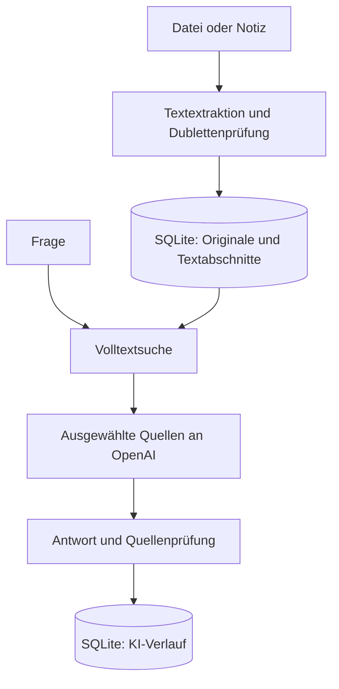

# Wissensraum AI – KI-gestütztes Wissensmanagement mit SQL

Version 1.0 · 15.10.2026 · lokale Einzelplatzanwendung · Python 3.11 oder neuer

Dokumente, Notizen, Originaldateien und KI-Verlauf werden in einer SQLite-SQL-Datenbank gespeichert. Die Anwendung bietet eine deutschsprachige Desktop-Oberfläche und eine Kommandozeilenschnittstelle. Es wird kein Webserver benötigt.

## Start unter Windows

1. ZIP vollständig in einen beschreibbaren Ordner entpacken, beispielsweise `H:\Wissensraum`. Nicht direkt aus der ZIP starten und nicht unter `Programme` ablegen.
2. Python 3.11 oder neuer von https://www.python.org/downloads/ mit Tcl/Tk installieren.
3. `start_windows.bat` doppelt anklicken. Beim ersten Start werden die Python-Bibliotheken für PDF und Word installiert; dafür ist Internetzugang erforderlich.
4. Die separat bereitgestellte Schlüsseldatei über **API-Schlüsseldatei** auswählen. Sie wird für diese Sitzung geladen. Für automatisches Laden die Datei mit dem Namen `.env.local` im Programmordner ablegen. Windows darf keinen zusätzlichen `.txt`-Suffix anhängen.
5. **Dateien importieren** anklicken oder über **Notiz erfassen** eigene Inhalte eingeben.
6. **Dokumente & Suche** durchsuchen. Unter **Wissen befragen** eine Frage eingeben; **Quellen suchen & antworten** startet die KI-Anfrage.

Zum Prüfen kann `beispiele/Freigabeprozess.md` importiert werden. Die Inhalte sind ausdrücklich fiktiv. Beispielfrage: „Wer gibt Beschaffungsanträge über 500 Euro frei?“

API-Zugangsdaten bleiben außerhalb der Versionsverwaltung. Die Anwendung lädt einen vorhandenen API-Schlüssel lokal. Schlüsseldateien und Datenbanken sind über `.gitignore` ausgeschlossen.

## Linux und macOS

Python 3.11+ mit Tkinter voraussetzen, anschließend `sh start.sh` ausführen. Unter Linux können zusätzlich die Betriebssystempakete für `python3-tk` und `python3-venv` erforderlich sein. Auf einem Rechner ohne grafische Anzeige die CLI verwenden.

## Funktionen und Grenzen

| Bereich | Implementiert |
|---|---|
| Datenbank | SQLite mit Fremdschlüsseln, Transaktionen, FTS5 und Schema-Version |
| Dokumente | TXT, Markdown, textbasierte PDF, DOCX einschließlich Tabellen |
| Originale | Binärdateien als BLOB in SQL; Export über die Oberfläche |
| Notizen | Titel, frei wählbarer Bereich, Inhalt |
| Dubletten | SHA-256 über den extrahierten, außen getrimmten Text; identischer Text wird einmal gespeichert |
| Suche | Volltext über Titel, Bereich und Abschnitte; BM25-Rangfolge |
| KI-Fragen | Höchstens acht passende Textabschnitte, Antwort mit [Q1]-Quellenverweisen |
| Zusammenfassung | Ausgewähltes Dokument bis 24.000 Zeichen |
| Verlauf | Erfolgreiche KI-Antworten und unveränderliche Quellenkopien in SQL |
| Sicherung | Konsistente SQLite-Sicherung über die Backup-API |
| Automatisierung | CLI für Import, Suche, Fragen, Zusammenfassung, Sicherung |

Die Suche ist lexikalisch: Begriffe müssen im Dokument vorkommen. Synonyme, echte semantische Suche und Vektor-Embeddings sind in Version 1 nicht implementiert. Bei Mehrwortfragen werden Suchbegriffe mit ODER verknüpft. Häufige Wörter können dadurch irrelevante Treffer erzeugen. Höchstens 30 Texttreffer werden in der Dokumentensuche angezeigt; mehrere Treffer aus demselben Dokument werden zusammengeführt.

Die KI erhält die acht bestbewerteten Abschnitte, keine vollständige Gesamtauswertung des Bestands. Ein relevanter Abschnitt kann außerhalb dieser Auswahl liegen. Quellenverweise werden auf gültige Nummern geprüft; das prüft nicht, ob die Aussage tatsächlich aus der Quelle folgt. Antworten ohne Quellenmarkierung erhalten einen ausdrücklichen Prüfhinweis. Aussagen müssen anhand der angezeigten Textstellen geprüft werden.

Grenzen: 20 MB Originaldatei, 2 Millionen extrahierte Zeichen pro Dokument, 4.000 Zeichen pro Frage, 24.000 Zeichen für eine Zusammenfassung. OCR für Scans, PST, Audio, Web-Crawling, Benutzerverwaltung, Rechtevergabe, PostgreSQL, Wissensgraph und Mehrbenutzerbetrieb sind nicht enthalten. Importierte Dokumente sind unveränderlich; korrigierte Inhalte werden als neues Dokument importiert. Beim Löschen eines Dokuments bleiben Quellenkopien im KI-Verlauf erhalten und können weiter sensible Inhalte enthalten.

## Datenmodell

| Tabelle | Zweck |
|---|---|
| `documents` | Titel, Bereich, Originalname, Original-BLOB, extrahierter Text, Hash, Erfassungszeit |
| `chunks` | Nummerierte Textabschnitte mit Fremdschlüssel auf das Dokument |
| `search_index` | FTS5-Index über Titel, Bereich und Text |
| `ai_runs` | Anfrageart, Frage, Antwort, Quellen-Snapshot als JSON, Modell, Zeit |

Die SQL-Definition steht in `schema.sql`; die Anwendung initialisiert sie automatisch aus `core.py`. `chunks_search` ist eine Sicht für den Volltextindex. SQL-Werte werden parametrisiert gebunden. KI-Ausgaben werden niemals als SQL oder Programmcode ausgeführt.



## Datenspeicherung und Betrieb

Standarddatei: `data/wissen.db` im Programmordner. Alternativer Pfad über `WISSEN_DB`. Das Modell kann über `OPENAI_MODEL` konfiguriert werden; Standard ist `gpt-4.1-mini`. Der Schlüssel wird aus `OPENAI_API_KEY`, `.env.local` im Programmordner oder `.env.local` im übergeordneten Ordner geladen. Die Oberfläche kann zusätzlich eine vorhandene Schlüsseldatei für die laufende Sitzung laden. Es gibt keinen Dialog, der einen Schlüssel im Klartext anzeigt.

Dokumentimport und Suche benötigen keine API. Bei Fragen werden Frage und ausgewählte Textabschnitte an die OpenAI-API gesendet; bei Zusammenfassungen der vollständige unterstützte Dokumenttext. Die Anwendung setzt `store=false` bei Responses-Anfragen. Dies ersetzt keine Prüfung der geltenden Datenverarbeitung und ist keine Zusage vollständiger Speicherfreiheit beim Anbieter. Die API-Nutzung wird separat abgerechnet.

Die SQLite-Datei ist nicht durch die Anwendung verschlüsselt. Betriebssystemkonto und Laufwerksverschlüsselung schützen lokale Daten. Dies ist eine Einzelplatzanwendung; die aktive Datenbank auf einem lokalen Datenträger halten. Für Netzwerkfreigaben und parallele Bearbeitung ist diese Version nicht ausgelegt.

**Sicherung:** „Datenbank sichern“ erstellt eine vollständige Datenbankkopie einschließlich Originalen und KI-Verlauf. **Wiederherstellung:** Anwendung beenden, bestehende `data/wissen.db` samt eventuell vorhandenen `wissen.db-wal` und `wissen.db-shm` gemeinsam in einen anderen Ordner verschieben, Sicherungsdatei als `data/wissen.db` einsetzen, Anwendung starten. Nicht die aktive Datei im laufenden Betrieb durch eine Sicherung ersetzen. Schlüsseldatei separat sichern.

## CLI

Im Programmordner, nach Installation der Abhängigkeiten:

```bash
python cli.py import beispiele/Freigabeprozess.md --category Prozesse
python cli.py list
python cli.py search "Freigabe"
python cli.py ask "Wer gibt Beschaffungsanträge frei?"
python cli.py summarize 1
python cli.py backup sicherung.db
```

Für eine andere Datenbank das globale Argument vor dem Unterbefehl setzen:

```bash
python cli.py --db data/test.db list
```

## Prüfung dieser Auslieferung

- 14 automatisierte Tests bestanden: Speicherung, BLOB-Erhalt, Dubletten, Suche, FTS-Löschung, Sicherung, UTF-8/Windows-Zeichensatz, DOCX-Tabellen, Scan-PDF-Ablehnung, Abschnittsüberlappung, Quellen-Auswahl, Verlauf, ungültige Quellen, API-Fehler und Eingabegrenzen.
- KI-Vertrag mit simulierten API-Antworten geprüft. Live-Test mit synthetischen Testdaten durchgeführt; die API antwortete mit HTTP 429. Live-Antwortqualität ist deshalb nicht bestätigt.
- Die Desktop-Oberfläche ist implementiert und kompiliert. Grafischer Start und visuelle Bedienprüfung waren mangels Anzeige in der Erstellungsumgebung nicht möglich. Der Windows-Starter wurde auf diesem Linux-System nicht ausgeführt.
- Eigenständiges Projekt. GitHub Actions ist für Python 3.11 und 3.13 auf Windows und Linux vorbereitet. Remote-CI-Ergebnisse liegen vor dem ersten Push noch nicht vor.

Tests ausführen:

```bash
python -m unittest discover -s tests -v
```

## Fehlerbehandlung

**HTTP 429:** API-Guthaben, Abrechnung und Projektlimits prüfen. Der Test dieser Auslieferung ist daran gescheitert. Die Anwendung stellt API-Limits nicht selbst um und wiederholt kostenpflichtige Anfragen nicht automatisch.

**Keine Treffer:** Konkrete Begriffe aus dem Dokument verwenden. Diese Version enthält keine semantische Suche.

**PDF ohne Text:** OCR ist erforderlich und nicht Bestandteil dieser Version.

**Kein Tkinter / keine Anzeige:** Python mit Tcl/Tk auf einem Desktop installieren oder die CLI verwenden.

**Kein API-Schlüssel:** Über „API-Schlüsseldatei“ die separat bereitgestellte Konfiguration auswählen. Keine Zugangsdaten in Notizen oder Dokumente importieren.

## Entwicklung

Die CI-Tests rufen keine kostenpflichtige KI-API auf. API-Verträge werden mit kontrollierten Testantworten geprüft. Die Desktop-Oberfläche benötigt eine separate manuelle Bedienprüfung. Änderungen an Datenmodellen benötigen eine passende Migration; die aktuelle Version initialisiert Schema 1 und lehnt neuere Schemata ab.
