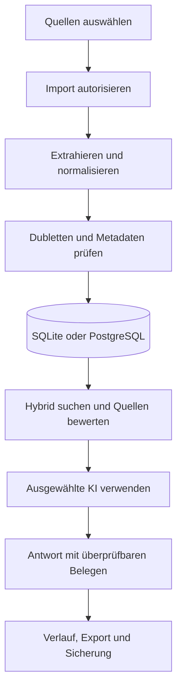

# Masterplan Wissensraum-AI

- **Dokumentversion:** 1.0
- **Stand:** 19.10.2026
- **Produktstand:** 1.8.1
- **Repository:** `Melchy1971/Wissensraum-AI`
- **Status:** Verbindliche Planungsgrundlage

## 1. Zweck

Wissensraum-AI wird zu einer lokal kontrollierten Wissensplattform ausgebaut, die Dokumente, E-Mails und Notizen sicher importiert, strukturiert, durchsucht und mit wählbaren KI-Modellen auswertet.

Der Masterplan steuert:

- Produktumfang und Architekturgrenzen
- Releases, Prioritäten und Abhängigkeiten
- Datenmodell und Migrationen
- Sicherheits- und Datenschutzanforderungen
- messbare Abnahmekriterien
- technische Schulden und Betriebsrisiken

## 2. Zielbild

Die Anwendung soll einen belastbaren Wissensprozess abbilden:

Zielzustand:

- Windows-Desktopanwendung als primärer Client
- lokaler Betrieb ohne zwingenden Cloud-Dienst
- wahlweise SQLite oder PostgreSQL als aktive Datenbank
- explizit autorisierte Imports aus Dateien, Ordnern, PST und E-Mail-Konten
- austauschbare KI-Anbieter: OpenAI, Claude, Gemini und Ollama
- hybride Suche aus Volltext und Vektoren mit optionalem Reranking
- nachvollziehbare Antworten mit Quellen, Fundstellen und Qualitätsstatus
- sichere Schlüsselverwaltung außerhalb der Wissensdatenbank
- reproduzierbare Installation, Migration, Sicherung und Wiederherstellung

## 3. Planungsannahmen

| Annahme | Konsequenz |
|---|---|
| Primärer Betrieb durch einen Benutzer auf einem Windows-PC | Keine Benutzerverwaltung im aktuellen Produktkern |
| PostgreSQL auf dem VPS ist optional | SQLite bleibt funktionsfähiger Offline-Standard |
| Importierte Inhalte können vertraulich sein | Keine Zugangsdaten in Repository, SQL, Logs oder Screenshots |
| KI-Anbieter sind austauschbar und können ausfallen | Import, Suche und Export müssen ohne KI funktionieren |
| Externe Postfächer dürfen nicht verändert werden | E-Mail-Zugriff bleibt lesend und benötigt minimale Berechtigungen |
| Originale müssen beweissicher erhalten bleiben | Originaldatei, extrahierter Text, Prüfsumme und Quelle werden getrennt nachvollziehbar gespeichert |
| Datenmenge wächst schrittweise | Langläufer benötigen Fortschritt, Abbruch und Wiederaufnahme |

Die Annahmen werden vor Beginn eines Mehrbenutzer- oder Serverbetriebs neu bewertet.

## 4. Bestätigter Ist-Stand

### 4.1 Produktfunktionen

| Bereich | Stand 1.8.1 | Reifegrad |
|---|---|---|
| Desktop-Oberfläche | Deutsche Tkinter-Oberfläche mit Hauptnavigation und kontrolliertem Beenden | Produktiv nutzbar |
| Lokale Dokumente | TXT, Markdown, textbasierte PDF und DOCX | Produktiv nutzbar |
| Ordnerimport | Rekursiv, relative Pfade, keine Verfolgung symbolischer Links | Produktiv nutzbar |
| PST | Optional über `libratom` | Eingeschränkt durch lokale Systemabhängigkeiten |
| E-Mail | Gmail/IMAP sowie Microsoft Graph, zweistufige Importfreigabe | Funktionsfähig, keine Anhänge |
| Dubletten | SHA-256 über normalisierten extrahierten Text | Exakte Inhaltsdubletten |
| Suche | Lexikalische Volltextsuche: SQLite mit BM25, PostgreSQL mit `ts_rank_cd` | Funktionsfähig, keine Semantik |
| KI | OpenAI, Claude, Gemini und Ollama; Anbieter und Modell aktivierbar | Adapter getestet, Live-Abdeckung unvollständig |
| Quellen | KI-Kontext aus maximal acht Abschnitten, Quellenmarkierungen `[Qn]` | Technisch geprüft, keine fachliche Belegprüfung |
| Datenbanken | SQLite oder PostgreSQL mit eigenem Schema `wissensraum` | PostgreSQL-18-Vertragstest in CI verdrahtet; erfolgreicher Live-Lauf noch ausstehend |
| Schlüssel | Betriebssystem-Schlüsselspeicher; externe Variablen und Dateien lesbar | Sicherheitskritischer Kern vorhanden |
| Design | Telekom-Magenta, Hell-/Dunkelmodus, eigenes Logo | Produktiv nutzbar |
| Sicherung | SQLite-Backup; PostgreSQL serverseitig | Wiederherstellung noch nicht automatisiert getestet |

### 4.2 Aktuelles Datenmodell

| Tabelle/Objekt | Aufgabe |
|---|---|
| `documents` | Dokumentmetadaten, Original-BLOB, extrahierter Text, SHA-256 |
| `chunks` | Nummerierte Textabschnitte je Dokument |
| `search_index` | SQLite-FTS5-Index; PostgreSQL verwendet die jeweilige Backend-Implementierung |
| `ai_runs` | Anfrage, Antwort, Modell und unveränderlicher Quellen-Snapshot |
| `settings` | Nicht geheime Anwendungseinstellungen |
| `email_accounts` | Kontometadaten ohne Kennwörter oder Token |
| `email_imports` | Zuordnung importierter Servernachrichten zu Dokumenten |
| `data/database.json` | Lokales Datenbankprofil ohne Kennwort |
| `data/design.json` | Lokale Designkonfiguration |
| `data/branding/logo.png` | Normalisiertes Anwendungslogo |

### 4.3 Qualitätsbasis

- 274 automatisierte Anwendungstests
- Windows und Linux mit Python 3.11 und 3.13
- grafische Tests unter virtuellem Linux-Bildschirm
- PostgreSQL-18-Vertragstest in CI verdrahtet; erfolgreicher Live-Lauf noch ausstehend
- CI ohne kostenpflichtige KI-, E-Mail- oder Microsoft-Aufrufe
- API-Verträge über kontrollierte Testantworten

## 5. Verbindliche Produktprinzipien

1. **Offline-Kern:** Import, Verwaltung, Suche und Export funktionieren ohne KI-API.
2. **Explizite Autorisierung:** Vollständige E-Mails werden erst nach Auswahl durch den Benutzer abgerufen.
3. **Keine Geheimnisse in SQL:** API-Schlüssel, Passwörter und OAuth-Token bleiben im Betriebssystem-Schlüsselspeicher oder in ausdrücklich konfigurierten externen Secret-Quellen außerhalb der Wissensdatenbank, etwa Umgebungsvariablen oder lokal ignorierten `.env`-Dateien.
4. **Keine stillen Datenwechsel:** Ein Wechsel zwischen SQLite und PostgreSQL migriert keine Daten automatisch.
5. **Nachvollziehbare Quellen:** Jede KI-Antwort zeigt die tatsächlich verwendeten Textstellen.
6. **Fail closed:** Ungültige Konfigurationen, fehlende Rechte und unsichere TLS-Einstellungen führen zum Abbruch, nicht zum unsicheren Fallback.
7. **Versionierte Vorwärtsmigrationen mit Rückwärtskompatibilitätsprüfung:** Jede Schemaänderung wird als versionierte Vorwärtsmigration ausgeführt und besitzt eine Versionsprüfung, Vorab-Sicherung sowie automatisierte Migrations- und Rückwärtskompatibilitätstests.
8. **Unvertrauenswürdige Inhalte:** Importierte Texte gelten als Daten, niemals als ausführbare Anweisung.
9. **Reproduzierbarkeit:** Unterstützte Python-Versionen und Abhängigkeiten bleiben fest versioniert und durch CI geprüft.
10. **Löschtransparenz:** Löschfunktionen benennen, welche Originale, Suchindizes, Importmarkierungen und KI-Verläufe erhalten oder entfernt werden.

## 6. Zielarchitektur

| Schicht | Verantwortung | Zielzustand |
|---|---|---|
| Oberfläche | Navigation, Auswahl, Status, Fehlerdarstellung | Keine Geschäftslogik in UI-Ereignissen |
| Anwendungsdienste | Importaufträge, Suche, KI-Anfragen, Sicherungen | Klare transaktionale Use-Cases |
| Adapter | Dateiformate, PST, IMAP, Graph, KI-Anbieter | Einheitliche Schnittstellen und Timeouts |
| Retrieval | Volltext, Vektoren, Fusion, Reranking | Backendunabhängige Ergebnisstruktur |
| Persistenz | SQLite und PostgreSQL | Funktionsgleicher Vertrag, versionierte Migrationen |
| Geheimnisse | API-, E-Mail- und Datenbankzugänge | Sicherer lokaler Speicher oder ausdrücklich konfigurierte externe Secret-Quelle außerhalb der Wissensdatenbank |
| Betrieb | Logs, Diagnose, Backup, Wiederherstellung | Datenschutzgerechte und prüfbare Abläufe |

### 6.1 Geplante Kernobjekte

| Objekt | Zweck | Release |
|---|---|---|
| `sources` | Herkunft, Quelltyp, Konto, Pfad und Abrufkontext vereinheitlichen | 1.9 |
| `import_jobs` | Laufstatus, Fortschritt, Fehler, Abbruch und Wiederaufnahme | 2.0 |
| `attachments` | E-Mail-Anhänge und Beziehung zur Nachricht | 2.0 |
| `document_versions` | Korrigierte oder erneut importierte Fassungen nachvollziehen | 2.0 |
| `embeddings` | Vektoren, Modell, Dimension, Prüfsumme und Erzeugungszeit | 2.1 |
| `entities` / `relations` | Kontrollierter Wissensgraph | 2.3 |
| `audit_events` | Sicherheits- und Betriebsereignisse ohne Geheimnisse | 2.4 |

## 7. Release-Roadmap

### Release 1.9 – Stabilisierung und Betriebsfähigkeit

**Ziel:** Der bestehende Funktionsumfang wird konsistent installierbar, diagnostizierbar und wiederherstellbar.

**Muss-Umfang:**

- [x] README-Widersprüche bereinigt und PostgreSQL-Funktionsumfang einschließlich Suche, TLS-Ausnahme, Sicherung und fehlender Schema-Migration eindeutig dokumentiert
- [x] Fail-closed-Startdiagnose für Python, Tcl/Tk, Pillow, sicheren Schlüsselbund, aktive SQLite-/PostgreSQL-Datenbank, Anwendungsschema und Schreibrechte; CLI `doctor`, redigierter Desktop-Abbruch vor Store-Initialisierung und Konsolenpfad ohne Tk umgesetzt
- [x] strukturierte lokale Logs mit Rotation und konsequenter Geheimnisfilterung
- [ ] Konfigurationsexport und -import ohne Schlüssel, Kennwörter und Token (Implementierung und realer PostgreSQL-Vertragstest vorhanden; Abschluss erst nach erfolgreichem PostgreSQL-CI-Lauf)
- SQLite-Wiederherstellung als geführter Ablauf
- dokumentierter und automatisiert geprüfter PostgreSQL-Backup-/Restore-Prozess
- Schema-Migrationsrahmen statt ausschließlich eingebetteter Initialisierung
- einheitliches Quellenmodell `sources` für Quelltyp und anwendbare Herkunftsangaben; bestehende Herkunftsangaben werden versioniert migriert
- Gesundheitsanzeige für aktive Datenbank, KI-Anbieter und E-Mail-Konten
- negative Tests für beschädigte Konfigurationen und unterbrochene Schreibvorgänge

**Abnahme:**

- Neuinstallation auf sauberem Windows-System ohne manuelle Paketkorrektur
- Wiederherstellung einer Testdatenbank mit 100 % identischen Dokument-Hashes
- kein Geheimnis in Log, Konfiguration, Testartefakt oder Git-Historie
- alle bisherigen Funktionen unter SQLite und PostgreSQL ohne Regression
- im Testbestand für lokale Dateien, Notizen, PST, IMAP und Microsoft Graph besitzt jedes neu importierte oder migrierte Dokument genau einen gültigen `sources`-Bezug; Quelltyp und anwendbare Herkunftsangaben entsprechen unter SQLite und PostgreSQL zu 100 % den erwarteten Werten

### Release 2.0 – Robuste Importplattform

**Ziel:** Große und heterogene Quellen werden kontrolliert, transparent und wiederaufnehmbar verarbeitet.

**Muss-Umfang:**

- persistente Importaufträge mit Fortschritt, Fehlerliste, Abbruch und Wiederaufnahme
- Extraktion von E-Mail-Anhängen mit separater Benutzerfreigabe
- OCR für bildbasierte PDF- und Bilddateien
- MIME-, Dateigrößen- und Dekompressionsgrenzen gegen Ressourcenmissbrauch
- Quarantäne für fehlerhafte, verschlüsselte oder nicht unterstützte Dateien
- Dokumentversionen statt unverbundener Neuimporte
- Vorschau der erkannten Metadaten vor endgültiger Speicherung
- Importbericht als CSV oder Markdown

**Soll-Umfang:**

- zusätzliche Formate: HTML, RTF, XLSX, PPTX und EML
- regelbasierte Kategorien und Tags
- zeitgesteuerte Postfachsynchronisation nur nach expliziter Aktivierung

**Abnahme:**

- ein unterbrochener Import kann ohne Doppelanlage fortgesetzt werden
- jede importierte Einheit besitzt Quelle, Prüfsumme, Status und Fehlerhistorie
- 1.000 gemischte Testdateien werden mit mindestens 99 % technisch korrekt abgeschlossen; fachlich nicht extrahierbare Dateien werden eindeutig ausgewiesen
- Anhänge werden niemals ohne Freigabe gespeichert

### Release 2.1 – Hybrid-RAG und Antwortqualität

**Ziel:** Relevante Inhalte werden auch bei Synonymen und abweichender Formulierung zuverlässig gefunden.

**Muss-Umfang:**

- Embedding-Schnittstelle mit wählbarem Anbieter und lokalem Modell
- `pgvector` für PostgreSQL; definierte lokale Strategie für SQLite
- hybride Fusion aus Volltext- und Vektorsuche
- optionaler Reranker
- konfigurierbare Chunk-Strategie nach Dokumenttyp
- Anzeige von Dokument, Abschnitt, Fundstelle, Retrieval-Score und Reranking-Score
- Antwort verweigern oder kennzeichnen, wenn die Quellenlage nicht ausreicht
- Evaluationsdatensatz mit Fragen, erwarteten Quellen und Ausschlussfällen

**Abnahme:**

- Recall@10 mindestens 0,85 auf dem freigegebenen Evaluationsdatensatz
- mindestens 95 % der beantworteten Testfragen enthalten die erwartete Hauptquelle
- 100 % der Tatsachenantworten enthalten mindestens einen gültigen Quellenverweis
- unbelegte Antworten werden sichtbar markiert und nicht als gesichert dargestellt
- Retrieval-P95 unter 2 Sekunden für den vereinbarten Referenzbestand

### Release 2.2 – Wissensorganisation

**Ziel:** Dokumente werden über reine Suche hinaus als gepflegter Wissensbestand verwaltet.

**Umfang:**

- Tags, Sammlungen, Favoriten und gespeicherte Suchen
- Dokumentstatus: neu, geprüft, veraltet, archiviert
- Verantwortlicher und Wiedervorlagedatum
- Beziehungen zwischen Dokumenten
- Metadatenbearbeitung ohne Veränderung des Originals
- kontrollierte Versionierung und Vergleich zweier Fassungen
- Export einzelner Sammlungen mit Quellenmanifest

**Abnahme:**

- jede Metadatenänderung ist nachvollziehbar
- Originaldatei und Original-Hash bleiben unverändert
- veraltete Inhalte können aus KI-Antworten ausgeschlossen werden

### Release 2.3 – Wissensgraph

**Ziel:** Personen, Organisationen, Prozesse, Systeme, Entscheidungen und ihre Beziehungen werden strukturiert nutzbar.

**Umfang:**

- konfigurierbare Entitätstypen und Relationsarten
- KI-gestützte Vorschläge, aber keine automatische Freigabe
- Herkunftsnachweis bis zur konkreten Textstelle
- Zusammenführung und Trennung erkannter Entitäten
- Graphansicht mit Filtern
- Graphkontext als ergänzende, begrenzte RAG-Quelle

**Abnahme:**

- keine Relation ohne Quellenbeleg
- KI-Vorschläge bleiben bis zur Bestätigung als ungeprüft markiert
- Änderungen sind umkehrbar und protokolliert

### Release 2.4 – Betrieb und Governance

**Ziel:** Datenqualität, Kosten, Sicherheit und Wiederherstellbarkeit werden messbar gesteuert.

**Umfang:**

- Dashboard für Importfehler, Datenmenge, Suchqualität und KI-Nutzung
- Kosten- und Tokenbudgets je Anbieter
- Aufbewahrungsregeln für KI-Verlauf und gelöschte Inhalte
- automatische Integritätsprüfung und Wiederherstellungsübung
- signierte Release-Artefakte und Software-Stückliste
- Abhängigkeits-, Secret- und Sicherheitsprüfungen in CI
- Datenschutzexport und selektive Löschung

**Abnahme:**

- Recovery Point Objective: maximal 24 Stunden
- Recovery Time Objective: maximal 2 Stunden
- quartalsweise Wiederherstellungsprüfung erfolgreich
- kritische Sicherheitslücken blockieren ein Release

### Release 3.0 – Mehrbenutzerbetrieb, nur nach eigener Freigabe

**Entscheidungstor:** Mehrbenutzerbetrieb verändert Bedrohungsmodell, Datenmodell und Betriebsverantwortung. Er wird nicht schrittweise in die Einzelplatzversion eingeschoben.

Erforderlicher Mindestumfang:

- zentrale Authentifizierung mit OIDC
- Rollen und Berechtigungen auf Sammlung und Dokument
- Mandanten- oder Organisationsgrenzen
- serverseitige Sitzungen und CSRF-Schutz
- manipulationsgeschützter Audit-Verlauf
- gleichzeitige Bearbeitung und Konfliktbehandlung
- zentrale Geheimnisverwaltung
- Betriebs-, Patch- und Incident-Prozess

## 8. Priorisiertes Arbeitsprogramm

| Priorität | Arbeitspaket | Nutzen | Abhängigkeit |
|---|---|---|---|
| P0 | Veröffentlichtes Datenbankkennwort ändern | Schließt unmittelbares Zugangsrisiko | VPS-Zugriff |
| P0 | README und Ist-Stand synchronisieren | Verhindert Fehlbedienung und falsche Annahmen | Keine |
| P0 | Migrationen und Wiederherstellung absichern | Reduziert Datenverlustrisiko | Testdatenbanken |
| P1 | Importaufträge und Fehlerjournal | Beherrscht große Datenmengen | Schema-Migration |
| P1 | E-Mail-Anhänge mit Freigabe | Schließt wesentliche Inhaltslücke | Importaufträge |
| P1 | OCR | Erschließt gescannte Dokumente | Importaufträge |
| P1 | Evaluationsdatensatz | Messbasis für RAG-Qualität | Repräsentative Testdokumente |
| P2 | Hybrid-RAG und Reranking | Höhere Treffergenauigkeit | Embedding-Entscheidung, Evaluation |
| P2 | Dokumentstatus und Versionen | Datenqualität und Aktualität | Schema-Migration |
| P3 | Wissensgraph | Strukturierte Zusammenhänge | Stabile Quellen- und Versionslogik |
| P3 | Mehrbenutzerentscheidung | Skalierung | Eigenes Sicherheits- und Betriebskonzept |

## 9. Qualitätskennzahlen

| Kennzahl | Zielwert |
|---|---:|
| CI-Erfolgsquote auf `main` | 100 % |
| Unterstützte Plattformmatrix | Windows/Linux × Python 3.11/3.13 |
| Exakte Dubletten im Bestand | 0 |
| Dokumente ohne Quelle oder Prüfsumme | 0 |
| Tatsachenantworten ohne Quellenverweis | 0 % |
| Geheimnisse in Repository, Logs und SQL | 0 |
| Erfolgreiche Wiederherstellungsprüfungen | 100 % |
| Importfehler ohne verständlichen Fehlerstatus | 0 |
| Kritische Sicherheitsbefunde bei Release | 0 |

Qualitätsziele für Retrieval werden erst mit einem versionierten Evaluationsdatensatz verbindlich gemessen. Einzelne Demonstrationsfragen sind kein Qualitätsnachweis.

## 10. Sicherheits- und Datenschutzkontrollen

### 10.1 Sofortmaßnahmen

- Das bereits außerhalb der Anwendung übermittelte PostgreSQL-Kennwort ersetzen.
- Datenbankzugriff auf erforderliche Quell-IP-Adressen und minimale Rechte begrenzen.
- Für entfernte PostgreSQL-Verbindungen mindestens TLS `require`, bevorzugt `verify-full`, einsetzen.
- Produktionsdaten niemals für CI oder Screenshots verwenden.

### 10.2 Dauerhafte Kontrollen

- Schlüsselwerte vor jeder Protokollierung redigieren.
- API- und Netzwerkfehler ohne Anfrageinhalte oder Zugangsdaten anzeigen.
- Importdateien auf Größe, Typ und Dekompressionsverhältnis begrenzen.
- HTML und E-Mail-Inhalte niemals aktiv ausführen.
- Modellanweisungen gegen Prompt-Injection aus importierten Dokumenten härten.
- Quelleninhalt und Benutzeranweisung logisch trennen.
- OAuth-Berechtigungen auf `Mail.Read` begrenzen.
- PostgreSQL-Anwendungskonto ohne Schema- oder Datenbankadministrationsrechte betreiben; Schema-Reset gesondert autorisieren.
- Sicherheitsrelevante Änderungen durch negative Tests absichern.

## 11. Datenmigration und Kompatibilität

Für jede Schemaänderung gilt:

1. aktuelle Schemaversion erkennen
2. kompatiblen Upgradepfad prüfen
3. Sicherung oder Restore-Punkt erzeugen
4. Migration transaktional ausführen
5. Tabellen, Indizes, Fremdschlüssel und Zeilenzahlen prüfen
6. Anwendung erst danach freigeben
7. Abbruch ohne Teilmigration bei Fehlern

SQLite und PostgreSQL müssen denselben fachlichen Speichervertrag erfüllen. Backendspezifische Indizes und Suchfunktionen dürfen unterschiedliche Technik verwenden, aber keine unterschiedlichen Produktfunktionen erzeugen.

## 12. Definition of Done

Ein Arbeitspaket ist abgeschlossen, wenn:

- Anforderungen und Nicht-Ziele dokumentiert sind
- Fehler- und Abbruchpfade implementiert sind
- SQLite und PostgreSQL bewertet wurden
- automatisierte Positiv- und Negativtests bestehen
- keine Zugangsdaten in Code, Testdaten oder Artefakten stehen
- Benutzeroberfläche im Hell- und Dunkelmodus geprüft wurde
- Bedienungsanleitung und Masterplan aktualisiert sind
- Migration und Rückwärtskompatibilität geklärt sind
- CI auf allen unterstützten Plattformen grün ist
- messbare Abnahmekriterien erfüllt und nachgewiesen sind

### 12.1 DoD-Nachweis: strukturierte lokale Logs (Release 1.9)

| Prüfaspekt | Bewertung und Nachweis |
|---|---|
| Anforderungen | Lokale UTF-8-JSONL-Datei `data/logs/wissensraum.jsonl`, festes sicheres Schema, 5-MiB-Rotation, fünf Sicherungen, Einzelwriter-Schutz, generische Ausfallmeldung und Defense-in-Depth-Filterung sind implementiert und in der Bedienungsanleitung beschrieben. |
| Nicht-Ziele | Kein vollständiger Audit-Verlauf, keine Protokollierung fachlicher Inhalte, keine zeitbasierte Langzeitarchivierung, kein Remote-Logging und keine neuen Zugriffe auf Schlüsselbund, Umgebung oder Schlüsseldateien nur zum Zweck des Loggings. |
| Fehler- und Abbruchverhalten | Einrichtungs-, Schreib-, Rotations-, Callback- und Schließfehler geben ausschließlich die generische Logging-Warnung aus und ändern weder Erfolg noch fachlichen Fehlerpfad von CLI oder Desktop. `doctor` startet kein Logging und erzeugt keinen Logordner. Konstruktorfehler geben die Ziel-Sperre frei; nach regulärem Schließen ist sie erneut erwerbbar. |
| SQLite / PostgreSQL | Das Ereignisschema und die Dateirotation sind backendunabhängig. Beide Backends liefern nur die freigegebene Backend-Kennung. Ein bereits zum Öffnen eines PostgreSQL-Stores geladener Kennwortwert wird zusätzlich an den finalen Filter übergeben; SQLite besitzt keinen entsprechenden Laufzeitwert. Es werden keine Zugangsdaten eigens für Logging nachgeladen. |
| Migration / Rückwärtskompatibilität | Keine SQL-Schema-, Daten- oder Konfigurationsmigration erforderlich. Bestehende SQLite- und PostgreSQL-Datenbanken bleiben unverändert; Logging-Ausfall ist nicht blockierend. Neue lokale Logdateien sind additive Betriebsartefakte und alte Programmversionen ignorieren sie. |
| UI-Themes | Nicht anwendbar: Es gibt kein neues UI-Element und keine Änderung an Hell-/Dunkelmodus. Die einzige sichtbare Reaktion ist eine themenunabhängige generische Warnung auf dem bestehenden Fehlerkanal. |
| Sicherheit | Nur exakte eingebaute Skalartypen und freigegebene Metadaten gelangen in das Schema; Ausnahmetexte, Tracebacks und nicht freigegebene Werte werden verworfen. Formbasierte und bekannte-Wert-Redaktion sind eine zusätzliche Grenze, ersetzen aber weder Dateirechte noch die Prüfung vor Weitergabe. Pfad-, Windows- und Hardlink-Aliasse eines vorhandenen Ziels teilen dieselbe Besitzsperre. |
| Messbarer Testnachweis | Abschlusslauf auf Windows mit Projektinterpreter: fokussiert `python -m unittest tests.test_logging tests.test_logging_integration -v` = 79 Tests, erfolgreich, 3 POSIX-Dateisystemtests plattformbedingt übersprungen; vollständig `python -m unittest discover -s tests -v` = 197 Tests, erfolgreich, 4 Übersprünge (drei POSIX-Dateisystemfälle und lokal nicht konfigurierter PostgreSQL-Testdienst). |

### 12.2 DoD-Nachweis: sicherer Konfigurationstransfer (Release 1.9)

| Prüfaspekt | Bewertung und Nachweis |
|---|---|
| Anforderungen | Versionierter JSON-Export und -Import sind über CLI und **Einstellungen → Konfiguration** verfügbar. Die feste Positivliste umfasst KI-Anbieter/Modelle/Deaktivierung, Datenbankprofil, Designmodus und E-Mail-Kontometadaten. |
| Nicht-Ziele | Keine Dokumente, Originale, KI-Verläufe, Logs, Logo-Dateien, API-Schlüssel, Datenbank-/E-Mail-Kennwörter, OAuth-Token, Schlüsselbundinhalte, Umgebungswerte oder Inhalte beziehungsweise Pfade externer Schlüsseldateien. Keine Datenmigration zwischen SQLite und PostgreSQL. |
| Fehler- und Abbruchverhalten | Format, Version, exakte Container- und Skalartypen, Feldlisten, Wertebereiche und Enumerationen werden vollständig vor der ersten Änderung geprüft. Unbekannte und geheimnisverdächtige Schlüssel werden abgelehnt. SQL-Änderungen laufen in einer Transaktion; atomar ersetzte lokale Konfigurationsdateien werden bei späterem Fehler aus ihren Snapshots zurückgesetzt. |
| SQLite / PostgreSQL | Der Dienst nutzt den gemeinsamen `store.connect()`-Vertrag und backendneutrale SQL-Platzhalter. Die lokale Autoritätsdatei verhindert, dass ein PostgreSQL-Export versehentlich veraltete SQLite-Metadaten übernimmt. Crash-Tests decken SQLite→PostgreSQL, PostgreSQL→SQLite und geänderte PostgreSQL-Server-/Datenbankprofile ab. Der echte PostgreSQL-18-Test ist in CI verdrahtet; ein erfolgreicher Live-Lauf des erweiterten Vertrags steht noch aus. |
| Neustart / Kompatibilität | Ein importiertes Datenbankprofil wird gespeichert, aber der während des Imports geöffnete Store bleibt aktiv. Jede Profildifferenz, einschließlich Host- oder Datenbankwechsel innerhalb von PostgreSQL, meldet den erforderlichen Neustart. Bestehende Installationen erzeugen die Autoritätsdatei beim authentifizierten Desktop-Start oder ausdrücklich mit `config-sync`; der geheime-freie CLI-Export schlägt vorher fail-closed fehl. Formatversion 1 wird exakt akzeptiert; andere Versionen schlagen fail-closed fehl. Es ist keine SQL-Schemamigration erforderlich. |
| Sicherheit | Der CLI-Export liest ausschließlich die validierte Autoritätsdatei sowie Datenbank- und Designprofil und öffnet weder SQL noch Schlüsselbund oder Kennwort-/Tokenquellen. Das Wiederherstellungsjournal speichert nur die nicht geheime Ursprungsidentität; die Verbindung wird vor normaler Store-Auswahl wiederhergestellt. Bestehende Zielsystem-Geheimnisse bleiben beim Import unverändert. Dateiausgaben, CLI-Status und Betriebslogs enthalten weder gewählte Pfade noch Konfigurationsinhalte. |
| UI-Themes | Der Konfigurationsbereich verwendet bestehende ttk-Stile und ist damit in Hell- und Dunkelmodus eingebunden; Abbruch-, Fehler- und Erfolgspfade sind ohne Live-Anzeige getestet, die Auffindbarkeit im Einstellungs-Notebook im GUI-Vertragstest. |
| Messbarer Testnachweis | Abschlusslauf auf Windows mit Projektinterpreter: fokussiert `python -m unittest discover -s tests -p 'test_configuration.py' -v` = 53 Tests, erfolgreich; vollständig `python -m unittest discover -s tests -v` = 274 Tests, erfolgreich, 5 Übersprünge (drei Windows-Dateisystemfälle und zwei Tests des lokal nicht konfigurierten PostgreSQL-Dienstes). Der erfolgreiche Live-PostgreSQL-CI-Lauf bleibt ausstehend. |

## 13. Entscheidungsregister

| ID | Entscheidung | Status |
|---|---|---|
| D-001 | Desktop-Einzelplatzanwendung bleibt bis Release 2.x die Produktgrenze | Gültig |
| D-002 | SQLite ist Offline-Standard; PostgreSQL ist aktivierbare Alternative | Gültig |
| D-003 | Geheimnisse werden nicht in der Wissensdatenbank gespeichert | Gültig |
| D-004 | E-Mail-Import benötigt eine explizite Nachrichtenauswahl | Gültig |
| D-005 | Telekom-Magenta und eigenes Logo bilden die Designbasis | Gültig |
| D-006 | Hybrid-RAG wird erst nach Aufbau eines Evaluationsdatensatzes freigegeben | Beschlossen |
| D-007 | Mehrbenutzerbetrieb benötigt ein separates Architektur- und Sicherheits-Gate | Beschlossen |
| D-008 | Lokale Vektorsuche für SQLite ist vor Release 2.1 technisch zu entscheiden | Offen |
| D-009 | OCR-Engine und Lizenzmodell sind vor Release 2.0 festzulegen | Offen |

## 14. Hauptrisiken

| Risiko | Auswirkung | Gegenmaßnahme |
|---|---|---|
| Verlust oder Beschädigung der Datenbank | Verlust des Wissensbestands | automatisierte Backups, Restore-Tests, transaktionale Migrationen |
| Abweichendes Verhalten von SQLite und PostgreSQL | inkonsistente Ergebnisse | gemeinsamer Speichervertrag und Backend-Matrix |
| Geheimnisse in Logs oder Konfiguration | Konten- und Datenbankkompromittierung | zentrale Redigierung, Secret-Scans, Testfälle |
| Prompt-Injection in Dokumenten | manipulierte KI-Antwort oder Datenabfluss | strikte Kontexttrennung, minimale Toolrechte, Ausgabetests |
| Schlechte Retrieval-Qualität | plausible, aber falsche Antworten | Evaluationsdatensatz, Hybrid-Suche, Reranking, Ablehnungslogik |
| Große oder schadhafte Dateien | Ressourcenerschöpfung | Limits, Quarantäne, Timeouts, isolierte Verarbeitung |
| Externe API-Änderungen | Ausfall einzelner Anbieter | Adapterverträge, Versionierung, kontrollierte Fehlerzustände |
| Fehlende Live-Tests | unerkannte Integrationsfehler | optionale, manuell freigegebene Smoke-Tests mit synthetischen Daten |
| Unkontrollierter Funktionszuwachs | hohe Kopplung und Regressionen | Release-Gates, Nicht-Ziele, Definition of Done |

## 15. Nächster verbindlicher Release-Schnitt

Der nächste Release ist **1.9 – Stabilisierung und Betriebsfähigkeit**. Neue Großfunktionen wie OCR, E-Mail-Anhänge und Vektorsuche beginnen erst, wenn folgende Gates erfüllt sind:

- Dokumentation widerspruchsfrei
- Datenbankmigrationen versioniert
- SQLite- und PostgreSQL-Wiederherstellung geprüft
- strukturierte, geheimnisfreie Diagnose vorhanden
- bestehende 51 Tests weiterhin grün und um Restore-/Fehlertests erweitert

Damit wird zuerst die Betriebs- und Datensicherheit des vorhandenen Funktionsumfangs abgesichert. Danach folgen Importausbau und Hybrid-RAG in getrennten Releases.
