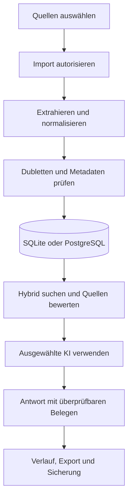

# Masterplan Wissensraum-AI

**Dokumentversion:** 1.4

**Stand:** 22.10.2026

**Produktstand:** 1.8.1 stabil · 1.9 in Entwicklung

**Repository:** `Melchy1971/Wissensraum-AI`

**Geprüfter Repository-Stand:** Commit `0d05aa5` (letzter codewirksamer Stand `ad7cf0e`; danach ausschließlich `masterplan.md` geändert)

**Status:** Phasen- und Testplan

**Legende:** ✅ vollständig implementiert und gesamtes Gate nachweislich bestanden · 🟡 implementiert oder teilweise geprüft, aber noch nicht vollständig abgenommen · ❌ Gate fehlgeschlagen oder Freigabe blockiert · ⬜ geplant und noch nicht begonnen

## 1. Zweck

Wissensraum-AI wird zu einer lokal kontrollierten Wissensplattform ausgebaut, die Dokumente, E-Mails und Notizen sicher importiert, strukturiert, durchsucht und mit wählbaren KI-Modellen auswertet.

Der Masterplan steuert:

- Produktumfang und Architekturgrenzen
- Releases, Prioritäten und Abhängigkeiten
- Datenmodell und Migrationen
- Sicherheits- und Datenschutzanforderungen
- messbare Abnahmekriterien
- technische Schulden und Betriebsrisiken

## 2. Zielbild

Die Anwendung soll einen belastbaren Wissensprozess abbilden:



Zielzustand:

- ✅ Windows-Desktopanwendung als primärer Client
- ✅ lokaler Betrieb ohne zwingenden Cloud-Dienst
- ✅ wahlweise SQLite oder PostgreSQL als aktive Datenbank
- ✅ explizit autorisierte Imports aus Dateien, Ordnern, PST und E-Mail-Konten
- ✅ austauschbare KI-Anbieter: OpenAI, Claude, Gemini und Ollama
- hybride Suche aus Volltext und Vektoren mit optionalem Reranking
- ✅ nachvollziehbare Antworten mit verwendeten Quellen und Fundstellen; ein belastbarer Qualitätsstatus ist noch geplant
- ✅ sichere Schlüsselverwaltung außerhalb der Wissensdatenbank
- reproduzierbare Installation, Migration, Sicherung und Wiederherstellung

## 3. Planungsannahmen

| Annahme | Konsequenz |
|---|---|
| Primärer Betrieb durch einen Benutzer auf einem Windows-PC | Keine Benutzerverwaltung im aktuellen Produktkern |
| PostgreSQL auf dem VPS ist optional | SQLite bleibt funktionsfähiger Offline-Standard |
| Importierte Inhalte können vertraulich sein | Keine Zugangsdaten in Repository, SQL, Logs oder Screenshots |
| KI-Anbieter sind austauschbar und können ausfallen | Import, Suche und Export müssen ohne KI funktionieren |
| Externe Postfächer dürfen nicht verändert werden | E-Mail-Zugriff bleibt lesend und benötigt minimale Berechtigungen |
| Originale müssen beweissicher erhalten bleiben | Originaldatei, extrahierter Text, Prüfsumme und Quelle werden getrennt nachvollziehbar gespeichert |
| Datenmenge wächst schrittweise | Langläufer benötigen Fortschritt, Abbruch und Wiederaufnahme |

Die Annahmen werden vor Beginn eines Mehrbenutzer- oder Serverbetriebs neu bewertet.

## 4. ✅ Bestätigter Ist-Stand

### 4.1 Produktfunktionen

| Bereich | Stand 1.8.1 | Reifegrad |
|---|---|---|
| ✅ Desktop-Oberfläche | Deutsche Tkinter-Oberfläche mit Hauptnavigation und kontrolliertem Beenden | Produktiv nutzbar |
| ✅ Lokale Dokumente | TXT, Markdown, textbasierte PDF und DOCX | Produktiv nutzbar |
| ✅ Ordnerimport | Rekursiv, relative Pfade, keine Verfolgung symbolischer Links | Produktiv nutzbar |
| ✅ PST | Optional über `libratom` | Eingeschränkt durch lokale Systemabhängigkeiten |
| ✅ E-Mail | Gmail/IMAP sowie Microsoft Graph, zweistufige Importfreigabe | Funktionsfähig, keine Anhänge |
| ✅ Dubletten | SHA-256 über normalisierten extrahierten Text | Exakte Inhaltsdubletten |
| ✅ Suche | Lexikalische Volltextsuche mit BM25 | Funktionsfähig, keine Semantik |
| ✅ KI | OpenAI, Claude, Gemini und Ollama; Anbieter und Modell aktivierbar | Adapter getestet, Live-Abdeckung unvollständig |
| ✅ Quellen | KI-Kontext aus maximal acht Abschnitten, Quellenmarkierungen `[Qn]` | Technisch geprüft, keine fachliche Belegprüfung |
| ✅ Datenbanken | SQLite oder PostgreSQL mit eigenem Schema `wissensraum` | Vertragstest gegen PostgreSQL 18 |
| ✅ Schlüssel | Betriebssystem-Schlüsselspeicher; externe Variablen und Dateien lesbar | Sicherheitskritischer Kern vorhanden |
| ✅ Design | Telekom-Magenta, Hell-/Dunkelmodus, eigenes Logo | Produktiv nutzbar |
| ✅ SQLite-Sicherung | Konsistentes SQLite-Backup | Wiederherstellung noch nicht automatisiert getestet |
| PostgreSQL-Sicherung | Serveradministrativer Prozess vorgesehen | Noch nicht als geprüfter Anwendungsablauf umgesetzt |

### 4.2 Aktuelles Datenmodell

| Tabelle/Objekt | Aufgabe |
|---|---|
| ✅ `documents` | Dokumentmetadaten, Original-BLOB, extrahierter Text, SHA-256 |
| ✅ `chunks` | Nummerierte Textabschnitte je Dokument |
| ✅ `search_index` | SQLite-FTS5-Index; PostgreSQL verwendet die jeweilige Backend-Implementierung |
| ✅ `ai_runs` | Anfrage, Antwort, Modell und unveränderlicher Quellen-Snapshot |
| ✅ `settings` | Nicht geheime Anwendungseinstellungen |
| ✅ `email_accounts` | Kontometadaten ohne Kennwörter oder Token |
| ✅ `email_imports` | Zuordnung importierter Servernachrichten zu Dokumenten |
| 🟡 `schema_migrations` | Versionierte PostgreSQL-Migrationshistorie; im Hermes-Stand implementiert, aber noch nicht abgenommen |
| ✅ `data/database.json` | Lokales Datenbankprofil ohne Kennwort |
| ✅ `data/design.json` | Lokale Designkonfiguration |
| ✅ `data/branding/logo.png` | Normalisiertes Anwendungslogo |

### 4.3 Qualitätsbasis und Hermes-Prüfung

| Prüfstand | Ergebnis |
|---|---|
| ✅ Stabiler Stand 1.8.1 | 51 Tests; Windows/Linux und Python 3.11/3.13 waren vollständig grün |
| 🟡 Hermes-Stand 1.9 | Neue Migrationsschicht und 38 zusätzliche Tests; insgesamt 89 Tests |
| ❌ Lokale Prüfung des Hermes-Stands | Erstprüfung: 74 bestanden, 12 umgebungsbedingt übersprungen, 3 Fehler |
| ❌ Lokale Nachprüfung 20.10.2026 (Windows, Python 3.13.8, `297339b`) | 81 bestanden, 5 übersprungen, 3 Fehler; übersprungen sind die fünf PostgreSQL-Tests (kein Testdienst konfiguriert), GUI-Tests liefen |
| ✅ Lokale Prüfung nach Testkorrektur 20.10.2026 (Windows, Python 3.13.8, `55bc4ca`) | 84 bestanden, 5 übersprungen (PostgreSQL-Testdienst nicht konfiguriert), 0 Fehler |
| ❌ GitHub Actions vor Korrektur | Alle fünf Jobs fehlgeschlagen in Lauf `39380439985` (`717db89`) und `39381519764` (`297339b`) |
| ✅ GitHub Actions nach Korrektur | Lauf `39410112241` (`55bc4ca`): alle fünf Jobs grün; Windows/Linux × Python 3.11/3.13 je 89 Tests, 84 bestanden, 5 PostgreSQL-Tests übersprungen; Job `postgres` (PostgreSQL 18) 8 von 8 bestanden, 0 übersprungen |
| ✅ Lokale Nachprüfung 21.10.2026 (Windows, Python 3.13.8, `ad7cf0e`) | 89 Tests: 84 bestanden, 5 übersprungen (PostgreSQL-Testdienst nicht konfiguriert), 0 Fehler |
| ✅ GitHub Actions aktueller codewirksamer Stand | Lauf `39410785307` (`ad7cf0e`): alle fünf Jobs grün |
| ✅ Repositoryprüfung 22.10.2026 | Head `0d05aa5`; seit `ad7cf0e` keine Code-, Schema- oder Teständerung, sondern ausschließlich Aktualisierung von `masterplan.md` |
| ✅ Testdatenschutz | CI verwendet synthetische Daten und ruft keine kostenpflichtigen KI-, E-Mail- oder Microsoft-Dienste auf |

Aktueller Code- und CI-Nachweis: [GitHub Actions Lauf 39410785307](https://github.com/Melchy1971/Wissensraum-AI/actions/runs/39410785307) (`ad7cf0e`); Korrekturlauf [39410112241](https://github.com/Melchy1971/Wissensraum-AI/actions/runs/39410112241) (`55bc4ca`); rote Vorläufe [39381519764](https://github.com/Melchy1971/Wissensraum-AI/actions/runs/39381519764) und [39380439985](https://github.com/Melchy1971/Wissensraum-AI/actions/runs/39380439985). Der nachfolgende Repository-Commit `0d05aa5` änderte ausschließlich diesen Masterplan und verändert die technische Prüfbasis nicht.

### 4.4 Vom Hermes Agent neu implementiert

- 🟡 eigenständiges Modul `migrations.py` mit geordneten Migrationen 1 bis 4
- 🟡 SQLite-Dateisperre mit begrenzter Wartezeit und Prozess-Synchronisation
- 🟡 verifizierte SQLite-Sicherung vor einer Versionsmigration
- 🟡 PostgreSQL-Transaktionen mit Advisory Lock und begrenztem Lock-Timeout
- 🟡 Tabelle `schema_migrations` mit lückenloser Versionshistorie
- 🟡 strikte Prüfung von Tabellen, Spalten, Defaults, Fremdschlüsseln, Constraints und Suchindizes
- 🟡 kontrollierte Übernahme eines exakt passenden, unversionierten Legacy-Schemas
- 🟡 atomarer PostgreSQL-Schema-Reset mit Rollback bei Fehlern
- 🟡 Schutz destruktiver PostgreSQL-Tests durch `PGTEST_ALLOW_DESTRUCTIVE=1` und Datenbanknamen mit `_test`
- 🟡 Windows-Starter priorisiert stabile Python-Versionen und baut eine ungültige virtuelle Umgebung neu auf
- 🟡 Testumfang von 51 auf 89 Tests erweitert

Die Funktionen sind im Code vorhanden und automatisch in der vollständigen CI-Matrix geprüft. Sie erhalten erst nach dem protokollierten manuellen Migrationstest den Status ✅.

## 5. Verbindliche Produktprinzipien

1. ✅ **Offline-Kern:** Import, Verwaltung, Suche und Export funktionieren ohne KI-API.
2. ✅ **Explizite Autorisierung:** Vollständige E-Mails werden erst nach Auswahl durch den Benutzer abgerufen.
3. ✅ **Keine Geheimnisse in SQL:** API-Schlüssel, Passwörter und OAuth-Token bleiben im Betriebssystem-Schlüsselspeicher oder in ausdrücklich gesetzten Umgebungsvariablen.
4. ✅ **Keine stillen Datenwechsel:** Ein Wechsel zwischen SQLite und PostgreSQL migriert keine Daten automatisch.
5. ✅ **Nachvollziehbare Quellen:** Jede gespeicherte KI-Antwort enthält die tatsächlich verwendeten Textstellen als Quellen-Snapshot.
6. ✅ **Fail closed:** Ungültige Konfigurationen, fehlende Rechte und unsichere TLS-Einstellungen führen in den implementierten Verbindungs- und Schlüsselpfaden zum Abbruch.
7. 🟡 **Abwärtsgerichtete Migrationen:** Migrationen 1 bis 4, Vorab-Sicherung, Sperren und Schema-Prüfungen sind implementiert und automatisch geprüft. Die Abnahme ist wegen des ausstehenden manuellen Migrationstests offen.
8. **Unvertrauenswürdige Inhalte:** Importierte Texte gelten als Daten, niemals als ausführbare Anweisung.
9. ✅ **Reproduzierbarkeit:** Unterstützte Python-Versionen und Abhängigkeiten bleiben fest versioniert und durch CI geprüft.
10. ✅ **Löschtransparenz:** Für den aktuellen Dokumentlöschpfad sind Original, Suchindex, Importmarkierung und erhaltener KI-Quellen-Snapshot dokumentiert und getestet.

## 6. Zielarchitektur

| Schicht | Verantwortung | Zielzustand |
|---|---|---|
| Oberfläche | Navigation, Auswahl, Status, Fehlerdarstellung | Keine Geschäftslogik in UI-Ereignissen |
| Anwendungsdienste | Importaufträge, Suche, KI-Anfragen, Sicherungen | Klare transaktionale Use-Cases |
| ✅ Adapter | Dateiformate, PST, IMAP, Graph und vier KI-Anbieter sind angebunden | Einheitliche Schnittstellen und Timeouts weiter härten |
| Retrieval | Volltext, Vektoren, Fusion, Reranking | Backendunabhängige Ergebnisstruktur |
| ✅ Persistenz | SQLite und PostgreSQL mit gemeinsamem, getestetem Speichervertrag | Migrationen weiter versionieren und absichern |
| ✅ Geheimnisse | API-, E-Mail- und Datenbankzugänge | Sicherer lokaler Speicher ist umgesetzt |
| Betrieb | Logs, Diagnose, Backup, Wiederherstellung | Datenschutzgerechte und prüfbare Abläufe |

### 6.1 Geplante Kernobjekte

| Objekt | Zweck | Release |
|---|---|---|
| `sources` | Herkunft, Quelltyp, Konto, Pfad und Abrufkontext vereinheitlichen | 1.9 |
| `import_jobs` | Laufstatus, Fortschritt, Fehler, Abbruch und Wiederaufnahme | 2.0 |
| `attachments` | E-Mail-Anhänge und Beziehung zur Nachricht | 2.0 |
| `document_versions` | Korrigierte oder erneut importierte Fassungen nachvollziehen | 2.0 |
| `embeddings` | Vektoren, Modell, Dimension, Prüfsumme und Erzeugungszeit | 2.1 |
| `entities` / `relations` | Kontrollierter Wissensgraph | 2.3 |
| `audit_events` | Sicherheits- und Betriebsereignisse ohne Geheimnisse | 2.4 |

## 7. Phasenplan mit Test-Gates

Die Phasen werden in der angegebenen Reihenfolge getestet. Eine Phase wird erst mit ✅ markiert, wenn ihr automatischer und manueller Test vollständig bestanden ist. Ein rotes Gate blockiert die Freigabe nachfolgender Änderungen, verhindert aber nicht das Testen bereits freigegebener früherer Phasen.

| Phase | Inhalt | Status | Testfreigabe |
|---:|---|---|---|
| 0 | Installation, Start und Oberfläche | ✅ | freigegeben |
| 1 | Dokumente, Notizen, Suche und SQLite-Sicherung | ✅ | freigegeben |
| 2 | KI-Anbieter, Aktivierung und Quellenantworten | ✅ | freigegeben; Live-Anbieter einzeln prüfen |
| 3 | Ordner-, PST- und E-Mail-Import | ✅ | freigegeben; PST bleibt optional |
| 4 | Versionierte SQLite-/PostgreSQL-Migrationen | 🟡 | CI grün (`39410785307`), manueller Migrationstest offen |
| 5 | Release 1.9 Betriebsfähigkeit | ⬜ | nach Phase 4 |
| 6 | Release 2.0 Importplattform | ⬜ | nach Phase 5 |
| 7 | Release 2.1 Hybrid-RAG | ⬜ | nach Phase 6 |
| 8 | Wissensorganisation und Wissensgraph | ⬜ | nach Phase 7 |
| 9 | Betrieb und Governance | ⬜ | nach Phase 8 |
| 10 | Mehrbenutzerbetrieb | ⬜ | separates Entscheidungstor |

### Phase 0 – Installation, Start und Oberfläche ✅

**Enthalten:**

- Windows-Starter und virtuelle Python-Umgebung
- automatische Installation der Abhängigkeiten
- Reparatur einer beschädigten Pillow-Installation
- Hauptnavigation, Hell-/Dunkelmodus, Logo und Beenden-Schaltfläche

**Manueller Test:**

1. In einer Eingabeaufforderung `py -3.13 --version` ausführen.
2. Anwendung mit `start_windows.bat` starten.
3. Prüfen, ob Hauptseite, Navigation und Logo vollständig dargestellt werden.
4. Zwischen Hell- und Dunkelmodus wechseln und die Anwendung neu starten.
5. **Beenden** betätigen.

**Erwartetes Ergebnis:**

- kein Traceback und kein Pillow-Fehler
- Designauswahl und Logo bleiben nach dem Neustart erhalten
- **Beenden** schließt das Fenster unmittelbar und kontrolliert

**Gate:** Phase bestanden, wenn zwei aufeinanderfolgende Starts ohne Reparaturschleife funktionieren.

### Phase 1 – Dokumente, Notizen, Suche und Sicherung ✅

**Enthalten:**

- TXT-, Markdown-, PDF- und DOCX-Import
- Notizen und Kategorien
- exakte Inhaltsdubletten über SHA-256
- Volltextsuche und Originalexport
- Dokumentlöschung und SQLite-Sicherung

**Manueller Test:**

1. `beispiele/Freigabeprozess.md` importieren.
2. Dieselbe Datei erneut importieren.
3. Nach `Freigabe` suchen.
4. Eine Testnotiz anlegen und wiederfinden.
5. Das Original exportieren und mit der Quelldatei vergleichen.
6. Eine SQLite-Sicherung erstellen.
7. Nur die Testnotiz löschen und erneut suchen.

**Erwartetes Ergebnis:**

- Erstimport erfolgreich, Zweitimport als Dublette erkannt
- Suche zeigt das richtige Dokument und den passenden Abschnitt
- Originaldatei bleibt bytegetreu exportierbar
- Sicherungsdatei wird erstellt und das gelöschte Testobjekt verschwindet aus Suche und Index

**Gate:** Keine unerkannte Dublette, kein verwaister Suchtreffer und keine Veränderung des Originals.

### Phase 2 – KI-Anbieter und Quellenantworten ✅

**Enthalten:**

- OpenAI, Claude, Gemini und Ollama
- getrennte Bearbeitungsauswahl und aktive KI
- maskierte Schlüsselanzeige und Betriebssystem-Schlüsselspeicher
- Verbindungstest, Zusammenfassung und quellenbasierte Antwort

**Manueller Test:**

1. Unter **Einstellungen → KI** einen verfügbaren Anbieter auswählen.
2. Modell und Schlüssel speichern.
3. **Als aktive KI verwenden** betätigen.
4. Prüfen, ob ausschließlich dieser Anbieter mit **AKTIV** markiert ist.
5. Verbindung testen.
6. Zum importierten Freigabeprozess eine Frage stellen.
7. Quellen `[Q1]` und angezeigte Textstelle vergleichen.

**Erwartetes Ergebnis:**

- Schlüssel wird nie im Klartext angezeigt
- Speichern allein wechselt den aktiven Anbieter nicht
- Aktivieren bleibt nach Neustart erhalten
- Antwort enthält gültige Quellenverweise oder einen ausdrücklichen Prüfhinweis

**Gate:** Adaptertest und ein manueller Smoke-Test des tatsächlich verwendeten Anbieters sind grün. HTTP 429 gilt als Anbieter-/Kontolimit und nicht als fachlicher Erfolg.

### Phase 3 – Lokale Quellen, PST und E-Mail ✅

**Enthalten:**

- einzelne Dateien und rekursiver Ordnerimport
- relative Quellpfade und getrennte Importstatistik
- PST-Import über optionale lokale Erweiterung
- Gmail/IMAP und Microsoft Graph
- E-Mail-Vorschau vor dem Vollabruf
- grüner Status für bereits importierte Nachrichten

**Manueller Test:**

1. Einen Testordner mit zwei Unterordnern, zwei unterstützten Dateien und einer nicht unterstützten Datei anlegen.
2. **Ordner inkl. Unterordner** ausführen.
3. Gefundene, importierte, vorhandene, übersprungene und fehlerhafte Dateien prüfen.
4. Ein Test-E-Mail-Konto in den Einstellungen hinterlegen.
5. **Postfach importieren** ausführen und prüfen, dass zunächst keine Nachricht aktiviert ist.
6. Genau eine Testnachricht aktivieren und importieren.
7. Vorschau erneut öffnen.

**Erwartetes Ergebnis:**

- Unterordner werden rekursiv verarbeitet und relative Pfade gespeichert
- nicht unterstützte Dateien werden nur gezählt, nicht importiert
- nicht aktivierte E-Mails werden nicht vollständig gespeichert
- die importierte Nachricht zeigt dauerhaft **✓ Importiert** und lässt sich nicht erneut aktivieren
- das Postfach bleibt unverändert und Nachrichten werden nicht als gelesen markiert

**Gate:** Alle Zähler stimmen mit dem Testordner überein; die Testnachricht existiert genau einmal.

### Phase 4 – Versionierte Datenbankmigrationen 🟡

**Hermes-Umsetzung:**

- geordnete Migrationen 1 bis 4 für SQLite und PostgreSQL
- SQLite-Sicherung vor Versionswechsel
- Sperren gegen parallele Migrationen
- Schema- und Historienprüfung
- PostgreSQL-Advisory-Lock und atomarer Schema-Reset
- kontrollierte Übernahme eines passenden Legacy-Schemas
- Schutz destruktiver PostgreSQL-Tests

**Automatischer Test:**

```powershell
python -m unittest tests.test_migrations -v
python -m unittest tests.test_database -v
python -m unittest tests.test_postgres -v
python -m unittest discover -s tests -v
```

PostgreSQL-Destruktivtests dürfen ausschließlich gegen eine Wegwerfdatenbank mit Namen `*_test` und gesetztem `PGTEST_ALLOW_DESTRUCTIVE=1` laufen. Die produktive VPS-Datenbank ist kein Testziel.

**Nachgewiesene Fehler** (am 20.10.2026 auf `297339b` erneut reproduziert; Korrekturstand siehe jeweils am Ende):

1. Der Reset-Unit-Test verwendet einen Mock ohne den neuen Parameter `acquire_lock=False` (`test_database.DatabaseSettingsTests.test_reset_recreates_and_validates_on_same_locked_transaction`, `ValueError` aus `database.py:162`). **Korrigiert:** Mocks akzeptieren `acquire_lock` und prüfen `acquire_lock=False`; lokal grün.
2. Ein SQLite-Rollback-Test ersetzt den Migrationskatalog unvollständig; die Schema-Prüfung greift anschließend auf fehlende DDL-Einträge zu (`test_failed_sqlite_migration_rolls_back_schema_and_version`, `IndexError` in `migrations.py:346`). **Korrigiert:** Test behält die echte Migration 1 und ersetzt nur Migration 2; lokal grün.
3. Ein Store-Test setzt nur `PRAGMA user_version` auf 3 zurück, lässt aber ein Version-4-Schema bestehen; die neue strikte Prüfung verwirft diese inkonsistente Testdatenbank (`test_store_initialization_uses_migration_layer`, `ValueError` in `migrations.py:318`). **Korrigiert:** Test verwendet die historische Version-3-Fixture und prüft das Ergebnis auf Version 4; lokal grün.
4. Der reale PostgreSQL-Test vergleicht ein zurückgegebenes PostgreSQL-Array als Zeichenkette mit einer Python-Liste (`test_unversioned_unexpected_table_sets_are_rejected_without_metadata`, drei Subtests, z. B. `'{unrelated}' != ['unrelated']`); nur im CI-Job `postgres` reproduziert, lokal mangels Testdienst übersprungen. Ursache: `table_name` hat den Domänentyp `sql_identifier`, dessen Array psycopg nicht dekodiert. **Korrigiert:** Abfrage castet auf `table_name::text`; im CI-Job `postgres` von Lauf `39410112241` grün.
5. Die GitHub-Läufe `39380439985` und `39381519764` waren in allen fünf Jobs rot. **Behoben:** Lauf `39410112241` ist in allen fünf Jobs grün.
6. `python -m unittest tests.test_database` scheiterte beim Import von `test_settings`, weil nur `discover` den Ordner `tests/` in den Suchpfad legt. **Korrigiert:** `tests/test_database.py` ergänzt den eigenen Ordner im Suchpfad; lokal grün.

**Manueller Test nach Fehlerkorrektur:**

1. Kopie einer SQLite-Datenbank der Schemaversionen 1, 2 und 3 bereitstellen.
2. Anwendung jeweils einmal starten.
3. Automatisch erzeugte Datei `.pre-migration-vN.bak` prüfen.
4. Dokumentzahl, SHA-256-Werte, Einstellungen, E-Mail-Konten und Suche vor/nach der Migration vergleichen.
5. Migration absichtlich mit einer Testmigration abbrechen und vollständiges Rollback prüfen.
6. Zwei Prozesse gleichzeitig gegen dieselbe Testdatenbank starten und Sperrverhalten prüfen.
7. Dieselben Prüfungen gegen eine isolierte PostgreSQL-Datenbank `wissensraum_test` ausführen.

**Erwartetes Ergebnis:**

- Daten und Suchindex bleiben vollständig erhalten
- Sicherung ist integritätsgeprüft und auf der alten Schemaversion lesbar
- Fehler hinterlassen weder Teilschema noch falschen Versionsstempel
- parallele Starts führen genau eine Migration aus
- unversionierte oder manipulierte Schemas werden ohne Änderung abgelehnt

**Gate:** 89 von 89 Tests grün, alle fünf CI-Jobs grün, PostgreSQL-18-Test grün und dokumentierter manueller Migrationstest bestanden. Automatischer Teil erfüllt: Die Matrix-Jobs überspringen nur die fünf PostgreSQL-Tests, die der Job `postgres` vollständig ausführt. Offen ist der manuelle Migrationstest; bis dahin bleibt Phase 4 🟡 und Release 1.9 ist nicht freigegeben.

### Phase 5 – Release 1.9 Stabilisierung und Betriebsfähigkeit ⬜

**Ziel:** Der bestehende Funktionsumfang wird konsistent installierbar, diagnostizierbar und wiederherstellbar.

**Muss-Umfang:**

- README-Widersprüche bereinigen; PostgreSQL-Funktionsumfang eindeutig dokumentieren
- Startdiagnose für Python, Tcl/Tk, Pillow, Schlüsselbund, Datenbank und Schreibrechte
- strukturierte lokale Logs mit Rotation und konsequenter Geheimnisfilterung
- Konfigurationsexport und -import ohne Schlüssel, Kennwörter und Token
- SQLite-Wiederherstellung als geführter Ablauf
- dokumentierter und automatisiert geprüfter PostgreSQL-Backup-/Restore-Prozess
- 🟡 Schema-Migrationsrahmen ist implementiert und automatisch geprüft; Abnahme wartet auf den manuellen Migrationstest aus Phase 4
- Gesundheitsanzeige für aktive Datenbank, KI-Anbieter und E-Mail-Konten
- negative Tests für beschädigte Konfigurationen und unterbrochene Schreibvorgänge

**Test und Abnahme:**

- Neuinstallation auf sauberem Windows-System ohne manuelle Paketkorrektur
- Wiederherstellung einer Testdatenbank mit 100 % identischen Dokument-Hashes
- kein Geheimnis in Log, Konfiguration, Testartefakt oder Git-Historie
- alle bisherigen Funktionen unter SQLite und PostgreSQL ohne Regression

**Gate:** Phase 5 ist erst freigegeben, wenn Phase 4 grün ist und Installation, Diagnose, Backup und Restore auf einem sauberen Windows-Testsystem protokolliert wurden.

### Phase 6 – Release 2.0 Robuste Importplattform ⬜

**Ziel:** Große und heterogene Quellen werden kontrolliert, transparent und wiederaufnehmbar verarbeitet.

**Muss-Umfang:**

- persistente Importaufträge mit Fortschritt, Fehlerliste, Abbruch und Wiederaufnahme
- Extraktion von E-Mail-Anhängen mit separater Benutzerfreigabe
- OCR für bildbasierte PDF- und Bilddateien
- MIME-, Dateigrößen- und Dekompressionsgrenzen gegen Ressourcenmissbrauch
- Quarantäne für fehlerhafte, verschlüsselte oder nicht unterstützte Dateien
- Dokumentversionen statt unverbundener Neuimporte
- Vorschau der erkannten Metadaten vor endgültiger Speicherung
- Importbericht als CSV oder Markdown

**Soll-Umfang:**

- zusätzliche Formate: HTML, RTF, XLSX, PPTX und EML
- regelbasierte Kategorien und Tags
- zeitgesteuerte Postfachsynchronisation nur nach expliziter Aktivierung

**Test und Abnahme:**

- ein unterbrochener Import kann ohne Doppelanlage fortgesetzt werden
- jede importierte Einheit besitzt Quelle, Prüfsumme, Status und Fehlerhistorie
- 1.000 gemischte Testdateien werden mit mindestens 99 % technisch korrekt abgeschlossen; fachlich nicht extrahierbare Dateien werden eindeutig ausgewiesen
- Anhänge werden niemals ohne Freigabe gespeichert

**Gate:** Ein referenzierter Import-Testbestand und ein wiederholbarer Abbruch-/Fortsetzungstest sind vollständig grün.

### Phase 7 – Release 2.1 Hybrid-RAG und Antwortqualität ⬜

**Ziel:** Relevante Inhalte werden auch bei Synonymen und abweichender Formulierung zuverlässig gefunden.

**Muss-Umfang:**

- Embedding-Schnittstelle mit wählbarem Anbieter und lokalem Modell
- `pgvector` für PostgreSQL; definierte lokale Strategie für SQLite
- hybride Fusion aus Volltext- und Vektorsuche
- optionaler Reranker
- konfigurierbare Chunk-Strategie nach Dokumenttyp
- Anzeige von Dokument, Abschnitt, Fundstelle, Retrieval-Score und Reranking-Score
- Antwort verweigern oder kennzeichnen, wenn die Quellenlage nicht ausreicht
- Evaluationsdatensatz mit Fragen, erwarteten Quellen und Ausschlussfällen

**Test und Abnahme:**

- Recall@10 mindestens 0,85 auf dem freigegebenen Evaluationsdatensatz
- mindestens 95 % der beantworteten Testfragen enthalten die erwartete Hauptquelle
- 100 % der Tatsachenantworten enthalten mindestens einen gültigen Quellenverweis
- unbelegte Antworten werden sichtbar markiert und nicht als gesichert dargestellt
- Retrieval-P95 unter 2 Sekunden für den vereinbarten Referenzbestand

**Gate:** Die Qualitätswerte werden automatisiert aus einem versionierten Evaluationsdatensatz erzeugt; Einzelbeispiele reichen nicht aus.

### Phase 8A – Release 2.2 Wissensorganisation ⬜

**Ziel:** Dokumente werden über reine Suche hinaus als gepflegter Wissensbestand verwaltet.

**Umfang:**

- Tags, Sammlungen, Favoriten und gespeicherte Suchen
- Dokumentstatus: neu, geprüft, veraltet, archiviert
- Verantwortlicher und Wiedervorlagedatum
- Beziehungen zwischen Dokumenten
- Metadatenbearbeitung ohne Veränderung des Originals
- kontrollierte Versionierung und Vergleich zweier Fassungen
- Export einzelner Sammlungen mit Quellenmanifest

**Test und Abnahme:**

- jede Metadatenänderung ist nachvollziehbar
- Originaldatei und Original-Hash bleiben unverändert
- veraltete Inhalte können aus KI-Antworten ausgeschlossen werden

### Phase 8B – Release 2.3 Wissensgraph ⬜

**Ziel:** Personen, Organisationen, Prozesse, Systeme, Entscheidungen und ihre Beziehungen werden strukturiert nutzbar.

**Umfang:**

- konfigurierbare Entitätstypen und Relationsarten
- KI-gestützte Vorschläge, aber keine automatische Freigabe
- Herkunftsnachweis bis zur konkreten Textstelle
- Zusammenführung und Trennung erkannter Entitäten
- Graphansicht mit Filtern
- Graphkontext als ergänzende, begrenzte RAG-Quelle

**Test und Abnahme:**

- keine Relation ohne Quellenbeleg
- KI-Vorschläge bleiben bis zur Bestätigung als ungeprüft markiert
- Änderungen sind umkehrbar und protokolliert

**Gate Phase 8:** Dokumentversionen, Statuswechsel und Graphänderungen sind mit Originalquelle, Benutzerentscheidung und Rücknahmeweg nachweisbar.

### Phase 9 – Release 2.4 Betrieb und Governance ⬜

**Ziel:** Datenqualität, Kosten, Sicherheit und Wiederherstellbarkeit werden messbar gesteuert.

**Umfang:**

- Dashboard für Importfehler, Datenmenge, Suchqualität und KI-Nutzung
- Kosten- und Tokenbudgets je Anbieter
- Aufbewahrungsregeln für KI-Verlauf und gelöschte Inhalte
- automatische Integritätsprüfung und Wiederherstellungsübung
- signierte Release-Artefakte und Software-Stückliste
- Abhängigkeits-, Secret- und Sicherheitsprüfungen in CI
- Datenschutzexport und selektive Löschung

**Test und Abnahme:**

- Recovery Point Objective: maximal 24 Stunden
- Recovery Time Objective: maximal 2 Stunden
- quartalsweise Wiederherstellungsprüfung erfolgreich
- kritische Sicherheitslücken blockieren ein Release

**Gate:** Backup-Wiederherstellung, Sicherheitsprüfung und Datenschutzexport werden in einer vollständigen Betriebsübung nachgewiesen.

### Phase 10 – Release 3.0 Mehrbenutzerbetrieb, nur nach eigener Freigabe ⬜

**Entscheidungstor:** Mehrbenutzerbetrieb verändert Bedrohungsmodell, Datenmodell und Betriebsverantwortung. Er wird nicht schrittweise in die Einzelplatzversion eingeschoben.

Erforderlicher Mindestumfang:

- zentrale Authentifizierung mit OIDC
- Rollen und Berechtigungen auf Sammlung und Dokument
- Mandanten- oder Organisationsgrenzen
- serverseitige Sitzungen und CSRF-Schutz
- manipulationsgeschützter Audit-Verlauf
- gleichzeitige Bearbeitung und Konfliktbehandlung
- zentrale Geheimnisverwaltung
- Betriebs-, Patch- und Incident-Prozess

## 8. Priorisiertes Arbeitsprogramm

| Priorität | Arbeitspaket | Nutzen | Abhängigkeit |
|---|---|---|---|
| P0 | Veröffentlichtes Datenbankkennwort ändern | Schließt unmittelbares Zugangsrisiko | VPS-Zugriff |
| ✅ P0 | Vier nachgewiesene Migrations-Testfehler korrigieren (`55bc4ca`) | Stellt ein belastbares Phase-4-Gate her | Hermes-Commit `717db895` |
| ✅ P0 | Alle fünf CI-Jobs wieder auf Grün bringen (Lauf `39410112241`) | Verhindert Freigabe eines nicht abgenommenen Datenbankumbaus | Korrigierte Migrationstests |
| P0 | README und Ist-Stand synchronisieren | Verhindert Fehlbedienung und falsche Annahmen | Keine |
| P0 | Manuellen Migrations- und Wiederherstellungstest protokollieren | Reduziert Datenverlustrisiko | Isolierte SQLite-/PostgreSQL-Testdatenbanken |
| P1 | Importaufträge und Fehlerjournal | Beherrscht große Datenmengen | Schema-Migration |
| P1 | E-Mail-Anhänge mit Freigabe | Schließt wesentliche Inhaltslücke | Importaufträge |
| P1 | OCR | Erschließt gescannte Dokumente | Importaufträge |
| P1 | Evaluationsdatensatz | Messbasis für RAG-Qualität | Repräsentative Testdokumente |
| P2 | Hybrid-RAG und Reranking | Höhere Treffergenauigkeit | Embedding-Entscheidung, Evaluation |
| P2 | Dokumentstatus und Versionen | Datenqualität und Aktualität | Schema-Migration |
| P3 | Wissensgraph | Strukturierte Zusammenhänge | Stabile Quellen- und Versionslogik |
| P3 | Mehrbenutzerentscheidung | Skalierung | Eigenes Sicherheits- und Betriebskonzept |

## 9. Qualitätskennzahlen

| Kennzahl | Zielwert |
|---|---:|
| CI-Erfolgsquote auf `main` | 100 % |
| Unterstützte Plattformmatrix | Windows/Linux × Python 3.11/3.13 |
| Exakte Dubletten im Bestand | 0 |
| Dokumente ohne Quelle oder Prüfsumme | 0 |
| Tatsachenantworten ohne Quellenverweis | 0 % |
| Geheimnisse in Repository, Logs und SQL | 0 |
| Erfolgreiche Wiederherstellungsprüfungen | 100 % |
| Importfehler ohne verständlichen Fehlerstatus | 0 |
| Kritische Sicherheitsbefunde bei Release | 0 |

Qualitätsziele für Retrieval werden erst mit einem versionierten Evaluationsdatensatz verbindlich gemessen. Einzelne Demonstrationsfragen sind kein Qualitätsnachweis.

## 10. Sicherheits- und Datenschutzkontrollen

### 10.1 Sofortmaßnahmen

- Das bereits außerhalb der Anwendung übermittelte PostgreSQL-Kennwort ersetzen.
- Datenbankzugriff auf erforderliche Quell-IP-Adressen und minimale Rechte begrenzen.
- ✅ Für entfernte PostgreSQL-Verbindungen verhindert die Anwendung unverschlüsselten Betrieb und verlangt mindestens TLS `require`; `verify-full` bleibt die bevorzugte VPS-Konfiguration.
- ✅ CI und automatisierte Oberflächenbilder verwenden ausschließlich synthetische Testdaten.

### 10.2 Dauerhafte Kontrollen

- ✅ API- und Datenbankfehler werden ohne Zugangsdaten ausgegeben; die Redigierung ist durch Tests abgesichert.
- Importdateien auf Größe, Typ und Dekompressionsverhältnis begrenzen.
- ✅ Importierte Dokument- und E-Mail-Inhalte werden als Daten verarbeitet und nicht aktiv ausgeführt.
- Modellanweisungen gegen Prompt-Injection aus importierten Dokumenten härten.
- Quelleninhalt und Benutzeranweisung logisch trennen.
- ✅ Microsoft OAuth ist auf die delegierte Berechtigung `Mail.Read` begrenzt.
- PostgreSQL-Anwendungskonto ohne Schema- oder Datenbankadministrationsrechte betreiben; Schema-Reset gesondert autorisieren.
- ✅ Für Schlüsselverwaltung, Eingabevalidierung, TLS-Konfiguration, Quellenmarkierungen und Schema-Reset bestehen Negativtests.

## 11. Datenmigration und Kompatibilität

Für jede Schemaänderung gilt:

1. aktuelle Schemaversion erkennen
2. kompatiblen Upgradepfad prüfen
3. Sicherung oder Restore-Punkt erzeugen
4. Migration transaktional ausführen
5. Tabellen, Indizes, Fremdschlüssel und Zeilenzahlen prüfen
6. Anwendung erst danach freigeben
7. Abbruch ohne Teilmigration bei Fehlern

SQLite und PostgreSQL müssen denselben fachlichen Speichervertrag erfüllen. Backendspezifische Indizes und Suchfunktionen dürfen unterschiedliche Technik verwenden, aber keine unterschiedlichen Produktfunktionen erzeugen.

🟡 Im Hermes-Stand implementiert: Erkennung der Schemaversion, Migration von Schema 1 bis 3 auf Schema 4, Vorab-Sicherung, Sperren, Rollback-Logik und PostgreSQL-Migrationshistorie. Die Testmatrix ist grün; die Migrationsschicht ist bis zum manuellen Migrationstest nicht freigegeben.

## 12. Definition of Done

Ein Arbeitspaket ist abgeschlossen, wenn:

- Anforderungen und Nicht-Ziele dokumentiert sind
- Fehler- und Abbruchpfade implementiert sind
- SQLite und PostgreSQL bewertet wurden
- automatisierte Positiv- und Negativtests bestehen
- keine Zugangsdaten in Code, Testdaten oder Artefakten stehen
- Benutzeroberfläche im Hell- und Dunkelmodus geprüft wurde
- Bedienungsanleitung und Masterplan aktualisiert sind
- Migration und Rückwärtskompatibilität geklärt sind
- CI auf allen unterstützten Plattformen grün ist
- messbare Abnahmekriterien erfüllt und nachgewiesen sind

## 13. Entscheidungsregister

| ID | Entscheidung | Status |
|---|---|---|
| D-001 | ✅ Desktop-Einzelplatzanwendung bleibt bis Release 2.x die Produktgrenze | Gültig und umgesetzt |
| D-002 | ✅ SQLite ist Offline-Standard; PostgreSQL ist aktivierbare Alternative | Gültig und umgesetzt |
| D-003 | ✅ Geheimnisse werden nicht in der Wissensdatenbank gespeichert | Gültig und umgesetzt |
| D-004 | ✅ E-Mail-Import benötigt eine explizite Nachrichtenauswahl | Gültig und umgesetzt |
| D-005 | ✅ Telekom-Magenta und eigenes Logo bilden die Designbasis | Gültig und umgesetzt |
| D-006 | Hybrid-RAG wird erst nach Aufbau eines Evaluationsdatensatzes freigegeben | Beschlossen |
| D-007 | Mehrbenutzerbetrieb benötigt ein separates Architektur- und Sicherheits-Gate | Beschlossen |
| D-008 | Lokale Vektorsuche für SQLite ist vor Release 2.1 technisch zu entscheiden | Offen |
| D-009 | OCR-Engine und Lizenzmodell sind vor Release 2.0 festzulegen | Offen |

## 14. Hauptrisiken

| Risiko | Auswirkung | Gegenmaßnahme |
|---|---|---|
| Verlust oder Beschädigung der Datenbank | Verlust des Wissensbestands | automatisierte Backups, Restore-Tests, transaktionale Migrationen |
| Abweichendes Verhalten von SQLite und PostgreSQL | inkonsistente Ergebnisse | gemeinsamer Speichervertrag und Backend-Matrix |
| Geheimnisse in Logs oder Konfiguration | Konten- und Datenbankkompromittierung | zentrale Redigierung, Secret-Scans, Testfälle |
| Prompt-Injection in Dokumenten | manipulierte KI-Antwort oder Datenabfluss | strikte Kontexttrennung, minimale Toolrechte, Ausgabetests |
| Schlechte Retrieval-Qualität | plausible, aber falsche Antworten | Evaluationsdatensatz, Hybrid-Suche, Reranking, Ablehnungslogik |
| Große oder schadhafte Dateien | Ressourcenerschöpfung | Limits, Quarantäne, Timeouts, isolierte Verarbeitung |
| Externe API-Änderungen | Ausfall einzelner Anbieter | Adapterverträge, Versionierung, kontrollierte Fehlerzustände |
| Fehlende Live-Tests | unerkannte Integrationsfehler | optionale, manuell freigegebene Smoke-Tests mit synthetischen Daten |
| Unkontrollierter Funktionszuwachs | hohe Kopplung und Regressionen | Release-Gates, Nicht-Ziele, Definition of Done |

## 15. Nächster verbindlicher Release-Schnitt

Der nächste Release ist **1.9 – Stabilisierung und Betriebsfähigkeit**. Neue Großfunktionen wie OCR, E-Mail-Anhänge und Vektorsuche beginnen erst, wenn folgende Gates erfüllt sind:

- ✅ Phase 4 mit 89 von 89 bestandenen Tests (Matrix plus Job `postgres`)
- ✅ alle fünf GitHub-CI-Jobs grün
- SQLite-Migrationen 1, 2 und 3 auf 4 mit unveränderten Dokument-Hashes geprüft
- PostgreSQL-Migration und atomarer Reset ausschließlich gegen eine isolierte `*_test`-Datenbank geprüft
- Dokumentation widerspruchsfrei
- SQLite- und PostgreSQL-Wiederherstellung geprüft
- strukturierte, geheimnisfreie Diagnose vorhanden

Der letzte codewirksame Stand `ad7cf0e` erfüllt die automatischen Gates; der geprüfte Repository-Head `0d05aa5` enthält danach nur Dokumentationsänderungen. Die manuellen Migrations- und Wiederherstellungstests sowie die übrigen Punkte stehen noch aus. Damit wird zuerst die Betriebs- und Datensicherheit des vorhandenen Funktionsumfangs abgesichert. Danach folgen Importausbau und Hybrid-RAG in getrennten Phasen.
