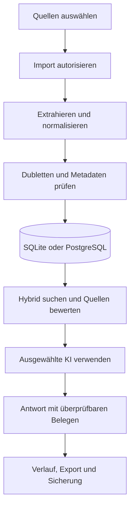

# Masterplan Wissensraum-AI

**Dokumentversion:** 1.8

**Stand:** 23.10.2026

**Produktstand:** 1.9 freigegeben am 23.10.2026 (Stand `4b37177`) · Vorgänger 1.8.1

**Repository:** `Melchy1971/Wissensraum-AI`

**Geprüfter Repository-Stand:** Commit `4b37177` (scrollbare Einstellungsseiten). CI-Lauf [39918310287](https://github.com/Melchy1971/Wissensraum-AI/actions/runs/39918310287) auf `4b37177` (23.10.2026): alle sieben Jobs grün. Davor: Lauf `39914353899` auf `ea7d929` grün; Läufe bis `585ae5a` rot im Vorschauschritt.

**Ablage:** Einziger Masterplan ist diese Datei `masterplan.md`. Die frühere Kopie `docs/masterplan.md` wurde am 22.10.2026 entfernt.

**Status:** Phasen- und Testplan · Release 1.9 freigegeben, Phasen 0 bis 5 ✅ · Phase 6 (Release 2.0) in Arbeit

**Legende:** ✅ vollständig implementiert und gesamtes Gate nachweislich bestanden · 🟡 implementiert oder teilweise geprüft, aber noch nicht vollständig abgenommen · ❌ Gate fehlgeschlagen oder Freigabe blockiert · ⬜ geplant und noch nicht begonnen

## Aktualisierung 22.10.2026 (Nachmittag) – Synchronisation, Linux-Identitätsbindung, geführte SQLite-Wiederherstellung

**Synchronisation:** Der bisherige Root-Masterplan (Dokumentversion 1.5, 89 Tests, Phase 5 ⬜) war gegenüber `docs/masterplan.md` (Dokumentversion 1.0, 321 Tests, Release-1.9-Checkliste) veraltet. Beide Dateien wurden in dieser Datei zusammengeführt, `docs/masterplan.md` wurde danach gelöscht. Der Ist-Stand, die Release-1.9-Checkliste und die DoD-Nachweise stammen aus `docs/masterplan.md`. Phasenplan, Test-Gates und Phase-4-Historie stammen aus dem Root-Plan.

**Testzahl:** `docs/masterplan.md` nannte 321 Tests. Nach diesem Stand ergänzte `e4a75ae` einen Test, der Head `c5503bc` hatte 322. Mit acht neuen Wiederherstellungstests, vier Tests zur Gesundheitsanzeige, sieben Negativtests, sieben Tests zum Quellenmodell einem PostgreSQL-Rundlauftest, einem WAL-Wiederherstellungstest, einem Logo-Test und zwei Layout-Tests waren es 353 (Abnahme Release 1.9). Schritt 6.1 ergänzt 17 Tests (4 Importgrenzen, 7 Importaufträge, 2 Referenzbestand, 2 Oberfläche, 1 CLI, 1 PostgreSQL): 370. Schritt 6.2 ergänzt 17 Tests (14 Versionen und Vorschau, 2 Oberfläche, 1 PostgreSQL): 387. Schritt 6.3a ergänzt 18 Tests (16 Anhänge und Strukturparser, 1 Oberfläche, 1 PostgreSQL): 405. Schritt 6.3b ergänzt 20 Tests (11 E-Mail- und PST-Aufträge, 6 Bereinigung, 2 Oberfläche, 1 PostgreSQL): 425. Schritt 6.4 ergänzt 12 Tests (11 OCR, 1 Oberfläche): jetzt 437.

| Bereich | Ergebnis | Status |
|---|---|---|
| Neuer Fehler | `test_secret_free_sqlite_identity_rejects_replacement_at_same_path_without_sql` unter Linux deterministisch rot: ext4 vergibt nach dem Löschen dieselbe Inode-Nummer, die Bindung `device+inode` erkennt den Austausch der SQLite-Datei nicht. Die Linux-CI-Jobs für `c5503bc` sind damit sehr wahrscheinlich rot (CI-Lauf nicht einsehbar). | ❌ → behoben |
| Korrektur | `configuration_authority._filesystem_binding` ergänzt unter Linux die `statx`-Erstellungszeit (`created_ns`). Windows-Format unverändert. Bestehende Linux-Identitätsdateien ohne `created_ns` werden fail-closed abgelehnt und beim nächsten normalen Start neu geschrieben. | ✅ |
| Geheimnisprüfung | Gesamte Git-Historie (46 Commits, alle Diffs) auf API-Schlüssel, Token, private Schlüssel, Verbindungs-URLs mit Kennwort und Kennwortzuweisungen geprüft, dazu Dateinamen (`.env`, Datenbanken, Logs, Schlüsseldateien). 12 Treffer, alle harmlos: Variablennamen, Oberflächentexte und erfundene Werte in den Tests der Log-Filterung. Lokale Logs (`data/logs/wissensraum.jsonl`) und Konfigurationsdateien: 0 Treffer. CI-Vorschaubilder nicht geprüft. | ✅ für den geprüften Stand |
| Python 3.12 | CI-Matrix um 3.12 erweitert (jetzt sieben Jobs). Lokal unter Linux und Windows mit 3.12 grün. | ✅ in CI ([39914353899](https://github.com/Melchy1971/Wissensraum-AI/actions/runs/39914353899)) |
| Befund Wiederherstellung | `restore_sqlite` öffnete die Sicherung nur lesend; bei einer Sicherung im WAL-Modus legt SQLite dabei `-wal`/`-shm` neben der Benutzerdatei an und kann sie nicht entfernen. Unter Windows führte das zu sporadischen Testfehlern. Korrigiert: Die Sicherung wird byteweise in die Staging-Datei kopiert, eine vorhandene `-wal`-Datei mit, damit dort gespeicherte Änderungen nicht verloren gehen. Zwei Tests, beide mit Gegenprobe. | ✅ |
| Kleinkorrekturen | `start.sh`-Tests werden ohne `sh` im Suchpfad übersprungen statt mit Fehler abzubrechen (in der CI unter Windows vorhanden). Ein beschädigtes `logo.png` meldet jetzt „Gespeichertes Logo ist nicht lesbar“ statt einer fehlerhaften Bildbibliothek. | ✅ |
| CI-Befund Vorschaubilder | `tests/capture_settings.py` startete die echte Anwendung; die fail-closed-Startdiagnose bricht auf CI-Runnern ohne sicheren Schlüsselspeicher ab. Rot seit `e4a75ae`/`1000bcf` (Hermes-Merge), in allen Läufen bis `585ae5a`. Korrigiert wie in `tests/test_gui.py`: Startdiagnose im Vorschauskript ersetzt, die Diagnose selbst prüft `tests/test_diagnostics.py`. Lokal unter Linux mit Python 3.11 reproduziert und behoben, alle sechs Vorschaubilder entstehen. | ✅ in CI ([39914353899](https://github.com/Melchy1971/Wissensraum-AI/actions/runs/39914353899)) |
| Befund Werkzeugleiste | Die in dieser Entwicklungsrunde ergänzten Schaltflächen „Sicherung wiederherstellen“ und „Systemstatus“ machten die Werkzeugleiste zu breit; „Beenden“ und „Einstellungen“ fielen bei Mindestbreite heraus, bei 1180 Pixeln war „Beenden“ abgeschnitten. Beide Aktionen liegen jetzt unter Einstellungen → Datenbank. Neue GUI-Tests prüfen die sichtbare Werkzeugleiste bei Mindestbreite und die vollständige Datenbankseite bei 1180×780. | ✅ |
| Scrollbare Einstellungsseiten | Auf Entscheidung des Product Owners umgesetzt. Alle fünf Einstellungsseiten liegen in einem senkrecht scrollbaren Bereich (Mausrad nur über der Seite, Farbe folgt Hell-/Dunkelmodus). Texte brechen an der sichtbaren Breite um, höchstens bei ihrem bisherigen Wert; reine Schaltflächenreihen brechen bei Bedarf in weitere Zeilen um. Damit sind auch bei 920×650 alle Texte, Schaltflächen und Felder erreichbar. Vorher waren dort auf vier Seiten Texte und Schaltflächen rechts und die Datenbankseite unten abgeschnitten; bei 1180×780 war „Schlüsseldatei importieren“ abgeschnitten. Die Sonderlösung `resize_settings_text` entfällt. GUI-Test prüft für alle Seiten bei Mindestgröße: letztes Element erreichbar, kein Text und keine Schaltfläche über den Rand, Hintergrund in beiden Modi; Gegenproben ohne Bildlaufbereich, Farbwechsel, Textumbruch oder Zeilenumbruch der Schaltflächen sind rot. | ✅ |
| Release-Gate-Skript | `tests/release_gate.py` führt die manuellen Migrations- und Wiederherstellungsschritte aus Phase 4 und 5 reproduzierbar an Kopien aus und schreibt ein Protokoll mit Checkliste für die menschlichen Prüfungen. Lauf 22.10.2026 Windows, Python 3.13.8: M1 Migration 1 bis 4 auf 5, M2 Abbruch mit Rollback, M3 zwei gleichzeitige Starts, M4 Kopie der echten `data/wissen.db` (bereits Version 5, 0 Dokumente, daher ohne Aussagekraft für Bestandsdaten), R1 SQLite-Wiederherstellung: PASS. P1 PostgreSQL: SKIP (kein Testdienst unter Windows). Lauf Linux, Python 3.13, PostgreSQL 16.2: alle sechs Schritte PASS. Gegenprobe: defekte Wiederherstellung ergibt FAIL und Exit-Code 1. Lauf Markus auf `585ae5a` (Windows, Python 3.13.8, 22.10.2026 18:48, `release-gate-20261022-184843.md`): M1, M2, M3, R1 PASS; M4 nicht anwendbar, weil kein Altbestand mit Inhalt existiert; P1 offen, Nachweis über den CI-Job `postgres`. Manuelle Oberflächenprüfungen und Unterschrift stehen aus. | ✅ |
| PostgreSQL-Backup/Restore | Ablauf in README dokumentiert: `pg_dump --schema=wissensraum --format=custom`, Prüfung mit `pg_restore --list`, Wiederherstellung über `DROP SCHEMA` und `pg_restore --single-transaction --exit-on-error --no-owner`, danach Schemaprüfung durch die Anwendung. Kennwort nur interaktiv bzw. über `PGPASSWORD`, nie in der Befehlszeile. Rundlauftest vergleicht Prüfsummen, Originale, Abschnitte, Quellen, KI-Verlauf, Einstellungen, Migrationshistorie und fortlaufende IDs. Gegenprobe: ohne Wiederherstellungsschritt rot. CI-Job `postgres` installiert Client-Werkzeuge 18 und verlangt sie (`PGTEST_REQUIRE_PG_TOOLS=1`). | ✅ |
| Quellenmodell `sources` (Schema 5) | Neue Migration 5 für beide Backends: Tabelle `sources` (Primärschlüssel `document_id`, Löschweitergabe mit dem Dokument, Konto-ID ohne Fremdschlüssel, damit die Herkunft eine Kontolöschung überdauert) und deterministische Rückfüllung des Bestands. Alle Importpfade (Notiz, Datei, Ordner, PST, IMAP, Graph) schreiben die Quelle in derselben Transaktion wie das Dokument. Unversionierte PostgreSQL-Bestandsschemata werden als Version 4 übernommen und danach auf 5 migriert. Nebenbefund behoben: `database.reset_postgresql` prüfte gegen eine fest verdrahtete Tabellenliste und hätte nach jeder neuen Tabelle den Reset abgelehnt; die Liste wird jetzt aus dem Migrationskatalog abgeleitet. Lokaler PostgreSQL-16.2-Testdienst eingerichtet; die Abnahme verlangt weiterhin den CI-Lauf gegen PostgreSQL 18. | ✅ |
| Negativtests Konfiguration | Alle Konfigurationsdateien (`database.json`, `design.json`, Autorität, lokale Identität, Resync-Markierung, Import-Journal) mit leeren, binären, abgeschnittenen, formfalschen und tief verschachtelten Inhalten geprüft; Schreibabbrüche an Schreib-, fsync- und Ersetzungsschritt geprüft. Drei Fehler gefunden und behoben: `design.json` in falscher Form (Liste, `null`, Zahl, Theme als Liste) brach mit `AttributeError`/`TypeError` ab statt auf „hell“ zurückzufallen; tief verschachteltes `database.json` gab den internen `RecursionError`-Text aus; ein fehlgeschlagenes Logo-Speichern meldete fälschlich ein unlesbares Bild und hinterließ `logo.tmp.png`. Gegenprobe: Die neuen Tests schlagen gegen den alten Code fehl. | ✅ |
| Gesundheitsanzeige | `diagnostics.health_overview`, CLI `status`, Desktop „Systemstatus prüfen“ unter Einstellungen → Datenbank: Datenbank antwortet (mit Dokumentanzahl), aktive KI mit Modell und Schlüsselquelle, E-Mail-Konten ohne gespeicherte Zugangsdaten. Liest nur lokalen Zustand, baut keine Verbindung zu KI-Anbietern oder Postfächern auf, gibt keine Schlüssel aus. `status` öffnet den Store wie jeder normale CLI-Befehl (inkl. Migration), anders als das schreibgeschützte `doctor`. | ✅ |
| SQLite-Wiederherstellung | `migrations.restore_sqlite`, CLI `restore <sicherung> --confirm <dateiname>`, Desktop „Sicherung wiederherstellen“ unter Einstellungen → Datenbank: Sicherung nur lesend, Vorprüfung (Integrität, Version 1–4, exaktes Schema), geprüfte Sicherung des aktuellen Stands, Einspielen unter Migrationssperre, Hash-Vergleich aller Dokumente, automatisches Zurückspielen bei Abweichung. Unlesbare Zieldatenbank wird nicht überschrieben. | ✅ |
| Tests Linux, Python 3.11, 3.12 und 3.13 | 353 Tests. 3.12 und 3.13 mit lokalem PostgreSQL 16.2: je 351 bestanden, 2 übersprungen (Windows-Pfadfälle). 3.11 ohne PostgreSQL-Dienst: 341 bestanden, 12 übersprungen. Jeweils 0 Fehler. | ✅ lokal |
| Tests Windows, Python 3.11, 3.12 und 3.13 | 353 Tests, je 337 bestanden, 16 übersprungen (3 POSIX-Logging-Fälle, 10 PostgreSQL, 3 `start.sh`-Tests ohne `sh` im Suchpfad). 3.12 und 3.13: 0 Fehler. 3.11 auf dem Entwicklungsrechner: in jedem Lauf ein bis fünf Fehler beim Löschen des Temp-Ordners nach bestandenem Test (WinError 145), jedes Mal in anderen, überwiegend bereits vorhandenen Tests; der CI-Job Windows/3.11 war in allen geprüften Läufen grün. Vermutlich lokales Zusammenspiel mit dem Virenscanner. | 🟡 lokal, nicht release-blockierend (CI Windows/3.11 grün) |
| CI-Matrix | Lauf [39918310287](https://github.com/Melchy1971/Wissensraum-AI/actions/runs/39918310287) auf `4b37177` (23.10.2026): alle sieben Jobs grün, Windows/Linux × Python 3.11/3.12/3.13 und `postgres` (PostgreSQL 18 einschließlich `pg_dump`/`pg_restore`-Rundlauf). Davor grün: `39914353899` auf `ea7d929`. Läufe bis `585ae5a` rot im Vorschauschritt. | ✅ für `4b37177` |

**Nächster kleinster Schritt:** 6.4 committen und CI prüfen; danach Abnahme Release 2.0. 6.3 abgenommen 23.10.2026 (CI [39976859099](https://github.com/Melchy1971/Wissensraum-AI/actions/runs/39976859099)). 6.2 abgenommen 23.10.2026 (CI [39932577799](https://github.com/Melchy1971/Wissensraum-AI/actions/runs/39932577799)). 6.1 abgenommen 23.10.2026 (CI [39925457254](https://github.com/Melchy1971/Wissensraum-AI/actions/runs/39925457254)). Offen außerhalb der Gates: P0 „Veröffentlichtes Datenbankkennwort ändern“ auf dem VPS.

## Aktualisierung 22.10.2026 – Release 1.9 nach Hermes-Merge

**Quellennachweis:** GitHub-Commit-Historie auf `main`, zuletzt Merge-Commit [`80e3807`](https://github.com/Melchy1971/Wissensraum-AI/commit/80e3807c9e8ac9aeeef70210ae47026e7f28a349) (PR #1). Diese Aktualisierung bestätigt Commit-Inhalte anhand der Commit-Beschreibungen, **nicht** einen erneuten vollständigen Lauf aller manuellen Abnahmetests.

| Bereich | Neuer Stand | Abnahme |
|---|---|---|
| ✅ elease-1.9-Branch | Hermes-Änderungen durch PR #1 nach `main` gemergt | CI und manuelles Release-Gate für Merge-Head erneut nachweisen |
| ✅ onfigurationswiederherstellung | Portabilitätskorrektur `e4a75ae` | Import/Export auf sauberem Windows-System und ohne Geheimnisse testen |
| ✅ tartdiagnose | Diagnostik vor Recovery schreibgeschützt gehärtet (`dffa98e`) | Fehlerfälle, Seiteneffekte und Recovery-Protokoll testen |
| ✅ indows-Starter | Python 3.12 ergänzt (`bc538db`) | Startmatrix 3.11/3.12/3.13 prüfen; CI-Abdeckung separat bestätigen |
| ✅ QLite-Migration | Sperrverhalten über alternative Pfadnamen serialisiert (`994fa1e`) | Gleichzeitige Starts mit Pfad-Alias, Symlink und Abbruch testen |
| ✅ I-Kompilierung | Produktionsmodule werden kompiliert (`c4447b5`) | Grünstatus für Merge-Head bestätigen |
| ✅ okumentation | Release-1.9-Status synchronisiert (`b117ac9`) | Gegen tatsächliche Module und Tests abgleichen |

**Wichtige Korrektur:** Ältere Aussagen in diesem Dokument, wonach nach `ad7cf0e` nur Dokumentation geändert worden sei, beziehen sich auf den damaligen Prüfstand und sind für den aktuellen Head überholt. Die vorherige grüne CI-Matrix belegt nicht automatisch die Qualität von `80e3807`.

**Nächstes Gate (P0):** (1) vollständige CI auf `80e3807` verifizieren, (2) Migrationen einschließlich Restore und konkurrierender Starts manuell protokollieren, (3) Diagnose/Recovery und Konfigurationstransfer auf sauberer Windows-Installation testen, (4) README und Testmatrix mit Python 3.12 abgleichen, (5) erst dann Phase 4/5 und Release 1.9 als vollständig abgeschlossen kennzeichnen. **Erfüllt:** abgenommen 23.10.2026: CI-Lauf [39918310287](https://github.com/Melchy1971/Wissensraum-AI/actions/runs/39918310287) auf `4b37177`, Release-Gate-Protokoll `release-gate-20261022-184843.md`.

## 1. Zweck

Wissensraum-AI wird zu einer lokal kontrollierten Wissensplattform ausgebaut, die Dokumente, E-Mails und Notizen sicher importiert, strukturiert, durchsucht und mit wählbaren KI-Modellen auswertet.

Der Masterplan steuert:

- Produktumfang und Architekturgrenzen
- Releases, Prioritäten und Abhängigkeiten
- Datenmodell und Migrationen
- Sicherheits- und Datenschutzanforderungen
- messbare Abnahmekriterien
- technische Schulden und Betriebsrisiken

## 2. Zielbild

Die Anwendung soll einen belastbaren Wissensprozess abbilden:



Zielzustand:

- ✅ Windows-Desktopanwendung als primärer Client
- ✅ lokaler Betrieb ohne zwingenden Cloud-Dienst
- ✅ wahlweise SQLite oder PostgreSQL als aktive Datenbank
- ✅ explizit autorisierte Imports aus Dateien, Ordnern, PST und E-Mail-Konten
- ✅ austauschbare KI-Anbieter: OpenAI, Claude, Gemini und Ollama
- hybride Suche aus Volltext und Vektoren mit optionalem Reranking
- ✅ nachvollziehbare Antworten mit verwendeten Quellen und Fundstellen; ein belastbarer Qualitätsstatus ist noch geplant
- ✅ sichere Schlüsselverwaltung außerhalb der Wissensdatenbank
- reproduzierbare Installation, Migration, Sicherung und Wiederherstellung

## 3. Planungsannahmen

| Annahme | Konsequenz |
|---|---|
| Primärer Betrieb durch einen Benutzer auf einem Windows-PC | Keine Benutzerverwaltung im aktuellen Produktkern |
| PostgreSQL auf dem VPS ist optional | SQLite bleibt funktionsfähiger Offline-Standard |
| Importierte Inhalte können vertraulich sein | Keine Zugangsdaten in Repository, SQL, Logs oder Screenshots |
| KI-Anbieter sind austauschbar und können ausfallen | Import, Suche und Export müssen ohne KI funktionieren |
| Externe Postfächer dürfen nicht verändert werden | E-Mail-Zugriff bleibt lesend und benötigt minimale Berechtigungen |
| Originale müssen beweissicher erhalten bleiben | Originaldatei, extrahierter Text, Prüfsumme und Quelle werden getrennt nachvollziehbar gespeichert |
| Datenmenge wächst schrittweise | Langläufer benötigen Fortschritt, Abbruch und Wiederaufnahme |

Die Annahmen werden vor Beginn eines Mehrbenutzer- oder Serverbetriebs neu bewertet.

## 4. ✅ Bestätigter Ist-Stand

### 4.1 Produktfunktionen

| Bereich | Aktueller Stand 1.9-dev | Reifegrad |
|---|---|---|
| Desktop-Oberfläche | Deutsche Tkinter-Oberfläche mit Hauptnavigation und kontrolliertem Beenden | Produktiv nutzbar |
| Lokale Dokumente | TXT, Markdown, textbasierte PDF und DOCX | Produktiv nutzbar |
| Ordnerimport | Rekursiv, relative Pfade, keine Verfolgung symbolischer Links | Produktiv nutzbar |
| PST | Optional über `libratom` | Eingeschränkt durch lokale Systemabhängigkeiten |
| E-Mail | Gmail/IMAP sowie Microsoft Graph, zweistufige Importfreigabe | Funktionsfähig, keine Anhänge |
| Dubletten | SHA-256 über normalisierten extrahierten Text | Exakte Inhaltsdubletten |
| Suche | Lexikalische Volltextsuche: SQLite mit BM25, PostgreSQL mit `ts_rank_cd` | Funktionsfähig, keine Semantik |
| KI | OpenAI, Claude, Gemini und Ollama; Anbieter und Modell aktivierbar | Adapter getestet, Live-Abdeckung unvollständig |
| Quellen | KI-Kontext aus maximal acht Abschnitten, Quellenmarkierungen `[Qn]` | Technisch geprüft, keine fachliche Belegprüfung |
| Datenbanken | SQLite oder PostgreSQL mit eigenem Schema `wissensraum`; beide über geordnete Migrationen bis Schema 4 verwaltet | Lokale Verträge getestet; PostgreSQL-Live-Abdeckung in CI noch nicht vollständig nachgewiesen |
| Schlüssel | Betriebssystem-Schlüsselspeicher; externe Variablen und Dateien lesbar | Sicherheitskritischer Kern vorhanden |
| Design | Telekom-Magenta, Hell-/Dunkelmodus, eigenes Logo | Produktiv nutzbar |
| Sicherung | SQLite-Backup; PostgreSQL serverseitig mit `pg_dump` | ✅ Geführte SQLite-Wiederherstellung implementiert und automatisch getestet; PostgreSQL-Backup/Restore dokumentiert und als `pg_dump`/`pg_restore`-Rundlauf automatisch getestet |

### 4.2 Aktuelles Datenmodell

| Tabelle/Objekt | Aufgabe |
|---|---|
| `documents` | Dokumentmetadaten, Original-BLOB, extrahierter Text, SHA-256 |
| `chunks` | Nummerierte Textabschnitte je Dokument |
| `search_index` | SQLite-FTS5-Index; PostgreSQL verwendet die jeweilige Backend-Implementierung |
| `ai_runs` | Anfrage, Antwort, Modell und unveränderlicher Quellen-Snapshot |
| `settings` | Nicht geheime Anwendungseinstellungen |
| `email_accounts` | Kontometadaten ohne Kennwörter oder Token |
| `email_imports` | Zuordnung importierter Servernachrichten zu Dokumenten |
| `sources` | Genau eine Herkunft je Dokument: Quelltyp, Konto-ID, Fundort (Schema 5) |
| `PRAGMA user_version` / `schema_migrations` | Versionsmetadaten für geordnete SQLite-/PostgreSQL-Migrationen |
| `data/database.json` | Lokales Datenbankprofil ohne Kennwort |
| `data/design.json` | Lokale Designkonfiguration |
| `data/branding/logo.png` | Normalisiertes Anwendungslogo |

### 4.3 Qualitätsbasis

- Aktueller Stand 22.10.2026: 353 Tests. Linux Python 3.12/3.13 mit lokalem PostgreSQL 16.2 je 351 bestanden, 2 übersprungen; Linux Python 3.11 ohne PostgreSQL 341 bestanden, 12 übersprungen; Windows Python 3.11/3.12/3.13 je 335 bestanden, 16 übersprungen, unter 3.11 vereinzelt ein umgebungsbedingter Temp-Ordner-Aufräumfehler.
- Dokumentierter Vorstand `b117ac9`: 321 Tests auf Windows erfolgreich, 9 Übersprünge (3 plattformspezifische Logging-Dateisystemfälle, 6 nicht konfigurierte Live-PostgreSQL-Diensttests).
- Unterstützte Python-Versionen 3.11, 3.12 und 3.13; CI-Matrix auf Windows und Linux mit allen drei Versionen (seit 22.10.2026, vorher nur 3.11 und 3.13), dazu der Job `postgres`: sieben Jobs
- grafische Tests unter virtuellem Linux-Bildschirm
- PostgreSQL-18-Dienst in CI verdrahtet; erfolgreicher entfernter Lauf von `test_configuration_transfer_contract_on_real_postgresql` noch nicht nachgewiesen
- CI ohne kostenpflichtige KI-, E-Mail- oder Microsoft-Aufrufe
- API-Verträge über kontrollierte Testantworten

#### Historie Phase 4 (Hermes-Prüfstand, 89 Tests)

| Prüfstand | Ergebnis |
|---|---|
| ✅ Stabiler Stand 1.8.1 | 51 Tests; Windows/Linux und Python 3.11/3.13 waren vollständig grün |
| 🟡 Hermes-Stand 1.9 | Neue Migrationsschicht und 38 zusätzliche Tests; insgesamt 89 Tests |
| ❌ Lokale Prüfung des Hermes-Stands | Erstprüfung: 74 bestanden, 12 umgebungsbedingt übersprungen, 3 Fehler |
| ❌ Lokale Nachprüfung 20.10.2026 (Windows, Python 3.13.8, `297339b`) | 81 bestanden, 5 übersprungen, 3 Fehler; übersprungen sind die fünf PostgreSQL-Tests (kein Testdienst konfiguriert), GUI-Tests liefen |
| ✅ Lokale Prüfung nach Testkorrektur 20.10.2026 (Windows, Python 3.13.8, `55bc4ca`) | 84 bestanden, 5 übersprungen (PostgreSQL-Testdienst nicht konfiguriert), 0 Fehler |
| ❌ GitHub Actions vor Korrektur | Alle fünf Jobs fehlgeschlagen in Lauf `39380439985` (`717db89`) und `39381519764` (`297339b`) |
| ✅ GitHub Actions nach Korrektur | Lauf `39410112241` (`55bc4ca`): alle fünf Jobs grün; Windows/Linux × Python 3.11/3.13 je 89 Tests, 84 bestanden, 5 PostgreSQL-Tests übersprungen; Job `postgres` (PostgreSQL 18) 8 von 8 bestanden, 0 übersprungen |
| ✅ Lokale Nachprüfung 21.10.2026 (Windows, Python 3.13.8, `ad7cf0e`) | 89 Tests: 84 bestanden, 5 übersprungen (PostgreSQL-Testdienst nicht konfiguriert), 0 Fehler |
| ✅ GitHub Actions aktueller codewirksamer Stand | Lauf `39410785307` (`ad7cf0e`): alle fünf Jobs grün |
| ✅ Repositoryprüfung 22.10.2026 | Head `0d05aa5`; seit `ad7cf0e` keine Code-, Schema- oder Teständerung, sondern ausschließlich Aktualisierung von `masterplan.md` |
| ✅ Testdatenschutz | CI verwendet synthetische Daten und ruft keine kostenpflichtigen KI-, E-Mail- oder Microsoft-Dienste auf |

Aktueller Code- und CI-Nachweis: [GitHub Actions Lauf 39410785307](https://github.com/Melchy1971/Wissensraum-AI/actions/runs/39410785307) (`ad7cf0e`); Korrekturlauf [39410112241](https://github.com/Melchy1971/Wissensraum-AI/actions/runs/39410112241) (`55bc4ca`); rote Vorläufe [39381519764](https://github.com/Melchy1971/Wissensraum-AI/actions/runs/39381519764) und [39380439985](https://github.com/Melchy1971/Wissensraum-AI/actions/runs/39380439985). Der nachfolgende Repository-Commit `0d05aa5` änderte ausschließlich diesen Masterplan und verändert die technische Prüfbasis nicht.

### 4.4 Vom Hermes Agent neu implementiert

- ✅ eigenständiges Modul `migrations.py` mit geordneten Migrationen 1 bis 4
- ✅ SQLite-Dateisperre mit begrenzter Wartezeit und Prozess-Synchronisation
- ✅ verifizierte SQLite-Sicherung vor einer Versionsmigration
- ✅ PostgreSQL-Transaktionen mit Advisory Lock und begrenztem Lock-Timeout
- ✅ Tabelle `schema_migrations` mit lückenloser Versionshistorie
- ✅ strikte Prüfung von Tabellen, Spalten, Defaults, Fremdschlüsseln, Constraints und Suchindizes
- ✅ kontrollierte Übernahme eines exakt passenden, unversionierten Legacy-Schemas
- ✅ atomarer PostgreSQL-Schema-Reset mit Rollback bei Fehlern
- ✅ Schutz destruktiver PostgreSQL-Tests durch `PGTEST_ALLOW_DESTRUCTIVE=1` und Datenbanknamen mit `_test`
- ✅ Windows-Starter priorisiert stabile Python-Versionen und baut eine ungültige virtuelle Umgebung neu auf
- ✅ Testumfang von 51 auf 89 Tests erweitert

Die Funktionen sind im Code vorhanden, in der vollständigen CI-Matrix geprüft und mit dem manuellen Migrationstest abgenommen 23.10.2026: CI-Lauf [39918310287](https://github.com/Melchy1971/Wissensraum-AI/actions/runs/39918310287) auf `4b37177`, Release-Gate-Protokoll `release-gate-20261022-184843.md`.

## 5. Verbindliche Produktprinzipien

1. ✅ **Offline-Kern:** Import, Verwaltung, Suche und Export funktionieren ohne KI-API.
2. ✅ **Explizite Autorisierung:** Vollständige E-Mails werden erst nach Auswahl durch den Benutzer abgerufen.
3. ✅ **Keine Geheimnisse in SQL:** API-Schlüssel, Passwörter und OAuth-Token bleiben im Betriebssystem-Schlüsselspeicher oder in ausdrücklich konfigurierten externen Secret-Quellen außerhalb der Wissensdatenbank, etwa Umgebungsvariablen oder lokal ignorierten `.env`-Dateien.
4. ✅ **Keine stillen Datenwechsel:** Ein Wechsel zwischen SQLite und PostgreSQL migriert keine Daten automatisch.
5. ✅ **Nachvollziehbare Quellen:** Jede gespeicherte KI-Antwort enthält die tatsächlich verwendeten Textstellen als Quellen-Snapshot.
6. ✅ **Fail closed:** Ungültige Konfigurationen, fehlende Rechte und unsichere TLS-Einstellungen führen in den implementierten Verbindungs- und Schlüsselpfaden zum Abbruch.
7. ✅ **Versionierte Vorwärtsmigrationen mit Rückwärtskompatibilitätsprüfung:** Jede Schemaänderung wird als versionierte Vorwärtsmigration ausgeführt und besitzt eine Versionsprüfung, Vorab-Sicherung sowie automatisierte Migrations- und Rückwärtskompatibilitätstests.
8. **Unvertrauenswürdige Inhalte:** Importierte Texte gelten als Daten, niemals als ausführbare Anweisung.
9. ✅ **Reproduzierbarkeit:** Unterstützte Python-Versionen und Abhängigkeiten bleiben fest versioniert und durch CI geprüft.
10. ✅ **Löschtransparenz:** Für den aktuellen Dokumentlöschpfad sind Original, Suchindex, Importmarkierung und erhaltener KI-Quellen-Snapshot dokumentiert und getestet.

## 6. Zielarchitektur

| Schicht | Verantwortung | Zielzustand |
|---|---|---|
| Oberfläche | Navigation, Auswahl, Status, Fehlerdarstellung | Keine Geschäftslogik in UI-Ereignissen |
| Anwendungsdienste | Importaufträge, Suche, KI-Anfragen, Sicherungen | Klare transaktionale Use-Cases |
| ✅ Adapter | Dateiformate, PST, IMAP, Graph und vier KI-Anbieter sind angebunden | Einheitliche Schnittstellen und Timeouts weiter härten |
| Retrieval | Volltext, Vektoren, Fusion, Reranking | Backendunabhängige Ergebnisstruktur |
| ✅ Persistenz | SQLite und PostgreSQL mit gemeinsamem, getestetem Speichervertrag | Migrationen weiter versionieren und absichern |
| ✅ Geheimnisse | API-, E-Mail- und Datenbankzugänge | Sicherer lokaler Speicher oder ausdrücklich konfigurierte externe Secret-Quelle außerhalb der Wissensdatenbank |
| Betrieb | Logs, Diagnose, Backup, Wiederherstellung | Datenschutzgerechte und prüfbare Abläufe |

### 6.1 Geplante Kernobjekte

| Objekt | Zweck | Release |
|---|---|---|
| ✅ `sources` | Herkunft, Quelltyp, Konto, Pfad und Abrufkontext vereinheitlichen | 1.9 (Schema 5 implementiert) |
| `import_jobs` | Laufstatus, Fortschritt, Fehler, Abbruch und Wiederaufnahme | 2.0 |
| `attachments` | E-Mail-Anhänge und Beziehung zur Nachricht | 2.0 |
| `document_versions` | Korrigierte oder erneut importierte Fassungen nachvollziehen | 2.0 |
| `embeddings` | Vektoren, Modell, Dimension, Prüfsumme und Erzeugungszeit | 2.1 |
| `entities` / `relations` | Kontrollierter Wissensgraph | 2.3 |
| `audit_events` | Sicherheits- und Betriebsereignisse ohne Geheimnisse | 2.4 |

## 7. Phasenplan mit Test-Gates

Die Phasen werden in der angegebenen Reihenfolge getestet. Eine Phase wird erst mit ✅ markiert, wenn ihr automatischer und manueller Test vollständig bestanden ist. Ein rotes Gate blockiert die Freigabe nachfolgender Änderungen, verhindert aber nicht das Testen bereits freigegebener früherer Phasen.

| Phase | Inhalt | Status | Testfreigabe |
|---:|---|---|---|
| 0 | Installation, Start und Oberfläche | ✅ | freigegeben |
| 1 | Dokumente, Notizen, Suche und SQLite-Sicherung | ✅ | freigegeben |
| 2 | KI-Anbieter, Aktivierung und Quellenantworten | ✅ | freigegeben; Live-Anbieter einzeln prüfen |
| 3 | Ordner-, PST- und E-Mail-Import | ✅ | freigegeben; PST bleibt optional |
| 4 | Versionierte SQLite-/PostgreSQL-Migrationen | ✅ | freigegeben 23.10.2026 |
| 5 | Release 1.9 Betriebsfähigkeit | ✅ | freigegeben 23.10.2026 |
| 6 | Release 2.0 Importplattform | 🟡 | freigegeben 23.10.2026, in vier Teilschritten (D-010); 6.1 ✅ (23.10.2026, CI [39925457254](https://github.com/Melchy1971/Wissensraum-AI/actions/runs/39925457254) auf `ca5bce6`), 6.2 ✅ (23.10.2026, CI [39932577799](https://github.com/Melchy1971/Wissensraum-AI/actions/runs/39932577799) auf `4cdb50e`), 6.3a ✅ (23.10.2026, CI [39942033441](https://github.com/Melchy1971/Wissensraum-AI/actions/runs/39942033441) auf `e36be53`), 6.3 ✅ (6.3b 23.10.2026, CI [39976859099](https://github.com/Melchy1971/Wissensraum-AI/actions/runs/39976859099) auf `e4d1f95`), 6.4 lokal erfüllt, CI ausstehend |
| 7 | Release 2.1 Hybrid-RAG | ⬜ | nach Phase 6 |
| 8 | Wissensorganisation und Wissensgraph | ⬜ | nach Phase 7 |
| 9 | Betrieb und Governance | ⬜ | nach Phase 8 |
| 10 | Mehrbenutzerbetrieb | ⬜ | separates Entscheidungstor |

### Phase 0 – Installation, Start und Oberfläche ✅

**Enthalten:**

- Windows-Starter und virtuelle Python-Umgebung
- automatische Installation der Abhängigkeiten
- Reparatur einer beschädigten Pillow-Installation
- Hauptnavigation, Hell-/Dunkelmodus, Logo und Beenden-Schaltfläche

**Manueller Test:**

1. In einer Eingabeaufforderung `py -3.13 --version` ausführen.
2. Anwendung mit `start_windows.bat` starten.
3. Prüfen, ob Hauptseite, Navigation und Logo vollständig dargestellt werden.
4. Zwischen Hell- und Dunkelmodus wechseln und die Anwendung neu starten.
5. **Beenden** betätigen.

**Erwartetes Ergebnis:**

- kein Traceback und kein Pillow-Fehler
- Designauswahl und Logo bleiben nach dem Neustart erhalten
- **Beenden** schließt das Fenster unmittelbar und kontrolliert

**Gate:** Phase bestanden, wenn zwei aufeinanderfolgende Starts ohne Reparaturschleife funktionieren.

### Phase 1 – Dokumente, Notizen, Suche und Sicherung ✅

**Enthalten:**

- TXT-, Markdown-, PDF- und DOCX-Import
- Notizen und Kategorien
- exakte Inhaltsdubletten über SHA-256
- Volltextsuche und Originalexport
- Dokumentlöschung und SQLite-Sicherung

**Manueller Test:**

1. `beispiele/Freigabeprozess.md` importieren.
2. Dieselbe Datei erneut importieren.
3. Nach `Freigabe` suchen.
4. Eine Testnotiz anlegen und wiederfinden.
5. Das Original exportieren und mit der Quelldatei vergleichen.
6. Eine SQLite-Sicherung erstellen.
7. Nur die Testnotiz löschen und erneut suchen.

**Erwartetes Ergebnis:**

- Erstimport erfolgreich, Zweitimport als Dublette erkannt
- Suche zeigt das richtige Dokument und den passenden Abschnitt
- Originaldatei bleibt bytegetreu exportierbar
- Sicherungsdatei wird erstellt und das gelöschte Testobjekt verschwindet aus Suche und Index

**Gate:** Keine unerkannte Dublette, kein verwaister Suchtreffer und keine Veränderung des Originals.

### Phase 2 – KI-Anbieter und Quellenantworten ✅

**Enthalten:**

- OpenAI, Claude, Gemini und Ollama
- getrennte Bearbeitungsauswahl und aktive KI
- maskierte Schlüsselanzeige und Betriebssystem-Schlüsselspeicher
- Verbindungstest, Zusammenfassung und quellenbasierte Antwort

**Manueller Test:**

1. Unter **Einstellungen → KI** einen verfügbaren Anbieter auswählen.
2. Modell und Schlüssel speichern.
3. **Als aktive KI verwenden** betätigen.
4. Prüfen, ob ausschließlich dieser Anbieter mit **AKTIV** markiert ist.
5. Verbindung testen.
6. Zum importierten Freigabeprozess eine Frage stellen.
7. Quellen `[Q1]` und angezeigte Textstelle vergleichen.

**Erwartetes Ergebnis:**

- Schlüssel wird nie im Klartext angezeigt
- Speichern allein wechselt den aktiven Anbieter nicht
- Aktivieren bleibt nach Neustart erhalten
- Antwort enthält gültige Quellenverweise oder einen ausdrücklichen Prüfhinweis

**Gate:** Adaptertest und ein manueller Smoke-Test des tatsächlich verwendeten Anbieters sind grün. HTTP 429 gilt als Anbieter-/Kontolimit und nicht als fachlicher Erfolg.

### Phase 3 – Lokale Quellen, PST und E-Mail ✅

**Enthalten:**

- einzelne Dateien und rekursiver Ordnerimport
- relative Quellpfade und getrennte Importstatistik
- PST-Import über optionale lokale Erweiterung
- Gmail/IMAP und Microsoft Graph
- E-Mail-Vorschau vor dem Vollabruf
- grüner Status für bereits importierte Nachrichten

**Manueller Test:**

1. Einen Testordner mit zwei Unterordnern, zwei unterstützten Dateien und einer nicht unterstützten Datei anlegen.
2. **Ordner inkl. Unterordner** ausführen.
3. Gefundene, importierte, vorhandene, übersprungene und fehlerhafte Dateien prüfen.
4. Ein Test-E-Mail-Konto in den Einstellungen hinterlegen.
5. **Postfach importieren** ausführen und prüfen, dass zunächst keine Nachricht aktiviert ist.
6. Genau eine Testnachricht aktivieren und importieren.
7. Vorschau erneut öffnen.

**Erwartetes Ergebnis:**

- Unterordner werden rekursiv verarbeitet und relative Pfade gespeichert
- nicht unterstützte Dateien werden nur gezählt, nicht importiert
- nicht aktivierte E-Mails werden nicht vollständig gespeichert
- die importierte Nachricht zeigt dauerhaft **✓ Importiert** und lässt sich nicht erneut aktivieren
- das Postfach bleibt unverändert und Nachrichten werden nicht als gelesen markiert

**Gate:** Alle Zähler stimmen mit dem Testordner überein; die Testnachricht existiert genau einmal.

### Phase 4 – Versionierte Datenbankmigrationen ✅

**Hermes-Umsetzung:**

- geordnete Migrationen 1 bis 4 für SQLite und PostgreSQL
- SQLite-Sicherung vor Versionswechsel
- Sperren gegen parallele Migrationen
- Schema- und Historienprüfung
- PostgreSQL-Advisory-Lock und atomarer Schema-Reset
- kontrollierte Übernahme eines passenden Legacy-Schemas
- Schutz destruktiver PostgreSQL-Tests

**Automatischer Test:**

```powershell
python -m unittest tests.test_migrations -v
python -m unittest tests.test_database -v
python -m unittest tests.test_postgres -v
python -m unittest discover -s tests -v
```

PostgreSQL-Destruktivtests dürfen ausschließlich gegen eine Wegwerfdatenbank mit Namen `*_test` und gesetztem `PGTEST_ALLOW_DESTRUCTIVE=1` laufen. Die produktive VPS-Datenbank ist kein Testziel.

**Nachgewiesene Fehler** (am 20.10.2026 auf `297339b` erneut reproduziert; Korrekturstand siehe jeweils am Ende):

1. Der Reset-Unit-Test verwendet einen Mock ohne den neuen Parameter `acquire_lock=False` (`test_database.DatabaseSettingsTests.test_reset_recreates_and_validates_on_same_locked_transaction`, `ValueError` aus `database.py:162`). **Korrigiert:** Mocks akzeptieren `acquire_lock` und prüfen `acquire_lock=False`; lokal grün.
2. Ein SQLite-Rollback-Test ersetzt den Migrationskatalog unvollständig; die Schema-Prüfung greift anschließend auf fehlende DDL-Einträge zu (`test_failed_sqlite_migration_rolls_back_schema_and_version`, `IndexError` in `migrations.py:346`). **Korrigiert:** Test behält die echte Migration 1 und ersetzt nur Migration 2; lokal grün.
3. Ein Store-Test setzt nur `PRAGMA user_version` auf 3 zurück, lässt aber ein Version-4-Schema bestehen; die neue strikte Prüfung verwirft diese inkonsistente Testdatenbank (`test_store_initialization_uses_migration_layer`, `ValueError` in `migrations.py:318`). **Korrigiert:** Test verwendet die historische Version-3-Fixture und prüft das Ergebnis auf Version 4; lokal grün.
4. Der reale PostgreSQL-Test vergleicht ein zurückgegebenes PostgreSQL-Array als Zeichenkette mit einer Python-Liste (`test_unversioned_unexpected_table_sets_are_rejected_without_metadata`, drei Subtests, z. B. `'{unrelated}' != ['unrelated']`); nur im CI-Job `postgres` reproduziert, lokal mangels Testdienst übersprungen. Ursache: `table_name` hat den Domänentyp `sql_identifier`, dessen Array psycopg nicht dekodiert. **Korrigiert:** Abfrage castet auf `table_name::text`; im CI-Job `postgres` von Lauf `39410112241` grün.
5. Die GitHub-Läufe `39380439985` und `39381519764` waren in allen fünf Jobs rot. **Behoben:** Lauf `39410112241` ist in allen fünf Jobs grün.
6. `python -m unittest tests.test_database` scheiterte beim Import von `test_settings`, weil nur `discover` den Ordner `tests/` in den Suchpfad legt. **Korrigiert:** `tests/test_database.py` ergänzt den eigenen Ordner im Suchpfad; lokal grün.

**Manueller Test nach Fehlerkorrektur:** Die Schritte 1 bis 7 führt `python tests/release_gate.py` reproduzierbar aus (Schritt 7 nur mit gesetzten `PGTEST_*`-Variablen); das erzeugte Protokoll dokumentiert das Ergebnis.

1. Kopie einer SQLite-Datenbank der Schemaversionen 1, 2, 3 und 4 bereitstellen (seit Schema 5 einschließlich Prüfung der rückgefüllten `sources`-Zeilen).
2. Anwendung jeweils einmal starten.
3. Automatisch erzeugte Datei `.pre-migration-vN.bak` prüfen.
4. Dokumentzahl, SHA-256-Werte, Einstellungen, E-Mail-Konten und Suche vor/nach der Migration vergleichen.
5. Migration absichtlich mit einer Testmigration abbrechen und vollständiges Rollback prüfen.
6. Zwei Prozesse gleichzeitig gegen dieselbe Testdatenbank starten und Sperrverhalten prüfen.
7. Dieselben Prüfungen gegen eine isolierte PostgreSQL-Datenbank `wissensraum_test` ausführen.

**Erwartetes Ergebnis:**

- Daten und Suchindex bleiben vollständig erhalten
- Sicherung ist integritätsgeprüft und auf der alten Schemaversion lesbar
- Fehler hinterlassen weder Teilschema noch falschen Versionsstempel
- parallele Starts führen genau eine Migration aus
- unversionierte oder manipulierte Schemas werden ohne Änderung abgelehnt

**Gate:** 89 von 89 Tests grün, alle CI-Jobs grün (damals fünf, seit 22.10.2026 sieben), PostgreSQL-18-Test grün und dokumentierter manueller Migrationstest bestanden. Automatischer Teil erfüllt: Die Matrix-Jobs überspringen nur die fünf PostgreSQL-Tests, die der Job `postgres` vollständig ausführt. **Erfüllt:** abgenommen 23.10.2026: CI-Lauf [39918310287](https://github.com/Melchy1971/Wissensraum-AI/actions/runs/39918310287) auf `4b37177`, Release-Gate-Protokoll `release-gate-20261022-184843.md`.

### Phase 5 – Release 1.9 Stabilisierung und Betriebsfähigkeit ✅

**Ziel:** Der bestehende Funktionsumfang wird konsistent installierbar, diagnostizierbar und wiederherstellbar.

**Muss-Umfang:**

- [x] README-Widersprüche bereinigt und PostgreSQL-Funktionsumfang einschließlich Suche, TLS-Ausnahme, Sicherungsgrenzen und versionierter Schema-Migration eindeutig dokumentiert
- [x] Fail-closed-Startdiagnose für Python, Tcl/Tk, Pillow, sicheren Schlüsselbund, aktive SQLite-/PostgreSQL-Datenbank, Anwendungsschema und Schreibrechte; CLI `doctor` bleibt read-only und meldet ausstehende Konfigurationswiederherstellung redigiert, der Desktop verarbeitet sie erst nach erfolgreicher Diagnose und vor dem normalen Store-Öffnen
- [x] strukturierte lokale Logs mit Rotation und konsequenter Geheimnisfilterung
- [x] Konfigurationsexport und -import ohne Schlüssel, Kennwörter und Token
- [x] SQLite-Wiederherstellung als geführter Ablauf
- [x] dokumentierter und automatisiert geprüfter PostgreSQL-Backup-/Restore-Prozess
- [x] geordneter, versionierter Schema-Migrationsrahmen für SQLite und PostgreSQL mit Metadaten, Sperren, Sicherung/Validierung und Rollback-Tests; PostgreSQL-Reset migrationsbasiert und atomar
- [x] einheitliches Quellenmodell `sources` für Quelltyp und anwendbare Herkunftsangaben; bestehende Herkunftsangaben werden versioniert migriert
- [x] Gesundheitsanzeige für aktive Datenbank, KI-Anbieter und E-Mail-Konten
- [x] negative Tests für beschädigte Konfigurationen und unterbrochene Schreibvorgänge

**Test und Abnahme:**

- Neuinstallation auf sauberem Windows-System ohne manuelle Paketkorrektur
- Wiederherstellung einer Testdatenbank mit 100 % identischen Dokument-Hashes
- kein Geheimnis in Log, Konfiguration, Testartefakt oder Git-Historie
- alle bisherigen Funktionen unter SQLite und PostgreSQL ohne Regression
- im Testbestand für lokale Dateien, Notizen, PST, IMAP und Microsoft Graph besitzt jedes neu importierte oder migrierte Dokument genau einen gültigen `sources`-Bezug; Quelltyp und anwendbare Herkunftsangaben entsprechen unter SQLite und PostgreSQL zu 100 % den erwarteten Werten

**Gate:** Phase 5 ist erst freigegeben, wenn Phase 4 grün ist und Installation, Diagnose, Backup und Restore auf einem sauberen Windows-Testsystem protokolliert wurden. **Erfüllt:** abgenommen 23.10.2026: CI-Lauf [39918310287](https://github.com/Melchy1971/Wissensraum-AI/actions/runs/39918310287) auf `4b37177`, Release-Gate-Protokoll `release-gate-20261022-184843.md`.

### Phase 6 – Release 2.0 Robuste Importplattform 🟡

**Ziel:** Große und heterogene Quellen werden kontrolliert, transparent und wiederaufnehmbar verarbeitet.

**Muss-Umfang:**

- persistente Importaufträge mit Fortschritt, Fehlerliste, Abbruch und Wiederaufnahme
- Extraktion von E-Mail-Anhängen mit separater Benutzerfreigabe
- OCR für bildbasierte PDF- und Bilddateien
- MIME-, Dateigrößen- und Dekompressionsgrenzen gegen Ressourcenmissbrauch
- Quarantäne für fehlerhafte, verschlüsselte oder nicht unterstützte Dateien
- Dokumentversionen statt unverbundener Neuimporte
- Vorschau der erkannten Metadaten vor endgültiger Speicherung
- Importbericht als CSV oder Markdown

**Soll-Umfang:**

- zusätzliche Formate: HTML, RTF, XLSX, PPTX und EML
- regelbasierte Kategorien und Tags
- zeitgesteuerte Postfachsynchronisation nur nach expliziter Aktivierung

**Test und Abnahme:**

- ein unterbrochener Import kann ohne Doppelanlage fortgesetzt werden
- jede importierte Einheit besitzt Quelle, Prüfsumme, Status und Fehlerhistorie
- 1.000 gemischte Testdateien werden mit mindestens 99 % technisch korrekt abgeschlossen; fachlich nicht extrahierbare Dateien werden eindeutig ausgewiesen
- Anhänge werden niemals ohne Freigabe gespeichert

**Gate:** Ein referenzierter Import-Testbestand und ein wiederholbarer Abbruch-/Fortsetzungstest sind vollständig grün.

**Zuschnitt (D-010, Entscheidung Product Owner 23.10.2026):** Release 2.0 wird in vier Teilschritten mit jeweils eigenem Gate umgesetzt. Ein Teilschritt beginnt erst, wenn der vorherige grün ist.

| Teilschritt | Umfang | Gate | Status |
|---|---|---|---|
| 6.1 Importaufträge | Schema 6 mit `import_jobs`, `import_items` und `import_item_errors` für SQLite und PostgreSQL. Datei- und Ordnerimporte laufen als persistente Aufträge mit Fortschritt, Fehlerliste, Abbruch und Wiederaufnahme ohne Doppelanlage. Grenzen: Dateigröße (20 MB, bestehend), Dateisignatur passend zur Endung, Entpackgrenzen für DOCX (Gesamtgröße, Verhältnis, Eintragszahl), Seitengrenze für PDF, Textgrenze (bestehend). Quarantäne als Status mit Grund (nicht unterstützt, zu groß, Signatur falsch, verschlüsselt, beschädigt, kein lesbarer Text); die Originaldatei bleibt unberührt und wird nicht kopiert. Importbericht als CSV. E-Mail- und PST-Importe bleiben vorerst außerhalb der Aufträge und folgen mit 6.3. | Referenzierter Testbestand aus 1.000 gemischten Dateien: mindestens 99 % technisch korrekt abgeschlossen, nicht extrahierbare Dateien eindeutig als Quarantäne ausgewiesen. Wiederholbarer Abbruch-/Fortsetzungstest ohne Doppelanlage, auch bei Abbruch zwischen Dokument und Statuseintrag. Jede Einheit mit Quelle, Prüfsumme, Status und Fehlerhistorie. Beide Backends, CI grün. | ✅ abgenommen 23.10.2026. Referenzbestand 1.000 Dateien (850 Text, PDF, DOCX, 10 Dubletten, 140 Quarantäne in sieben Gründen) zu 100 % korrekt klassifiziert, Ziel 99 %. Drei Abbrüche, ein Absturz nach dem fünften gespeicherten Dokument, Fortsetzung: identisches Ergebnis, 850 Dokumente, 850 Quellen, kein Duplikat (`tests/test_import_reference.py`). PostgreSQL: Abbruch, Fortsetzung und Absturzerholung gegen echten Dienst (`test_import_job_with_cancel_resume_and_crash_recovery_on_real_postgresql`). Linux 3.11/3.12/3.13 mit PostgreSQL: je 368 bestanden, 2 übersprungen. Windows 3.12/3.13: je 353 bestanden, 17 übersprungen; 3.11 zusätzlich der bekannte WinError 145. Mutationsproben: Entfernen der Absturzerkennung erzeugt ein Duplikat, Entfernen der DOCX-Grenzen lässt die Bombentests fehlschlagen. CI [39925457254](https://github.com/Melchy1971/Wissensraum-AI/actions/runs/39925457254) auf `ca5bce6`: alle sieben Jobs grün, Referenztests in allen Matrix-Jobs ausgeführt, PostgreSQL-18-Job 14 von 14 einschließlich Importauftrag. |
| 6.2 Versionen und Vorschau | Schema 7 mit `document_versions` (Versionskette je Fundort). Ein Dateiimport mit gleichem Fundort und geändertem Inhalt wird neue Version statt unverbundener Neuimport. Vorschau vor dem Speichern mit Titel, Typ, Größe, Textanfang und erwartetem Ergebnis. | Gleicher Fundort mit geändertem Inhalt ergibt eine neue Version derselben Kette. Ältere Versionen bleiben abrufbar. Suche und Dokumentliste liefern standardmäßig nur die aktuelle Version. Die Vorschau zeigt Titel, Typ, Größe und Textanfang, bevor etwas gespeichert wird, und schreibt nichts in die Datenbank. Beide Backends, CI grün (Gate festgelegt 23.10.2026, Product Owner). | ✅ abgenommen 23.10.2026: `tests/test_versions.py` (14 Tests) prüft Versionskette, Abrufbarkeit älterer Fassungen, Filter für Liste und Suche, Löschen der aktuellen Version, Duplikat ohne neue Version, Absturz nach gespeicherter Version und die Vorschau ohne Schreibzugriff (Zeilenzahlen aller Tabellen unverändert). Oberfläche: Vorschau mit Titel, Typ, Größe, Textanfang und Ergebnis, abgebrochene Vorschau speichert nichts, Versionsdialog. PostgreSQL: `test_document_versions_preview_and_current_search_on_real_postgresql`. Mutationsproben: ohne Suchfilter, ohne Versionskette und mit schreibender Vorschau schlagen die Tests fehl. Linux 3.11/3.12/3.13 mit PostgreSQL: je 385 bestanden, 2 übersprungen. Windows 3.12: 369 bestanden, 18 übersprungen; 3.11 und 3.13 lokal nur WinError 145 beim Aufräumen. Bekannte Grenze: Kehrt eine Datei zu einem früheren Inhalt zurück, meldet der Import „bereits vorhanden“, die Kette behält die neuere Version als aktuelle. CI [39932577799](https://github.com/Melchy1971/Wissensraum-AI/actions/runs/39932577799) auf `4cdb50e`: alle sieben Jobs grün, `test_versions` in den Matrix-Jobs ausgeführt, PostgreSQL-18-Job 15 von 15 einschließlich Versionstest. |
| 6.3 E-Mail-Anhänge | Anhänge mit separater Benutzerfreigabe; E-Mail- und PST-Importe als Aufträge | 1. Die E-Mail-Auswahl zeigt je Nachricht die Anhänge mit Name, Typ und Größe, ohne Anhangsinhalt herunterzuladen. 2. Jeder Anhang ist standardmäßig nicht freigegeben; nur ausdrücklich freigegebene Anhänge werden geladen und gespeichert. Ein Test zeichnet alle Abrufe an IMAP, Graph und PST auf und beweist, dass ohne Freigabe kein Anhangsinhalt angefordert wird. 3. Ein freigegebener Anhang wird ein eigenes Dokument mit Verweis auf seine E-Mail, mit denselben Grenzen und Quarantänegründen wie eine lokale Datei; Bilder und Scans bis 6.4 als Quarantäne „kein lesbarer Text“. 4. E-Mail- und PST-Importe laufen als Aufträge mit Abbruch und Fortsetzung ohne Doppelanlage. 5. Postfächer bleiben nur lesbar, Microsoft weiterhin nur `Mail.Read`. 6. Beide Backends, CI grün. (Gate festgelegt 23.10.2026, Product Owner) | 🟡 Aufgeteilt in 6.3a (Punkte 1, 2, 3, 5 für IMAP und Graph, PST-Anhänge nachweislich ungelesen) und 6.3b (Punkt 4 Aufträge, dazu Freigabe einzelner PST-Anhänge). **Befund:** Der IMAP-Import lud bis 6.2 mit `BODY.PEEK[]` die vollständige Nachricht und speicherte sie samt Anhängen als Original; das verletzte Punkt 2 bereits vor 6.3. Behoben: IMAP liest zuerst `BODYSTRUCTURE`, danach nur Kopfzeilen und Textteile, Anhänge einzeln nach Freigabe. Bereits gespeicherte Originale wurden nicht verändert. **6.3a abgenommen 23.10.2026:** Schema 8 mit `email_attachments`. `tests/test_mail_attachments.py` (16 Tests) zeichnet jeden IMAP-Abruf, jede Graph-Adresse und jeden PST-Lesezugriff auf: ohne Freigabe kein Abruf von Anhangsinhalt und kein Anhangsbyte in der Datenbank; mit Freigabe genau der freigegebene Teil. Mutationsproben: Abruf aller Teile, Vollabruf, Graph-Metadaten mit Inhalt, Graph lädt alle Anhänge, PST liest Anhänge, IMAP speichert alle Anhänge: alle sechs schlagen fehl. PostgreSQL: `test_released_mail_attachment_is_linked_on_real_postgresql`. Linux 3.11/3.12/3.13 mit PostgreSQL: je 403 bestanden, 2 übersprungen. Windows 3.12: 386 bestanden, 19 übersprungen; 3.13 lokal nur WinError 145. CI [39942033441](https://github.com/Melchy1971/Wissensraum-AI/actions/runs/39942033441) auf `e36be53`: alle sieben Jobs grün, Anhangstests in den Matrix-Jobs ausgeführt, PostgreSQL-18-Job 16 von 16 einschließlich Anhangstest. **6.3b abgenommen 23.10.2026:** IMAP-, Graph- und PST-Auswahl werden Importaufträge (`create_mail_job`, `create_pst_job`, `job_handler`); jede Nachricht und jeder freigegebene Anhang ist ein Eintrag mit Status, Grund, Prüfsumme und Fehlerverlauf. PST hat eine Auswahl mit Anhangsmetadaten; Anhangsinhalt wird nur für freigegebene Einträge gelesen. `tests/test_mail_jobs.py` (11 Tests): Auswahl und Freigabe, Abbruch und Fortsetzung, Absturz nach gespeicherter Nachricht und nach gespeichertem Anhang ohne Doppelanlage, Anmeldefehler lässt den Auftrag offen, ungültige Auswahl ohne Auftrag, Graph-Element-Anhänge in Quarantäne, PST liest nur freigegebene und nicht zu große Anhänge. Bereinigung alter IMAP-Originale (`mail_cleanup.py`, CLI `strip-mail-attachments`, Schaltfläche unter Einstellungen → Datenbank): Probelauf, geprüfte SQLite-Sicherung, Text und Prüfsumme unverändert, E-Mails mit sonst verändertem Text übersprungen, VACUUM entfernt die Bytes aus der Datei, PostgreSQL nur mit bestätigter pg_dump-Sicherung (`tests/test_mail_cleanup.py`, 6 Tests). Mutationsproben: ohne VACUUM, Auftrag mit allen Anhängen, PST liest alle Anhänge, ohne Absturzerkennung für Nachrichten, ohne Textprüfung: alle schlagen fehl (die Absturzerkennung für Nachrichten blieb zunächst unentdeckt; Test ergänzt). PostgreSQL: `test_pst_job_and_attachment_cleanup_on_real_postgresql`. Linux 3.11/3.12/3.13 mit PostgreSQL: je 423 bestanden, 2 übersprungen. Windows 3.12: 405 bestanden, 20 übersprungen; 3.11 und 3.13 lokal nur WinError 145. CI [39976859099](https://github.com/Melchy1971/Wissensraum-AI/actions/runs/39976859099) auf `e4d1f95`: alle sieben Jobs grün, Auftrags- und Bereinigungstests in den Matrix-Jobs ausgeführt, PostgreSQL-18-Job 17 von 17. **Gate 6.3 vollständig erfüllt.** |
| 6.4 OCR | OCR für bildbasierte PDF- und Bilddateien mit Tesseract (D-009) als optionale Erweiterung | 1. Optional: ohne Tesseract läuft die Anwendung unverändert, Bilder und Scans bleiben in Quarantäne; der Systemstatus zeigt OCR-Verfügbarkeit, Version und die Sprachen Deutsch und Englisch. 2. Mit Tesseract werden PNG, JPG, TIFF und PDFs ohne Textebene gelesen, auch als freigegebene E-Mail-Anhänge; der Text ist als OCR-Ergebnis gekennzeichnet. 3. Erzeugter Testbestand mit bekanntem deutschen und englischen Text in 300 dpi: höchstens 5 % Zeichenfehler. 4. Bisherige Quarantäne „kein lesbarer Text“ lässt sich gezielt erneut verarbeiten, ohne Doppelanlage. 5. Seitenobergrenze, Zeitgrenze je Seite, Pixellimit gegen Bildbomben; OCR läuft im Hintergrund und ist abbrechbar. 6. Nur lokal: ein Test beweist, dass während der OCR keine Netzwerkverbindung geöffnet wird. 7. CI: Linux-Jobs mit echtem Tesseract, Windows-Jobs prüfen den Betrieb ohne OCR; beide Backends, CI grün. (Gate festgelegt 23.10.2026, Product Owner) | 🟡 lokal erfüllt 23.10.2026: `ocr.py` (pytesseract 0.3.13, pypdfium2 5.14.0, `requirements-ocr.txt`, `install-ocr-support.bat`), Anbindung in `extract_document`, Systemstatus `ocr`, CLI `ocr-status` und `retry-no-text`, Schaltfläche „Quarantäne erneut verarbeiten“. `tests/test_ocr.py` (11 Tests): 1. Betrieb ohne OCR und alle Statusfälle; 2. PNG, JPG, TIFF, mehrseitiges TIFF, gescanntes PDF und freigegebener E-Mail-Anhang mit Kennzeichnung `[OCR · Tesseract]`; 3. Zeichenfehlerrate 0,00 % für PNG, JPG, TIFF und PDF (saubere, erzeugte Seiten in 300 dpi; echte Scans werden schlechter sein, das Gate prüft nur den sauberen Fall); 4. Nachholen ohne Doppelanlage, zweiter Durchlauf fasst nur die weiter leeren Einträge an; 5. Pixellimit vor dem Dekodieren, Seitengrenze, Zeitgrenze; 6. Socket-Aufrufe während der OCR verboten, keiner erfolgt (geprüft wird der Python-Prozess; das Tesseract-Programm selbst wird nicht überwacht). Gefunden und behoben: Grenzverletzungen wurden als „beschädigt“ gemeldet (`ImportRejected` erbt von `ValueError`); Ordner- und Dateiaufträge galten beim Nachholen als verschiedene Quellen; ein lokaler Import machte `cli status` unbrauchbar. Mutationsproben: Scans ohne OCR, ohne Kennzeichnung, ohne Seitengrenze, OCR trotz Abschaltung schlagen fehl; Pixelprüfung und Statusprüfung beim Nachholen sind doppelt abgesichert (gleichwertige Mutationen). Linux 3.11/3.12/3.13 mit Tesseract 4.1.1 (deu+eng) und PostgreSQL: je 435 bestanden, 2 übersprungen; Linux 3.13 ohne OCR: 427 bestanden, 10 übersprungen. Windows 3.13 mit Tesseract 5.5 aus `C:\Program Files`: alle 11 OCR-Tests bestanden; Windows 3.12 ohne OCR-Pakete: 409 bestanden, 28 übersprungen; 3.11 und 3.13 lokal WinError 145, unter 3.11 zusätzlich einmal eine fremde Datei `LEGACY.DB-SHM.tmp` neben einer Testdatenbank (Name und Schreibweise stammen nicht von SQLite, sondern von einem Programm auf dem Entwicklungsrechner; Test unverändert gelassen). CI ausstehend. |

### Phase 7 – Release 2.1 Hybrid-RAG und Antwortqualität ⬜

**Ziel:** Relevante Inhalte werden auch bei Synonymen und abweichender Formulierung zuverlässig gefunden.

**Muss-Umfang:**

- Embedding-Schnittstelle mit wählbarem Anbieter und lokalem Modell
- `pgvector` für PostgreSQL; definierte lokale Strategie für SQLite
- hybride Fusion aus Volltext- und Vektorsuche
- optionaler Reranker
- konfigurierbare Chunk-Strategie nach Dokumenttyp
- Anzeige von Dokument, Abschnitt, Fundstelle, Retrieval-Score und Reranking-Score
- Antwort verweigern oder kennzeichnen, wenn die Quellenlage nicht ausreicht
- Evaluationsdatensatz mit Fragen, erwarteten Quellen und Ausschlussfällen

**Test und Abnahme:**

- Recall@10 mindestens 0,85 auf dem freigegebenen Evaluationsdatensatz
- mindestens 95 % der beantworteten Testfragen enthalten die erwartete Hauptquelle
- 100 % der Tatsachenantworten enthalten mindestens einen gültigen Quellenverweis
- unbelegte Antworten werden sichtbar markiert und nicht als gesichert dargestellt
- Retrieval-P95 unter 2 Sekunden für den vereinbarten Referenzbestand

**Gate:** Die Qualitätswerte werden automatisiert aus einem versionierten Evaluationsdatensatz erzeugt; Einzelbeispiele reichen nicht aus.

### Phase 8A – Release 2.2 Wissensorganisation ⬜

**Ziel:** Dokumente werden über reine Suche hinaus als gepflegter Wissensbestand verwaltet.

**Umfang:**

- Tags, Sammlungen, Favoriten und gespeicherte Suchen
- Dokumentstatus: neu, geprüft, veraltet, archiviert
- Verantwortlicher und Wiedervorlagedatum
- Beziehungen zwischen Dokumenten
- Metadatenbearbeitung ohne Veränderung des Originals
- kontrollierte Versionierung und Vergleich zweier Fassungen
- Export einzelner Sammlungen mit Quellenmanifest

**Test und Abnahme:**

- jede Metadatenänderung ist nachvollziehbar
- Originaldatei und Original-Hash bleiben unverändert
- veraltete Inhalte können aus KI-Antworten ausgeschlossen werden

### Phase 8B – Release 2.3 Wissensgraph ⬜

**Ziel:** Personen, Organisationen, Prozesse, Systeme, Entscheidungen und ihre Beziehungen werden strukturiert nutzbar.

**Umfang:**

- konfigurierbare Entitätstypen und Relationsarten
- KI-gestützte Vorschläge, aber keine automatische Freigabe
- Herkunftsnachweis bis zur konkreten Textstelle
- Zusammenführung und Trennung erkannter Entitäten
- Graphansicht mit Filtern
- Graphkontext als ergänzende, begrenzte RAG-Quelle

**Test und Abnahme:**

- keine Relation ohne Quellenbeleg
- KI-Vorschläge bleiben bis zur Bestätigung als ungeprüft markiert
- Änderungen sind umkehrbar und protokolliert

**Gate Phase 8:** Dokumentversionen, Statuswechsel und Graphänderungen sind mit Originalquelle, Benutzerentscheidung und Rücknahmeweg nachweisbar.

### Phase 9 – Release 2.4 Betrieb und Governance ⬜

**Ziel:** Datenqualität, Kosten, Sicherheit und Wiederherstellbarkeit werden messbar gesteuert.

**Umfang:**

- Dashboard für Importfehler, Datenmenge, Suchqualität und KI-Nutzung
- Kosten- und Tokenbudgets je Anbieter
- Aufbewahrungsregeln für KI-Verlauf und gelöschte Inhalte
- automatische Integritätsprüfung und Wiederherstellungsübung
- signierte Release-Artefakte und Software-Stückliste
- Abhängigkeits-, Secret- und Sicherheitsprüfungen in CI
- Datenschutzexport und selektive Löschung

**Test und Abnahme:**

- Recovery Point Objective: maximal 24 Stunden
- Recovery Time Objective: maximal 2 Stunden
- quartalsweise Wiederherstellungsprüfung erfolgreich
- kritische Sicherheitslücken blockieren ein Release

**Gate:** Backup-Wiederherstellung, Sicherheitsprüfung und Datenschutzexport werden in einer vollständigen Betriebsübung nachgewiesen.

### Phase 10 – Release 3.0 Mehrbenutzerbetrieb, nur nach eigener Freigabe ⬜

**Entscheidungstor:** Mehrbenutzerbetrieb verändert Bedrohungsmodell, Datenmodell und Betriebsverantwortung. Er wird nicht schrittweise in die Einzelplatzversion eingeschoben.

Erforderlicher Mindestumfang:

- zentrale Authentifizierung mit OIDC
- Rollen und Berechtigungen auf Sammlung und Dokument
- Mandanten- oder Organisationsgrenzen
- serverseitige Sitzungen und CSRF-Schutz
- manipulationsgeschützter Audit-Verlauf
- gleichzeitige Bearbeitung und Konfliktbehandlung
- zentrale Geheimnisverwaltung
- Betriebs-, Patch- und Incident-Prozess

## 8. Priorisiertes Arbeitsprogramm

| Priorität | Arbeitspaket | Nutzen | Abhängigkeit |
|---|---|---|---|
| P0 | Veröffentlichtes Datenbankkennwort ändern | Schließt unmittelbares Zugangsrisiko | VPS-Zugriff |
| ✅ P0 | Vier nachgewiesene Migrations-Testfehler korrigieren (`55bc4ca`) | Stellt ein belastbares Phase-4-Gate her | Hermes-Commit `717db895` |
| ✅ P0 | Alle fünf CI-Jobs wieder auf Grün bringen (Lauf `39410112241`) | Verhindert Freigabe eines nicht abgenommenen Datenbankumbaus | Korrigierte Migrationstests |
| ✅ P0 | Linux-Identitätsbindung korrigieren und CI-Matrix für den Head grün nachweisen | Stellt grünes Gate wieder her | Push |
| ✅ P0 | README und Ist-Stand synchronisieren (Masterplan-Dateien zusammengeführt) | Verhindert Fehlbedienung und falsche Annahmen | Keine |
| ✅ P0 | Manuellen Migrations- und Wiederherstellungstest protokollieren | Reduziert Datenverlustrisiko | Isolierte SQLite-/PostgreSQL-Testdatenbanken |
| P1 | Importaufträge und Fehlerjournal | Beherrscht große Datenmengen | Schema-Migration |
| P1 | E-Mail-Anhänge mit Freigabe | Schließt wesentliche Inhaltslücke | Importaufträge |
| P1 | OCR | Erschließt gescannte Dokumente | Importaufträge |
| P1 | Evaluationsdatensatz | Messbasis für RAG-Qualität | Repräsentative Testdokumente |
| P2 | Hybrid-RAG und Reranking | Höhere Treffergenauigkeit | Embedding-Entscheidung, Evaluation |
| P2 | Dokumentstatus und Versionen | Datenqualität und Aktualität | Schema-Migration |
| P3 | Wissensgraph | Strukturierte Zusammenhänge | Stabile Quellen- und Versionslogik |
| P3 | Mehrbenutzerentscheidung | Skalierung | Eigenes Sicherheits- und Betriebskonzept |

## 9. Qualitätskennzahlen

| Kennzahl | Zielwert |
|---|---:|
| CI-Erfolgsquote auf `main` | 100 % |
| Unterstützte Plattformmatrix | Windows/Linux × Python 3.11/3.12/3.13 |
| Exakte Dubletten im Bestand | 0 |
| Dokumente ohne Quelle oder Prüfsumme | 0 |
| Tatsachenantworten ohne Quellenverweis | 0 % |
| Geheimnisse in Repository, Logs und SQL | 0 |
| Erfolgreiche Wiederherstellungsprüfungen | 100 % |
| Importfehler ohne verständlichen Fehlerstatus | 0 |
| Kritische Sicherheitsbefunde bei Release | 0 |

Qualitätsziele für Retrieval werden erst mit einem versionierten Evaluationsdatensatz verbindlich gemessen. Einzelne Demonstrationsfragen sind kein Qualitätsnachweis.

## 10. Sicherheits- und Datenschutzkontrollen

### 10.1 Sofortmaßnahmen

- Das bereits außerhalb der Anwendung übermittelte PostgreSQL-Kennwort ersetzen.
- Datenbankzugriff auf erforderliche Quell-IP-Adressen und minimale Rechte begrenzen.
- ✅ Für entfernte PostgreSQL-Verbindungen verhindert die Anwendung unverschlüsselten Betrieb und verlangt mindestens TLS `require`; `verify-full` bleibt die bevorzugte VPS-Konfiguration.
- ✅ CI und automatisierte Oberflächenbilder verwenden ausschließlich synthetische Testdaten.

### 10.2 Dauerhafte Kontrollen

- ✅ API- und Datenbankfehler werden ohne Zugangsdaten ausgegeben; die Redigierung ist durch Tests abgesichert.
- Importdateien auf Größe, Typ und Dekompressionsverhältnis begrenzen.
- ✅ Importierte Dokument- und E-Mail-Inhalte werden als Daten verarbeitet und nicht aktiv ausgeführt.
- Modellanweisungen gegen Prompt-Injection aus importierten Dokumenten härten.
- Quelleninhalt und Benutzeranweisung logisch trennen.
- ✅ Microsoft OAuth ist auf die delegierte Berechtigung `Mail.Read` begrenzt.
- PostgreSQL-Anwendungskonto ohne Schema- oder Datenbankadministrationsrechte betreiben; Schema-Reset gesondert autorisieren.
- ✅ Für Schlüsselverwaltung, Eingabevalidierung, TLS-Konfiguration, Quellenmarkierungen und Schema-Reset bestehen Negativtests.

## 11. Datenmigration und Kompatibilität

Für jede Schemaänderung gilt:

1. aktuelle Schemaversion erkennen
2. kompatiblen Upgradepfad prüfen
3. Sicherung oder Restore-Punkt erzeugen
4. Migration transaktional ausführen
5. Tabellen, Indizes, Fremdschlüssel und Zeilenzahlen prüfen
6. Anwendung erst danach freigeben
7. Abbruch ohne Teilmigration bei Fehlern

SQLite und PostgreSQL müssen denselben fachlichen Speichervertrag erfüllen. Backendspezifische Indizes und Suchfunktionen dürfen unterschiedliche Technik verwenden, aber keine unterschiedlichen Produktfunktionen erzeugen.

✅ Im Hermes-Stand implementiert und in Release 1.9 abgenommen: Erkennung der Schemaversion, Migration von Schema 1 bis 3 auf Schema 4 (inzwischen um Migration 5 `sources` erweitert), Vorab-Sicherung, Sperren, Rollback-Logik und PostgreSQL-Migrationshistorie. Die Testmatrix ist grün; die Migrationsschicht ist bis zum manuellen Migrationstest nicht freigegeben.

## 12. Definition of Done

Ein Arbeitspaket ist abgeschlossen, wenn:

- Anforderungen und Nicht-Ziele dokumentiert sind
- Fehler- und Abbruchpfade implementiert sind
- SQLite und PostgreSQL bewertet wurden
- automatisierte Positiv- und Negativtests bestehen
- keine Zugangsdaten in Code, Testdaten oder Artefakten stehen
- Benutzeroberfläche im Hell- und Dunkelmodus geprüft wurde
- Bedienungsanleitung und Masterplan aktualisiert sind
- Migration und Rückwärtskompatibilität geklärt sind
- CI auf allen unterstützten Plattformen grün ist
- messbare Abnahmekriterien erfüllt und nachgewiesen sind

### 12.1 DoD-Nachweis: strukturierte lokale Logs (Release 1.9)

| Prüfaspekt | Bewertung und Nachweis |
|---|---|
| Anforderungen | Lokale UTF-8-JSONL-Datei `data/logs/wissensraum.jsonl`, festes sicheres Schema, 5-MiB-Rotation, fünf Sicherungen, Einzelwriter-Schutz, generische Ausfallmeldung und Defense-in-Depth-Filterung sind implementiert und in der Bedienungsanleitung beschrieben. |
| Nicht-Ziele | Kein vollständiger Audit-Verlauf, keine Protokollierung fachlicher Inhalte, keine zeitbasierte Langzeitarchivierung, kein Remote-Logging und keine neuen Zugriffe auf Schlüsselbund, Umgebung oder Schlüsseldateien nur zum Zweck des Loggings. |
| Fehler- und Abbruchverhalten | Einrichtungs-, Schreib-, Rotations-, Callback- und Schließfehler geben ausschließlich die generische Logging-Warnung aus und ändern weder Erfolg noch fachlichen Fehlerpfad von CLI oder Desktop. `doctor` startet kein Logging und erzeugt keinen Logordner. Konstruktorfehler geben die Ziel-Sperre frei; nach regulärem Schließen ist sie erneut erwerbbar. |
| SQLite / PostgreSQL | Das Ereignisschema und die Dateirotation sind backendunabhängig. Beide Backends liefern nur die freigegebene Backend-Kennung. Ein bereits zum Öffnen eines PostgreSQL-Stores geladener Kennwortwert wird zusätzlich an den finalen Filter übergeben; SQLite besitzt keinen entsprechenden Laufzeitwert. Es werden keine Zugangsdaten eigens für Logging nachgeladen. |
| Migration / Rückwärtskompatibilität | Keine SQL-Schema-, Daten- oder Konfigurationsmigration erforderlich. Bestehende SQLite- und PostgreSQL-Datenbanken bleiben unverändert; Logging-Ausfall ist nicht blockierend. Neue lokale Logdateien sind additive Betriebsartefakte und alte Programmversionen ignorieren sie. |
| UI-Themes | Nicht anwendbar: Es gibt kein neues UI-Element und keine Änderung an Hell-/Dunkelmodus. Die einzige sichtbare Reaktion ist eine themenunabhängige generische Warnung auf dem bestehenden Fehlerkanal. |
| Sicherheit | Nur exakte eingebaute Skalartypen und freigegebene Metadaten gelangen in das Schema; Ausnahmetexte, Tracebacks und nicht freigegebene Werte werden verworfen. Formbasierte und bekannte-Wert-Redaktion sind eine zusätzliche Grenze, ersetzen aber weder Dateirechte noch die Prüfung vor Weitergabe. Pfad-, Windows- und Hardlink-Aliasse eines vorhandenen Ziels teilen dieselbe Besitzsperre. |
| Messbarer Testnachweis | Historischer fokussierter Abschlusslauf: `python -m unittest tests.test_logging tests.test_logging_integration -v` = 79 Tests, erfolgreich, 3 POSIX-Dateisystemtests plattformbedingt übersprungen. Vollständiger Windows-Lauf zum Nachweiszeitpunkt (`b117ac9`): `python -m unittest discover -s tests -v` = 321 Tests, erfolgreich, 9 Übersprünge (3 plattformspezifische Logging-Dateisystemfälle und 6 nicht konfigurierte Live-PostgreSQL-Diensttests). |

### 12.2 DoD-Nachweis: sicherer Konfigurationstransfer (Release 1.9)

| Prüfaspekt | Bewertung und Nachweis |
|---|---|
| Anforderungen | Versionierter JSON-Export und -Import sind über CLI und **Einstellungen → Konfiguration** verfügbar. Die feste Positivliste umfasst KI-Anbieter/Modelle/Deaktivierung, Datenbankprofil, Designmodus und E-Mail-Kontometadaten. |
| Nicht-Ziele | Keine Dokumente, Originale, KI-Verläufe, Logs, Logo-Dateien, API-Schlüssel, Datenbank-/E-Mail-Kennwörter, OAuth-Token, Schlüsselbundinhalte, Umgebungswerte oder Inhalte beziehungsweise Pfade externer Schlüsseldateien. Keine Datenmigration zwischen SQLite und PostgreSQL. |
| Fehler- und Abbruchverhalten | Format, Version, exakte Container- und Skalartypen, Feldlisten, Wertebereiche und Enumerationen werden vollständig vor der ersten Änderung geprüft. Unbekannte und geheimnisverdächtige Schlüssel werden abgelehnt. SQL-Änderungen laufen in einer Transaktion; atomar ersetzte lokale Konfigurationsdateien werden bei späterem Fehler aus ihren Snapshots zurückgesetzt. |
| SQLite / PostgreSQL | Der Dienst nutzt den gemeinsamen `store.connect()`-Vertrag und backendneutrale SQL-Platzhalter. Die lokale Autoritätsdatei verhindert, dass ein PostgreSQL-Export versehentlich veraltete SQLite-Metadaten übernimmt. Crash-Tests decken SQLite→PostgreSQL, PostgreSQL→SQLite und geänderte PostgreSQL-Server-/Datenbankprofile ab. Der echte PostgreSQL-18-Dienst ist in CI verdrahtet; der erfolgreiche entfernte Lauf von `test_configuration_transfer_contract_on_real_postgresql` steht noch aus. |
| Neustart / Kompatibilität | Ein importiertes Datenbankprofil wird gespeichert, aber der während des Imports geöffnete Store bleibt aktiv. Jede Profildifferenz, einschließlich Host- oder Datenbankwechsel innerhalb von PostgreSQL, meldet den erforderlichen Neustart. Bestehende Installationen erzeugen die Autoritätsdatei beim authentifizierten Desktop-Start oder ausdrücklich mit `config-sync`; der geheime-freie CLI-Export schlägt vorher fail-closed fehl. Formatversion 1 wird exakt akzeptiert; andere Versionen schlagen fail-closed fehl. Es ist keine SQL-Schemamigration erforderlich. |
| Sicherheit | Der CLI-Export liest ausschließlich die validierte Autoritätsdatei sowie Datenbank- und Designprofil und öffnet weder SQL noch Schlüsselbund oder Kennwort-/Tokenquellen. Das Wiederherstellungsjournal speichert nur die nicht geheime Ursprungsidentität; die Verbindung wird vor normaler Store-Auswahl wiederhergestellt. Bestehende Zielsystem-Geheimnisse bleiben beim Import unverändert. Dateiausgaben, CLI-Status und Betriebslogs enthalten weder gewählte Pfade noch Konfigurationsinhalte. |
| UI-Themes | Der Konfigurationsbereich verwendet bestehende ttk-Stile und ist damit in Hell- und Dunkelmodus eingebunden; Abbruch-, Fehler- und Erfolgspfade sind ohne Live-Anzeige getestet, die Auffindbarkeit im Einstellungs-Notebook im GUI-Vertragstest. |
| Messbarer Testnachweis | Historischer fokussierter Abschlusslauf: `python -m unittest discover -s tests -p 'test_configuration.py' -v` = 53 Tests, erfolgreich. Vollständiger Windows-Lauf zum Nachweiszeitpunkt (`b117ac9`): `python -m unittest discover -s tests -v` = 321 Tests, erfolgreich, 9 Übersprünge (3 plattformspezifische Logging-Dateisystemfälle und 6 nicht konfigurierte Live-PostgreSQL-Diensttests). Der erfolgreiche entfernte CI-Lauf von `test_configuration_transfer_contract_on_real_postgresql` bleibt ausstehend. |

### 12.3 DoD-Nachweis: Schema-Migrationsrahmen (Release 1.9)

| Prüfaspekt | Bewertung und Nachweis |
|---|---|
| Anforderungen | `migrations.py` enthält geordnete Vorwärtsmigrationen bis Schema 4 für SQLite und PostgreSQL. SQLite verwendet `PRAGMA user_version`, PostgreSQL die Tabelle `wissensraum.schema_migrations`. Store-Initialisierung und PostgreSQL-Schema-Reset verwenden diesen Rahmen. |
| Sicherheit und Parallelität | SQLite serialisiert Migrationen über Datei- und Identitätssperren; PostgreSQL verwendet eine transaktionale Advisory-Sperre. Neuere unbekannte Versionen und unvereinbare Bestandsschemata werden vor Änderungen abgelehnt. |
| Sicherung, Validierung und Fehlerpfad | Vor SQLite-Upgrades wird eine per Integritäts- und Versionsprüfung validierte Sicherung erstellt. Beide Backends validieren den Schema-Vertrag; fehlgeschlagene Migrationen und Nachvalidierungen rollen zurück. Der PostgreSQL-Reset löscht und migriert das Anwendungsschema in einer Transaktion. |
| Grenzen | Die Vor-Migrationssicherung ersetzt keinen geführten SQLite-Restore; dieser ist in 12.4 nachgewiesen. Ein dokumentierter und automatisiert geprüfter PostgreSQL-Backup-/Restore-Prozess bleibt offen. |
| Messbarer Testnachweis | Der vollständige Windows-Lauf zum Nachweiszeitpunkt (`b117ac9`) umfasst Migrations-, Sperr-, Sicherungs-, Validierungs-, Rollback-, Legacy-Adoptions- und Reset-Tests: 321 Tests erfolgreich, 9 Übersprünge. Sechs Übersprünge betreffen den lokal nicht konfigurierten Live-PostgreSQL-Dienst; daraus wird kein grüner Live-CI-Status abgeleitet. |

### 12.4 DoD-Nachweis: geführte SQLite-Wiederherstellung (Release 1.9) ✅

| Prüfaspekt | Bewertung und Nachweis |
|---|---|
| Anforderungen | Desktop „Sicherung wiederherstellen“ unter Einstellungen → Datenbank und CLI `restore <sicherung> --confirm <dateiname>`. Bestätigung über den exakten Dateinamen der aktiven Datenbank. |
| Nicht-Ziele | Keine PostgreSQL-Wiederherstellung (bleibt `pg_restore` auf dem Server), kein Überschreiben einer unlesbaren Zieldatenbank, keine Übertragung zwischen Backends. |
| Fehler- und Abbruchverhalten | Sicherung wird nur gelesen. Vorprüfung auf Integrität, Version 1 bis 4 und exaktes Schema vor jeder Änderung. Vorher geprüfte Sicherung `*.pre-restore-*.bak` des aktuellen Stands. Nach dem Einspielen Integritäts-, Schema- und Dokument-Hash-Vergleich, bei Abweichung automatisches Zurückspielen. Temporäre Dateien werden in jedem Fall entfernt. |
| Migration / Kompatibilität | Ältere Sicherungen werden unverändert eingespielt und beim nächsten Öffnen regulär auf Schema 4 migriert. Neuere Versionen werden abgelehnt. Nach dem Einspielen wird die Konfigurationsautorität neu synchronisiert. |
| UI-Themes | Nur bestehende Standarddialoge und ttk-Schaltfläche; manuelle Prüfung in Hell- und Dunkelmodus offen. |
| Messbarer Testnachweis | `tests.test_migrations.SQLiteRestoreTests` (6) und `tests.test_cli.CliRestoreTests` (2) grün unter Linux Python 3.11/3.13 und Windows Python 3.13.8. Mutationsprobe: Entfernen des Zurückspielens lässt `test_failed_verification_returns_to_previous_state` fehlschlagen. |
| Offen | CI-Matrix, manueller Test auf sauberem Windows-System. |

## 13. Entscheidungsregister

| ID | Entscheidung | Status |
|---|---|---|
| D-001 | ✅ Desktop-Einzelplatzanwendung bleibt bis Release 2.x die Produktgrenze | Gültig und umgesetzt |
| D-002 | ✅ SQLite ist Offline-Standard; PostgreSQL ist aktivierbare Alternative | Gültig und umgesetzt |
| D-003 | ✅ Geheimnisse werden nicht in der Wissensdatenbank gespeichert | Gültig und umgesetzt |
| D-004 | ✅ E-Mail-Import benötigt eine explizite Nachrichtenauswahl | Gültig und umgesetzt |
| D-005 | ✅ Telekom-Magenta und eigenes Logo bilden die Designbasis | Gültig und umgesetzt |
| D-006 | Hybrid-RAG wird erst nach Aufbau eines Evaluationsdatensatzes freigegeben | Beschlossen |
| D-007 | Mehrbenutzerbetrieb benötigt ein separates Architektur- und Sicherheits-Gate | Beschlossen |
| D-008 | Lokale Vektorsuche für SQLite ist vor Release 2.1 technisch zu entscheiden | Offen |
| D-009 | OCR mit Tesseract (Apache 2.0) über `pytesseract`, PDF-Seiten mit `pypdfium2` gerendert; lokal, optionale Erweiterung wie die PST-Unterstützung; kein Ghostscript (AGPL) und keine Cloud-OCR | Entschieden 23.10.2026 (Product Owner) |
| D-010 | Release 2.0 in vier Teilschritten mit eigenem Gate: 6.1 Importaufträge, 6.2 Versionen und Vorschau, 6.3 E-Mail-Anhänge, 6.4 OCR | Entschieden 23.10.2026 (Product Owner) |

## 14. Hauptrisiken

| Risiko | Auswirkung | Gegenmaßnahme |
|---|---|---|
| Verlust oder Beschädigung der Datenbank | Verlust des Wissensbestands | automatisierte Backups, Restore-Tests, transaktionale Migrationen |
| Abweichendes Verhalten von SQLite und PostgreSQL | inkonsistente Ergebnisse | gemeinsamer Speichervertrag und Backend-Matrix |
| Geheimnisse in Logs oder Konfiguration | Konten- und Datenbankkompromittierung | zentrale Redigierung, Secret-Scans, Testfälle |
| Prompt-Injection in Dokumenten | manipulierte KI-Antwort oder Datenabfluss | strikte Kontexttrennung, minimale Toolrechte, Ausgabetests |
| Schlechte Retrieval-Qualität | plausible, aber falsche Antworten | Evaluationsdatensatz, Hybrid-Suche, Reranking, Ablehnungslogik |
| Große oder schadhafte Dateien | Ressourcenerschöpfung | Limits, Quarantäne, Timeouts, isolierte Verarbeitung |
| Externe API-Änderungen | Ausfall einzelner Anbieter | Adapterverträge, Versionierung, kontrollierte Fehlerzustände |
| Fehlende Live-Tests | unerkannte Integrationsfehler | optionale, manuell freigegebene Smoke-Tests mit synthetischen Daten |
| Unkontrollierter Funktionszuwachs | hohe Kopplung und Regressionen | Release-Gates, Nicht-Ziele, Definition of Done |

## 15. Nächster verbindlicher Release-Schnitt

Release **1.9 – Stabilisierung und Betriebsfähigkeit** ist am 23.10.2026 freigegeben (abgenommen 23.10.2026: CI-Lauf [39918310287](https://github.com/Melchy1971/Wissensraum-AI/actions/runs/39918310287) auf `4b37177`, Release-Gate-Protokoll `release-gate-20261022-184843.md`). Alle folgenden Gates sind erfüllt. Der nächste Release ist **2.0 – Robuste Importplattform** (Phase 6); er beginnt erst nach ausdrücklicher Freigabe durch den Product Owner.

- ✅ alle sieben GitHub-CI-Jobs (Windows/Linux × Python 3.11/3.12/3.13 und `postgres`) für den aktuellen Head grün (erfüllt für `4b37177`, Lauf [39918310287](https://github.com/Melchy1971/Wissensraum-AI/actions/runs/39918310287); nach jeder weiteren Änderung erneut nachweisen)
- ✅ SQLite-Migrationen 1 bis 4 auf 5 mit unveränderten Dokument-Hashes und erwarteten `sources`-Werten geprüft (Release-Gate-Schritt M1 mit historischen Testdatenbanken auf Windows; Migration einer Kopie echter Altdaten nicht anwendbar, weil kein Altbestand mit Inhalt existiert)
- ✅ PostgreSQL-Migration und atomarer Reset ausschließlich gegen eine isolierte `*_test`-Datenbank geprüft
- ✅ Dokumentation widerspruchsfrei
- ✅ SQLite- und PostgreSQL-Wiederherstellung geprüft
- ✅ strukturierte, geheimnisfreie Diagnose vorhanden
- ✅ vollständiger Gesamtlauf (aktuell 437 Tests) grün; plattform- oder dienstbedingte Übersprünge transparent ausgewiesen

Damit wird zuerst die Betriebs- und Datensicherheit des vorhandenen Funktionsumfangs abgesichert. Danach folgen Importausbau und Hybrid-RAG in getrennten Phasen.
