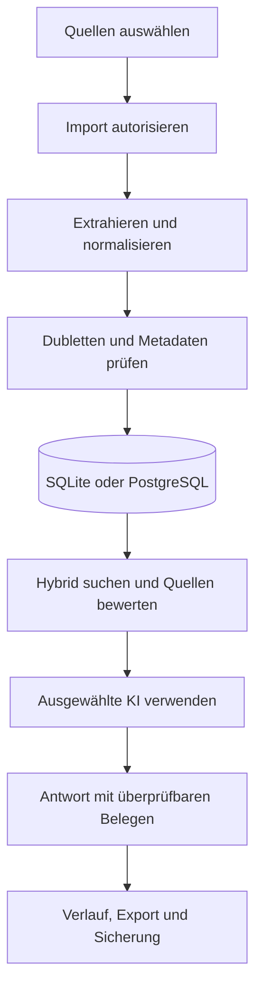

# Masterplan Wissensraum-AI

**Dokumentversion:** 1.9

**Stand:** 07.11.2026

**Produktstand:** 2.1 freigegeben am 05.11.2026 (Code-Stand `4957182`, Gate an `b0b41de`) · 2.0 abgenommen am 26.10.2026 (Code-Stand `84f9ecf`) · 1.9 freigegeben am 23.10.2026

**Repository:** `Melchy1971/Wissensraum-AI`

**Geprüfte Codebasis:** Letzter produktcodewirksamer Stand `4d2ecbe` (05.11.2026, Schritt 8A.1 Metadaten bearbeiten mit Verlauf, Schemaversion 12). Lokales Matrix-Gate an `7f6c43c`: 7 von 7 Jobs grün (`local-ci-gate-7f6c43c.md`); GitHub Actions für PR #8: 14 von 14 Checks grün. Davor `4957182` (05.11.2026, Chunk-Strategie je Dokumenttyp und Fundstellenanzeige, Schemaversion 11). Lokales Matrix-Gate an `b0b41de`: 7 von 7 Jobs grün (`local-ci-gate-b0b41de.md`); GitHub Actions für PR #7: 14 von 14 Checks grün. Davor `8bdd4f7` (03.11.2026, Schritt 7.4 Zweitabschnitt im erweiterten Antwortfenster): Lokales Matrix-Gate an `8bdd4f7`: 6 von 7 Jobs grün, windows-3.11 lokal durch Dateisperren des Virenscanners gestört; GitHub Actions für PR #6: 14 von 14 Checks grün (D-020). Davor: Lokales Matrix-Gate `tests/local_ci.py`: 7 von 7 Jobs grün an `5ca9021`, `4ef9545`, `6e1a9e3`, `ebd2475`, `72f0fbf`, `7b85460`, `3cb3aaa`, `d7decfe`, `c7ef78a` und `17aa5d2` (D-015, GitHub Actions ohne Budget). Vorheriger Abnahmestand `84f9ecf`: CI-Lauf [40185408996](https://github.com/Melchy1971/Wissensraum-AI/actions/runs/40185408996): alle sieben Jobs grün. Release 2.0 wurde am 26.10.2026 mit eigenen Daten abgenommen; nachfolgende Commits bis zu dieser Planaktualisierung betreffen ausschließlich README und Masterplan.

**Ablage:** Einziger Masterplan ist diese Datei `masterplan.md`. Die frühere Kopie `docs/masterplan.md` wurde am 22.10.2026 entfernt.

**Status:** Phasen- und Testplan · Release 1.9 freigegeben, Release 2.0 abgenommen 26.10.2026, Phasen 0 bis 6 ✅ · Release 2.0.1 (Soll-Umfang von Phase 6, D-013) abgenommen 26.10.2026, Phase 7 (Release 2.1) ✅, Release 2.1 freigegeben 05.11.2026 (D-021): 7.1 Evaluationsdatensatz ✅, 7.2a Vektorspeicher und Embedding-Adapter ✅, 7.2b Einbettung im Hintergrund ✅, 7.3 hybride Suche ✅, 7.4 Quellenabsicherung ✅ (eingefrorener Bestand V2 mit `qwen3:8b`: False Reject 3 von 66, False Accept 1 von 24 in zwei Läufen, synthetisch 9,3 % und 3,1 %), Chunk-Strategie je Dokumenttyp ✅ und Fundstellenanzeige ✅ (Gate 7 von 7 an `b0b41de`) · Phase 8A (Release 2.2 Wissensorganisation) ✅, Release 2.2 freigegeben 06.11.2026 (D-022, Tag `v2.2`): 8A.1 bis 8A.5 ✅, Schema 15, letztes Gate 7 von 7 an `2aadc5c` · Phase 8B (Release 2.3) ✅, Release 2.3 freigegeben 08.11.2026 (D-026, Tag `v2.3`): 8B.1 bis 8B.5 ✅, Graphkontext in Antworten nach Messung ❌ und standardmäßig aus (D-025), letztes Gate 7 von 7 an `bb8d1fe` · Phase 9 (Release 2.4) ✅, Release 2.4 freigegeben 08.11.2026 (D-027, Tag `v2.4`): 9.1 bis 9.6 ✅, Schema 18, Betriebsübung mit echten Daten bestanden

**Legende:** ✅ vollständig implementiert und gesamtes Gate nachweislich bestanden · 🟡 implementiert oder teilweise geprüft, aber noch nicht vollständig abgenommen · ❌ Gate fehlgeschlagen oder Freigabe blockiert · ⬜ geplant und noch nicht begonnen

## Aktualisierung 05.11.2026 (Mittag) – Phase 8A, Schritt 8A.1 Metadaten bearbeiten ✅

**Plan Phase 8A (freigegeben vom Product Owner 05.11.2026):** 8A.1 Metadaten bearbeiten mit Verlauf · 8A.2 Dokumentstatus, Verantwortlicher, Wiedervorlage, Ausschluss veralteter Inhalte aus KI-Antworten · 8A.3 Sammlungen, Favoriten, gespeicherte Suchen · 8A.4 Beziehungen zwischen Dokumenten, Vergleich zweier Fassungen · 8A.5 Export einer Sammlung mit Quellenmanifest. Jeder Schritt mit eigener Migration, Tests für beide Backends, Matrix-Gate 7 von 7 und eigenem PR.

**Umfang (`4d2ecbe`, README `2067c9d`, Test `7f6c43c`):** Schema 12 mit der Tabelle `metadata_changes` (Feld, alter und neuer Wert, Herkunft `manual`, `rule` oder `rule_revert`, Regellauf, Zeitpunkt; wird mit dem Dokument gelöscht), Migration für SQLite mit geprüfter Sicherung und für PostgreSQL unter Advisory Lock, Schema-Kataloge und `schema.sql` angepasst. `Store.update_metadata` ändert Titel, Bereich und Tags und protokolliert nur tatsächliche Änderungen; `Store.metadata_history` liefert den Verlauf mit UTC-Zeit auf beiden Backends. Regelläufe und ihre Rücknahme schreiben in denselben Verlauf. Oberfläche: Schaltfläche „Metadaten“ mit Bearbeitung und Verlauf; CLI: `edit` und `history`.

**Nachweise:** Gemeinsamer Vertrag `check_metadata_contract` (SQLite und PostgreSQL): Änderungen und Verlauf, Inhalt, Original, Hash und Dateiname unverändert, neuer Titel durchsuchbar, keine Einträge ohne tatsächliche Änderung, ungültige Eingaben ohne Spur, Regellauf und Rücknahme im Verlauf, Löschung entfernt den Verlauf. Dazu CLI- und Oberflächentest, Migrations- und Diagnosetests auf Schema 12. Lokales Matrix-Gate an `7f6c43c`: 7 von 7 grün. Windows 3.11, 3.12, 3.13 je 602 Tests bestanden, 32 übersprungen (windows-3.11 mit 7 wiederholten Tests nach WinError 145 beim Aufräumen); Linux 3.11, 3.12, 3.13 je 602 bestanden, 28 übersprungen; PostgreSQL 18.6 28 von 28. GitHub Actions für PR #8: 14 von 14 grün. Der erste PostgreSQL-Lauf an `2067c9d` scheiterte, weil zwei Tests gegen echtes PostgreSQL noch Schema 11 erwarteten; korrigiert in `7f6c43c`.

**Status:** 8A.1 ✅. Phase 8A 🟡, als Nächstes 8A.2.

## Aktualisierung 05.11.2026 (Nachmittag) – Phase 8A, Schritt 8A.2 Dokumentstatus und Wiedervorlage ✅

**Umfang:** Schema 13 ergänzt `documents` um `status` (`new`, `reviewed`, `outdated`, `archived`; Standard `new`), `owner` und `review_date` (ISO-Datum als Text), Migration für SQLite mit geprüfter Sicherung und für PostgreSQL unter Advisory Lock, Schema-Kataloge, Gesundheitsprüfung und `schema.sql` angepasst. `Store.update_metadata` ändert zusätzlich Status, Verantwortlichen und Wiedervorlage und protokolliert nur tatsächliche Änderungen in `metadata_changes`. `Store.due_reviews` listet fällige Wiedervorlagen. Volltext- und Vektorsuche erhalten den Filter `active_only`; `AI.ask` setzt ihn, solange die Einstellung `ai.exclude_retired` nicht ausgeschaltet ist (Standard: an). Die Suchliste zeigt weiterhin alle Dokumente. Oberfläche: Status, Verantwortlich und Wiedervorlage im Dialog „Metadaten“ und in der Detailansicht; CLI: `edit --status/--owner/--review-date`, `review-due`, `ai-retired`.

**Nachweise:** Gemeinsamer Vertrag `check_status_contract` (SQLite und PostgreSQL): Standardwerte nach Migration, Änderungen mit Verlauf, keine Einträge ohne Änderung, ungültiger Status, zu langer Verantwortlicher und ungültige Daten ohne Spur, fällige Wiedervorlagen, Volltext- und Vektorsuche mit und ohne Ausschluss, Rückkehr in die Antworten nach Statuswechsel, Einstellung an und aus. Dazu Test, dass `AI.ask` der Einstellung folgt, CLI- und Oberflächentest, Migrations- und Diagnosetests auf Schema 13. Recall auf V2: Der Bestand der Messung enthält nach der Migration ausschließlich Dokumente mit Status `new`; der Filter lässt damit jede Trefferliste unverändert, der Vertrag prüft genau diesen Fall (gleiche Treffer mit und ohne Ausschluss, solange kein Dokument veraltet oder archiviert ist).

**Gate:** Lokales Matrix-Gate an `046efaa`: 7 von 7 (`local-ci-gate-046efaa.md`). Windows 3.11, 3.12, 3.13 je 605 Tests bestanden, 33 übersprungen; windows-3.11 im ersten Lauf mit 13 Fehlern durch Dateisperren des Virenscanners beim Aufräumen, im Wiederholungslauf grün mit 17 wiederholten Tests (D-020). Linux 3.11, 3.12, 3.13 je 605 bestanden, 29 übersprungen; PostgreSQL 18.6 29 von 29. GitHub Actions für PR #9: 14 von 14 grün, gemergt als `21a8c1b`.

**Status:** 8A.2 ✅. Recall auf V2 am 06.11.2026 gemessen: unverändert (siehe Abnahme Release 2.2).

## Aktualisierung 05.11.2026 (Abend) – Phase 8A, Schritt 8A.3 Sammlungen, Favoriten, gespeicherte Suchen ✅

**Umfang:** Schema 14 mit den Tabellen `collections` (Name eindeutig ohne Rücksicht auf Groß- und Kleinschreibung), `collection_documents`, `favorites` und `saved_searches` (Name, Suchbegriff, optionaler Modus und Tag), Migration für SQLite mit geprüfter Sicherung und für PostgreSQL unter Advisory Lock, Kataloge und `schema.sql` angepasst. `Organization` (beide Backends) legt Sammlungen an, benennt sie um, löscht sie, nimmt Dokumente auf und entfernt sie, markiert Favoriten und speichert Suchen. `list` filtert nach Sammlung und Favoriten. Oberfläche: Auswahlfeld für alle Dokumente, Favoriten und Sammlungen (auch für die Suche), gespeicherte Suchen, Schaltflächen „Favorit“ und „Sammlungen“, Detailansicht mit Favorit und Sammlungen. CLI: `collections`, `collection-*`, `favorite`, `list --collection/--favorites`, `searches`, `search-save`, `search-delete`.

**Nachweise:** Gemeinsamer Vertrag `check_organization_contract` (SQLite und PostgreSQL): Namensregeln und Eindeutigkeit, Aufnahme ohne Doppelungen, unbekannte Dokumente und Sammlungen abgelehnt, Filter nach Sammlung und Favoriten, Ersetzen einer gespeicherten Suche gleichen Namens, ungültige Suchen abgelehnt, Dokumente unverändert, Löschen eines Dokuments entfernt es aus Sammlungen und Favoriten, Löschen einer Sammlung lässt Dokumente bestehen. Dazu CLI- und Oberflächentest, Migrations- und Diagnosetests auf Schema 14.

**Gate:** Lokales Matrix-Gate an `10253b7`: 7 von 7 (`local-ci-gate-10253b7.md`). Windows 3.11, 3.12, 3.13 je 609 Tests bestanden, 34 übersprungen (windows-3.11 mit 13 wiederholten Tests nach Dateisperren des Virenscanners); Linux 3.11, 3.12, 3.13 je 609 bestanden, 30 übersprungen; PostgreSQL 18.6 30 von 30. GitHub Actions für PR #10: 14 von 14 grün.

**Status:** 8A.3 ✅.

## Aktualisierung 05.11.2026 (Abend) – Phase 8A, Schritt 8A.4 Beziehungen und Fassungsvergleich ✅

**Umfang:** Schema 15 mit der Tabelle `document_relations` (Quelle, Ziel, Art `references`, `supersedes` oder `related`, Notiz; je Paar und Art eindeutig, `related` ohne Richtung mit der kleineren Kennung als Quelle), Migration für SQLite mit geprüfter Sicherung und für PostgreSQL unter Advisory Lock, Kataloge und `schema.sql` angepasst. `Relations` (beide Backends): `relate`, `unrelate`, `relations` aus Sicht eines Dokuments, `compare` als zeilenweiser Vergleich zweier Dokumente (difflib, höchstens 2.000 Zeilen). Anlegen und Entfernen einer Beziehung stehen im Metadatenverlauf (`relation`). Oberfläche: Dialog „Beziehungen“; im Dialog „Versionen“ Vergleich zweier markierter Versionen mit farbigen Zeilen. CLI: `relate`, `unrelate`, `relations`, `compare`.

**Nachweise:** Gemeinsamer Vertrag `check_relations_contract` (SQLite und PostgreSQL): Richtung je Art, Notiz normalisiert, doppelte und ungültige Beziehungen abgelehnt (auch Selbstbezug und unbekanntes Dokument), Verlauf bei Anlegen und Entfernen, Dokumente unverändert, Löschen eines Dokuments entfernt seine Beziehungen, Vergleich zweier Versionen mit Zählung und identischer Fassung. Dazu Test der Begrenzung, CLI- und Oberflächentests, Migrations- und Diagnosetests auf Schema 15.

**Gate:** Lokales Matrix-Gate an `9fc8ba9`: 7 von 7 (`local-ci-gate-9fc8ba9.md`). Linux 3.11, 3.12, 3.13 je 614 Tests bestanden, 31 übersprungen; PostgreSQL 18.6 31 von 31; Windows 3.11, 3.12, 3.13 je 614 bestanden, 35 übersprungen (windows-3.11 mit 9 wiederholten Tests nach Dateisperren des Virenscanners). GitHub Actions für PR #11: 14 von 14 grün.

**Status:** 8A.4 ✅.

## Aktualisierung 06.11.2026 – Phase 8A, Schritt 8A.5 Sammlungsexport mit Quellenmanifest ✅

**Umfang:** Ohne Schemaänderung. `Organization.export_collection` schreibt eine Sammlung als ZIP-Archiv: alle Originale bytegetreu (Notizen als UTF-8-Text) unter `dokumente/` mit bereinigtem, nummeriertem Dateinamen und `manifest.json` (Format `wissensraum-sammlung` Version 1, Schemaversion, Exportzeit UTC, Metadaten je Dokument, Quelltyp und ursprünglicher Dateiname ohne Fundort, Größe und SHA-256 jeder Datei, Hash des gespeicherten Textes, Beziehungen innerhalb der Sammlung). Schreiben über eine temporäre Datei mit `os.replace`; eine vorhandene Zieldatei wird nur ausdrücklich ersetzt. Oberfläche: „Exportieren“ im Dialog „Sammlungen“; CLI: `collection-export`.

**Nachweise:** Gemeinsamer Vertrag `check_export_contract` (SQLite und PostgreSQL): Archivinhalt und Dateinamen, jede Datei mit Größe und SHA-256 laut Manifest, Original bytegetreu, Notiz als Text, Metadaten und Quelltyp, Beziehungen nach außen ausgelassen, kein Überschreiben ohne Freigabe, unbekannte Sammlung ohne Datei und ohne temporäre Reste, leere Sammlung. Dazu CLI- und Oberflächentest.

**Gate:** Lokales Matrix-Gate an `84184d2`: 7 von 7 (`local-ci-gate-84184d2.md`). Windows 3.11, 3.12, 3.13 je 616 Tests bestanden, 36 übersprungen (windows-3.11 mit 9 wiederholten Tests nach Dateisperren des Virenscanners); Linux 3.11, 3.12, 3.13 je 616 bestanden, 32 übersprungen; PostgreSQL 18.6 32 von 32. GitHub Actions für PR #12: 14 von 14 grün, gemergt als `527491c`.

**Status:** 8A.5 ✅. Alle Schritte 8A.1 bis 8A.5 sind umgesetzt und je mit Gate 7 von 7 und grüner GitHub-CI abgenommen. Phase 8A ✅, Release 2.2 freigegeben 06.11.2026 (D-022).

**Offene Punkte für die Abnahme von Release 2.2 (Entscheidungen Product Owner 06.11.2026):**
- Verlauf für Sammlungen und Favoriten ergänzen: umgesetzt (`2aadc5c`). Aufnahme in und Entfernen aus einer Sammlung, Umbenennen und Löschen einer Sammlung sowie Setzen und Entfernen eines Favoriten stehen im Metadatenverlauf jedes betroffenen Dokuments (Felder `collection` und `favorite`, nur tatsächliche Änderungen). Gemeinsamer Vertrag `check_organization_contract` prüft die Einträge auf beiden Backends. Lokales Matrix-Gate an `2aadc5c`: 7 von 7 (`local-ci-gate-2aadc5c.md`), Windows und Linux je 616 Tests, PostgreSQL 32; windows-3.11 im ersten Lauf mit 6 Fehlern nur beim Aufräumen (Virenscanner), im Wiederholungslauf grün mit 9 wiederholten Tests.
- Ausschluss auf V2 gemessen (06.11.2026, nur Suche ohne Antwortmodell, Messkopie danach gelöscht): 90 Fragen, alle Bestandsdokumente nach Migration `new`. Recall@10 63 von 66 ohne und mit Ausschluss, 0 von 90 Trefferlisten verschieden. Nach Markieren der 2 erwarteten Dokumente der Fragen e01 bis e11 (ohne e07) als veraltet fanden ohne Ausschluss alle 10 Fragen sie weiter, mit Ausschluss enthielt keine der 90 Trefferlisten sie.
- Manuelle Prüfung der Dialoge Metadaten, Sammlungen, Beziehungen, Versionsvergleich und Export am Desktop: durch den Product Owner bestanden (06.11.2026).

## Aktualisierung 08.11.2026 – Phase 8B, Messung mit gefülltem Graphen ❌ für den Graphkontext

**Aufbau:** Frische Kopie des eingefrorenen Messbestands (`data/messbestand-phase7.db`, SHA-256 beginnt mit `0385f8ee`), für alle 55 Dokumente KI-Vorschläge über das lokale `qwen3:8b` (Ollama exklusiv, GPU frei), danach alle Vorschläge bestätigt: 349 Abschnitte, 14 ohne verwertbare Antwort (Lauf ging mit dem Fix aus PR #23 weiter), 907 Entitäten, 1.224 Erwähnungen, 474 Relationen bestätigt, 1.035 Vorschläge mangels wörtlichem Beleg oder unbekannter Art verworfen, 98 Minuten. Dann V2 (90 eigene Fragen, davon 82 mit Quelle im Bestand: 58 beantwortbar, 24 Ausschluss) mit `qwen3:8b`, Graphkontext aus und an, je zwei Läufe. Messkopien danach gelöscht; behalten werden nur Zählungen, Kennzahlen und Frage-IDs (lokal, `data/graph-messung-2026-11-08/`).

| Kennzahl | Graphkontext aus | Graphkontext an |
|---|---:|---:|
| False Reject (höchstens 5 von 58) | 3 (e04, e11, e53; Modell verweigert) | 4 (e09, e11, e41 Modell verweigert; e24 ohne Quellenkennung) |
| False Accept (höchstens 1 von 24) | 1 (e12) | **2 (e12, e86)** |
| Antwort mit gültiger Quelle | 56/56 | 56/56 |
| Erwartete Hauptquelle zitiert | 47/55 | 48/54 |
| Antwortzeit p50 / p95 (Lauf 1) | 22,8 s / 34,0 s | 21,7 s / 35,1 s |
| Prompt-Token im Mittel | 4.799 | 4.816 |
| Gleiche Einstufung Lauf 1 und 2 | 82/82 | 82/82 |

**Befund:** Beide Läufe sind je Variante in allen 82 Fragen identisch; die Unterschiede zwischen aus und an kommen aus dem Graphkontext, nicht aus Streuung. Ohne Graphkontext hält das Gate wie bei Release 2.1. Mit Graphkontext verfehlt es die Grenze für False Accept (2 statt höchstens 1, Ausschlussfrage e86 wird beantwortet) und eine beantwortbare Frage (e24) endet ohne Quellenkennung; zwei Fragen (e04, e53) werden mit Graph beantwortet, zwei andere (e09, e41) verweigert. Der Graphkontext verschiebt also Antworten, verbessert die Quellenlage aber nicht messbar. Der Hauptquellen-Anteil von 95 % (im Skript als `passed: false`) ist mit D-021 entfallen und hier nicht maßgeblich.

**Folge:** Der Graphkontext in Antworten ist nach dem Gate von 8B.5 nicht abnahmefähig (❌). Entscheidung des Product Owners 08.11.2026 (D-025): Graphkontext standardmäßig aus, Release 2.3 ohne Graphkontext in Antworten abnehmen. `ai.graph_context` gilt nur noch mit dem Wert `1` als eingeschaltet; ohne Einstellung ist die Anfrage die von Release 2.1. Wissensgraph, KI-Vorschläge, Zusammenführen, Trennen und Graphansicht bleiben Teil von 2.3. Ein verbesserter Graphkontext (zum Beispiel nur Relationen mit Bezug zu den gefundenen Abschnitten, kürzere Belege) braucht eine neue Messung und eine eigene Freigabe.

**Messskripte (lokal, nicht im Repository):** Vor der Messung korrigiert, weil sie sonst nach Stunden nichts Verwertbares geliefert hätten: `--json` fehlte beim Aufruf von `evaluate.py`, die Kennzahlen je Frage wurden unter falschen Schlüsseln gesucht, und unter Windows schreibt `python -I` die Ausgabe in der Konsolen-Codepage; die Rohdaten wurden nachträglich als cp1252 gelesen, verloren ging nichts.

## Aktualisierung 07.11.2026 – Phase 9, Schritt 9.6 Datenschutzexport und selektive Löschung ✅

**Umfang 9.6:** Neues Modul `privacy.py`, kein neues Schema. Export: alle Anwendungstabellen außer den abgeleiteten (`chunks`, `chunk_vectors`) als JSON, Binärwerte als Dateien, Manifest; Datei entsteht vollständig oder gar nicht. Selektive Löschung: Suche nach Text in Titel, Dateiname oder Inhalt (Platzhalterzeichen wörtlich), Vorschau der Folgen, Löschung in einer Transaktion samt Abschnitten, Volltexteinträgen, Vektoren, Versionen, Tags, Beziehungen, Graph-Erwähnungen und -Relationen, verwaisten Entitäten und deren Protokolleinträgen, KI-Antworten mit Zitat der Dokumente (beide Speicherformate) und Importeinträgen. SQLite: `secure_delete`, FTS5 `optimize` und `wal_checkpoint(TRUNCATE)`; die Meldung nennt die Zahl der Sicherungen, die die Daten noch enthalten. PostgreSQL: Freigabe über Autovacuum, dokumentiert. Oberfläche: Einstellungsseite „Datenschutz“; CLI `privacy-export`, `privacy-find`, `privacy-erase --confirm`.

**Nachweise:** Gemeinsamer Vertrag `check_privacy_contract` (SQLite und PostgreSQL): Suche ohne Rücksicht auf Groß- und Kleinschreibung und mit wörtlichen Platzhaltern, Folgenvorschau, Ablehnung unbekannter Nummern ohne Teillöschung, vollständige Löschung des Abgeleiteten, unbeteiligtes Dokument und seine KI-Antwort bleiben, Volltextsuche findet nichts mehr. SQLite: gelöschter Text steht weder in Datei, WAL noch Volltextindex. Export mit allen Tabellen und Originalen, ohne abgeleitete Tabellen, ohne Restdatei. CLI mit Pflichtbestätigung, Oberflächentest. Linux Python 3.13: 673 Tests, 0 Fehler, 42 übersprungen (umgebungsbedingt). gitleaks ohne Fund.

**Offen für die Phasenabnahme:** Gesamtübung (Sicherung, Wiederherstellung, Sicherheitsprüfung, Datenschutzexport) mit den echten Daten des Product Owners; Bestätigung der Annahmen aus 9.2 und 9.4.

**Gate:** Lokales Matrix-Gate an `84e5dc1`: 7 Jobs, windows-3.11 nur mit Aufräumfehlern durch fremde `*.DB-SHM.tmp`-Dateien des Virenscanners, damit nach D-020 über GitHub Actions nachgewiesen (`local-ci-gate-84e5dc1.md`); Windows und Linux je 673 Tests, PostgreSQL 42. GitHub Actions für PR #29 einschließlich `Security`: alle Jobs grün.

**Status:** 9.6 ✅.

## Aktualisierung 07.11.2026 – Phase 9, Schritt 9.5 Sicherheitsprüfungen in CI, SBOM, signierte Release-Artefakte ✅

**Umfang 9.5:** Workflow `security.yml` (Push, Pull Request, Aufruf aus dem Release): `pip-audit` 2.10.1 für `requirements-ocr.txt` mit allen abhängigen Paketen und `requirements-pst.txt`; `gitleaks` 8.28.0 (Prüfsumme festgelegt) über die gesamte Historie mit `.gitleaks.toml`, die nur die vier synthetischen Testwerte ausnimmt; `bandit` 1.9.4, hohe Schwere blockiert, Gesamtbericht als Artefakt; CycloneDX-Stückliste aus einer Umgebung mit genau den Anwendungsabhängigkeiten. Workflow `release.yml` für Tags `v*`: Tests und Sicherheitsprüfungen als Voraussetzung, dann Quellarchiv, Stückliste und Prüfsummenliste, schlüssellose Sigstore-Signatur (`sigstore/gh-action-sigstore-python` v3.5.0, an den Commit gebunden) und GitHub-Release mit Bündeln; manueller Start als Probelauf ohne Release. `tests.yml` zusätzlich aufrufbar, Push-Auslöser auf Branches begrenzt.

**Befunde und Korrekturen:** `pip-audit` meldete für den bisherigen Stand 67 Schwachstellen in pypdf 6.10.0 und 39 in Pillow 12.3.0 (beide verarbeiten importierte, unvertrauenswürdige Dateien). Angehoben auf pypdf 6.21.4 und Pillow 13.0.0, danach keine bekannten Schwachstellen. `gitleaks` fand 9 Stellen, alle synthetische Testwerte; Gegenprobe mit einem echt aussehenden Schlüssel schlägt weiterhin an. `bandit`: keine hohe Schwere; 46 mittlere Funde geprüft: 45 × B608 (f-String mit festen Tabellen- und Spaltennamen aus Konstanten, Werte immer parametrisiert), 1 × B310 (`urlopen` in `importer._graph_get`, vorher auf `https://graph.microsoft.com` beschränkt). Keine Änderung nötig.

**Nachweise:** Lokal mit denselben Versionen: `pip-audit` sauber, `gitleaks git` und `gitleaks dir` ohne Fund, `bandit -lll` ohne Fund, Stückliste CycloneDX 1.6 mit 34 Komponenten. Testsuite mit den neuen Bibliotheksversionen im Matrix-Gate. Die Release-Signatur lässt sich erst mit einem Tag oder manuellem Start auf GitHub nachweisen.

**Gate:** Lokales Matrix-Gate an `f2d754e`: 7 von 7 (`local-ci-gate-f2d754e.md`), Windows und Linux je 667 Tests mit pypdf 6.21.4 und Pillow 13.0.0, PostgreSQL 41. GitHub Actions für PR #28: Tests und `Security` (dependencies, secrets, code, sbom) grün. Release-Signatur noch nicht auf GitHub ausgeführt (erst mit Tag oder manuellem Probelauf).

**Status:** 9.5 ✅. Signatur nachgewiesen am 08.11.2026: manueller Probelauf von `Release` (Lauf 42422799489 an `f307864`) mit grünen Tests und Sicherheitsprüfungen; Quellarchiv, Stückliste und `SHA256SUMS.txt` mit `sigstore verify github` gegen die Identität `…/.github/workflows/release.yml@refs/heads/main` erfolgreich geprüft, Prüfsummen stimmen. Gegenproben: veränderte Datei und falsche Workflow-Identität werden abgelehnt.

## Aktualisierung 07.11.2026 – Phase 9, Schritt 9.4 Integritätsprüfung, tägliche Sicherung, Wiederherstellungsübung ✅

**Umfang 9.4:** Neues Modul `backups.py`, kein neues Schema (Einstellungen in `settings`). Integritätsprüfung: SQLite `integrity_check`, Fremdschlüssel, `validate_sqlite` und Prüfsumme jedes Dokuments; PostgreSQL Schemaversion und Prüfsummen; Ergebnis nur mit Zählungen und Dokumentnummern. Tägliche Sicherung (SQLite): Kopie über die Backup-API in eine temporäre Datei, Prüfung von Struktur, Schema und Prüfsummen, erst dann Umbenennen in `wissen-<Zeitstempel>.db`; Aufräumen auf die neuesten N Dateien dieses Musters; Abbruch bei weniger als doppelter Datenbankgröße frei. Auslösung in der Oberfläche eine Minute nach Start und danach stündlich im eigenen Thread, wenn die letzte Sicherung 24 Stunden oder älter ist; CLI `backup-daily` für die Aufgabenplanung. Wiederherstellungsübung: neueste Sicherung über `restore_sqlite` in eine temporäre Datei, Prüfung, Messung der Dauer gegen 2 Stunden, Ergebnis gespeichert; die aktive Datenbank bleibt unberührt. Betriebsübersicht zeigt Alter der Sicherung (RPO) und letzte Übung, Warnung nach 24 Stunden bzw. 90 Tagen. PostgreSQL: Sicherung und Übung weiter mit pg_dump und pg_restore auf dem Server, in der Anwendung nur Integritätsprüfung. Oberfläche im Reiter „Betrieb“, CLI `integrity`, `backup-daily [--force]`, `restore-drill`, `backup-settings`.

**Annahmen (vom Product Owner zu bestätigen):** Automatische Sicherung standardmäßig an, Ordner `backups` neben der Datenbank, 7 Sicherungen behalten, Übung manuell mit Erinnerung nach 90 Tagen.

**Nachweise:** `check_integrity_contract` (SQLite und PostgreSQL) mit manipulierter Prüfsumme; beschädigte Datei wird als Befund gemeldet statt abzubrechen; Sicherung geprüft, fällig nach 24 Stunden, Aufräumen auf N, keine Restdateien, Automatik aus, Speicherplatzgrenze, anderer Ordner; Übung bestanden, aktive Datenbank unberührt, Fälligkeit nach 90 Tagen; Übersicht ohne Pfade; CLI- und Oberflächentest. Linux Python 3.13: 667 Tests, 0 Fehler, 41 übersprungen (umgebungsbedingt).

**Offen für die Phasenabnahme:** Gesamtübung nach Gate von Phase 9 (Sicherung, Wiederherstellung, Sicherheitsprüfung und Datenschutzexport in einem Durchgang) mit den echten Daten des Product Owners.

**Gate:** Lokales Matrix-Gate an `98b7ea1`: windows-3.11 nur mit Aufräumfehlern durch fremde `*.DB-SHM.tmp`-Dateien (D-020, über GitHub Actions nachgewiesen), übrige 6 Jobs grün (`local-ci-gate-98b7ea1.md`); Windows und Linux je 667 Tests, PostgreSQL 41. GitHub Actions für PR #27: alle Jobs grün.

**Status:** 9.4 ✅.

## Aktualisierung 07.11.2026 – Phase 9, Schritt 9.3 Aufbewahrungsregeln ✅

**Umfang 9.3:** Neues Modul `retention.py`, kein neues Schema (Regeln in `settings`). Vier Kategorien mit Aufbewahrung in Tagen, 0 = unbegrenzt (Voreinstellung): KI-Verlauf (`ai_runs`), KI-Nutzungszählung (`ai_usage`, laufender Monat bleibt immer), Fehlereinträge von Importaufträgen (`import_item_errors`), gelöschte Objekte und Änderungsprotokoll des Wissensgraphen (`graph_relations`, `entity_mentions`, `entities` mit `deleted_at`, `graph_changes`). Anwenden nur auf ausdrückliche Bestätigung nach Vorschau, in einer Transaktion. SQLite: `secure_delete` für die Löschung und anschließend `wal_checkpoint(TRUNCATE)`, damit entfernter Text nicht in Datei oder WAL lesbar bleibt. PostgreSQL: Freigabe über Autovacuum, dokumentiert. Oberfläche: Einstellungsseite „Aufbewahrung“ mit Vorschau und „Jetzt anwenden …“ mit Bestätigung. CLI: `retention [kategorie --days N] [--apply --confirm]`. Dokumente, Metadatenverlauf und Sammlungen sind ausgenommen; die selektive Löschung von Inhalten folgt mit 9.6.

**Nachweise:** Gemeinsamer Vertrag `check_retention_contract` (SQLite und PostgreSQL): ohne Regel wird nichts entfernt, Vorschau entfernt nichts, Anwenden entfernt genau die Vorschau, Bestandteile in Gebrauch bleiben, laufender Budgetmonat bleibt auch bei einem Tag Frist, ungültige Werte abgelehnt. SQLite: entfernter Text steht danach weder in der Datenbankdatei noch im WAL. Dazu CLI mit Pflichtbestätigung und Oberflächentest (Ablehnen entfernt nichts, ungültige Eingabe speichert nichts). Linux Python 3.13: 658 Tests, 0 Fehler, 40 übersprungen (umgebungsbedingt).

**Gate:** Lokales Matrix-Gate an `dd9f51c`: windows-3.11 nur mit Aufräumfehlern (D-020, über GitHub Actions nachgewiesen), übrige 6 Jobs grün (`local-ci-gate-dd9f51c.md`); Windows und Linux je 658 Tests, PostgreSQL 40. Zwei Testkorrekturen vor dem Gate: LIKE-Muster als Parameter (psycopg) und Zeitstempel mit UTC-Angabe (PostgreSQL-Sitzungszeitzone). GitHub Actions für PR #26: alle Jobs grün.

**Status:** 9.3 ✅.

## Aktualisierung 07.11.2026 – Phase 9, Schritt 9.2 Token- und Kostenbudgets je Anbieter ✅

**Umfang 9.2:** Schema 18 mit Tabelle `ai_usage` (Anbieter, Modell, Eingabe- und Ausgabe-Token, Zeitpunkt, kein Text), Migration für SQLite mit geprüfter Sicherung und für PostgreSQL unter Advisory Lock, Kataloge und `schema.sql` angepasst. Neues Modul `budgets.py`: Jede Antwort eines Anbieters wird mit den von ihm gemeldeten Tokenzahlen gezählt (OpenAI, Anthropic, Gemini einschließlich Denktoken, Ollama), auch abgeschnittene Antworten. Budget je Anbieter und Kalendermonat (UTC) in Token und optional in Euro mit selbst eingetragenen Preisen je 1 Million Token; 0 bedeutet ohne Grenze. Ab 80 % Warnung, ab 100 % lehnt `AI._request` jede weitere Anfrage an diesen Anbieter vor dem Senden ab (`ProviderError` der Art `budget`, ohne Wiederholung); die KI-Vorschläge für den Wissensgraphen enden dann sofort. Eine laufende Anfrage wird nicht abgebrochen, das Budget kann um eine Antwort überschritten werden. Einbettungen der semantischen Suche werden nicht gezählt. Oberfläche: Einstellungsseite „Budgets“, Monatsstand in der Betriebsübersicht. CLI: `budget [anbieter] [--tokens N] [--eur X] [--price-in X] [--price-out Y]`.

**Annahmen (vom Product Owner zu bestätigen, jederzeit änderbar):** Zeitraum Kalendermonat in UTC, Warnschwelle 80 %, harte Sperre bei 100 % ohne Ausnahmeschalter, keine eingebauten Preise.

**Nachweise:** Gemeinsamer Vertrag `check_budget_contract` (SQLite und PostgreSQL): Zählung, Monatsgrenze, Warnung, Sperre je Anbieter, Eurobudget über Preise, Prüfung ungültiger Werte, kein Inhalt in `ai_usage`. Dazu Auswertung der Tokenangaben aller Anbieter einschließlich fehlerhafter Werte, Sperre vor dem Senden ohne Wiederholung, Abbruch der Graphvorschläge, deutsche Ausgabe, CLI- und Oberflächentest. Migrations-, Diagnose- und Resettests auf Schema 18. Linux Python 3.13: 653 Tests, 0 Fehler, 39 übersprungen (umgebungsbedingt).

**Gate:** Lokales Matrix-Gate an `a5177e0`: 7 von 7 (`local-ci-gate-a5177e0.md`), Windows und Linux je 653 Tests, PostgreSQL 39. Korrektur vor dem Gate: Versionsliste im PostgreSQL-Test folgt jetzt `CURRENT_SCHEMA_VERSION`. GitHub Actions für PR #25: alle Jobs grün.

**Status:** 9.2 ✅.

## Aktualisierung 07.11.2026 – Phase 9, Schritt 9.1 Betriebsübersicht ✅

**Plan Phase 9 (freigegeben vom Product Owner 06.11.2026, Beginn vor der Abnahme von Release 2.3 ausdrücklich freigegeben):** 9.1 Betriebsübersicht (Importfehler, Datenmenge, Vektorstand, KI-Nutzung) · 9.2 Token- und Kostenbudgets je Anbieter mit Sperre bei Überschreitung · 9.3 Aufbewahrungsregeln für KI-Verlauf und gelöschte Inhalte · 9.4 Integritätsprüfung, tägliche Sicherung (RPO 24 h) und Wiederherstellungsübung (RTO 2 h) · 9.5 Sicherheitsprüfungen in CI (Abhängigkeiten, Secrets, Code) mit Software-Stückliste und signierten Release-Artefakten · 9.6 Datenschutzexport und selektive Löschung. Jeder Schritt mit Tests für beide Backends, Matrix-Gate 7 von 7 und eigenem PR. Signatur über Sigstore in GitHub Actions (D-024).

**Umfang 9.1:** Neues Modul `operations.py` mit `overview` (beide Backends über denselben Speicherzugriff) und `report`. Erfasst werden Dokumente nach Status und Quelle, Textumfang und Größe der Originale, fällige Wiedervorlagen, Abschnitte, Vektoren je Modell und Abschnitte ohne Vektor, Importaufträge und Einträge nach Status, Importfehler im Zeitraum nach Fehlercode, KI-Anfragen im Zeitraum nach Art, Modell, Antwortstatus und mit Graphkontext sowie Entitäten und Relationen nach Status. Zeitraum 1 bis 3.650 Tage, Standard 30. Ausgegeben werden nur Zahlen, Status und Fehlercodes, keine Titel, Texte, Fragen, Antworten, Pfade oder Fehlermeldungen. Oberfläche: Reiter „Betrieb“ mit Zeitraum, Aktualisieren und JSON-Export. CLI: `overview [--days N] [--json]`. Kein neues Schema. Suchqualität ist nicht Teil der Übersicht; sie wird weiter mit `tests/eval` auf dem eingefrorenen Bestand V2 gemessen, die Übersicht zeigt dafür den Antwortstatus der KI-Anfragen. Tokenverbrauch wird bisher nicht gespeichert und folgt mit 9.2.

**Nachweise:** Gemeinsamer Vertrag `check_operations_contract` (SQLite und PostgreSQL): Zählungen je Bereich, Zeitraumfilter für Importfehler und KI-Anfragen, Begrenzung auf 3.650 Tage, kein Titel-, Text-, Fragen-, Pfad- oder Meldungsinhalt in Bericht und JSON. Dazu Test der deutschen Zahlenformatierung, der Wiedervorlage zum angegebenen Tag und Oberflächentest des Reiters mit JSON-Export. Linux Python 3.13: 645 Tests, 0 Fehler, 38 übersprungen (umgebungsbedingt, unter anderem PostgreSQL ohne Wegwerf-Cluster).

**Gate:** Lokales Matrix-Gate an `fa1659d`: 7 von 7 (`local-ci-gate-fa1659d.md`), Windows und Linux je 645 Tests, PostgreSQL 38. GitHub Actions für PR #24: alle Jobs grün.

**Status:** 9.1 ✅.

## Aktualisierung 06.11.2026 – Phase 8B, Schritt 8B.1 Datenmodell des Wissensgraphen ✅

**Plan Phase 8B (freigegeben vom Product Owner 06.11.2026):** 8B.1 Datenmodell (konfigurierbare Entitäts- und Relationsarten, Pflichtbeleg mit Textstelle, Protokoll und Rücknahme, manuelles Anlegen) · 8B.2 KI-Vorschläge (bleiben ungeprüft bis zur Bestätigung, Zitat muss wörtlich im Abschnitt stehen) · 8B.3 Zusammenführen und Trennen von Entitäten · 8B.4 Graphansicht mit Filtern · 8B.5 Graphkontext als begrenzte RAG-Quelle mit V2-Messung. Jeder Schritt mit eigener Migration, Tests für beide Backends, Matrix-Gate 7 von 7 und eigenem PR. Speicherung in Tabellen von SQLite und PostgreSQL, kein separater Graphserver (D-023). KI-Vorschläge nur mit lokalem Ollama (D-023).

**Umfang 8B.1:** Schema 16 mit `entity_types` und `relation_types` (je fünf deutsche Startwerte), `entities`, `entity_mentions` und `graph_relations` (Beleg als Dokument, Start, Ende und wörtliches Zitat, bei Relationen Pflichtspalten), `graph_changes`. Migration für SQLite mit geprüfter Sicherung und für PostgreSQL unter Advisory Lock, Kataloge und `schema.sql` angepasst. `Graph` (beide Backends): Arten anlegen, umbenennen, löschen nur ohne Verwendung; Entitäten mit erster Erwähnung anlegen, umbenennen, Erwähnungen ergänzen, Relationen mit Beleg anlegen; Entitäten, Erwähnungen und Relationen werden nur als gelöscht markiert; jede Änderung steht in `graph_changes` und lässt sich einmal zurücknehmen. Oberfläche: Dialog „Wissensgraph“ mit Beleg aus der Markierung in der Detailansicht, Änderungsliste mit Rücknahme. CLI-Befehle für Arten, Entitäten, Relationen, Änderungen und Rücknahme.

**Nachweise:** Gemeinsamer Vertrag `check_graph_contract` (SQLite und PostgreSQL): Startkataloge, Belege nur wörtlich und an der angegebenen Stelle, doppelte und ungültige Entitäten und Relationen abgelehnt, Selbstbezug abgelehnt, Detail- und Dokumentsicht, Suche nach Name und Art, Löschen und Rücknahme von Entität, Relation und Umbenennung, Rücknahme nur einmal, Arten nur ohne Verwendung löschbar, Dokument unverändert, Löschen des Belegdokuments entfernt Erwähnungen und Relationen. Dazu CLI- und Oberflächentest, Migrations- und Diagnosetests auf Schema 16, Reset-Test auf PostgreSQL mit den beiden Startkatalogen.

**Gate:** Lokales Matrix-Gate an `1f759a0`: 7 von 7 (`local-ci-gate-1f759a0.md`), Windows und Linux je 620 Tests, PostgreSQL 33. GitHub Actions für PR #16: 14 von 14 grün.

**Status:** 8B.1 ✅.

## Aktualisierung 06.11.2026 – Phase 8B, Schritt 8B.5 Graphkontext als begrenzte RAG-Quelle ✅

**Umfang:** Ohne Schemaänderung. `graph_context` liefert bestätigte Relationen zwischen bestätigten Entitäten mit Beleg in den Dokumenten der ausgewählten Abschnitte (höchstens 8, Zitat höchstens 200 Zeichen). `AI.answer` reserviert 600 Token in beiden Fenstern und übergibt das Feld `graphkontext` mit der Kennung der Belegquelle und Regel 9, aber nur, wenn die Einstellung `ai.graph_context` an ist (Standard) und mindestens eine bestätigte Relation existiert; sonst bleibt die Anfrage Zeichen für Zeichen die von Release 2.1. Der KI-Verlauf speichert die verwendeten Relationen. CLI: `ai-graph`.

**Nachweise:** Gemeinsamer Vertrag `check_graph_context_contract` (SQLite und PostgreSQL): nur bestätigte Relationen und Entitäten, nur Belegdokumente aus den Quellen, Einstellung an und aus. Dazu: Eingabe ohne Graph unverändert, Relation ohne übergebene Quelle entfällt, Anfrage ohne bestätigte Relation identisch mit Release 2.1 (Anweisungen und Eingabe), mit Relation Feld, Kennung, Regel und Protokoll, ungeprüfte Relation nie im Kontext, Obergrenze, CLI-Schalter. Lokal: Linux 639 Tests, PostgreSQL 37 grün.

**V2-Messung:** Der eingefrorene Bestand V2 enthält keinen Wissensgraphen. Damit ist die Anfrage für alle 90 Fragen mit der von Release 2.1 identisch, belegt durch den Test der identischen Anfrage; False Reject und False Accept sind dadurch unverändert. Eine Messung mit gefülltem Graphen setzt bestätigte Relationen im Bestand des Product Owners voraus und ist offen.

**Gate:** Lokales Matrix-Gate an `bee716a`: 7 von 7 (`local-ci-gate-bee716a.md`), Windows und Linux je 639 Tests, PostgreSQL 37. GitHub Actions für PR #20: 14 von 14 grün, windows-3.12 im zweiten Lauf (zeitabhängiger Test `test_sqlite_migrations_serialize_across_spawned_processes`, Wartezeit 10 Sekunden auf dem GitHub-Rechner überschritten).

**Status:** 8B.5 ✅. Alle Schritte 8B.1 bis 8B.5 sind umgesetzt und je mit Gate 7 von 7 und grüner GitHub-CI abgenommen. Release 2.3 am 08.11.2026 freigegeben (D-026), Graphkontext in Antworten nach D-025 standardmäßig aus.

**Abnahme von Release 2.3 (08.11.2026, D-026):** Oberfläche vom Product Owner bestätigt (06.11.2026), Messung mit gefülltem Graphen durchgeführt (Graphkontext ❌, daher nach D-025 standardmäßig aus), letztes Gate 7 von 7 an `bb8d1fe` ohne Aufräumfehler (`local-ci-gate-bb8d1fe.md`, Windows und Linux je 674 Tests, PostgreSQL 42). Tag `v2.3` auf `main`. Hinweis: `main` enthält zu diesem Zeitpunkt bereits Phase 9 (Schema 18); deren Funktionen sind erst mit Release 2.4 abgenommen.

**Vor der Abnahme offene Punkte (Stand 07.11.2026):**
- Manuelle Prüfung am Desktop: Oberfläche vom Product Owner am 06.11.2026 als sichtbar bestätigt; Durchgang durch Dialog „Wissensgraph“ und „Graphansicht“ mit eigenen Daten steht aus.
- Graphkontext mit gefülltem Graphen ❌ (Messung 08.11.2026); nach D-025 standardmäßig aus und nicht Teil der Abnahme von 2.3.
- Zeitabhängige Tests: `test_sqlite_migrations_serialize_across_spawned_processes` (GitHub, 10 Sekunden), `test_import_lock_blocks_an_independent_process_and_releases_after_exit` (lokal windows-3.12) und ein Hänger in `test_matrix_for_50000_vectors_stays_below_200_mib` (lokal windows-3.12) traten je einmal auf; sie berühren den Graphen nicht. Die beiden prozessbasierten Tests warten seit 07.11.2026 bis zu 30 bzw. 60 Sekunden auf den Kindprozess (vorher 5 bzw. 10); ein bestandener Test endet weiter, sobald der Prozess fertig ist. Für den Hänger im Matrixtest gibt es keinen Befund, er bleibt beobachtet.


## Aktualisierung 06.11.2026 – Phase 8B, Schritt 8B.4 Graphansicht mit Filtern ✅

**Umfang:** Ohne Schemaänderung. `graph_data` (beide Backends) liefert Knoten und Kanten mit Filtern nach Entitätsarten, Relationsarten, ungeprüften Vorschlägen, Namensteil (mit direkten Nachbarn) und Umfeld einer Entität in 1 bis 3 Schritten, höchstens 150 Knoten nach Zahl der Relationen, Hinweis bei Kürzung. Neues Modul `graph_view.py`: Fenster „Graphansicht“ mit Ringlayout (Fokus in der Mitte, Nachbarn innen, übrige außen), Farbe je Art, gestrichelt für ungeprüft, Klick zeigt Belege, Doppelklick zentriert. Die Schaltflächen am Dokument stehen in zwei Reihen.

**Nachweise:** Gemeinsamer Vertrag `check_graph_view_contract` (SQLite und PostgreSQL) für alle Filter, Reihenfolge, Umfeld in einem und zwei Schritten, Kürzung ohne Kanten zu fehlenden Knoten und unsichtbaren Fokus; Layouttest (Fokus mittig, Nachbarn innen, alles im Bild); Oberflächentest mit Filtern, Belegen, Zentrieren und Fehlerfall. Lokal: Linux 632 Tests, PostgreSQL 36 grün.

**Gate:** Lokales Matrix-Gate an `7c95af7`: 7 von 7 (`local-ci-gate-7c95af7.md`), Windows und Linux je 632 Tests, PostgreSQL 36. GitHub Actions für PR #19: 14 von 14 grün.

**Status:** 8B.4 ✅.


## Aktualisierung 06.11.2026 – Phase 8B, Schritt 8B.3 Zusammenführen und Trennen ✅

**Umfang:** Ohne Schemaänderung. `merge_entities` führt eine Entität in eine andere derselben Art über: aktive Erwähnungen und Relationen wechseln, eine Relation zwischen beiden wird als gelöscht markiert, die überführte Entität ebenso. `split_entity` legt eine neue Entität derselben Art an und verschiebt ausgewählte Erwähnungen und Relationen; mindestens eine Erwähnung bleibt. Beide Vorgänge speichern im Änderungsprotokoll, was verschoben wurde (JSON), und lassen sich exakt zurücknehmen; die Rücknahme wird abgelehnt, wenn verschobene Einträge später verändert wurden oder die abgetrennte Entität neue Einträge hat. Oberfläche: „Zusammenführen“ und „Trennen“ im Dialog „Wissensgraph“. CLI: `entity-merge`, `entity-split`.

**Nachweise:** Gemeinsamer Vertrag `check_merge_split_contract` (SQLite und PostgreSQL): Zusammenführen nur gleicher Art und nicht mit sich selbst, Erwähnungen und Relationen wechseln, Selbstbezug entfällt, Rücknahme stellt beide Entitäten mit ihren Einträgen wieder her; Trennen mit ungültiger Auswahl, vollständiger Auswahl oder vergebenem Namen abgelehnt, Relationen wechseln mit, spätere Änderung blockiert die Rücknahme bis zu deren Rücknahme, Dokument unverändert. Dazu Oberflächentest. Lokal: Linux 628 Tests, PostgreSQL 35 grün.

**Gate:** Lokales Matrix-Gate an `4999d94`: 7 von 7 (`local-ci-gate-4999d94.md`), Windows und Linux je 628 Tests, PostgreSQL 35; windows-3.11 erst im dritten Lauf (Virenscanner), windows-3.12 im zweiten (zeitabhängiger Konfigurationstest). GitHub Actions für PR #18: 14 von 14 grün.

**Status:** 8B.3 ✅.

## Aktualisierung 06.11.2026 – Phase 8B, Schritt 8B.2 KI-Vorschläge ✅

**Umfang:** Schema 17 ergänzt `entity_mentions.status` (Standard `confirmed`). Neues Modul `graph_suggest.py`: liest ein Dokument in den Abschnitten der aktuellen Chunk-Strategie, fragt ausschließlich das lokale Ollama (`qwen3:8b`, Temperatur 0, JSON-Format, D-023) und übergibt den Text als JSON-Daten mit festen Regeln gegen Anweisungen im Text. Übernommen wird nur, was ein wörtliches Zitat im Abschnitt und eine vorhandene Art hat; Entitäten, Erwähnungen und Relationen entstehen als `proposed`, vorhandene Entitäten gleichen Namens werden wiederverwendet, Doppelungen nicht angelegt. `confirm_graph_item` bestätigt Entität, Erwähnung oder Relation (Relation erst nach ihren Entitäten), protokolliert und zurücknehmbar; Zurücknahme der Bestätigung einer Entität mit bestätigten Relationen wird abgelehnt. Oberfläche: Spalte „Prüfung“, „KI-Vorschläge (Ollama)“ im Hintergrund, „Markierte bestätigen“. CLI: `graph-suggest`, `graph-confirm`.

**Nachweise:** Gemeinsamer Vertrag `check_suggestion_contract` (SQLite und PostgreSQL) mit gefälschtem Ollama: erfundenes Zitat, unbekannte Art, kein Objekt, nicht wörtliche und unbekannte Relationen verworfen (5 von 9), drei Entitäten, drei Erwähnungen und eine Relation als ungeprüft, Anfrage mit Modell, JSON-Format und Temperatur 0, Dokument unverändert, Bestätigungsreihenfolge, Protokoll und Rücknahme, zweiter Lauf ohne Doppelungen, ungültige Modellantwort nur gezählt. Dazu lange Dokumente mit Dokument-Offsets über drei Abschnitte, CLI- und Oberflächentest (Hintergrundlauf und Bestätigen). Keine Tests rufen ein echtes Modell auf. Kurztest mit echtem `qwen3:8b` am 06.11.2026 auf einem erfundenen Sitzungsprotokoll (kein Bestand des Product Owners): 8 sinnvolle Entitäten (Personen, Organisationen, System, Entscheidung, Prozess) und 3 korrekte Relationen mit wörtlichem Beleg, 1 Vorschlag verworfen, eine im Text eingeschleuste Aufforderung zum Erfinden einer Person befolgte das Modell nicht, 36 Sekunden für einen Abschnitt. Eine genannte Person fehlte; Vollständigkeit ist kein Gate-Kriterium, Vorschläge ersetzen keine Prüfung.

**Gate:** Lokales Matrix-Gate an `282f8b8`: 7 von 7 (`local-ci-gate-282f8b8.md`), Windows und Linux je 625 Tests, PostgreSQL 34; windows-3.11 im ersten Lauf mit 6 Fehlern nur beim Aufräumen (Virenscanner), im Wiederholungslauf grün.

**Status:** 8B.2 ✅ (GitHub Actions für PR #17: 14 von 14 grün, gemergt als `06c872e`).

## Aktualisierung 06.11.2026 – Phase 8A abgeschlossen, Release 2.2 freigegeben ✅

Der Product Owner hat Release 2.2 am 06.11.2026 freigegeben (D-022). Grundlage: 8A.1 bis 8A.5 je mit Matrix-Gate 7 von 7 und 14 von 14 GitHub-Checks, offene Punkte erledigt (Verlauf für Sammlungen und Favoriten, Ausschluss auf V2 gemessen, manuelle Prüfung bestanden), letztes Gate 7 von 7 an `2aadc5c`, CI auf `main` grün. Tag `v2.2`. Datenbankschema 15; bestehende Datenbanken werden beim ersten Start migriert, SQLite mit geprüfter Sicherung.

**Nächster Schritt:** Phase 8B (Release 2.3 Wissensgraph). Teilschritte und Gates werden geplant und vom Product Owner freigegeben, bevor die Umsetzung beginnt.

## Aktualisierung 05.11.2026 – Phase 7 abgeschlossen, Release 2.1 freigegeben ✅

**Umfang (`4957182`, README `b0b41de`):**

- Chunk-Strategie je Dokumenttyp: `cli.py chunking` zeigt Standard und Einstellungen, `cli.py chunking <typ> --size N --overlap M` setzt eine eigene Abschnittslänge (300 bis 8.000 Zeichen, Überlappung höchstens die halbe Länge), `--reset` stellt den Standard her. Typ ist die Dateiendung bei Dateien und Anhängen, sonst die Quelle (`note`, `pst`, `imap`, `graph`). Ohne Einstellung bleibt jeder Typ bei 1.800/200 Zeichen; Bestand, Vektoren und die Messwerte von 7.4 bleiben gültig (Entscheidung Product Owner 05.11.2026). Eine Änderung zerlegt genau die Dokumente dieses Typs neu, alle Versionen eingeschlossen; ihre Vektoren entfallen mit den alten Abschnitten und werden im Hintergrund neu berechnet. Ablage in der Tabelle `settings`, keine Migration, gleicher Vertrag für SQLite und PostgreSQL. Eine Einstellungsseite in der Oberfläche gibt es nicht.
- Fundstellenanzeige: Die Suchliste zeigt je Treffer Abschnitt, Fundstelle (Textstelle um das erste Suchwort, Suchwörter mit »…« markiert) und den RRF-Score mit den Rängen in Volltext- und Vektorsuche; die Detailansicht nennt dieselben Angaben, `cli.py search` gibt `fundstelle` aus. Ein Reranking-Score entfällt, weil es keinen Reranker gibt (D-019, Entscheidung Product Owner 05.11.2026).

**Nachweise:** Neuer gemeinsamer Vertrag `check_chunking_contract` (SQLite und PostgreSQL), Tests für Dokumenttyp, E-Mail-Quellen, CLI `chunking`, Fundstelle, CLI `search` und die Oberfläche. Lokales Matrix-Gate an `b0b41de`: 7 von 7 grün. Windows 3.11, 3.12, 3.13 je 598 Tests bestanden, 31 übersprungen (windows-3.11 mit 5 wiederholten Tests nach WinError 145 beim Aufräumen); Linux 3.11, 3.12, 3.13 je 598 bestanden, 27 übersprungen; PostgreSQL 18.6 27 von 27. GitHub Actions für PR #7: 14 von 14 Checks grün.

**Nächster Schritt (Entscheidung Product Owner 05.11.2026):** Die Reihenfolge des Masterplans gilt: zuerst Release 2.2 (Phase 8A Wissensorganisation), dann 2.3, 2.4 und 3.0; Release 3.1 (VPS, Docker, PostgreSQL mit pgvector, Reverse Proxy und TLS, eigene Domain, Authentifizierung und Rollen, Backup und Wiederherstellung, Monitoring, Deployment und Rollback) beginnt erst nach dem Sicherheits- und Mehrbenutzer-Gate von 3.0. Als Nächstes werden Teilschritte und Gates von Phase 8A geplant und vom Product Owner freigegeben.

**Status:** Beide Muss-Punkte ✅. Der Product Owner hat das Abnahmekriterium „mindestens 95 % der beantworteten Testfragen enthalten die erwartete Hauptquelle“ auch für Release 2.1 gestrichen (D-021, gemessen 54 von 63, 86 %). Alle übrigen Abnahmekriterien von Phase 7 sind erfüllt. Phase 7 ✅, **Release 2.1 freigegeben am 05.11.2026**.

## Aktualisierung 03.11.2026 (Abend) – Phase 7, Schritt 7.4 Quellenabsicherung abgeschlossen ✅

**Grundlage:** Eingefrorener Bestand V2 (`data/eval-set-v2.freeze.json`, Code `e0efa8e`, Datenbank `0385f8ee…`): 55 Dokumente, 349 Abschnitte, 349 Vektoren, 66 beantwortbare und 24 Ausschlussfragen, `qwen3:8b` mit Temperatur 0, `qwen3-embedding:0.6b`. Die Einzelfalldaten liegen nur anonymisiert und lokal vor (Frage-IDs, Ränge, Abschnittsnummern, Kategorien), Rohdaten wurden nach der Auswertung gelöscht.

**Diagnose von B** (`e0efa8e`, zweiter Beleglauf aus, ein Lauf): False Reject 11 von 66, False Accept 2 von 24, P95 38,3 s. Die erste Messung von B ergab 8 von 66. Gleiche Parameter, gleicher Bestand: `qwen3:8b` schwankt auch bei Temperatur 0 um bis zu drei False Rejects je Lauf. Ursachen: erwartete Quelle nicht unter den Antwortdokumenten e11 (der Fachbegriff der Frage steht in keinem Dokument); richtige Quelle, aber nicht der Abschnitt mit der Antwort im Kontext e02, e03, e04, e06, e08, e09, e19, e22, e94; Modell verweigert trotz Beleg e53; falsche Antwort bei Ausschlussfrage e12, e71; keine Antwort ohne gültige Kennung, keine technischen Fehler.

**Ursache im Kontextaufbau:** Die hybride Suche übernimmt je Dokument den Abschnitt der Liste, in der das Dokument besser rangiert, bei Gleichstand den der Volltextsuche. Der beste Abschnitt der Vektorsuche desselben Dokuments ging verloren. Mehr Abschnitte im Fenster von 8.192 Token verdrängen Trefferdokumente mit niedrigerem Rang (gemessen: drei Zweitabschnitte verdrängen bei e15 und e41 das erwartete Dokument).

**Umfang (`9371775`, `8bdd4f7`):** Treffer und Nachbarabschnitte werden unverändert innerhalb von 8.192 Token gewählt. Danach erhält das beste Dokument den besten Abschnitt der anderen Suchliste, wenn er abweicht (`Retrieval.alternates`, eigene Kennung), im zusätzlichen Platz bis 9.216 Token. Er verdrängt kein Trefferdokument; der Kontext von B bleibt bei allen 90 Fragen vollständig erhalten. `qwen3:8b` mit 9.216 Token (5,9 GB) und das Embedding-Modell passen gemeinsam in den Grafikspeicher der Referenz-GPU. Der enge zweite Beleglauf bleibt im Code, ist aber standardmäßig aus. `compare_variants.py` nimmt optimierte Varianten auf derselben Freeze auf, mit Pflichtangabe des Code-Commits. Suche, Ranking, Recall und MRR sind unverändert.

**Verworfene Varianten (je ein Lauf):**

| Variante | False Reject | False Accept | P95 | Grund |
|---|---|---|---|---|
| ohne Denkphase, 1 Zweitabschnitt, 8.192 Token | 10/66 | 1/24 | 13,4 s | fünf bisher korrekte Fälle verschlechtert |
| 3 Zweitabschnitte, 10.240 Token | 3/66 | 2/24 | 73,0 s | 0,5 GB auf der CPU, P95 fast verdoppelt, kein False Accept behoben |
| 1 Zweitabschnitt, 9.216 Token, Embedding auf der CPU | 5/66 | 1/24 | 31,9 s | Recall@1 0,682 statt 0,697 |
| 1 Zweitabschnitt im gemeinsamen Fenster von 9.216 Token | 5/66 | 1/24 | 42,6 s | zusätzliches Trefferdokument, e15 verschlechtert |

**Messung B2 (`9371775`), zwei Läufe:**

| | B (Diagnose) | B2 Lauf 1 | B2 Lauf 2 |
|---|---|---|---|
| False Reject | 11/66 | 3/66 (e04, e11, e53) | 3/66 (e04, e11, e53) |
| False Accept | 2/24 | 1/24 (e12) | 1/24 (e12) |
| Recall@1 / @3 / @5 / MRR | 0,697 / 0,894 / 0,955 / 0,809 | unverändert | unverändert |
| P95 Antwort | 38,3 s | 40,5 s | 33,9 s |
| technische Fehler | 0 | 0 | 0 |
| Hauptquelle zitiert | 46 von 55 | 54 von 63 | 54 von 63 |

Beide Läufe mit identischer Klassifikation. Behoben gegenüber B: e02, e03, e06, e08, e09, e19, e22, e94 und der False Accept e71; kein bisher korrekter Fall verschlechtert. Vergleichsgate mit A, B, C und B2: grün, Gewinner B2 (A, B und C verfehlen False Reject und False Accept). Synthetischer Datensatz mit B2: False Reject 9,3 %, False Accept 3,1 %, hybrid Recall@1 0,704, Recall@3 0,852, Recall@10 0,963, MRR 0,781, alles unverändert gegenüber `c7ef78a`.

**Nachweise:** Neue Tests für den Zweitabschnitt (andere Suchliste, kein Verdrängen von Treffern, eigenes Fenster), das Antwortfenster von 9.216 Token, den abgeschalteten zweiten Beleglauf und optimierte Varianten im Vergleichsgate. GitHub Actions für PR #6: 14 von 14 Checks grün (Windows und Ubuntu je 3.11, 3.12, 3.13 in Push- und PR-Lauf, PostgreSQL). Lokales Matrix-Gate an `8bdd4f7` (`local-ci-gate-8bdd4f7.md`): windows-3.12, windows-3.13 je 592 Tests bestanden, 30 übersprungen; linux-3.11, 3.12, 3.13 je 592 bestanden, 26 übersprungen; PostgreSQL 18.6 26 von 26. windows-3.11 scheiterte zweimal an Dateisperren beim Aufräumen der Temp-Ordner (WinError 145, 32, 5, Schattendateien `*.tmp`) durch den Virenscanner des Entwicklungsrechners; Windows 3.11 gilt über GitHub Actions als nachgewiesen (D-020).

**Betriebsvoraussetzung:** Ollama muss für die Antwort exklusiv laufen. Belegen andere Programme Grafikspeicher oder fordern andere Clients `qwen3:8b` mit anderem Kontextfenster an, lädt Ollama die Modelle wechselnd neu; die Antwortzeit steigt dann stark (gemessen am 03.11.2026 mit einem zweiten Client).

**Status:** 7.4 ✅ nach D-020. Phase 7 bleibt 🟡: konfigurierbare Chunk-Strategie und Fundstellenanzeige sind offen. Release 2.1 ist nicht freigegeben.

## Aktualisierung 03.11.2026 – Phase 7, deterministisches A/B/C-Vergleichsgate 🟡

**Umfang:** `tests/eval/compare_variants.py` validiert genau je einen anonymisierten Bericht für A, B und C gegen identische Freeze-Metadaten. Abweichende Commit-, Datenbank-, Evaluations- oder Modellstände, unvollständige Vektoren, widersprüchliche Konfusionsmatrizen und nicht monotone Recall-Werte brechen fail-closed ab. Die festen Grenzen werden aus dem eingefrorenen Bestand berechnet: False Reject höchstens 10 %, False Accept höchstens 5 %, technische Fehler 0. Die Gewinnerreihenfolge ist vor der Messung festgelegt: False Reject, False Accept, MRR, P95, Modellaufrufe, zweite Evidenzläufe, Nachbarabschnitte.

**Nachweise:** 4 neue Unit-Tests für Gewinnerauswahl, vollständig rotes Gate, abweichende Freeze-Daten, unvollständige Vektoren, inkonsistente Zählwerte und Recall-Vertrag. Lokal 4 von 4 bestanden; Syntaxprüfung erfolgreich. Die vollständige Matrix und das lokale 7-von-7-Gate stehen noch aus.

**Status:** Das Auswertungswerkzeug ist implementiert, die privaten Varianten A, B und C sind noch nicht gemessen. Phase 7.4 bleibt 🟡. Erst drei valide Ergebnisdateien und das anschließend grüne Matrix-Gate erlauben eine Freigabe.

## Aktualisierung 30.10.2026 (Nachmittag) – Phase 7, Schritt 7.4 Antwortkontext und Fehlerdiagnose 🟡

**Umfang (`17aa5d2`):** `tests/eval/evaluate.py --json` liefert je Frage eine Diagnose ohne Dokumenttext: erwartete Hauptquelle und ihr Rang in der hybriden Suche, übergebene Abschnitte (Dokument-ID, Titel, Chunk-ID, Abschnitt, Treffer oder Nachbar), Quellenlage, Antwortstatus, zitierte Chunks, Antwortzeit, Fehlerklasse. Verweigerungsgründe getrennt: `modell_verweigert`, `ohne_quellenkennung`, `ungueltige_kennung`, `providerfehler`; im Gate zählen alle als False Reject. Neuer Antwortkontext `retrieval.answer_context` nur für `AI.ask`: Dokumentranking aus 7.3 unverändert, je Treffer der beste Abschnitt, danach in Rangfolge der direkte Vorgänger und Nachfolger aus `Store.adjacent_chunks` (SQLite und PostgreSQL, nur aktuelle Version, höchstens drei Abschnitte je Aufruf, parametrisiert), höchstens 12 Abschnitte, 3 je Dokument, 21.600 Zeichen, Dubletten und enthaltene Texte entfallen, Kennungen Q1 bis Qn in Dokument- und Lesereihenfolge. `as_sources` und die Suche sind unverändert, Recall und MRR synthetisch identisch und per Test festgeschrieben. Providerfehler als `ProviderError` mit Klasse (`timeout`, `unreachable`, `server`, `http`, `incomplete`, `empty`) und technischem Detail ohne Inhalt. Genau ein Retry bei `timeout`, `unreachable`, `server` und `incomplete`, mit identischer Anfrage; kein Retry bei HTTP 4xx, leerer Antwort, Verweigerung, Antwort ohne Kennung oder erfundener Kennung. Ollama: Tokenlimit 4.096 statt 1.600, Timeout 300 s.

**Diagnose der 12 False Rejects an `c7ef78a`:** Hauptquelle nicht unter den acht Dokumenten e41; richtige Quelle, falscher Abschnitt e02, e08, e25; Modell übersieht vorhandenen Beleg e53; Antwort ohne Quellenkennung e15; Abbruch e17, e46; durch den Bestand nicht eindeutig beantwortbar e07, e12, e14, e60 (die gefragte Angabe steht in keinem Dokument des Messbestands, bei e60 spielte laut Spielplan eine andere Mannschaft). Ursache der Abbrüche: `done_reason=length` bei `eval_count=1600`, die Denkphase von `qwen3` verbrauchte das Tokenlimit; Kontext (4.975 und 5.380 Prompt-Token), Timeout und Speicher waren es nicht.

**Prompt:** Die geforderte Präzisierung (Antwort zulässig, wenn ein Abschnitt die Frage beantwortet; sinngleiche Formulierungen gelten als Beleg; Zusammenführung mehrerer Abschnitte) wurde auf 32 Fragen (die 12 False Rejects, die 20 Ausschlussfragen) gemessen und nicht übernommen. False Accept stieg auf 7 von 20, mit zusätzlicher Einschränkung („verwandtes Thema, ähnliche Angabe zu anderem Gegenstand ist kein Beleg“) auf 6 von 20; dazu wurden e12, e14 und e60 beantwortet, obwohl der Bestand die Antwort nicht enthält. Mit dem bisherigen Prompt und demselben Kontext: 1 von 20. Der Prompt bleibt deshalb unverändert.

**Messung eigene Fragen (`qwen3:8b`, Temperatur 0, 90 Fragen, Messkopie mit 1.492 Abschnitten):**

| Kennzahl | `c7ef78a` | `17aa5d2` | ohne Nachbarn | Ziel |
|---|---:|---:|---:|---:|
| False Reject (von 70) | 12 | 11 | 12 | höchstens 7 |
| False Accept (von 20) | 1 | 1 | 1 | höchstens 1 |
| angenommene Antworten mit gültiger Quelle | 59 von 59 | 60 von 60 | 59 von 59 | 100 % |
| Hauptquelle zitiert | 48 von 58 | 51 von 59 | 49 von 58 | mindestens 95 % |
| Providerfehler | 2 | 0 | 0 | |
| Antwortzeit P95 | 38 s | 137 s | 88 s | |

„Ohne Nachbarn“ ist `17aa5d2` mit einem Abschnitt je Dokument (Ablation, nur lokal). False Rejects `17aa5d2`: e07, e08, e12, e14, e20, e22, e25, e27, e41, e53, e60, alle durch Modellverweigerung; False Accept e71. Gegenüber `c7ef78a` angenommen: e02, e15, e17, e46; neu verweigert: e20, e22, e27 (Hauptquelle auf Rang 1, richtiger Abschnitt übergeben). e20 und e22 werden auch ohne Nachbarn verweigert: Die Änderung folgt aus dem größeren Tokenlimit und Kontextfenster, nicht aus den Nachbarn. Ein zweiter vollständiger Lauf mit `17aa5d2` entfiel, weil das Kriterium im ersten verfehlt ist; die Reproduzierbarkeit zweier identischer Läufe ist für diesen Stand deshalb nicht nachgewiesen.

**Synthetisch (`17aa5d2`, 86 Fragen):** False Accept 3,1 % (q70), False Reject 9,3 % (q22, q23, q28, q29, q50), 50 von 50 mit gültiger Quelle, Hauptquelle 49 von 49, P95 20,5 s. Recall@1/@3/@10 und MRR unverändert (hybrid 0,704 / 0,852 / 0,963 / 0,781).

**Antwortzeit:** 12 Abschnitte und 4.096 Ausgabetoken brauchen ein Kontextfenster von 16.384 Token. Auf der RTX 3050 (8 GB) lagert Ollama dann 17 % des Modells auf die CPU aus; bis 8.192 Token läuft es vollständig auf der GPU.

**Tests:** 7 neue Tests (Nachbar vor und nach dem Treffer, erster und letzter Abschnitt, kein fremdes Dokument, höchstens 3 je Dokument und 12 insgesamt, Dubletten, stabile Kennungen, Snapshot nur zitierter Texte, Prompt-Injection im Nachbarabschnitt, genau ein Retry je technischer Fehlerklasse, kein Retry nach Verweigerung, fehlender oder ungültiger Kennung); `adjacent_chunks` und `answer_context` im gemeinsamen Vertrag für SQLite und PostgreSQL; Retrieval-Werte festgeschrieben. Lokales Matrix-Gate an `17aa5d2`: 7 von 7 grün, je 550 Tests, Linux 25 und Windows 29 übersprungen (wie bisher), PostgreSQL 26 von 26.

**Bewertung:** 7.4 bleibt 🟡. Verfehlt: False Reject eigene Fragen (11 statt höchstens 7) und Hauptquelle zitiert (86 % statt 95 %). Vier der elf False Rejects sind Fragen, die der Bestand nicht beantwortet (e07, e12, e14, e60); ihre Einstufung entscheidet der Product Owner. Auch ohne sie läge die Rate bei 7 von 66 (10,6 %). Die übrigen False Rejects sind Verweigerungen von `qwen3:8b` trotz übergebenem Beleg.

## Aktualisierung 30.10.2026 – Phase 7, Schritt 7.4 eigene Ausschlussfragen 🟡

**Anlass:** Der Product Owner hat 20 eigene Ausschlussfragen (e71 bis e90) geschrieben, lokal in `data/eval-eigene-fragen.json` (jetzt 90 Fragen, nicht versioniert). Code unverändert `c7ef78a`, Modell `qwen3:8b`, Temperatur 0. Messkopie neu aufgebaut (1.490 Abschnitte, alle eingebettet), danach gelöscht.

| tatsächlich | angenommen | verweigert |
|---|---:|---:|
| beantwortbar (70) | 58 | 12 |
| Ausschluss (20) | 1 | 19 |

| Kennzahl | eigene Fragen | Ziel |
|---|---:|---:|
| False-Accept-Rate | 5,0 % (e71) | höchstens 5 % |
| False-Reject-Rate | 17,1 % | höchstens 10 % |
| Precision / Recall beantwortbar | 0,983 / 0,829 | |
| angenommene Antworten mit gültiger Quelle | 59 von 59 | 100 % |
| Hauptquelle zitiert | 48 von 58 | |
| Antwortzeit P95 | 38,0 s | |

False Rejects e02, e07, e08, e12, e14, e15, e17, e25, e41, e46, e53, e60; 2 davon abgebrochene Antworten. Die erste Stufe stuft alle 90 eigenen Fragen als `sufficient` ein, auch alle 20 Ausschlussfragen: Auf dem eigenen Bestand entscheidet allein das antwortende Modell. Die False-Accept-Rate liegt genau auf der Grenze, ein weiterer Fehler ergäbe 10 %.

**Bewertung:** Bedingung „eigene Ausschlussfragen gemessen“ erfüllt, False Accept im Ziel. 7.4 bleibt 🟡, weil die False-Reject-Rate auf den eigenen Fragen mit 17,1 % über 10 % liegt.

## Aktualisierung 30.10.2026 – Phase 7, Schritt 7.4 Messung mit `qwen3:8b` 🟡

**Anlass:** Mit `qwen2.5:7b-instruct` verfehlte 7.4 die Zielwerte deutlich. Der Product Owner hat `qwen3:8b` als Ollama-Modell eingestellt (vorher `llama3.2`, auf dem Entwicklungsrechner nicht installiert); das Modell wurde über Ollama geladen und liegt vollständig im Grafikspeicher (5,2 GB). Code unverändert `c7ef78a` (Gate 7 von 7). Die Denkphase von `qwen3` liefert Ollama getrennt, das Antwortfeld enthält nur die Antwort; der bestehende Antwortpfad funktioniert ohne Änderung.

**Synthetisch (86 Fragen), zwei Läufe identisch:**

| tatsächlich | angenommen | verweigert |
|---|---:|---:|
| beantwortbar (54) | 49 | 5 |
| Ausschluss (32) | 1 | 31 |

| Kennzahl | `qwen3:8b` | Ziel | `qwen2.5:7b` |
|---|---:|---:|---:|
| False-Accept-Rate | 3,1 % | höchstens 5 % | 6,2 % |
| False-Reject-Rate | 9,3 % | höchstens 10 % | 38,9 % |
| Precision / Recall beantwortbar | 0,980 / 0,907 | | 0,943 / 0,611 |
| angenommene Antworten mit gültiger Quelle | 50 von 50 | 100 % | 35 von 35 |
| Hauptquelle zitiert | 49 von 49 | | 33 von 33 |
| Antwortzeit P95 | 20,9 s | | 2,4 s |

Angenommen nach Gruppe: wortgleich 20 von 20, umschrieben 29 von 34, Ausschluss 1 von 32 (q70 Hauptuntersuchung für das Pedelec: das Dokument nennt nur die Jahresinspektion). False Rejects q22, q23, q28, q29, q50; bei q22 und q50 lag die Hauptquelle nicht unter den übergebenen Abschnitten. Der Abstand zum Ziel ist knapp: ein weiterer False Reject ergäbe 11,1 %.

**Eigene Fragen (70 beantwortbare, Messkopie mit 1.488 Abschnitten, danach gelöscht):** angenommen 58, alle mit gültiger Quelle, 49 davon mit der erwarteten Hauptquelle (die übrigen zitieren ein anderes Dokument mit derselben Angabe, etwa README statt Masterplan); verweigert 12 (11 durch das Modell, 1 abgebrochene Antwort). False-Reject-Rate 17,1 % (`qwen2.5:7b`: 72,9 %), Antwortzeit P95 47 s.

**Bewertung (Product Owner):** 7.4 bleibt 🟡, bis eigene Ausschlussfragen gemessen sind und die False-Reject-Rate auf den eigenen Fragen höchstens 10 % beträgt. Die Antwortzeit mit Denkphase (P95 21 s synthetisch, 47 s auf eigenen Dokumenten) ist für die Bedienung hoch; das Gate misst nur die Suchzeit.

## Aktualisierung 29.10.2026 (Abend) – Phase 7, Schritt 7.4 Quellenabsicherung 🟡

**Umfang (`54e890c`, Korrektur des Kontextfensters `c7ef78a`, Entscheidung D-019):** Neues Modul `evidence.py`. Vor jeder KI-Anfrage bewertet `assess` das Suchergebnis aus 7.3 (keine zweite Suche) als `sufficient`, `weak`, `insufficient` oder `unavailable`. `unavailable` (Suche technisch fehlgeschlagen) und `insufficient` ohne Treffer stellen keine KI-Anfrage. `weak` gilt bei ausgefallener semantischer Suche, unvollständigem Vektorbestand, fehlender Übereinstimmung von Volltext und Vektor unter den ersten drei Dokumenten oder, ohne semantische Suche, wenn der beste Treffer weniger als die Hälfte der Suchwörter enthält. Die Regeln enthalten keine kalibrierten Gewichte oder Schwellen. Zweite Stufe: Der Systemprompt trennt Frage, unvertrauenswürdige Quellen, Regeln und erlaubte Kennungen; das antwortende Modell muss mit `KEINE_AUSREICHENDE_QUELLE` antworten, wenn keine Quelle die Antwort enthält, die Anwendung zeigt dann „Im Wissensbestand wurde keine ausreichend belastbare Quelle gefunden.“ und die ähnlichsten Dokumente als Suchhinweise. Nach der Antwort prüft `check_answer`: unbekannte oder erfundene Kennung verwirft die Antwort (`InvalidCitation`, keine Speicherung, keine zweite Anfrage, Ereignis ohne Inhalt im Betriebsprotokoll); eine Antwort ohne Quellenverweis wird nicht als Antwort angezeigt und ihr Text nicht gespeichert. Ollama antwortet mit Temperatur 0 und einem Kontextfenster passend zur Eingabe. Oberfläche: „Quellenlage ausreichend“, „Quellenlage schwach“ (hervorgehoben, Hinweis über der Antwort, Quellen darunter), „Keine ausreichende Quelle“, „Retrieval nicht verfügbar“. `cli.py ask` nutzt denselben Weg, gibt `quellenlage` und `status` aus und endet mit 0 (Antwort), 2 (Verweigerung) oder 1 (Suche nicht verfügbar oder ungültige Antwort). Speicherung ohne Migration: `ai_runs.sources_json` enthält jetzt ein Objekt mit Suchmodus, Quellenlage, Begründung, Antwortstatus und Snapshot (Dokument- und Abschnittsnummern aller übergebenen Quellen, Abschnittstext nur für zitierte); ältere Einträge mit reiner Liste bleiben lesbar.

**Befund zur Kalibrierung:** Signale der Suche allein trennen Ausschlussfragen nicht von Umschreibungen. Auf dem synthetischen Datensatz verwirft die beste Kombination zweier Signale (höchste Vektorähnlichkeit, Anteil bekannter Begriffe) ohne durchgelassene Ausschlussfrage 28 von 54 beantwortbaren Fragen; die höchste Ähnlichkeit einer Ausschlussfrage liegt jetzt bei 0,768, über vielen beantwortbaren. Ein lokales Prüfmodell vor der Anfrage (`qwen2.5:7b`, wörtlicher Beleg) kam auf 28 % False Reject bei 1 von 8 False Accepts und +1,3 s. Auf Entscheidung des Product Owners deshalb die zweistufige Prüfung mit dem antwortenden Modell.

**Datensatz:** 24 neue synthetische Ausschlussfragen (q63 bis q86), jede nah an einem vorhandenen Dokument und gegen dessen vollständigen Text geprüft; vier beantwortbare Entwürfe wurden verworfen. Jetzt 86 Fragen: 20 wortgleich, 34 umschrieben, 32 Ausschluss. Ihre Vektoren stammen aus Ollama 0.40.12 auf der GPU; die bestehenden Vektoren (Ollama 0.40.4) bleiben, damit die Werte aus 7.3 gültig bleiben. Abweichung zwischen beiden Läufen: Kosinus mindestens 0,9987.

**Quellenlage vor der KI-Anfrage (synthetisch):** wortgleich 20 / 0 / 0, umschrieben 26 / 8 / 0, Ausschluss 26 / 6 / 0 (sufficient / weak / insufficient). Die erste Stufe verweigert hier nichts, weil jede Frage Treffer hat; `weak` markiert Umschreibungen und Ausschlussfragen etwa gleich oft.

**Gefunden und behoben:** Ollama kürzte jede Eingabe über seinem Standard-Kontextfenster ohne Meldung von vorn. Gemessen: 16.379 Zeichen Eingabe, nur 2.050 Token verarbeitet, die Regeln am Anfang fehlten. Der Fehler bestand im Ollama-Anbieter schon vor 7.4 und traf jede längere Frage. Jetzt setzt die Anwendung `num_ctx` passend zur Eingabe (Zeichen durch drei plus Antwortlänge, auf eine Zweierpotenz aufgerundet, 4.096 bis 32.768); dieselbe Eingabe wird vollständig verarbeitet (4.852 Token). Aufgefallen ist das erst an den langen Abschnitten der eigenen Daten.

**End-to-end, synthetisch, antwortendes Modell `qwen2.5:7b-instruct` lokal, Temperatur 0, volles Kontextfenster:**

| tatsächlich | angenommen | verweigert |
|---|---:|---:|
| beantwortbar (54) | 33 | 21 |
| Ausschluss (32) | 2 | 30 |

| Kennzahl | Wert | Ziel |
|---|---:|---:|
| True Accept / True Reject | 33 / 30 | |
| False Accept / False Reject | 2 / 21 | |
| Precision beantwortbar | 0,943 | |
| Recall beantwortbar | 0,611 | |
| False-Accept-Rate Ausschluss | 6,2 % | höchstens 5 % |
| False-Reject-Rate beantwortbar | 38,9 % | höchstens 10 % |
| angenommene Antworten mit gültiger Quelle | 35 von 35 | 100 % |
| Hauptquelle zitiert | 33 von 33 | |
| KI-Anfrage bei insufficient oder unavailable | 0 | 0 |
| Antwortzeit P95 | 2,36 s | |

Nach Gruppe angenommen: wortgleich 19 von 20, umschrieben 14 von 34, Ausschluss 2 von 32 (q71 gesetzliche Rente: das Dokument nennt nur die Rente der Berufsunfähigkeitsversicherung; q72 wer die Klassenfahrt bezahlt hat). Korrigiert am 30.10.2026, vorher falsch als IP-Adresse des Routers und Hundesteuer zugeordnet. Zwei der False Rejects (q22, q50) sind richtig verweigert, ihre Hauptquelle lag nicht unter den übergebenen Abschnitten. Mit Temperatur 0 waren zwei Läufe identisch; vor der Korrektur des Kontextfensters lag die False-Reject-Rate bei 42,6 %.

**Modellvergleich (gleicher Prompt, synthetisch, vor der Korrektur des Kontextfensters):** `qwen2.5:7b-instruct` mit Standardtemperatur 3,1 % bzw. 6,2 % False Accept und 33 % bzw. 41 % False Reject in zwei Läufen; `llama3.1` 53 % False Accept, 9 % False Reject, 35 Antworten ohne Quellenverweis; `gpt-oss` liegt nur zu 5,8 von 13,1 GB im Grafikspeicher und wurde nach über 40 Minuten abgebrochen. Kein lokal verfügbares Modell erreicht beide Ziele. Das im Produkt eingestellte Modell `llama3.2` ist auf dem Entwicklungsrechner nicht installiert.

**Eigene Fragen (70 beantwortbare zu 44 Dokumenten, Messkopie mit 238 Dokumenten und 1.462 Abschnitten, danach gelöscht), `qwen2.5:7b-instruct`, volles Kontextfenster:** angenommen 19, verweigert 51 (35 durch das Modell, 16 Antworten ohne Quellenverweis), False-Reject-Rate 72,9 %, alle 19 angenommenen Antworten zitieren die erwartete Hauptquelle, Antwortzeit P95 9,3 s. Vor der Korrektur des Kontextfensters kam keine einzige Antwort durch (57 ohne Quellenverweis, 11 abgebrochen). Die Quellenlage vor der KI-Anfrage war für alle 70 Fragen `sufficient`. Eigene Ausschlussfragen liegen noch nicht vor; die False-Accept-Rate ist deshalb nur synthetisch gemessen.

**Reranker (Abschnitt 12 des Auftrags):** nicht umgesetzt. Hybrid erreicht die Zielwerte für Recall@1 und MRR aus 7.3 (70 eigene Fragen: 0,586 und 0,706 gegen 0,514 und 0,680 der Vektorsuche). Ein Reranker würde zudem die Hauptschwäche von 7.4 nicht beheben, die im Lesen der Quellen durch das antwortende Modell liegt.

**Nachweise:** 14 neue Tests (`tests/test_evidence.py` mit gemeinsamem Vertrag für beide Backends, PostgreSQL-Fall, Oberflächentest für Zustände, Verweigerung ohne Anfrage und Suchhinweise): 543 Tests. Abgedeckt: ausreichende wortgleiche und semantische Quelle, schwache Quelle, Ausschlussfrage über das Kennwort, widersprüchliche Quellen im Prompt, nur ein allgemeiner Treffer, Volltext-Fallback, unvollständiger Vektorbestand, Ollama nicht erreichbar, keine Quelle, unbekannte und erfundene Kennung, Antwort ohne Kennung, Prompt-Injection im Dokument und mit Aufforderung zur Quellenunterdrückung, keine KI-Anfrage bei `insufficient` und `unavailable`, gleiche Ergebnisse unter SQLite und PostgreSQL, CLI und Oberfläche mit derselben Klassifikation, Snapshot nach Dokumentlöschung, Betriebsprotokoll ohne Frage, Antwort und Dokumenttext, Temperatur und Kontextfenster für Ollama. Mutationsproben: KI-Anfrage trotz `insufficient`, ohne Übereinstimmungsregel, Kennwort ignoriert, Snapshot mit allen Texten, ohne Kennungsprüfung, ohne `unavailable`: alle schlagen fehl. Lokales Matrix-Gate an `c7ef78a`: 7 von 7 Jobs grün (`local-ci-gate-c7ef78a.md`). Linux 3.11, 3.12, 3.13: je 543 bestanden, 25 übersprungen (23 ohne PostgreSQL-Testdienst, 2 Windows-Pfadfälle). Windows 3.11.9, 3.12.10, 3.13.8: je 543 bestanden, 29 übersprungen (23 ohne PostgreSQL-Testdienst, 3 ohne `sh`, 2 Dateiersatz bei geöffneter Datei, 1 POSIX-Symlink). PostgreSQL 18.6: 26 von 26. **Hinweis:** Der erste Lauf von windows-3.11 scheiterte an `test_configuration.ConfigurationTransferTests.test_import_lock_blocks_an_independent_process_and_releases_after_exit` (Konfigurationsimport nach Ende eines sperrenden Zweitprozesses). Der Test berührt 7.4 nicht; einzeln 6 von 6 und als Modul 3 von 3 grün, der wiederholte Job grün. Ein zeitabhängiger Fehler in diesem Test ist damit wahrscheinlich, aber nicht aufgeklärt; offen als Restpunkt.

**Status:** 7.4 🟡 (Gate 7 von 7 an `c7ef78a`): Klassifikation, Prompt-Vertrag, Prüfung nach der Antwort, Speicherung, Oberfläche und CLI umgesetzt, keine KI-Anfrage bei `insufficient` und `unavailable`, 100 % der angenommenen Antworten mit gültiger Quelle. Zielwerte für False Accept und False Reject mit lokalen Modellen verfehlt. Phase 7 🟡.

## Aktualisierung 29.10.2026 (Nachmittag) – Phase 7, Schritte 7.1 und 7.3 abgenommen ✅

**Anlass:** 7.3 verfehlte das MRR-Kriterium auf 26 Dokumenten um 0,004 (eine Frage). 7.1 war offen, weil der eigene Bestand zu klein war, damit Recall@10 trennt. Auf Entscheidung des Product Owners wurde der Bestand vergrößert und der Fragenkatalog erweitert. Der Code bleibt `d7decfe` (Gate 7 von 7), geändert ist nur der Messbestand.

**Messbestand (Messkopie, nur lokal, danach gelöscht):** Kopie der eigenen Datenbank (21 Dokumente) plus README, Masterplan und drei Ordner aus den eigenen Dokumenten: 232 Dokumente, 1.450 Abschnitte, alle eingebettet. Ordner mit Code und Bibliotheken (`node_modules`, `.git`, `venv`, `dist`, `build`) wurden ausgelassen, sie hätten rund 45.000 Dateien fremden Texts eingebracht. **Fragen:** 70 eigene Fragen des Product Owners zu 44 verschiedenen Dokumenten (30 bisherige, 40 neue), lokal in `data/eval-eigene-fragen.json`, keine Ausschlussfragen.

| Kennzahl | Volltext | Vektor exakt | Hybrid |
|---|---:|---:|---:|
| Recall@1 | 0,471 | 0,514 | 0,586 |
| Recall@3 | 0,686 | 0,829 | 0,771 |
| Recall@10 | 0,829 | 0,943 | 0,929 |
| MRR | 0,603 | 0,680 | 0,706 |
| P95 mit Frage-Vektor | 10 ms | 80 ms | 85 ms |

**Kriterium D-018 erfüllt:** Hybrid ist bei Recall@1 und MRR mindestens so gut wie die Vektorsuche, auch getrennt betrachtet: bisherige 30 Fragen R@1 0,600 gegen 0,567, MRR 0,747 gegen 0,716; neue 40 Fragen R@1 0,575 gegen 0,475, MRR 0,675 gegen 0,653. Recall@10 trennt jetzt (0,829 / 0,943 / 0,929) und liegt für Hybrid über 0,85.

**Grenzen:** Hybrid ist nicht durchweg besser. Gegenüber der Vektorsuche verbessert es 14 Fragen und verschlechtert 15; es bringt öfter die Hauptquelle auf Platz 1, verliert aber bei Recall@3 (neue Fragen 0,700 gegen 0,825) und Recall@10. Zwei Fragen (e11, e12) findet kein Verfahren unter den ersten 10. Die eigenen Fragen sind nicht versioniert und enthalten keine Ausschlussfragen; Ausschlussfälle prüft weiter nur der synthetische Teil.

**Status:** 7.1 ✅, 7.2 ✅, 7.3 ✅ (Gate an `d7decfe`, Kriterien auf dem erweiterten Bestand erfüllt). Phase 7 🟡: offen sind optionaler Reranker, Antwort kennzeichnen oder verweigern bei schwacher Quellenlage, Chunk-Strategie je Dokumenttyp, Anzeige von Fundstelle und Scores.

## Aktualisierung 29.10.2026 (Mittag) – Phase 7, Schritt 7.3 hybride Suche (zunächst 🟡, abgenommen siehe oben)

**Umfang (`d7decfe`, Entscheidung D-018):** Neues Modul `retrieval.py` mit einem einzigen Suchweg für Dokumentensuche, „Wissen befragen“ und `cli.py search`. Reciprocal Rank Fusion mit k = 60, Rang ab 1, je höchstens 50 Kandidaten aus Volltext und Vektorsuche, je Liste nur der beste Abschnitt eines Dokuments, höchstens 10 Dokumente, Gleichstand nach `document_id`. Jedes Ergebnis enthält Dokument, Titel, Bereich, besten Abschnitt, `fulltext_rank`, `vector_rank`, beide Rohwerte nur zur Diagnose, `rrf_score` und `retrieval_method`. Modi `fulltext`, `vector`, `hybrid`; Fallback auf Volltext, wenn die semantische Suche aus ist, keine Vektoren vorliegen, Ollama nicht innerhalb von 15 s antwortet oder ein Vektor beschädigt ist. Statustexte in der Oberfläche: „Volltextsuche“, „Hybride Suche“, „Hybride Suche – Vektorbestand unvollständig“, „Volltext-Fallback – semantisches Modell nicht erreichbar“, zusätzlich „Volltext-Fallback – Vektorbestand nicht lesbar, wird neu geladen“. Keine Rohwerte in der Liste. CLI `search --mode` und `--diagnose`.

- Frage-Vektor mit `qwen3-embedding` und Suchanweisung, LRU-Zwischenspeicher mit 100 Einträgen im Arbeitsspeicher, keine Protokollierung, keine Speicherung in der Datenbank.
- Vektorcache: eine float16-Matrix je Datenbank und Modell (C-zusammenhängend) mit Abschnitts- und Dokumentnummern. Schlüssel aus Datenbankidentität, Modell, Generationstoken `vectors.generation` und höchster Abschnittsnummer mit Vektor, beides aus Indexzugriffen. Das Token wird in derselben Transaktion wie `save_vectors` und das Löschen erneuert. Filter für aktuelle Version, Tag und Löschung liest jede Suche frisch aus der Datenbank, auf Dokumentebene.
- Bewertung in Blöcken zu 1.024 Zeilen mit wiederverwendetem float32-Puffer. numpy wandelt float16 ohne SIMD um; diese Umwandlung kostet rund 125 ms bei 58.000 Vektoren, die Multiplikation selbst 17 ms.
- Volltextsuche ohne Füllwörter (Deutsch und Englisch, eine Liste für beide Backends); besteht die Anfrage nur aus Füllwörtern, wird mit ihnen gesucht.
- Volltext läuft parallel zu Frage-Embedding und Vektorsuche (eigener Thread; Datenbank und numpy geben den GIL frei). Ein Fehler der Volltextsuche wird weiterhin zuerst gemeldet.
- **Schema 11 (nur PostgreSQL):** gespeicherte, berechnete Spalten `chunks.search_vector` und `documents.search_vector` mit GIN-Index, Abfrage mit UNION statt OR. Gleiche Rangwerte wie vorher, im Test gegen den früheren Ausdruck geprüft. SQLite übernimmt nur die Versionsnummer. Die Schemaprüfung kennt jetzt Spalten, die eine spätere Migration ergänzt, und prüft den Berechnungsausdruck; eine nachträglich in eine normale Spalte umgewandelte `search_vector` wird abgelehnt.
- `tests/eval/evaluate.py` misst Volltext, Vektor und Hybrid für den synthetischen Datensatz und für eigene Fragen. `tests/bench/benchmark.py` erzeugt den Referenzbestand (10.000 Dokumente, 57.992 Abschnitte, 1.024 Dimensionen, fester Seed) und misst kalt und warm.

**Befund unterwegs:** Die erste Messung verfehlte das Zeitziel deutlich. SQLite: P95 567 ms ohne Frage-Embedding, verursacht durch einen Tabellenscan für den Cache-Schlüssel (56 ms), den Filter je Abschnitt statt je Dokument (168 ms) und einen zweiten Tabellenscan für den Vektorstand (60 ms). PostgreSQL: P95 5,9 s, weil die OR-Verknüpfung von Text- und Titelsuche den GIN-Index umging und jeder der 58.000 Abschnitte neu zerlegt wurde; mit UNION 1,8 s, mit gespeicherten Suchvektoren 549 ms, mit paralleler Volltextsuche 266 ms. Im Postgres-Pfad von `vector_counts` fand der Benchmark einen Zugriff über Spaltennummer, den die Vertragstests nicht abdeckten; behoben.

**Evaluation synthetisch (54 beantwortbare, 8 Ausschlussfragen):**

| Kennzahl | Volltext | Vektor exakt | Hybrid |
|---|---:|---:|---:|
| Recall@1 | 0,537 | 0,759 | 0,704 |
| Recall@3 | 0,611 | 0,926 | 0,852 |
| Recall@10 | 0,630 | 1,000 | 0,963 |
| MRR | 0,573 | 0,855 | 0,781 |
| Recall@10 wortgleich | 1,000 | 1,000 | 1,000 |
| Recall@10 Umschreibung | 0,412 | 1,000 | 0,941 |

Kriterium erfüllt: Recall@10 0,963 ≥ 0,85, wortgleich nicht schlechter als Volltext. Hybrid liegt bei Recall@1 und MRR unter der reinen Vektorsuche; kein Wert für k (1 bis 120), Kandidatenzahl (5 bis 50) oder Vektorgewicht bis 3 erreichte die Vektorwerte.

**Evaluation eigene Fragen (30, Messkopie der eigenen Datenbank plus README, Masterplan und drei private PDF-Dokumente: 26 Dokumente, 220 Abschnitte, alle eingebettet; Kopie danach gelöscht):**

| Kennzahl | Volltext | Vektor exakt | Hybrid |
|---|---:|---:|---:|
| Recall@1 | 0,600 | 0,633 | 0,633 |
| Recall@3 | 0,867 | 0,933 | 0,867 |
| Recall@10 | 0,967 | 0,967 | 1,000 |
| MRR | 0,746 | 0,787 | 0,783 |
| P95 | 8 ms | 85 ms | 92 ms (mit Frage-Vektor) |

**Kriterium verfehlt:** Recall@1 gleich, MRR 0,004 unter der Vektorsuche. Die Differenz ist eine einzelne Frage (e15: Vektor Rang 1, Volltext nicht unter den ersten 10, Hybrid Rang 4). Nach Entscheidung des Product Owners als verfehlt gewertet, die Parameter werden nicht an diese 30 Fragen angepasst. Hybrid findet als einziges Verfahren alle 30 Hauptquellen unter den ersten 10.

**Benchmark (Referenzbestand, 100 warme Suchen mit 40 verschiedenen Fragen, davon 12 sechsmal; P95):**

| Lauf | Cache | Laden | Kalt gesamt | Warm Median | Warm P95 | Warm Max |
|---|---:|---:|---:|---:|---:|---:|
| SQLite, Linux 2 Kerne, synthetische Frage-Vektoren | 114,2 MiB | 468 ms | 758 ms | 199 ms | 249 ms | 282 ms |
| PostgreSQL 18.6, Linux 2 Kerne, synthetisch | 114,2 MiB | 1.395 ms | 1.516 ms | 213 ms | 266 ms | 298 ms |
| SQLite, Windows, Frage-Vektoren von Ollama (E2E, inkl. Frage-Embedding) | 114,2 MiB | 643 ms | 1.213 ms | 162 ms | 255 ms | 342 ms |

Ziele: warme Suche einschließlich Frage-Embedding P95 unter 2 s erfüllt (255 ms, Frage-Embedding P95 112 ms bei 40 % neuen Fragen); Retrieval ohne Frage-Embedding P95 unter 500 ms erfüllt (SQLite 249 ms, PostgreSQL 266 ms); Speicher unter 200 MiB erfüllt (114,2 MiB). Der kalte Lauf ist getrennt ausgewiesen. In keinem warmen Lauf wurde die Matrix neu geladen, Volltext-Fallbacks 0.

**Invalidierung nachgewiesen** (`tests/test_retrieval.py`, `tests/test_postgres.py`): neue Vektoren, überschriebener Vektor bei gleicher Anzahl, Löschen mit Generationswechsel in derselben Transaktion, andere Datenbankdatei, Vektoren ohne Generation (Stand 7.2), falsche Dimension mit Fallback und Neuladen, Modellwechsel; unter PostgreSQL erkennt die Suche die Änderung einer zweiten Verbindung. Mutationsproben: ohne Generationswechsel beim Löschen, ohne Füllwortfilter-Rückfall, ohne Prüfung des Berechnungsausdrucks, Volltext nacheinander statt parallel: alle schlagen fehl.

**Nachweise:** 18 neue Tests (`tests/test_retrieval.py` mit gemeinsamem Vertrag für beide Backends, PostgreSQL-Fälle für hybride Suche, Cache über eine zweite Verbindung, Migration 10 → 11 mit unverändertem Rang und manipulierte Suchspalte, Oberflächentest für Status und Fallback, gleichzeitige SQLite-Verbindungen): 529 Tests. Lokales Matrix-Gate an `d7decfe`: 7 von 7 Jobs grün (`local-ci-gate-d7decfe.md`). Linux 3.11, 3.12, 3.13: je 529 bestanden, 24 übersprungen (22 ohne PostgreSQL-Testdienst, 2 Windows-Pfadfälle). Windows 3.11.9, 3.12.10, 3.13.8: je 529 bestanden, 28 übersprungen (22 ohne PostgreSQL-Testdienst, 3 ohne `sh`, 2 Dateiersatz bei geöffneter Datei, 1 POSIX-Symlink), keine Wiederholung. PostgreSQL 18.6: 25 von 25 ohne Übersprung. Migration einer Kopie der eigenen SQLite-Datenbank: Version 10 → 11, 21 Dokumente mit identischen Hashes, 81 Abschnitte, geprüfte Sicherung `pre-migration-v10`, WAL erhalten, Gesundheitsprüfung bestanden, Original unverändert, Kopie danach gelöscht. Die PostgreSQL-Migration ist nur gegen die Wegwerfdatenbank geprüft, nicht gegen den VPS.

**Gefunden und behoben:** Zwei gleichzeitig geöffnete SQLite-Verbindungen scheiterten in etwa einem von zwanzig Fällen mit „database is locked“, weil `connect()` bei jeder Verbindung `PRAGMA journal_mode=WAL` setzte und dieser Wechsel nicht auf das Zeitlimit wartet. Der Fehler bestand schon vorher (Oberfläche und Hintergrund-Einbettung), die parallele Volltextsuche machte ihn unter Windows sichtbar. WAL wird jetzt einmal beim Öffnen des Stores gesetzt; der neue Test scheiterte am alten Code in 3 von 3 Läufen.

**Status:** 7.2 ✅ (Gate an `d7decfe`), 7.3 🟡 (alle Punkte umgesetzt, Zeit- und Speicherziele erfüllt, Kriterium „MRR auf eigenen Fragen mindestens wie Vektor“ um 0,004 verfehlt), 7.1 🟡 (eigene Fragen integriert; der Bestand ist mit 26 Dokumenten zu klein, damit Recall@10 trennt), Phase 7 🟡.

## Aktualisierung 29.10.2026 (Vormittag) – Importgrenze 50 MB und seitenweise OCR, alle 30 eigenen Fragen gemessen

**Anlass:** Bei der Messung der eigenen Fragen lehnte der Import das 36-MB-Vertrags-PDF des Product Owners ab (Grenze 20 MB). Die Codeprüfung zeigte zudem, dass OCR nur lief, wenn ein PDF auf keiner Seite Text hatte; einzelne gescannte Seiten in einem PDF mit Textebene fielen ohne Meldung weg.

**Änderung (`3cb3aaa`, Entscheidung D-017):** Grenze für Dateien und E-Mail-Anhänge 50 MB statt 20 MB; die Meldungen leiten sich aus `MAX_DOCUMENT_BYTES` ab. In PDFs mit Textebene werden Seiten ganz ohne Textebene per OCR erkannt und je Seite mit `[OCR · Tesseract]` markiert; die Vorschau meldet die Zahl dieser Seiten. Vollständig gescannte PDFs behalten den bisherigen Weg, damit gespeicherte Scans Dubletten bleiben. Ohne Tesseract bleibt das Verhalten unverändert. Ein erster Entwurf mit einer Schwelle von 20 Zeichen je Seite überschrieb kurze echte Textseiten und wurde vor dem Commit verworfen (vom bestehenden Test `test_versions` aufgedeckt). Grenze: Eine gescannte Seite mit eingestempelter Seitenzahl behält nur diese Zahl.

**Nachweise:** 2 neue Tests (gemischtes PDF mit echter OCR, gemischtes und kurzes PDF ohne OCR), Grenztests auf 50 MB nachgezogen: 511 Tests. Der neue OCR-Test scheitert am vorherigen Code. Lokales Matrix-Gate an `3cb3aaa`: 7 von 7 Jobs grün. windows-3.11 lief dabei erstmals mit python.org 3.11.9 statt mit dem uv-Build (siehe Restpunkte vom 28.10.2026). Echter Import auf einer Messkopie: Vertrag mit 13 Seiten und 29.981 Zeichen jetzt importiert (alle Seiten mit Textebene, keine OCR nötig).

**Eigene Fragen, alle 30 (Messkopie mit 26 Dokumenten, 218 Abschnitten, alle eingebettet; Kopie danach gelöscht):**

| Kennzahl | Volltext | Vektor exakt |
|---|---:|---:|
| Recall@1 | 0,533 | 0,633 |
| Recall@3 | 0,867 | 0,933 |
| Recall@10 | 1,000 | 0,933 |
| MRR | 0,711 | 0,783 |
| P95 | 6 ms | 68 ms mit Frage-Vektor |

Vertragsfragen (8): Vektor 7 von 8 auf Platz 1, Volltext 4 von 8. Projektfragen (15): Volltext bei Recall@1 besser. Zwei Fragen zum Infomaterial findet die Vektorsuche gar nicht, weil die gesuchten Begriffe im extrahierten Text des Infomaterials fehlen (5 Seiten, alle mit Textebene); ob die Information in Bildern steht oder fehlt, ist offen. Beide Verfahren ergänzen sich, das stützt die Fusion in Schritt 7.3. Bei 26 Dokumenten ist Recall@10 nicht aussagekräftig.

## Aktualisierung 29.10.2026 – Phase 7, Schritt 7.1 eigene Fragen 🟡

**Umfang (`7b85460`):** Der Product Owner hat 30 eigene Fragen mit erwarteter Quelle geliefert: 15 zu zwei privaten PDF-Dokumenten, 8 zu `masterplan.md`, 7 zu `README.md`. Die Fragen liegen nur lokal in `data/eval-eigene-fragen.json` (durch `.gitignore` ausgeschlossen), weil sie private Inhalte betreffen. `tests/eval/evaluate.py --own <Fragen> --db <Kopie>` misst sie über die Produktsuche und `vector_search` auf gespeicherten Vektoren, die Zeit der Vektorsuche schließt den Frage-Vektor ein. Fragen ohne Quelle im Bestand werden ausgewiesen und nicht mitgezählt. 1 neuer Test: 509 Tests.

**Befund Bestand:** Keines der vier erwarteten Dokumente war im Bestand (21 Dokumente, überwiegend E-Mails). Für die Messung wurden `README.md` und `masterplan.md` in eine Kopie der eigenen Datenbank importiert (23 Dokumente, 186 Abschnitte, alle eingebettet), die Kopie wurde danach gelöscht. Die zwei privaten PDF-Dokumente sind nicht importiert, ihre 15 Fragen bleiben ungemessen.

**Ergebnis der 15 messbaren Fragen:**

| Kennzahl | Volltext | Vektor exakt |
|---|---:|---:|
| Recall@1 | 0,933 | 0,667 |
| Recall@3 | 1,000 | 1,000 |
| Recall@10 | 1,000 | 1,000 |
| MRR | 0,967 | 0,833 |
| P95 | 5 ms | 363 ms (mit Frage-Vektor über Ollama) |

Alle Abweichungen der Vektorsuche auf Platz 1 betreffen README-Fragen, bei denen `masterplan.md` vor `README.md` liegt. Der Masterplan beschreibt dieselben Funktionen; bei diesen Fragen sind zwei Quellen plausibel. Bei 23 Dokumenten ist Recall@10 nicht aussagekräftig. Eine Abnahme nach Phase-7-Gate ist mit diesem Stand nicht möglich.

**Offen:** die zwei privaten PDF-Dokumente importieren; Bestand vergrößern, damit Recall@10 trennt.

## Aktualisierung 28.10.2026 (Abend) – Phase 7, Schritt 7.2b Einbettung im Hintergrund ✅ (abgenommen 29.10.2026 an `d7decfe`)

**Umfang (`72f0fbf`):** `vector_sync.py` mit `VectorSync`: standardmäßig aus, Aktivierung prüft einmal das lokale Ollama-Modell. Der Timer der geöffneten Anwendung startet alle 30 Sekunden in einem Hintergrund-Thread einen Lauf über höchstens 256 Abschnitte ohne Vektor; neue Importe und der Bestand werden so schrittweise erfasst. Ein Fehlschlag behält die Aktivierung, neuer Versuch nach fünf Minuten, bereits gespeicherte Chargen bleiben. Gesendet werden nur Abschnittstexte an Ollama auf diesem Rechner; OpenAI ist bewusst nicht auswählbar, weil es Inhalte überträgt. Einstellungsseite „KI-Anbieter“ mit Bereich „Semantische Suche“ (Modell, Aktivieren, Deaktivieren, Fortschritt), CLI `vectors [--activate|--deactivate|--run]`. `save_vectors` überspringt Abschnitte, die während eines Laufs gelöscht wurden, statt die ganze Charge abzubrechen. Die Suche nutzt die Vektoren noch nicht.

**Nachweise:** 8 neue Tests (`tests/test_vector_sync.py`, Oberflächentest in `tests/test_gui.py`, Löschfall in `tests/test_vectors.py`): 508 Tests. Lokales Matrix-Gate an `72f0fbf`: 7 von 7 Jobs grün. Echter Lauf mit Ollama 0.40.4 auf einer Kopie der eigenen Datenbank: 81 von 81 Abschnitten in 15 Sekunden einschließlich Aktivierung und zwei Programmstarts, Original unverändert, Kopie danach gelöscht.

**Grenze:** Bei der gemessenen Rate von etwa 0,15 Sekunden je Abschnitt braucht ein Bestand von 50.000 Abschnitten rund zwei Stunden Rechenzeit, über den Timer verteilt auf mehrere Sitzungen. Für große Bestände ist `vectors --run` vorgesehen.

## Aktualisierung 28.10.2026 (Abend) – Phase 7, Schritt 7.2a Vektorspeicher und Embedding-Adapter ✅ (abgenommen 29.10.2026 an `d7decfe`)

**Umfang (`ebd2475`):** Migration 10 legt `chunk_vectors` an, für SQLite mit `BLOB`, für PostgreSQL mit `BYTEA`: ein Vektor je Abschnitt mit Modell und Dimension, Löschung mit dem Abschnitt. `VectorIndex` in `core.py` gilt für beide Stores: `pending_vectors(model)` liefert Abschnitte ohne Vektor dieses Modells, ein Vektor eines anderen Modells zählt als fehlend. `save_vectors` prüft Endlichkeit, Dimension und Länge und speichert L2-normiert als float16. `vector_search` sucht exakt mit numpy und beachtet Versions- und Tagfilter wie die Volltextsuche. `Embedder` spricht Ollama (`qwen3-embedding:0.6b`, Abfrage-Präfix laut Modellkarte) und OpenAI (`text-embedding-3-small`) über die bestehende Anbietergrenze an. Neue Abhängigkeit `numpy==2.3.4`. Schemaverträge, `schema.sql` und Testfixtures folgen Version 10. Die eingefrorenen historischen Fixtures hatten Version 9 nicht enthalten, sie ist ergänzt. Import, Suche und Oberfläche sind noch nicht angebunden.

**Nachweise:** 5 neue Tests (`tests/test_vectors.py` mit gemeinsamem Vertrag für beide Backends, PostgreSQL-Fall in `tests/test_postgres.py`): 500 Tests. Lokales Matrix-Gate an `ebd2475`: 7 von 7 Jobs grün. Migration einer Kopie der eigenen SQLite-Datenbank: Version 9 → 10, 17 Dokumente mit identischen Hashes, 34 Abschnitte, geprüfte Sicherung `pre-migration-v9`, Gesundheitsprüfung bestanden, Original unverändert. Adapter gegen lokales Ollama 0.40.4: 1.024 Dimensionen.

**Grenze:** `vector_search` liest bei jeder Anfrage alle Vektoren des Modells aus der Datenbank, bei 50.000 Abschnitten etwa 100 MB. Die P95-Messung und ein Zwischenspeicher folgen in Schritt 7.3. **Erledigt mit 7.3:** Vektorcache im Arbeitsspeicher, P95 gemessen.

## Aktualisierung 28.10.2026 (Nachmittag) – Phase 7, Schritt 7.1 Evaluationsdatensatz ✅ (abgenommen 29.10.2026, siehe oben)

**Umfang:** Synthetischer Teil des Evaluationsdatensatzes nach D-014 (1). `tests/eval/corpus.json` mit 100 Dokumenten, davon 80 thematische Nachbarn als Störer. `tests/eval/questions.json` mit 62 Fragen: 20 wortgleich, 34 umschrieben, 8 Ausschlussfragen ohne Antwort im Korpus. `tests/eval/vectors.json` mit den Vektoren von `qwen3-embedding:0.6b` (Ollama 0.40.4, 1.024 Dimensionen, float16, L2-normiert) für alle 100 Abschnitte und 62 Fragen, je Vektor mit SHA-256 des Textes. Fragen erhalten die Instruktion aus der Modellkarte, Dokumente nicht. `tests/eval/build_vectors.py` erzeugt die Datei neu, `tests/eval/evaluate.py` misst. Kein Produktcode geändert. 3 neue Tests in `tests/test_eval_dataset.py`: 495 Tests.

**Basislinie (`6e1a9e3`, gemessen unter Windows):**

| Kennzahl | Volltext heute | Vektor exakt |
|---|---:|---:|
| Recall@1 | 0,500 | 0,759 |
| Recall@3 | 0,556 | 0,926 |
| Recall@10 | 0,704 | 1,000 |
| MRR | 0,547 | 0,855 |
| Recall@10 wortgleich | 1,000 | 1,000 |
| Recall@10 umschrieben | 0,529 | 1,000 |
| Ausschlussfragen ohne Treffer | 0 von 8 | 0 von 8 |
| P95 ohne Frage-Vektor | 4,2 ms | 11,8 ms |

**Befunde:**

- Mit 20 Dokumenten deckten die ersten zehn Treffer die Hälfte des Korpus ab, Recall@10 trennte nicht. Der Korpus wurde deshalb auf 100 Dokumente erweitert. Recall@10 der Vektorsuche bleibt 1,0, Recall@1 und Recall@3 trennen jetzt. Auch bei 100 Dokumenten ist das Kriterium Recall@10 ≥ 0,85 auf dem synthetischen Teil leicht erreichbar; aussagekräftig für die Abnahme bleibt der eigene Teil.
- Die Volltextsuche verknüpft alle Wörter mit ODER und findet über Füllwörter für jede Ausschlussfrage Treffer.
- Die Vektorähnlichkeit trennt Ausschlussfragen nicht: höchste Ähnlichkeit einer Ausschlussfrage 0,598, niedrigste einer beantwortbaren Frage 0,366. Eine einfache Schwelle reicht für „Antwort verweigern“ nicht.
- P95 gilt für 100 Abschnitte und ohne Erzeugung des Frage-Vektors. Das Gate verlangt 10.000 Dokumente und etwa 50.000 Abschnitte einschließlich Frage-Vektor; dieser Referenzbestand fehlt noch.

**Offen für 7.1:** 20 bis 30 eigene Fragen des Product Owners mit erwarteter Quelle auf eigenen Daten; Referenzbestand für die P95-Messung.

## Aktualisierung 28.10.2026 – P0 MIME-Typ von PST-Anhängen, lokales Matrix-Gate

**Fehler:** Lauf [40491494118](https://github.com/Melchy1971/Wissensraum-AI/actions/runs/40491494118) am Merge `9b718d6`: Linux und PostgreSQL grün, Windows 3.11, 3.12 und 3.13 rot in `test_pst_archive.PstArchiveTests.test_attachment_metadata_without_reading_content`. Für einen DOCX-Anhang lieferte die libpff-Implementierung unter Windows keinen MIME-Typ.

**Ursache:** `mimetypes.guess_type` ergänzt seine Tabelle unter Windows aus der Registry und unter Linux aus `/etc/mime.types`. Auf dem Windows-Runner ohne Office ist `.docx` nicht registriert, das Ergebnis war `None`. Auf dem Entwicklungsrechner mit Office war der Test grün. Reproduziert unter Windows mit einer `mimetypes`-Tabelle ohne Registry: am Stand `9b718d6` exakt `('alt.docx', None, 7)`.

**Korrektur `dbb1edc`:** `content_types.py` mit fester Endungstabelle, `application/octet-stream` für unbekannte Endungen. PST-Anhänge nutzen zuerst die MAPI-Eigenschaft `PR_ATTACH_MIME_TAG` (0x370E), dann die Tabelle. Gelesen werden nur Eintrags- und Werttyp sowie der Wert von 0x370E, nie die Anhangsdaten. `importer.py` und `mail_structure.py` nutzen dieselbe Tabelle. Tests für DOCX, XLSX, PPTX, PDF, PNG, JPG und unbekannte Typen; sie schlagen fehl, sobald Anhangsinhalt oder `mimetypes` angefasst wird. Gleiches Ergebnis unter Linux, Windows mit und Windows ohne Registry (identischer Hash der Zuordnung).

**Matrix-Gate:** Die Läufe für `dbb1edc` starteten keinen Job, GitHub meldet fehlgeschlagene Zahlungen beziehungsweise erreichtes Ausgabenlimit. Ein neues Budget ist nicht vorgesehen. `tests/local_ci.py` ersetzt die Matrix mit denselben sieben Jobs (`ba17343`, `0c441e0`, `5ca9021`), 5 neue Tests in `tests/test_local_ci.py`: 492 Tests.

| Job am `5ca9021` | Ergebnis | Tests | Übersprungen | Wiederholt |
|---|---|---:|---:|---:|
| windows-3.11 | PASS | 492 | 23 | 4 |
| windows-3.12 | PASS | 492 | 23 | 0 |
| windows-3.13 | PASS | 492 | 23 | 0 |
| linux-3.11 | PASS | 492 | 19 | 0 |
| linux-3.12 | PASS | 492 | 19 | 0 |
| linux-3.13 | PASS | 492 | 19 | 0 |
| postgres (PostgreSQL 18.6) | PASS | 20 | 0 | 0 |

Übersprünge Linux: 17 ohne PostgreSQL-Testdienst, 2 reine Windows-Pfadfälle. Übersprünge Windows: 17 ohne PostgreSQL-Testdienst, 3 ohne `sh`, 2 Dateiersatz bei geöffneter Datei, 1 POSIX-Symlink. Der PostgreSQL-Job lief ohne Übersprung, damit ist `test_configuration_transfer_contract_on_real_postgresql` erstmals gegen einen echten PostgreSQL-18-Server nachgewiesen.

**Bekannte Restpunkte:**

- Windows mit Python 3.11 auf dem Entwicklungsrechner: in jedem Lauf einige Tests (in den Gate-Läufen bisher 3 bis 13) mit WinError 145 beim Löschen des Temp-Ordners nach bestandenem Prüfteil, auch mit eigenem, vom Virenscan ausgenommenem Temp-Ordner. Unter 3.12 und 3.13 nie. Das Gate wiederholt genau diese Tests einmal und protokolliert sie; jeder andere Fehler bleibt rot. Am `0c441e0` schlug zusätzlich `test_diagnostics.DiagnosticTests.test_sqlite_v1_health_executes_real_write_at_custom_path_and_rolls_it_back` fehl, weil eine fremde Datei `LEGACY.DB-SHM.tmp` im Temp-Ordner lag; im bisher einzigen Lauf mit eigenem Temp-Ordner nicht aufgetreten. Ursache am 29.10.2026 eingegrenzt: Der Fehler hängt am Windows-Build von python-build-standalone (über uv installiert), nicht an Python 3.11. Gegenversuch mit uvs Python 3.13.13: 6 Fehler in einem Lauf; python.org-Builds 3.12.10 und 3.13.8: in keinem Lauf. Der Job windows-3.11 nutzt seit `3cb3aaa` python.org 3.11.9 (letzter Windows-Installer der Reihe 3.11), wie ihn auch `start_windows.bat` bei Nutzern verwendet: 0 Fehler, 0 Wiederholungen. Der erste Lauf an `3cb3aaa` mit dem uv-Build war rot, weil auch die Wiederholung an WinError 145 scheiterte; sein Ergebnis liegt unter `.local-ci/logs/3cb3aaa/windows-3.11-uv-build.json`.
- Das Nicht-Lesen von Anhangsinhalt ist mit Attrappen geprüft, nicht gegen eine echte PST-Datei mit libpff.
- `.github/workflows/tests.yml` kompiliert sieben Module nicht (`content_types.py`, `formats.py`, `mail_sync.py`, `pst_archive.py`, `rules.py`, `rules_view.py`, `sync_view.py`). Das lokale Gate kompiliert alle eingecheckten Python-Dateien. Die Workflow-Datei war für die Agentenwerkzeuge schreibgeschützt, die Korrektur `python -m compileall -q -l . tests` steht aus.

## Aktualisierung 22.10.2026 (Nachmittag) – Synchronisation, Linux-Identitätsbindung, geführte SQLite-Wiederherstellung

**Synchronisation:** Der bisherige Root-Masterplan (Dokumentversion 1.5, 89 Tests, Phase 5 ⬜) war gegenüber `docs/masterplan.md` (Dokumentversion 1.0, 321 Tests, Release-1.9-Checkliste) veraltet. Beide Dateien wurden in dieser Datei zusammengeführt, `docs/masterplan.md` wurde danach gelöscht. Der Ist-Stand, die Release-1.9-Checkliste und die DoD-Nachweise stammen aus `docs/masterplan.md`. Phasenplan, Test-Gates und Phase-4-Historie stammen aus dem Root-Plan.

**Testzahl:** `docs/masterplan.md` nannte 321 Tests. Nach diesem Stand ergänzte `e4a75ae` einen Test, der Head `c5503bc` hatte 322. Mit acht neuen Wiederherstellungstests, vier Tests zur Gesundheitsanzeige, sieben Negativtests, sieben Tests zum Quellenmodell einem PostgreSQL-Rundlauftest, einem WAL-Wiederherstellungstest, einem Logo-Test und zwei Layout-Tests waren es 353 (Abnahme Release 1.9). Schritt 6.1 ergänzt 17 Tests (4 Importgrenzen, 7 Importaufträge, 2 Referenzbestand, 2 Oberfläche, 1 CLI, 1 PostgreSQL): 370. Schritt 6.2 ergänzt 17 Tests (14 Versionen und Vorschau, 2 Oberfläche, 1 PostgreSQL): 387. Schritt 6.3a ergänzt 18 Tests (16 Anhänge und Strukturparser, 1 Oberfläche, 1 PostgreSQL): 405. Schritt 6.3b ergänzt 20 Tests (11 E-Mail- und PST-Aufträge, 6 Bereinigung, 2 Oberfläche, 1 PostgreSQL): 425. Schritt 6.4 ergänzt 12 Tests (11 OCR, 1 Oberfläche): 437. Die Gmail-Korrektur vom 24.10.2026 ergänzt 2: 439. Die Vorschau-Korrekturen vom 25.10.2026 ergänzen 2: jetzt 441.

| Bereich | Ergebnis | Status |
|---|---|---|
| Neuer Fehler | `test_secret_free_sqlite_identity_rejects_replacement_at_same_path_without_sql` unter Linux deterministisch rot: ext4 vergibt nach dem Löschen dieselbe Inode-Nummer, die Bindung `device+inode` erkennt den Austausch der SQLite-Datei nicht. Die Linux-CI-Jobs für `c5503bc` sind damit sehr wahrscheinlich rot (CI-Lauf nicht einsehbar). | ❌ → behoben |
| Korrektur | `configuration_authority._filesystem_binding` ergänzt unter Linux die `statx`-Erstellungszeit (`created_ns`). Windows-Format unverändert. Bestehende Linux-Identitätsdateien ohne `created_ns` werden fail-closed abgelehnt und beim nächsten normalen Start neu geschrieben. | ✅ |
| Geheimnisprüfung | Gesamte Git-Historie (46 Commits, alle Diffs) auf API-Schlüssel, Token, private Schlüssel, Verbindungs-URLs mit Kennwort und Kennwortzuweisungen geprüft, dazu Dateinamen (`.env`, Datenbanken, Logs, Schlüsseldateien). 12 Treffer, alle harmlos: Variablennamen, Oberflächentexte und erfundene Werte in den Tests der Log-Filterung. Lokale Logs (`data/logs/wissensraum.jsonl`) und Konfigurationsdateien: 0 Treffer. CI-Vorschaubilder nicht geprüft. | ✅ für den geprüften Stand |
| Python 3.12 | CI-Matrix um 3.12 erweitert (jetzt sieben Jobs). Lokal unter Linux und Windows mit 3.12 grün. | ✅ in CI ([39914353899](https://github.com/Melchy1971/Wissensraum-AI/actions/runs/39914353899)) |
| Befund Wiederherstellung | `restore_sqlite` öffnete die Sicherung nur lesend; bei einer Sicherung im WAL-Modus legt SQLite dabei `-wal`/`-shm` neben der Benutzerdatei an und kann sie nicht entfernen. Unter Windows führte das zu sporadischen Testfehlern. Korrigiert: Die Sicherung wird byteweise in die Staging-Datei kopiert, eine vorhandene `-wal`-Datei mit, damit dort gespeicherte Änderungen nicht verloren gehen. Zwei Tests, beide mit Gegenprobe. | ✅ |
| Kleinkorrekturen | `start.sh`-Tests werden ohne `sh` im Suchpfad übersprungen statt mit Fehler abzubrechen (in der CI unter Windows vorhanden). Ein beschädigtes `logo.png` meldet jetzt „Gespeichertes Logo ist nicht lesbar“ statt einer fehlerhaften Bildbibliothek. | ✅ |
| CI-Befund Vorschaubilder | `tests/capture_settings.py` startete die echte Anwendung; die fail-closed-Startdiagnose bricht auf CI-Runnern ohne sicheren Schlüsselspeicher ab. Rot seit `e4a75ae`/`1000bcf` (Hermes-Merge), in allen Läufen bis `585ae5a`. Korrigiert wie in `tests/test_gui.py`: Startdiagnose im Vorschauskript ersetzt, die Diagnose selbst prüft `tests/test_diagnostics.py`. Lokal unter Linux mit Python 3.11 reproduziert und behoben, alle sechs Vorschaubilder entstehen. | ✅ in CI ([39914353899](https://github.com/Melchy1971/Wissensraum-AI/actions/runs/39914353899)) |
| Befund Werkzeugleiste | Die in dieser Entwicklungsrunde ergänzten Schaltflächen „Sicherung wiederherstellen“ und „Systemstatus“ machten die Werkzeugleiste zu breit; „Beenden“ und „Einstellungen“ fielen bei Mindestbreite heraus, bei 1180 Pixeln war „Beenden“ abgeschnitten. Beide Aktionen liegen jetzt unter Einstellungen → Datenbank. Neue GUI-Tests prüfen die sichtbare Werkzeugleiste bei Mindestbreite und die vollständige Datenbankseite bei 1180×780. | ✅ |
| Scrollbare Einstellungsseiten | Auf Entscheidung des Product Owners umgesetzt. Alle fünf Einstellungsseiten liegen in einem senkrecht scrollbaren Bereich (Mausrad nur über der Seite, Farbe folgt Hell-/Dunkelmodus). Texte brechen an der sichtbaren Breite um, höchstens bei ihrem bisherigen Wert; reine Schaltflächenreihen brechen bei Bedarf in weitere Zeilen um. Damit sind auch bei 920×650 alle Texte, Schaltflächen und Felder erreichbar. Vorher waren dort auf vier Seiten Texte und Schaltflächen rechts und die Datenbankseite unten abgeschnitten; bei 1180×780 war „Schlüsseldatei importieren“ abgeschnitten. Die Sonderlösung `resize_settings_text` entfällt. GUI-Test prüft für alle Seiten bei Mindestgröße: letztes Element erreichbar, kein Text und keine Schaltfläche über den Rand, Hintergrund in beiden Modi; Gegenproben ohne Bildlaufbereich, Farbwechsel, Textumbruch oder Zeilenumbruch der Schaltflächen sind rot. | ✅ |
| Release-Gate-Skript | `tests/release_gate.py` führt die manuellen Migrations- und Wiederherstellungsschritte aus Phase 4 und 5 reproduzierbar an Kopien aus und schreibt ein Protokoll mit Checkliste für die menschlichen Prüfungen. Lauf 22.10.2026 Windows, Python 3.13.8: M1 Migration 1 bis 4 auf 5, M2 Abbruch mit Rollback, M3 zwei gleichzeitige Starts, M4 Kopie der echten `data/wissen.db` (bereits Version 5, 0 Dokumente, daher ohne Aussagekraft für Bestandsdaten), R1 SQLite-Wiederherstellung: PASS. P1 PostgreSQL: SKIP (kein Testdienst unter Windows). Lauf Linux, Python 3.13, PostgreSQL 16.2: alle sechs Schritte PASS. Gegenprobe: defekte Wiederherstellung ergibt FAIL und Exit-Code 1. Lauf Markus auf `585ae5a` (Windows, Python 3.13.8, 22.10.2026 18:48, `release-gate-20261022-184843.md`): M1, M2, M3, R1 PASS; M4 nicht anwendbar, weil kein Altbestand mit Inhalt existiert; P1 offen, Nachweis über den CI-Job `postgres`. Manuelle Oberflächenprüfungen und Unterschrift stehen aus. | ✅ |
| PostgreSQL-Backup/Restore | Ablauf in README dokumentiert: `pg_dump --schema=wissensraum --format=custom`, Prüfung mit `pg_restore --list`, Wiederherstellung über `DROP SCHEMA` und `pg_restore --single-transaction --exit-on-error --no-owner`, danach Schemaprüfung durch die Anwendung. Kennwort nur interaktiv bzw. über `PGPASSWORD`, nie in der Befehlszeile. Rundlauftest vergleicht Prüfsummen, Originale, Abschnitte, Quellen, KI-Verlauf, Einstellungen, Migrationshistorie und fortlaufende IDs. Gegenprobe: ohne Wiederherstellungsschritt rot. CI-Job `postgres` installiert Client-Werkzeuge 18 und verlangt sie (`PGTEST_REQUIRE_PG_TOOLS=1`). | ✅ |
| Quellenmodell `sources` (Schema 5) | Neue Migration 5 für beide Backends: Tabelle `sources` (Primärschlüssel `document_id`, Löschweitergabe mit dem Dokument, Konto-ID ohne Fremdschlüssel, damit die Herkunft eine Kontolöschung überdauert) und deterministische Rückfüllung des Bestands. Alle Importpfade (Notiz, Datei, Ordner, PST, IMAP, Graph) schreiben die Quelle in derselben Transaktion wie das Dokument. Unversionierte PostgreSQL-Bestandsschemata werden als Version 4 übernommen und danach auf 5 migriert. Nebenbefund behoben: `database.reset_postgresql` prüfte gegen eine fest verdrahtete Tabellenliste und hätte nach jeder neuen Tabelle den Reset abgelehnt; die Liste wird jetzt aus dem Migrationskatalog abgeleitet. Lokaler PostgreSQL-16.2-Testdienst eingerichtet; die Abnahme verlangt weiterhin den CI-Lauf gegen PostgreSQL 18. | ✅ |
| Negativtests Konfiguration | Alle Konfigurationsdateien (`database.json`, `design.json`, Autorität, lokale Identität, Resync-Markierung, Import-Journal) mit leeren, binären, abgeschnittenen, formfalschen und tief verschachtelten Inhalten geprüft; Schreibabbrüche an Schreib-, fsync- und Ersetzungsschritt geprüft. Drei Fehler gefunden und behoben: `design.json` in falscher Form (Liste, `null`, Zahl, Theme als Liste) brach mit `AttributeError`/`TypeError` ab statt auf „hell“ zurückzufallen; tief verschachteltes `database.json` gab den internen `RecursionError`-Text aus; ein fehlgeschlagenes Logo-Speichern meldete fälschlich ein unlesbares Bild und hinterließ `logo.tmp.png`. Gegenprobe: Die neuen Tests schlagen gegen den alten Code fehl. | ✅ |
| Gesundheitsanzeige | `diagnostics.health_overview`, CLI `status`, Desktop „Systemstatus prüfen“ unter Einstellungen → Datenbank: Datenbank antwortet (mit Dokumentanzahl), aktive KI mit Modell und Schlüsselquelle, E-Mail-Konten ohne gespeicherte Zugangsdaten. Liest nur lokalen Zustand, baut keine Verbindung zu KI-Anbietern oder Postfächern auf, gibt keine Schlüssel aus. `status` öffnet den Store wie jeder normale CLI-Befehl (inkl. Migration), anders als das schreibgeschützte `doctor`. | ✅ |
| SQLite-Wiederherstellung | `migrations.restore_sqlite`, CLI `restore <sicherung> --confirm <dateiname>`, Desktop „Sicherung wiederherstellen“ unter Einstellungen → Datenbank: Sicherung nur lesend, Vorprüfung (Integrität, Version 1–4, exaktes Schema), geprüfte Sicherung des aktuellen Stands, Einspielen unter Migrationssperre, Hash-Vergleich aller Dokumente, automatisches Zurückspielen bei Abweichung. Unlesbare Zieldatenbank wird nicht überschrieben. | ✅ |
| Tests Linux, Python 3.11, 3.12 und 3.13 | 353 Tests. 3.12 und 3.13 mit lokalem PostgreSQL 16.2: je 351 bestanden, 2 übersprungen (Windows-Pfadfälle). 3.11 ohne PostgreSQL-Dienst: 341 bestanden, 12 übersprungen. Jeweils 0 Fehler. | ✅ lokal |
| Tests Windows, Python 3.11, 3.12 und 3.13 | 353 Tests, je 337 bestanden, 16 übersprungen (3 POSIX-Logging-Fälle, 10 PostgreSQL, 3 `start.sh`-Tests ohne `sh` im Suchpfad). 3.12 und 3.13: 0 Fehler. 3.11 auf dem Entwicklungsrechner: in jedem Lauf ein bis fünf Fehler beim Löschen des Temp-Ordners nach bestandenem Test (WinError 145), jedes Mal in anderen, überwiegend bereits vorhandenen Tests; der CI-Job Windows/3.11 war in allen geprüften Läufen grün. Vermutlich lokales Zusammenspiel mit dem Virenscanner. | 🟡 lokal, nicht release-blockierend (CI Windows/3.11 grün) |
| CI-Matrix | Lauf [39918310287](https://github.com/Melchy1971/Wissensraum-AI/actions/runs/39918310287) auf `4b37177` (23.10.2026): alle sieben Jobs grün, Windows/Linux × Python 3.11/3.12/3.13 und `postgres` (PostgreSQL 18 einschließlich `pg_dump`/`pg_restore`-Rundlauf). Davor grün: `39914353899` auf `ea7d929`. Läufe bis `585ae5a` rot im Vorschauschritt. | ✅ für `4b37177` |

**Nächster kleinster Schritt:** Release 2.0.1 ist abgeschlossen (S1 bis S3 ✅). Festlegungen für Release 2.1 getroffen (D-014). Als Nächstes Teilschritte und Gates von Phase 7 planen und freigeben. Verschoben: Kennwort der VPS-Datenbank wird mit dem Live-Release geändert (Entscheidung 24.10.2026).

## Aktualisierung 22.10.2026 – Release 1.9 nach Hermes-Merge

**Quellennachweis:** GitHub-Commit-Historie auf `main`, zuletzt Merge-Commit [`80e3807`](https://github.com/Melchy1971/Wissensraum-AI/commit/80e3807c9e8ac9aeeef70210ae47026e7f28a349) (PR #1). Diese Aktualisierung bestätigt Commit-Inhalte anhand der Commit-Beschreibungen, **nicht** einen erneuten vollständigen Lauf aller manuellen Abnahmetests.

| Bereich | Neuer Stand | Abnahme |
|---|---|---|
| ✅ elease-1.9-Branch | Hermes-Änderungen durch PR #1 nach `main` gemergt | CI und manuelles Release-Gate für Merge-Head erneut nachweisen |
| ✅ onfigurationswiederherstellung | Portabilitätskorrektur `e4a75ae` | Import/Export auf sauberem Windows-System und ohne Geheimnisse testen |
| ✅ tartdiagnose | Diagnostik vor Recovery schreibgeschützt gehärtet (`dffa98e`) | Fehlerfälle, Seiteneffekte und Recovery-Protokoll testen |
| ✅ indows-Starter | Python 3.12 ergänzt (`bc538db`) | Startmatrix 3.11/3.12/3.13 prüfen; CI-Abdeckung separat bestätigen |
| ✅ QLite-Migration | Sperrverhalten über alternative Pfadnamen serialisiert (`994fa1e`) | Gleichzeitige Starts mit Pfad-Alias, Symlink und Abbruch testen |
| ✅ I-Kompilierung | Produktionsmodule werden kompiliert (`c4447b5`) | Grünstatus für Merge-Head bestätigen |
| ✅ okumentation | Release-1.9-Status synchronisiert (`b117ac9`) | Gegen tatsächliche Module und Tests abgleichen |

**Wichtige Korrektur:** Ältere Aussagen in diesem Dokument, wonach nach `ad7cf0e` nur Dokumentation geändert worden sei, beziehen sich auf den damaligen Prüfstand und sind für den aktuellen Head überholt. Die vorherige grüne CI-Matrix belegt nicht automatisch die Qualität von `80e3807`.

**Nächstes Gate (P0):** (1) vollständige CI auf `80e3807` verifizieren, (2) Migrationen einschließlich Restore und konkurrierender Starts manuell protokollieren, (3) Diagnose/Recovery und Konfigurationstransfer auf sauberer Windows-Installation testen, (4) README und Testmatrix mit Python 3.12 abgleichen, (5) erst dann Phase 4/5 und Release 1.9 als vollständig abgeschlossen kennzeichnen. **Erfüllt:** abgenommen 23.10.2026: CI-Lauf [39918310287](https://github.com/Melchy1971/Wissensraum-AI/actions/runs/39918310287) auf `4b37177`, Release-Gate-Protokoll `release-gate-20261022-184843.md`.

## 1. Zweck

Wissensraum-AI wird zu einer lokal kontrollierten Wissensplattform ausgebaut, die Dokumente, E-Mails und Notizen sicher importiert, strukturiert, durchsucht und mit wählbaren KI-Modellen auswertet.

Der Masterplan steuert:

- Produktumfang und Architekturgrenzen
- Releases, Prioritäten und Abhängigkeiten
- Datenmodell und Migrationen
- Sicherheits- und Datenschutzanforderungen
- messbare Abnahmekriterien
- technische Schulden und Betriebsrisiken

## 2. Zielbild

Die Anwendung soll einen belastbaren Wissensprozess abbilden:



Zielzustand:

- ✅ Windows-Desktopanwendung als primärer Client
- ✅ lokaler Betrieb ohne zwingenden Cloud-Dienst
- ✅ wahlweise SQLite oder PostgreSQL als aktive Datenbank
- ✅ explizit autorisierte Imports aus Dateien, Ordnern, PST und E-Mail-Konten
- ✅ austauschbare KI-Anbieter: OpenAI, Claude, Gemini und Ollama
- hybride Suche aus Volltext und Vektoren mit optionalem Reranking
- ✅ nachvollziehbare Antworten mit verwendeten Quellen und Fundstellen; ein belastbarer Qualitätsstatus ist noch geplant
- ✅ sichere Schlüsselverwaltung außerhalb der Wissensdatenbank
- reproduzierbare Installation, Migration, Sicherung und Wiederherstellung

## 3. Planungsannahmen

| Annahme | Konsequenz |
|---|---|
| Primärer Betrieb durch einen Benutzer auf einem Windows-PC | Keine Benutzerverwaltung im aktuellen Produktkern |
| PostgreSQL auf dem VPS ist optional | SQLite bleibt funktionsfähiger Offline-Standard |
| Importierte Inhalte können vertraulich sein | Keine Zugangsdaten in Repository, SQL, Logs oder Screenshots |
| KI-Anbieter sind austauschbar und können ausfallen | Import, Suche und Export müssen ohne KI funktionieren |
| Externe Postfächer dürfen nicht verändert werden | E-Mail-Zugriff bleibt lesend und benötigt minimale Berechtigungen |
| Originale müssen beweissicher erhalten bleiben | Originaldatei, extrahierter Text, Prüfsumme und Quelle werden getrennt nachvollziehbar gespeichert |
| Datenmenge wächst schrittweise | Langläufer benötigen Fortschritt, Abbruch und Wiederaufnahme |

Die Annahmen werden vor Beginn eines Mehrbenutzer- oder Serverbetriebs neu bewertet.

## 4. ✅ Bestätigter Ist-Stand

### 4.1 Produktfunktionen

| Bereich | Aktueller Stand 1.9-dev | Reifegrad |
|---|---|---|
| Desktop-Oberfläche | Deutsche Tkinter-Oberfläche mit Hauptnavigation und kontrolliertem Beenden | Produktiv nutzbar |
| Lokale Dokumente | TXT, Markdown, textbasierte PDF und DOCX | Produktiv nutzbar |
| Ordnerimport | Rekursiv, relative Pfade, keine Verfolgung symbolischer Links | Produktiv nutzbar |
| PST | Optional über `libpff-python` (seit 27.10.2026, vorher `libratom`) | Fertige Builds für Windows, Linux und macOS |
| E-Mail | Gmail/IMAP sowie Microsoft Graph, zweistufige Importfreigabe | Funktionsfähig, keine Anhänge |
| Dubletten | SHA-256 über normalisierten extrahierten Text | Exakte Inhaltsdubletten |
| Suche | Lexikalische Volltextsuche: SQLite mit BM25, PostgreSQL mit `ts_rank_cd` | Funktionsfähig, keine Semantik |
| KI | OpenAI, Claude, Gemini und Ollama; Anbieter und Modell aktivierbar | Adapter getestet, Live-Abdeckung unvollständig |
| Quellen | KI-Kontext aus maximal acht Abschnitten, Quellenmarkierungen `[Qn]` | Technisch geprüft, keine fachliche Belegprüfung |
| Datenbanken | SQLite oder PostgreSQL mit eigenem Schema `wissensraum`; beide über geordnete Migrationen bis Schema 4 verwaltet | Lokale Verträge getestet; PostgreSQL-Live-Abdeckung in CI noch nicht vollständig nachgewiesen |
| Schlüssel | Betriebssystem-Schlüsselspeicher; externe Variablen und Dateien lesbar | Sicherheitskritischer Kern vorhanden |
| Design | Telekom-Magenta, Hell-/Dunkelmodus, eigenes Logo | Produktiv nutzbar |
| Sicherung | SQLite-Backup; PostgreSQL serverseitig mit `pg_dump` | ✅ Geführte SQLite-Wiederherstellung implementiert und automatisch getestet; PostgreSQL-Backup/Restore dokumentiert und als `pg_dump`/`pg_restore`-Rundlauf automatisch getestet |

### 4.2 Aktuelles Datenmodell

| Tabelle/Objekt | Aufgabe |
|---|---|
| `documents` | Dokumentmetadaten, Original-BLOB, extrahierter Text, SHA-256 |
| `chunks` | Nummerierte Textabschnitte je Dokument |
| `search_index` | SQLite-FTS5-Index; PostgreSQL verwendet die jeweilige Backend-Implementierung |
| `ai_runs` | Anfrage, Antwort, Modell und unveränderlicher Quellen-Snapshot |
| `settings` | Nicht geheime Anwendungseinstellungen |
| `email_accounts` | Kontometadaten ohne Kennwörter oder Token |
| `email_imports` | Zuordnung importierter Servernachrichten zu Dokumenten |
| `sources` | Genau eine Herkunft je Dokument: Quelltyp, Konto-ID, Fundort (Schema 5) |
| `PRAGMA user_version` / `schema_migrations` | Versionsmetadaten für geordnete SQLite-/PostgreSQL-Migrationen |
| `data/database.json` | Lokales Datenbankprofil ohne Kennwort |
| `data/design.json` | Lokale Designkonfiguration |
| `data/branding/logo.png` | Normalisiertes Anwendungslogo |

### 4.3 Qualitätsbasis

- Aktueller Stand 26.10.2026: 441 automatisierte Tests. Die vollständige Linux-Prüfung mit Python 3.11, 3.12 und 3.13, PostgreSQL 16, OCR und virtuellem Bildschirm ist grün; unter Windows sind plattform- und dienstbedingte Übersprünge transparent ausgewiesen.
- Unterstützte Python-Versionen 3.11, 3.12 und 3.13; CI-Matrix auf Windows und Linux mit allen drei Versionen sowie separatem PostgreSQL-18-Job: sieben Jobs.
- CI-Lauf [40185408996](https://github.com/Melchy1971/Wissensraum-AI/actions/runs/40185408996) auf dem letzten codewirksamen Stand `84f9ecf`: alle sieben Jobs grün.
- PostgreSQL-Verträge, Migrationen, Importaufträge und Backup-/Restore-Rundlauf werden gegen echte PostgreSQL-Testdienste geprüft.
- Grafische Tests laufen unter virtuellem Linux-Bildschirm; Windows-spezifische Layoutfehler besitzen eigene Regressionstests.
- CI führt keine kostenpflichtigen KI-, E-Mail- oder Microsoft-Aufrufe aus; externe API-Verträge werden über kontrollierte Testantworten geprüft.

#### Historie Phase 4 (Hermes-Prüfstand, 89 Tests)

| Prüfstand | Ergebnis |
|---|---|
| ✅ Stabiler Stand 1.8.1 | 51 Tests; Windows/Linux und Python 3.11/3.13 waren vollständig grün |
| 🟡 Hermes-Stand 1.9 | Neue Migrationsschicht und 38 zusätzliche Tests; insgesamt 89 Tests |
| ❌ Lokale Prüfung des Hermes-Stands | Erstprüfung: 74 bestanden, 12 umgebungsbedingt übersprungen, 3 Fehler |
| ❌ Lokale Nachprüfung 20.10.2026 (Windows, Python 3.13.8, `297339b`) | 81 bestanden, 5 übersprungen, 3 Fehler; übersprungen sind die fünf PostgreSQL-Tests (kein Testdienst konfiguriert), GUI-Tests liefen |
| ✅ Lokale Prüfung nach Testkorrektur 20.10.2026 (Windows, Python 3.13.8, `55bc4ca`) | 84 bestanden, 5 übersprungen (PostgreSQL-Testdienst nicht konfiguriert), 0 Fehler |
| ❌ GitHub Actions vor Korrektur | Alle fünf Jobs fehlgeschlagen in Lauf `39380439985` (`717db89`) und `39381519764` (`297339b`) |
| ✅ GitHub Actions nach Korrektur | Lauf `39410112241` (`55bc4ca`): alle fünf Jobs grün; Windows/Linux × Python 3.11/3.13 je 89 Tests, 84 bestanden, 5 PostgreSQL-Tests übersprungen; Job `postgres` (PostgreSQL 18) 8 von 8 bestanden, 0 übersprungen |
| ✅ Lokale Nachprüfung 21.10.2026 (Windows, Python 3.13.8, `ad7cf0e`) | 89 Tests: 84 bestanden, 5 übersprungen (PostgreSQL-Testdienst nicht konfiguriert), 0 Fehler |
| ✅ GitHub Actions aktueller codewirksamer Stand | Lauf `39410785307` (`ad7cf0e`): alle fünf Jobs grün |
| ✅ Repositoryprüfung 22.10.2026 | Head `0d05aa5`; seit `ad7cf0e` keine Code-, Schema- oder Teständerung, sondern ausschließlich Aktualisierung von `masterplan.md` |
| ✅ Testdatenschutz | CI verwendet synthetische Daten und ruft keine kostenpflichtigen KI-, E-Mail- oder Microsoft-Dienste auf |

Aktueller Code- und CI-Nachweis: [GitHub Actions Lauf 39410785307](https://github.com/Melchy1971/Wissensraum-AI/actions/runs/39410785307) (`ad7cf0e`); Korrekturlauf [39410112241](https://github.com/Melchy1971/Wissensraum-AI/actions/runs/39410112241) (`55bc4ca`); rote Vorläufe [39381519764](https://github.com/Melchy1971/Wissensraum-AI/actions/runs/39381519764) und [39380439985](https://github.com/Melchy1971/Wissensraum-AI/actions/runs/39380439985). Der nachfolgende Repository-Commit `0d05aa5` änderte ausschließlich diesen Masterplan und verändert die technische Prüfbasis nicht.

### 4.4 Vom Hermes Agent neu implementiert

- ✅ eigenständiges Modul `migrations.py` mit geordneten Migrationen 1 bis 4
- ✅ SQLite-Dateisperre mit begrenzter Wartezeit und Prozess-Synchronisation
- ✅ verifizierte SQLite-Sicherung vor einer Versionsmigration
- ✅ PostgreSQL-Transaktionen mit Advisory Lock und begrenztem Lock-Timeout
- ✅ Tabelle `schema_migrations` mit lückenloser Versionshistorie
- ✅ strikte Prüfung von Tabellen, Spalten, Defaults, Fremdschlüsseln, Constraints und Suchindizes
- ✅ kontrollierte Übernahme eines exakt passenden, unversionierten Legacy-Schemas
- ✅ atomarer PostgreSQL-Schema-Reset mit Rollback bei Fehlern
- ✅ Schutz destruktiver PostgreSQL-Tests durch `PGTEST_ALLOW_DESTRUCTIVE=1` und Datenbanknamen mit `_test`
- ✅ Windows-Starter priorisiert stabile Python-Versionen und baut eine ungültige virtuelle Umgebung neu auf
- ✅ Testumfang von 51 auf 89 Tests erweitert

Die Funktionen sind im Code vorhanden, in der vollständigen CI-Matrix geprüft und mit dem manuellen Migrationstest abgenommen 23.10.2026: CI-Lauf [39918310287](https://github.com/Melchy1971/Wissensraum-AI/actions/runs/39918310287) auf `4b37177`, Release-Gate-Protokoll `release-gate-20261022-184843.md`.

## 5. Verbindliche Produktprinzipien

1. ✅ **Offline-Kern:** Import, Verwaltung, Suche und Export funktionieren ohne KI-API.
2. ✅ **Explizite Autorisierung:** Vollständige E-Mails werden erst nach Auswahl durch den Benutzer abgerufen.
3. ✅ **Keine Geheimnisse in SQL:** API-Schlüssel, Passwörter und OAuth-Token bleiben im Betriebssystem-Schlüsselspeicher oder in ausdrücklich konfigurierten externen Secret-Quellen außerhalb der Wissensdatenbank, etwa Umgebungsvariablen oder lokal ignorierten `.env`-Dateien.
4. ✅ **Keine stillen Datenwechsel:** Ein Wechsel zwischen SQLite und PostgreSQL migriert keine Daten automatisch.
5. ✅ **Nachvollziehbare Quellen:** Jede gespeicherte KI-Antwort enthält die tatsächlich verwendeten Textstellen als Quellen-Snapshot.
6. ✅ **Fail closed:** Ungültige Konfigurationen, fehlende Rechte und unsichere TLS-Einstellungen führen in den implementierten Verbindungs- und Schlüsselpfaden zum Abbruch.
7. ✅ **Versionierte Vorwärtsmigrationen mit Rückwärtskompatibilitätsprüfung:** Jede Schemaänderung wird als versionierte Vorwärtsmigration ausgeführt und besitzt eine Versionsprüfung, Vorab-Sicherung sowie automatisierte Migrations- und Rückwärtskompatibilitätstests.
8. ✅ **Unvertrauenswürdige Inhalte:** Importierte Texte gelten als Daten, niemals als ausführbare Anweisung.
9. ✅ **Reproduzierbarkeit:** Unterstützte Python-Versionen und Abhängigkeiten bleiben fest versioniert und durch CI geprüft.
10. ✅ **Löschtransparenz:** Für den aktuellen Dokumentlöschpfad sind Original, Suchindex, Importmarkierung und erhaltener KI-Quellen-Snapshot dokumentiert und getestet.

## 6. Zielarchitektur

| Schicht | Verantwortung | Zielzustand |
|---|---|---|
| Oberfläche | Navigation, Auswahl, Status, Fehlerdarstellung | Keine Geschäftslogik in UI-Ereignissen |
| Anwendungsdienste | Importaufträge, Suche, KI-Anfragen, Sicherungen | Klare transaktionale Use-Cases |
| ✅ Adapter | Dateiformate, PST, IMAP, Graph und vier KI-Anbieter sind angebunden | Einheitliche Schnittstellen und Timeouts weiter härten |
| Retrieval | Volltext, Vektoren, Fusion, Reranking | Backendunabhängige Ergebnisstruktur |
| ✅ Persistenz | SQLite und PostgreSQL mit gemeinsamem, getestetem Speichervertrag | Migrationen weiter versionieren und absichern |
| ✅ Geheimnisse | API-, E-Mail- und Datenbankzugänge | Sicherer lokaler Speicher oder ausdrücklich konfigurierte externe Secret-Quelle außerhalb der Wissensdatenbank |
| Betrieb | Logs, Diagnose, Backup, Wiederherstellung | Datenschutzgerechte und prüfbare Abläufe |

### 6.1 Geplante Kernobjekte

| Objekt | Zweck | Release |
|---|---|---|
| ✅ `sources` | Herkunft, Quelltyp, Konto, Pfad und Abrufkontext vereinheitlichen | 1.9 (Schema 5 implementiert) |
| ✅ `import_jobs` / `import_items` / `import_item_errors` | Laufstatus, Fortschritt, Fehler, Abbruch und Wiederaufnahme | 2.0 (Schema 6 implementiert) |
| ✅ `email_attachments` | E-Mail-Anhänge und Beziehung zur Nachricht | 2.0 (Schema 8 implementiert) |
| ✅ `document_versions` | Korrigierte oder erneut importierte Fassungen nachvollziehen | 2.0 (Schema 7 implementiert) |
| `embeddings` | Vektoren, Modell, Dimension, Prüfsumme und Erzeugungszeit | 2.1 |
| `entity_types` / `relation_types` / `entities` / `entity_mentions` / `graph_relations` / `graph_changes` | Kontrollierter Wissensgraph mit Pflichtbeleg und Rücknahme | 2.3 (Schema 16, 8B.1) |
| `audit_events` | Sicherheits- und Betriebsereignisse ohne Geheimnisse | 2.4 |

## 7. Phasenplan mit Test-Gates

Die Phasen werden in der angegebenen Reihenfolge getestet. Eine Phase wird erst mit ✅ markiert, wenn ihr automatischer und manueller Test vollständig bestanden ist. Ein rotes Gate blockiert die Freigabe nachfolgender Änderungen, verhindert aber nicht das Testen bereits freigegebener früherer Phasen.

| Phase | Inhalt | Status | Testfreigabe |
|---:|---|---|---|
| 0 | Installation, Start und Oberfläche | ✅ | freigegeben |
| 1 | Dokumente, Notizen, Suche und SQLite-Sicherung | ✅ | freigegeben |
| 2 | KI-Anbieter, Aktivierung und Quellenantworten | ✅ | freigegeben; Live-Anbieter einzeln prüfen |
| 3 | Ordner-, PST- und E-Mail-Import | ✅ | freigegeben; PST bleibt optional |
| 4 | Versionierte SQLite-/PostgreSQL-Migrationen | ✅ | freigegeben 23.10.2026 |
| 5 | Release 1.9 Betriebsfähigkeit | ✅ | freigegeben 23.10.2026 |
| 6 | Release 2.0 Importplattform | ✅ | freigegeben 23.10.2026, in vier Teilschritten (D-010); 6.1 ✅ (23.10.2026, CI [39925457254](https://github.com/Melchy1971/Wissensraum-AI/actions/runs/39925457254) auf `ca5bce6`), 6.2 ✅ (23.10.2026, CI [39932577799](https://github.com/Melchy1971/Wissensraum-AI/actions/runs/39932577799) auf `4cdb50e`), 6.3a ✅ (23.10.2026, CI [39942033441](https://github.com/Melchy1971/Wissensraum-AI/actions/runs/39942033441) auf `e36be53`), 6.3 ✅ (6.3b 23.10.2026, CI [39976859099](https://github.com/Melchy1971/Wissensraum-AI/actions/runs/39976859099) auf `e4d1f95`), alle vier Teilschritte ✅ (6.4 24.10.2026, CI [40097227667](https://github.com/Melchy1971/Wissensraum-AI/actions/runs/40097227667) auf `d05ef87`); abgenommen 26.10.2026 durch den Product Owner mit eigenen Daten; Soll-Umfang folgt als Release 2.0.1 (D-013), S1 in Arbeit |
| 7 | Release 2.1 Hybrid-RAG | ✅ freigegeben 05.11.2026 (D-021) | nach Phase 6 |
| 8 | Wissensorganisation und Wissensgraph | ✅ 8A (Release 2.2, D-022) und 8B (Release 2.3 freigegeben 08.11.2026, D-026; Graphkontext in Antworten standardmäßig aus, D-025) | nach Phase 7 |
| 9 | Betrieb und Governance | ✅ Release 2.4 freigegeben 08.11.2026 (D-027), Schema 18 | nach Phase 8 |
| 10 | Release 3.0 Sicherheitskern und Mehrbenutzerbetrieb | 🟡 gestartet 08.11.2026 (D-028), 10.1 Bedrohungsmodell erstellt | separates Architektur- und Sicherheits-Gate |
| 11 | Release 3.1 VPS-Webanwendung und eigene Domain | ⬜ | erst nach Phase 10; öffentliche Bereitstellung nur mit vollständigem Sicherheits- und Betriebs-Gate |

### Phase 0 – Installation, Start und Oberfläche ✅

**Enthalten:**

- Windows-Starter und virtuelle Python-Umgebung
- automatische Installation der Abhängigkeiten
- Reparatur einer beschädigten Pillow-Installation
- Hauptnavigation, Hell-/Dunkelmodus, Logo und Beenden-Schaltfläche

**Manueller Test:**

1. In einer Eingabeaufforderung `py -3.13 --version` ausführen.
2. Anwendung mit `start_windows.bat` starten.
3. Prüfen, ob Hauptseite, Navigation und Logo vollständig dargestellt werden.
4. Zwischen Hell- und Dunkelmodus wechseln und die Anwendung neu starten.
5. **Beenden** betätigen.

**Erwartetes Ergebnis:**

- kein Traceback und kein Pillow-Fehler
- Designauswahl und Logo bleiben nach dem Neustart erhalten
- **Beenden** schließt das Fenster unmittelbar und kontrolliert

**Gate:** Phase bestanden, wenn zwei aufeinanderfolgende Starts ohne Reparaturschleife funktionieren.

### Phase 1 – Dokumente, Notizen, Suche und Sicherung ✅

**Enthalten:**

- TXT-, Markdown-, PDF- und DOCX-Import
- Notizen und Kategorien
- exakte Inhaltsdubletten über SHA-256
- Volltextsuche und Originalexport
- Dokumentlöschung und SQLite-Sicherung

**Manueller Test:**

1. `beispiele/Freigabeprozess.md` importieren.
2. Dieselbe Datei erneut importieren.
3. Nach `Freigabe` suchen.
4. Eine Testnotiz anlegen und wiederfinden.
5. Das Original exportieren und mit der Quelldatei vergleichen.
6. Eine SQLite-Sicherung erstellen.
7. Nur die Testnotiz löschen und erneut suchen.

**Erwartetes Ergebnis:**

- Erstimport erfolgreich, Zweitimport als Dublette erkannt
- Suche zeigt das richtige Dokument und den passenden Abschnitt
- Originaldatei bleibt bytegetreu exportierbar
- Sicherungsdatei wird erstellt und das gelöschte Testobjekt verschwindet aus Suche und Index

**Gate:** Keine unerkannte Dublette, kein verwaister Suchtreffer und keine Veränderung des Originals.

### Phase 2 – KI-Anbieter und Quellenantworten ✅

**Enthalten:**

- OpenAI, Claude, Gemini und Ollama
- getrennte Bearbeitungsauswahl und aktive KI
- maskierte Schlüsselanzeige und Betriebssystem-Schlüsselspeicher
- Verbindungstest, Zusammenfassung und quellenbasierte Antwort

**Manueller Test:**

1. Unter **Einstellungen → KI** einen verfügbaren Anbieter auswählen.
2. Modell und Schlüssel speichern.
3. **Als aktive KI verwenden** betätigen.
4. Prüfen, ob ausschließlich dieser Anbieter mit **AKTIV** markiert ist.
5. Verbindung testen.
6. Zum importierten Freigabeprozess eine Frage stellen.
7. Quellen `[Q1]` und angezeigte Textstelle vergleichen.

**Erwartetes Ergebnis:**

- Schlüssel wird nie im Klartext angezeigt
- Speichern allein wechselt den aktiven Anbieter nicht
- Aktivieren bleibt nach Neustart erhalten
- Antwort enthält gültige Quellenverweise oder einen ausdrücklichen Prüfhinweis

**Gate:** Adaptertest und ein manueller Smoke-Test des tatsächlich verwendeten Anbieters sind grün. HTTP 429 gilt als Anbieter-/Kontolimit und nicht als fachlicher Erfolg.

### Phase 3 – Lokale Quellen, PST und E-Mail ✅

**Enthalten:**

- einzelne Dateien und rekursiver Ordnerimport
- relative Quellpfade und getrennte Importstatistik
- PST-Import über optionale lokale Erweiterung
- Gmail/IMAP und Microsoft Graph
- E-Mail-Vorschau vor dem Vollabruf
- grüner Status für bereits importierte Nachrichten

**Manueller Test:**

1. Einen Testordner mit zwei Unterordnern, zwei unterstützten Dateien und einer nicht unterstützten Datei anlegen.
2. **Ordner inkl. Unterordner** ausführen.
3. Gefundene, importierte, vorhandene, übersprungene und fehlerhafte Dateien prüfen.
4. Ein Test-E-Mail-Konto in den Einstellungen hinterlegen.
5. **Postfach importieren** ausführen und prüfen, dass zunächst keine Nachricht aktiviert ist.
6. Genau eine Testnachricht aktivieren und importieren.
7. Vorschau erneut öffnen.

**Erwartetes Ergebnis:**

- Unterordner werden rekursiv verarbeitet und relative Pfade gespeichert
- nicht unterstützte Dateien werden nur gezählt, nicht importiert
- nicht aktivierte E-Mails werden nicht vollständig gespeichert
- die importierte Nachricht zeigt dauerhaft **✓ Importiert** und lässt sich nicht erneut aktivieren
- das Postfach bleibt unverändert und Nachrichten werden nicht als gelesen markiert

**Gate:** Alle Zähler stimmen mit dem Testordner überein; die Testnachricht existiert genau einmal.

### Phase 4 – Versionierte Datenbankmigrationen ✅

**Hermes-Umsetzung:**

- geordnete Migrationen 1 bis 4 für SQLite und PostgreSQL
- SQLite-Sicherung vor Versionswechsel
- Sperren gegen parallele Migrationen
- Schema- und Historienprüfung
- PostgreSQL-Advisory-Lock und atomarer Schema-Reset
- kontrollierte Übernahme eines passenden Legacy-Schemas
- Schutz destruktiver PostgreSQL-Tests

**Automatischer Test:**

```powershell
python -m unittest tests.test_migrations -v
python -m unittest tests.test_database -v
python -m unittest tests.test_postgres -v
python -m unittest discover -s tests -v
```

PostgreSQL-Destruktivtests dürfen ausschließlich gegen eine Wegwerfdatenbank mit Namen `*_test` und gesetztem `PGTEST_ALLOW_DESTRUCTIVE=1` laufen. Die produktive VPS-Datenbank ist kein Testziel.

**Nachgewiesene Fehler** (am 20.10.2026 auf `297339b` erneut reproduziert; Korrekturstand siehe jeweils am Ende):

1. Der Reset-Unit-Test verwendet einen Mock ohne den neuen Parameter `acquire_lock=False` (`test_database.DatabaseSettingsTests.test_reset_recreates_and_validates_on_same_locked_transaction`, `ValueError` aus `database.py:162`). **Korrigiert:** Mocks akzeptieren `acquire_lock` und prüfen `acquire_lock=False`; lokal grün.
2. Ein SQLite-Rollback-Test ersetzt den Migrationskatalog unvollständig; die Schema-Prüfung greift anschließend auf fehlende DDL-Einträge zu (`test_failed_sqlite_migration_rolls_back_schema_and_version`, `IndexError` in `migrations.py:346`). **Korrigiert:** Test behält die echte Migration 1 und ersetzt nur Migration 2; lokal grün.
3. Ein Store-Test setzt nur `PRAGMA user_version` auf 3 zurück, lässt aber ein Version-4-Schema bestehen; die neue strikte Prüfung verwirft diese inkonsistente Testdatenbank (`test_store_initialization_uses_migration_layer`, `ValueError` in `migrations.py:318`). **Korrigiert:** Test verwendet die historische Version-3-Fixture und prüft das Ergebnis auf Version 4; lokal grün.
4. Der reale PostgreSQL-Test vergleicht ein zurückgegebenes PostgreSQL-Array als Zeichenkette mit einer Python-Liste (`test_unversioned_unexpected_table_sets_are_rejected_without_metadata`, drei Subtests, z. B. `'{unrelated}' != ['unrelated']`); nur im CI-Job `postgres` reproduziert, lokal mangels Testdienst übersprungen. Ursache: `table_name` hat den Domänentyp `sql_identifier`, dessen Array psycopg nicht dekodiert. **Korrigiert:** Abfrage castet auf `table_name::text`; im CI-Job `postgres` von Lauf `39410112241` grün.
5. Die GitHub-Läufe `39380439985` und `39381519764` waren in allen fünf Jobs rot. **Behoben:** Lauf `39410112241` ist in allen fünf Jobs grün.
6. `python -m unittest tests.test_database` scheiterte beim Import von `test_settings`, weil nur `discover` den Ordner `tests/` in den Suchpfad legt. **Korrigiert:** `tests/test_database.py` ergänzt den eigenen Ordner im Suchpfad; lokal grün.

**Manueller Test nach Fehlerkorrektur:** Die Schritte 1 bis 7 führt `python tests/release_gate.py` reproduzierbar aus (Schritt 7 nur mit gesetzten `PGTEST_*`-Variablen); das erzeugte Protokoll dokumentiert das Ergebnis.

1. Kopie einer SQLite-Datenbank der Schemaversionen 1, 2, 3 und 4 bereitstellen (seit Schema 5 einschließlich Prüfung der rückgefüllten `sources`-Zeilen).
2. Anwendung jeweils einmal starten.
3. Automatisch erzeugte Datei `.pre-migration-vN.bak` prüfen.
4. Dokumentzahl, SHA-256-Werte, Einstellungen, E-Mail-Konten und Suche vor/nach der Migration vergleichen.
5. Migration absichtlich mit einer Testmigration abbrechen und vollständiges Rollback prüfen.
6. Zwei Prozesse gleichzeitig gegen dieselbe Testdatenbank starten und Sperrverhalten prüfen.
7. Dieselben Prüfungen gegen eine isolierte PostgreSQL-Datenbank `wissensraum_test` ausführen.

**Erwartetes Ergebnis:**

- Daten und Suchindex bleiben vollständig erhalten
- Sicherung ist integritätsgeprüft und auf der alten Schemaversion lesbar
- Fehler hinterlassen weder Teilschema noch falschen Versionsstempel
- parallele Starts führen genau eine Migration aus
- unversionierte oder manipulierte Schemas werden ohne Änderung abgelehnt

**Gate:** 89 von 89 Tests grün, alle CI-Jobs grün (damals fünf, seit 22.10.2026 sieben), PostgreSQL-18-Test grün und dokumentierter manueller Migrationstest bestanden. Automatischer Teil erfüllt: Die Matrix-Jobs überspringen nur die fünf PostgreSQL-Tests, die der Job `postgres` vollständig ausführt. **Erfüllt:** abgenommen 23.10.2026: CI-Lauf [39918310287](https://github.com/Melchy1971/Wissensraum-AI/actions/runs/39918310287) auf `4b37177`, Release-Gate-Protokoll `release-gate-20261022-184843.md`.

### Phase 5 – Release 1.9 Stabilisierung und Betriebsfähigkeit ✅

**Ziel:** Der bestehende Funktionsumfang wird konsistent installierbar, diagnostizierbar und wiederherstellbar.

**Muss-Umfang:**

- [x] README-Widersprüche bereinigt und PostgreSQL-Funktionsumfang einschließlich Suche, TLS-Ausnahme, Sicherungsgrenzen und versionierter Schema-Migration eindeutig dokumentiert
- [x] Fail-closed-Startdiagnose für Python, Tcl/Tk, Pillow, sicheren Schlüsselbund, aktive SQLite-/PostgreSQL-Datenbank, Anwendungsschema und Schreibrechte; CLI `doctor` bleibt read-only und meldet ausstehende Konfigurationswiederherstellung redigiert, der Desktop verarbeitet sie erst nach erfolgreicher Diagnose und vor dem normalen Store-Öffnen
- [x] strukturierte lokale Logs mit Rotation und konsequenter Geheimnisfilterung
- [x] Konfigurationsexport und -import ohne Schlüssel, Kennwörter und Token
- [x] SQLite-Wiederherstellung als geführter Ablauf
- [x] dokumentierter und automatisiert geprüfter PostgreSQL-Backup-/Restore-Prozess
- [x] geordneter, versionierter Schema-Migrationsrahmen für SQLite und PostgreSQL mit Metadaten, Sperren, Sicherung/Validierung und Rollback-Tests; PostgreSQL-Reset migrationsbasiert und atomar
- [x] einheitliches Quellenmodell `sources` für Quelltyp und anwendbare Herkunftsangaben; bestehende Herkunftsangaben werden versioniert migriert
- [x] Gesundheitsanzeige für aktive Datenbank, KI-Anbieter und E-Mail-Konten
- [x] negative Tests für beschädigte Konfigurationen und unterbrochene Schreibvorgänge

**Test und Abnahme:**

- Neuinstallation auf sauberem Windows-System ohne manuelle Paketkorrektur
- Wiederherstellung einer Testdatenbank mit 100 % identischen Dokument-Hashes
- kein Geheimnis in Log, Konfiguration, Testartefakt oder Git-Historie
- alle bisherigen Funktionen unter SQLite und PostgreSQL ohne Regression
- im Testbestand für lokale Dateien, Notizen, PST, IMAP und Microsoft Graph besitzt jedes neu importierte oder migrierte Dokument genau einen gültigen `sources`-Bezug; Quelltyp und anwendbare Herkunftsangaben entsprechen unter SQLite und PostgreSQL zu 100 % den erwarteten Werten

**Gate:** Phase 5 ist erst freigegeben, wenn Phase 4 grün ist und Installation, Diagnose, Backup und Restore auf einem sauberen Windows-Testsystem protokolliert wurden. **Erfüllt:** abgenommen 23.10.2026: CI-Lauf [39918310287](https://github.com/Melchy1971/Wissensraum-AI/actions/runs/39918310287) auf `4b37177`, Release-Gate-Protokoll `release-gate-20261022-184843.md`.

### Phase 6 – Release 2.0 Robuste Importplattform ✅

**Ziel:** Große und heterogene Quellen werden kontrolliert, transparent und wiederaufnehmbar verarbeitet.

**Muss-Umfang:**

- persistente Importaufträge mit Fortschritt, Fehlerliste, Abbruch und Wiederaufnahme
- Extraktion von E-Mail-Anhängen mit separater Benutzerfreigabe
- OCR für bildbasierte PDF- und Bilddateien
- MIME-, Dateigrößen- und Dekompressionsgrenzen gegen Ressourcenmissbrauch
- Quarantäne für fehlerhafte, verschlüsselte oder nicht unterstützte Dateien
- Dokumentversionen statt unverbundener Neuimporte
- Vorschau der erkannten Metadaten vor endgültiger Speicherung
- Importbericht als CSV oder Markdown

**Soll-Umfang:**

- zusätzliche Formate: HTML, RTF, XLSX, PPTX und EML
- regelbasierte Kategorien und Tags
- zeitgesteuerte Postfachsynchronisation nur nach expliziter Aktivierung

**Test und Abnahme:**

- ein unterbrochener Import kann ohne Doppelanlage fortgesetzt werden
- jede importierte Einheit besitzt Quelle, Prüfsumme, Status und Fehlerhistorie
- 1.000 gemischte Testdateien werden mit mindestens 99 % technisch korrekt abgeschlossen; fachlich nicht extrahierbare Dateien werden eindeutig ausgewiesen
- Anhänge werden niemals ohne Freigabe gespeichert

**Gate:** Ein referenzierter Import-Testbestand und ein wiederholbarer Abbruch-/Fortsetzungstest sind vollständig grün.

**Release 2.0.1 – Soll-Umfang (D-013, Entscheidung Product Owner 26.10.2026):** Ein Teilschritt beginnt erst, wenn der vorherige grün ist.

| Teilschritt | Umfang | Gate | Status |
|---|---|---|---|
| S1 Formate | HTML, RTF, XLSX, PPTX, EML. Neue Pakete `openpyxl` 3.1.5 (MIT), `python-pptx` 1.0.2 (MIT), `striprtf` 0.0.35 (BSD-3-Clause). XLSX und PPTX mit denselben Entpackgrenzen wie DOCX und einer Obergrenze für Zellen und Folien. In EML-Dateien werden Anhänge nur mit Namen aufgeführt. | Je Format Testdateien für lesbar, beschädigt, falsche Endung, Entpackbombe und verschlüsselt; Referenzbestand von 1.000 Dateien um die neuen Formate erweitert, weiter mindestens 99 %; beide Backends, CI grün | ✅ 26.10.2026: `formats.py` (HTML ohne Skript und Stil mit Seitentitel; RTF; XLSX je Tabellenblatt mit Zellgrenze; PPTX je Folie mit Tabellen und Notizen und Foliengrenze; EML mit Anhangsnamen, Original ohne Anhangsinhalt); gemeinsame Office-Prüfung für DOCX, XLSX und PPTX: Kennwortschutz (OLE-Kopf) als „verschlüsselt“, Entpackgrenzen, fremder Office-Hauptteil als „Signatur“, fehlender Hauptteil wie bisher als „beschädigt“. `tests/test_formats.py` (12 Tests) deckt je Format lesbar, beschädigt, falsche Endung, Entpackbombe und Kennwortschutz ab. Referenzbestand: 25 Dateien je neuem Format und 10 kennwortgeschützte Office-Dateien, weiter 1.000 Dateien, 850 Dokumente, 140 Quarantäne, 100 % korrekt. PostgreSQL: `test_new_formats_import_as_job_on_real_postgresql`. Mutationsproben (Skripte im HTML-Text, ohne Kennworterkennung, EML mit Anhängen gespeichert, ohne Entpackgrenzen, ohne Zellgrenze, fremdes Office-Format als beschädigt): alle schlagen fehl. Linux 3.11 und 3.13 mit PostgreSQL: 454 Tests, 0 Fehler. CI 7/7 grün ([Lauf 40287373027](https://github.com/Melchy1971/Wissensraum-AI/actions/runs/40287373027)): 454 Tests, `test_formats` und PostgreSQL-Formattest gelaufen. |
| S2 Regeln | Schema 9 mit Tags und Regeln (Quellentyp, Ordner- oder Dateimuster, Absenderdomäne, Endung, Stichwort; setzt Bereich und Tags). Wirkt beim Import; auf vorhandene Dokumente nur nach Vorschau und Bestätigung. Entscheidungen Product Owner 26.10.2026: Den Bereich setzt die erste passende Regel in fester Reihenfolge, Tags kommen von allen passenden Regeln. Regeln dürfen auch den Bereich von E-Mails ändern, die Herkunft (Konto, Ordner) bleibt über die Quellentabelle sichtbar. Jede bestätigte Anwendung auf vorhandene Dokumente wird je Lauf gespeichert (vorheriger Bereich, hinzugefügte Tags) und lässt sich vollständig zurücknehmen. | Eindeutige Auswertung bei mehreren passenden Regeln (feste Reihenfolge); ohne Bestätigung keine Änderung an vorhandenen Dokumenten; Tags durchsuch- und filterbar; Rücknahme eines Laufs stellt den vorherigen Zustand exakt her; beide Backends, CI grün | ✅ 26.10.2026: Schema 9 (`tags`, `document_tags`, `rules`, `rule_runs`, `rule_run_changes`) in beiden Backends mit Vertragsprüfung. `rules.py`: Bedingungen mit UND, feste Reihenfolge (Position, dann ID), Bereich von der ersten passenden Regel, Tags von allen; Notizen bleiben unberührt. Beim Import entscheiden die Regeln vor dem Einfügen, daher bleibt der Volltextindex konsistent; bei späteren Bereichswechseln erneuert SQLite die FTS-Einträge. Vorschau schreibt nichts; Übernahme nur bestätigt, als Lauf mit vorherigem Bereich und hinzugefügten Tags; Dokumente, die sich seit der Vorschau geändert haben, werden übersprungen. Rücknahme stellt den Stand exakt her, ein später erneut geänderter Bereich bleibt und zählt als Konflikt. Tag-Filter in Liste und Suche (GUI und CLI), Tag-Spalte und Tags im Dokumentdetail. Einstellungsseite „Regeln“; CLI `tags`, `rules`, `rule-add`, `rule-delete`, `rules-preview`, `rules-apply --confirm`, `rules-runs`, `rules-revert`. `tests/test_rules.py` (13 Tests), PostgreSQL-Szenario `test_rules_tags_and_reverted_runs_on_real_postgresql`, GUI-Test für Vorschau, Übernahme, Filter und Rücknahme. 13 Mutationsproben (u. a. Tags nur von erster Regel, letzte Regel gewinnt, keine Regeln beim Import, kein FTS-Abgleich, Rücknahme ohne Bereich oder Tags, Übernahme trotz späterer Änderung, Tag-Filter ignoriert, Notizen betroffen, doppelte Rücknahme, Domäne ohne Punktgrenze, ODER statt UND): alle schlagen fehl. Linux 3.11, 3.12 und 3.13 mit PostgreSQL, Tesseract und virtuellem Bildschirm: 469 Tests, je 467 bestanden, 2 übersprungen. CI 7/7 grün ([Lauf 40294490000](https://github.com/Melchy1971/Wissensraum-AI/actions/runs/40294490000)). |
| S3 Postfachsynchronisation | Je Konto ausdrücklich zu aktivieren, mit Intervall; nur neue Nachrichten als Auftrag; nur bei geöffneter Anwendung; Anhänge nie automatisch. Entscheidungen Product Owner 26.10.2026: abgerufen wird nur, was nach der Aktivierung eingeht; ein Ordner je Konto (Microsoft 365: Posteingang); Intervall 15, 30 oder 60 Minuten oder 4 Stunden. | Ohne Aktivierung kein Abruf; kein Anhangsinhalt ohne Freigabe (aufgezeichnete Abrufe wie 6.3); keine Doppelanlage; bei Anmeldefehler Stopp mit Grund; Postfach bleibt nur lesbar; beide Backends, CI grün | ✅ 26.10.2026: `mail_sync.py` ohne Schemaänderung, Zustand je Konto als JSON in `settings` (`mail_sync.<Konto>`), ohne Zugangsdaten. Aktivierung merkt den Stand (IMAP: UIDVALIDITY und höchste UID, nur Suche ohne Nachrichteninhalt; Microsoft 365: Empfangszeit der neuesten Nachricht). Ein Lauf holt nur Betreffzeilen neuer Nachrichten und startet einen normalen E-Mail-Auftrag ohne Anhänge (höchstens 200 je Lauf). Von Hand importierte Nachrichten werden übersprungen. Anmelde-, Kennwort-, Ordner- und Tokenfehler (`MailLoginError`) sowie ein neu nummerierter Ordner stoppen das Konto mit Grund bis zur erneuten Aktivierung; ein nicht erreichbarer Server wird beim nächsten Intervall erneut versucht. Zeitgeber nur in der geöffneten Anwendung (Prüfung jede Minute, Lauf in einem Hintergrund-Thread, nie zwei gleichzeitig), Bedienung unter Einstellungen > E-Mail-Konten. `tests/test_mail_sync.py` (7 Tests mit aufgezeichneten IMAP- und Graph-Abrufen), PostgreSQL-Test, GUI-Test mit Zeitgeber. 10 Mutationsproben (u. a. Abruf ohne Aktivierung, kein Startpunkt, Anmeldefehler ohne Stopp, Anhänge freigegeben, keine UIDVALIDITY-Prüfung, Intervall ignoriert, Graph ohne Zeitfilter): alle schlagen fehl. Linux 3.11, 3.12 und 3.13 mit PostgreSQL: 478 Tests, je 476 bestanden, 2 übersprungen; CI-Lauf 40297894739: Linux 3.13 rot in `test_cancelled_preview_stores_nothing` (Hintergrundarbeit nach 30 s nicht fertig). Ursache im Testaufbau: Tk-Objekte beendeter Testfenster wurden von der Speicherbereinigung im Worker-Thread des nächsten Tests freigegeben, jede Tk-Variable wartet dort etwa eine Sekunde (Probe: 5 Variablen, 5,0 s). Seit S3 hat das Fenster mehr Variablen, daher häufiger. Korrektur: Speicherbereinigung im Haupt-Thread beim Aufräumen jedes GUI-Tests. Die Anwendung selbst ist nicht betroffen, sie hat nur ein Fenster mit laufender Ereignisschleife. CI 7/7 grün ([Lauf 40299963263](https://github.com/Melchy1971/Wissensraum-AI/actions/runs/40299963263)). Abnahme Product Owner 26.10.2026, Teil 1 belegt: Aktivierung des Gmail-Kontos (15 Min., INBOX) und „Jetzt abrufen“ ohne neue Nachricht („Keine neuen E-Mails“). Teil 2 offen: Die Testmails „WG: test 2“ und „test 3“ kamen über die Vorschau (Aufträge 7 und 8), nicht über die Synchronisation; die Anwendung war jeweils unter einer Minute offen, der Zeitgeber prüfte erst nach 60 s. Folge: Der Zeitgeber prüft jetzt 5 s nach dem Start, danach jede Minute. Teil 2 belegt: Synchronisation importierte „test 4“ (Auftrag 9, 6 s nach dem Start) und „AW: test 5“ (Auftrag 10); „test 4“ mit PDF-Anhang nur als Name im Text, gespeichertes Original 2.700 Bytes bei 50.168 Bytes Anhang, kein Anhangsdokument; Statuszeile „Synchronisation: 1 neue E-Mails“ vom Product Owner bestätigt. |

**Zwischenstand 24.10.2026:** Muss-Umfang vollständig umgesetzt, Abnahmekriterien und Gate automatisiert erfüllt (Teilschritte 6.1 bis 6.4, jeweils CI grün). Soll-Umfang nicht umgesetzt: weitere Formate (HTML, RTF, XLSX, PPTX, EML), regelbasierte Kategorien und Tags, zeitgesteuerte Postfachsynchronisation. **Entscheidung Product Owner 24.10.2026:** Der Soll-Umfang wird aus Release 2.0 herausgenommen und später einzeln eingeplant. Die zu diesem Zeitpunkt noch offene Abnahme mit eigenen Daten wurde am 26.10.2026 abgeschlossen und ist unmittelbar nach diesem Zwischenstand dokumentiert.

**Abnahme Release 2.0 mit eigenen Daten, abgeschlossen 26.10.2026** (lesend geprüft in der SQLite-Datenbank und im Betriebsprotokoll des Product Owners):

| Abnahmepunkt | Nachweis | Status |
|---|---|---|
| OCR eingerichtet | `.venv` mit pytesseract und pypdfium2, Tesseract 5.5 mit deu+eng, Systemstatus PASS | ✅ |
| Postfach-Vorschau und E-Mail-Import | Gmail-Anmeldung nach Korrektur `497b558`, IMAP-Auftrag 1 abgeschlossen, eine E-Mail importiert | ✅ |
| Ordner mit Vorschau, Auswahl und Auftrag | Ordnerauftrag 2: zwei DOCX und ein PDF importiert, eine XML-Datei als „nicht unterstützt“ in Quarantäne; Dateiauftrag 3: ein PDF importiert; alle Einträge mit Größe und Prüfsumme | ✅ |
| Texterkennung mit eigenem Scan | 25.10.: Das importierte 544-KB-PDF hatte bereits eine Textebene (7.113 Zeichen direkt gelesen), OCR war nicht nötig. 26.10.: Dateiauftrag 4 mit eigenem Bild, Text mit Kennzeichnung `[OCR · Tesseract]` erkannt (1.507 Zeichen) | ✅ |
| Freigabe eines einzelnen E-Mail-Anhangs | 26.10.: IMAP-Auftrag 5 mit zwei Einträgen (E-Mail und freigegebener Anhang), beide mit Größe und Prüfsumme. Anhang PNG mit 3,4 MB als eigenes Dokument mit Verweis auf die E-Mail gespeichert und per OCR gelesen (174 Zeichen); gespeichertes E-Mail-Original 10,7 KB mit Vermerk „1 Anhang nicht gespeichert“, also ohne Anhangsinhalt | ✅ |
| Bereinigung alter IMAP-Originale | Nicht nötig: keine IMAP-E-Mail aus der Zeit vor 6.3a in der Datenbank | entfällt |

**Bei der Abnahme gefundene und behobene Fehler** (jeweils mit Test, CI grün): Gmail-Benutzername und -Passwortform, Grund der Anmeldeablehnung (`497b558`, CI 40180328875); Schaltfläche „Importieren“ der Dateivorschau unter Windows nicht sichtbar, keine Auswahl in der Dateivorschau (`c5afff9`, CI 40182247481); Vorschau führte OCR aus und brauchte bei Scan-Ordnern Minuten (`84f9ecf`, CI [40185408996](https://github.com/Melchy1971/Wissensraum-AI/actions/runs/40185408996)).

Frühere Zwischenstände: Stand der lokalen Prüfung 24.10.2026, 15:27 bis 15:33: OCR in `.venv` verfügbar (Tesseract 5.5, deu+eng), Datenbank auf Schema 8 migriert; drei Hintergrundvorgänge mit `ValueError` abgebrochen, ein vierter vor Programmende nicht abgeschlossen; aktive SQLite-Datenbank ohne Dokumente und ohne Importauftrag. Die Abnahme ist damit nicht belegt. **Ursache geklärt 24.10.2026:** Dialog „IMAP-Anmeldung fehlgeschlagen“. Lesende Prüfung ohne Anmeldung bei Gmail: gespeicherter Benutzername ist nicht die Gmail-Adresse, gespeichertes Passwort hat 15 Zeichen und nicht die Form eines Google-App-Passworts (16 Kleinbuchstaben). Dateiimport mit OCR in einer Wegwerf-Datenbank mit der `.venv` des Product Owners fehlerfrei. **Korrektur in der Anwendung:** Gmail verwendet immer die E-Mail-Adresse als Benutzernamen (beim Speichern und bei der Anmeldung, auch für vorher falsch gespeicherte Konten); ein Passwort ohne App-Passwort-Form wird vor dem Speichern abgelehnt; die Anmeldefehlermeldung nennt den Grund (abgelehnt, App-Passwort verlangt, Browser-Anmeldung verlangt, vorübergehend nicht verfügbar, Serverantwortcode) ohne Benutzername, Passwort oder Servertext; Fehler beim Öffnen des Ordners werden getrennt gemeldet. Tests: 2 neue in `test_importer.py`, Oberflächentest erweitert. Linux 3.11 und 3.13 mit PostgreSQL: 439 Tests, 0 Fehler; Windows 3.12 und 3.13 für die betroffenen Module grün (3.13 einmal WinError 145, Wiederholung grün). Nächster Schritt des Product Owners: neues App-Passwort erzeugen, im Konto speichern, Abnahme wiederholen. **Stand 25.10.2026:** Korrektur auf `497b558`, CI [40180328875](https://github.com/Melchy1971/Wissensraum-AI/actions/runs/40180328875) alle sieben Jobs grün. Lesende Prüfung der Datenbank des Product Owners: eine E-Mail per IMAP-Auftrag importiert (Anmeldung, Vorschau und Auftrag funktionieren); kein freigegebener Anhang, kein Ordnerauftrag, kein OCR-Text. Abnahmepunkte Anhangsfreigabe und Ordner mit Scan damit nicht belegt. **Befund Product Owner 25.10.2026:** In der Dateivorschau ließen sich Dateien weder an- noch abwählen, und der Import ließ sich nicht starten. Gemessen auf dem Rechner des Product Owners (1920 × 1032, 100 %): Das Vorschaufenster forderte 696 Pixel Höhe an, hatte 650, die Schaltfläche „Importieren“ wurde nicht angezeigt. Unter Linux passte es mit 643 Pixeln knapp, deshalb blieb es in den Tests unbemerkt. **Korrektur:** Schaltflächen und Steuerzeile werden in beiden Vorschaufenstern (Dateien, E-Mail/PST) zuerst und am unteren Rand angeordnet; die Liste nimmt den Rest. Die Dateivorschau hat eine Auswahl (Spalte „Auswahl“, Doppelklick, „Markierte umschalten“, „Alle auswählen“, „Keine auswählen“); ohne Auswahl ist „Importieren“ gesperrt; bei Teilauswahl enthält der Auftrag nur die gewählten Dateien. Neuer Test prüft beide Fenster bei 1080 × 650 und Mindestgröße 820 × 480 auf sichtbare Schaltflächen und die Wirkung der Auswahl; Gegenprobe mit alter Anordnung schlägt fehl. Oberflächentests auf dem Rechner des Product Owners: 29 von 29 grün. Linux 3.13 mit PostgreSQL und OCR: 440 Tests, 0 Fehler. **Zweiter Befund 25.10.2026:** Die Ordnervorschau des Product Owners lief über fünf Minuten, weil sie jeden Scan vollständig per OCR erkannte; der Import hätte ihn ein zweites Mal erkannt. **Korrektur:** Die Vorschau führt keine OCR aus (`OcrDeferred`), sondern zeigt „wird beim Import per OCR gelesen“ mit Seitenzahl, ermittelt ohne Dekodieren der Bildpunkte; erkannt wird einmal beim Import. Ob ein Scan Duplikat oder leer ist, zeigt erst der Importbericht. Neuer Test prüft, dass in der Vorschau kein Tesseract-Aufruf erfolgt und der Import alle Scans liest. Linux 3.13 in drei OCR-Zuständen grün.

**Zuschnitt (D-010, Entscheidung Product Owner 23.10.2026):** Release 2.0 wird in vier Teilschritten mit jeweils eigenem Gate umgesetzt. Ein Teilschritt beginnt erst, wenn der vorherige grün ist.

| Teilschritt | Umfang | Gate | Status |
|---|---|---|---|
| 6.1 Importaufträge | Schema 6 mit `import_jobs`, `import_items` und `import_item_errors` für SQLite und PostgreSQL. Datei- und Ordnerimporte laufen als persistente Aufträge mit Fortschritt, Fehlerliste, Abbruch und Wiederaufnahme ohne Doppelanlage. Grenzen: Dateigröße (20 MB, bestehend), Dateisignatur passend zur Endung, Entpackgrenzen für DOCX (Gesamtgröße, Verhältnis, Eintragszahl), Seitengrenze für PDF, Textgrenze (bestehend). Quarantäne als Status mit Grund (nicht unterstützt, zu groß, Signatur falsch, verschlüsselt, beschädigt, kein lesbarer Text); die Originaldatei bleibt unberührt und wird nicht kopiert. Importbericht als CSV. E-Mail- und PST-Importe bleiben vorerst außerhalb der Aufträge und folgen mit 6.3. | Referenzierter Testbestand aus 1.000 gemischten Dateien: mindestens 99 % technisch korrekt abgeschlossen, nicht extrahierbare Dateien eindeutig als Quarantäne ausgewiesen. Wiederholbarer Abbruch-/Fortsetzungstest ohne Doppelanlage, auch bei Abbruch zwischen Dokument und Statuseintrag. Jede Einheit mit Quelle, Prüfsumme, Status und Fehlerhistorie. Beide Backends, CI grün. | ✅ abgenommen 23.10.2026. Referenzbestand 1.000 Dateien (850 Text, PDF, DOCX, 10 Dubletten, 140 Quarantäne in sieben Gründen) zu 100 % korrekt klassifiziert, Ziel 99 %. Drei Abbrüche, ein Absturz nach dem fünften gespeicherten Dokument, Fortsetzung: identisches Ergebnis, 850 Dokumente, 850 Quellen, kein Duplikat (`tests/test_import_reference.py`). PostgreSQL: Abbruch, Fortsetzung und Absturzerholung gegen echten Dienst (`test_import_job_with_cancel_resume_and_crash_recovery_on_real_postgresql`). Linux 3.11/3.12/3.13 mit PostgreSQL: je 368 bestanden, 2 übersprungen. Windows 3.12/3.13: je 353 bestanden, 17 übersprungen; 3.11 zusätzlich der bekannte WinError 145. Mutationsproben: Entfernen der Absturzerkennung erzeugt ein Duplikat, Entfernen der DOCX-Grenzen lässt die Bombentests fehlschlagen. CI [39925457254](https://github.com/Melchy1971/Wissensraum-AI/actions/runs/39925457254) auf `ca5bce6`: alle sieben Jobs grün, Referenztests in allen Matrix-Jobs ausgeführt, PostgreSQL-18-Job 14 von 14 einschließlich Importauftrag. |
| 6.2 Versionen und Vorschau | Schema 7 mit `document_versions` (Versionskette je Fundort). Ein Dateiimport mit gleichem Fundort und geändertem Inhalt wird neue Version statt unverbundener Neuimport. Vorschau vor dem Speichern mit Titel, Typ, Größe, Textanfang und erwartetem Ergebnis. | Gleicher Fundort mit geändertem Inhalt ergibt eine neue Version derselben Kette. Ältere Versionen bleiben abrufbar. Suche und Dokumentliste liefern standardmäßig nur die aktuelle Version. Die Vorschau zeigt Titel, Typ, Größe und Textanfang, bevor etwas gespeichert wird, und schreibt nichts in die Datenbank. Beide Backends, CI grün (Gate festgelegt 23.10.2026, Product Owner). | ✅ abgenommen 23.10.2026: `tests/test_versions.py` (14 Tests) prüft Versionskette, Abrufbarkeit älterer Fassungen, Filter für Liste und Suche, Löschen der aktuellen Version, Duplikat ohne neue Version, Absturz nach gespeicherter Version und die Vorschau ohne Schreibzugriff (Zeilenzahlen aller Tabellen unverändert). Oberfläche: Vorschau mit Titel, Typ, Größe, Textanfang und Ergebnis, abgebrochene Vorschau speichert nichts, Versionsdialog. PostgreSQL: `test_document_versions_preview_and_current_search_on_real_postgresql`. Mutationsproben: ohne Suchfilter, ohne Versionskette und mit schreibender Vorschau schlagen die Tests fehl. Linux 3.11/3.12/3.13 mit PostgreSQL: je 385 bestanden, 2 übersprungen. Windows 3.12: 369 bestanden, 18 übersprungen; 3.11 und 3.13 lokal nur WinError 145 beim Aufräumen. Bekannte Grenze: Kehrt eine Datei zu einem früheren Inhalt zurück, meldet der Import „bereits vorhanden“, die Kette behält die neuere Version als aktuelle. CI [39932577799](https://github.com/Melchy1971/Wissensraum-AI/actions/runs/39932577799) auf `4cdb50e`: alle sieben Jobs grün, `test_versions` in den Matrix-Jobs ausgeführt, PostgreSQL-18-Job 15 von 15 einschließlich Versionstest. |
| 6.3 E-Mail-Anhänge | Anhänge mit separater Benutzerfreigabe; E-Mail- und PST-Importe als Aufträge | 1. Die E-Mail-Auswahl zeigt je Nachricht die Anhänge mit Name, Typ und Größe, ohne Anhangsinhalt herunterzuladen. 2. Jeder Anhang ist standardmäßig nicht freigegeben; nur ausdrücklich freigegebene Anhänge werden geladen und gespeichert. Ein Test zeichnet alle Abrufe an IMAP, Graph und PST auf und beweist, dass ohne Freigabe kein Anhangsinhalt angefordert wird. 3. Ein freigegebener Anhang wird ein eigenes Dokument mit Verweis auf seine E-Mail, mit denselben Grenzen und Quarantänegründen wie eine lokale Datei; Bilder und Scans bis 6.4 als Quarantäne „kein lesbarer Text“. 4. E-Mail- und PST-Importe laufen als Aufträge mit Abbruch und Fortsetzung ohne Doppelanlage. 5. Postfächer bleiben nur lesbar, Microsoft weiterhin nur `Mail.Read`. 6. Beide Backends, CI grün. (Gate festgelegt 23.10.2026, Product Owner) | 🟡 Aufgeteilt in 6.3a (Punkte 1, 2, 3, 5 für IMAP und Graph, PST-Anhänge nachweislich ungelesen) und 6.3b (Punkt 4 Aufträge, dazu Freigabe einzelner PST-Anhänge). **Befund:** Der IMAP-Import lud bis 6.2 mit `BODY.PEEK[]` die vollständige Nachricht und speicherte sie samt Anhängen als Original; das verletzte Punkt 2 bereits vor 6.3. Behoben: IMAP liest zuerst `BODYSTRUCTURE`, danach nur Kopfzeilen und Textteile, Anhänge einzeln nach Freigabe. Bereits gespeicherte Originale wurden nicht verändert. **6.3a abgenommen 23.10.2026:** Schema 8 mit `email_attachments`. `tests/test_mail_attachments.py` (16 Tests) zeichnet jeden IMAP-Abruf, jede Graph-Adresse und jeden PST-Lesezugriff auf: ohne Freigabe kein Abruf von Anhangsinhalt und kein Anhangsbyte in der Datenbank; mit Freigabe genau der freigegebene Teil. Mutationsproben: Abruf aller Teile, Vollabruf, Graph-Metadaten mit Inhalt, Graph lädt alle Anhänge, PST liest Anhänge, IMAP speichert alle Anhänge: alle sechs schlagen fehl. PostgreSQL: `test_released_mail_attachment_is_linked_on_real_postgresql`. Linux 3.11/3.12/3.13 mit PostgreSQL: je 403 bestanden, 2 übersprungen. Windows 3.12: 386 bestanden, 19 übersprungen; 3.13 lokal nur WinError 145. CI [39942033441](https://github.com/Melchy1971/Wissensraum-AI/actions/runs/39942033441) auf `e36be53`: alle sieben Jobs grün, Anhangstests in den Matrix-Jobs ausgeführt, PostgreSQL-18-Job 16 von 16 einschließlich Anhangstest. **6.3b abgenommen 23.10.2026:** IMAP-, Graph- und PST-Auswahl werden Importaufträge (`create_mail_job`, `create_pst_job`, `job_handler`); jede Nachricht und jeder freigegebene Anhang ist ein Eintrag mit Status, Grund, Prüfsumme und Fehlerverlauf. PST hat eine Auswahl mit Anhangsmetadaten; Anhangsinhalt wird nur für freigegebene Einträge gelesen. `tests/test_mail_jobs.py` (11 Tests): Auswahl und Freigabe, Abbruch und Fortsetzung, Absturz nach gespeicherter Nachricht und nach gespeichertem Anhang ohne Doppelanlage, Anmeldefehler lässt den Auftrag offen, ungültige Auswahl ohne Auftrag, Graph-Element-Anhänge in Quarantäne, PST liest nur freigegebene und nicht zu große Anhänge. Bereinigung alter IMAP-Originale (`mail_cleanup.py`, CLI `strip-mail-attachments`, Schaltfläche unter Einstellungen → Datenbank): Probelauf, geprüfte SQLite-Sicherung, Text und Prüfsumme unverändert, E-Mails mit sonst verändertem Text übersprungen, VACUUM entfernt die Bytes aus der Datei, PostgreSQL nur mit bestätigter pg_dump-Sicherung (`tests/test_mail_cleanup.py`, 6 Tests). Mutationsproben: ohne VACUUM, Auftrag mit allen Anhängen, PST liest alle Anhänge, ohne Absturzerkennung für Nachrichten, ohne Textprüfung: alle schlagen fehl (die Absturzerkennung für Nachrichten blieb zunächst unentdeckt; Test ergänzt). PostgreSQL: `test_pst_job_and_attachment_cleanup_on_real_postgresql`. Linux 3.11/3.12/3.13 mit PostgreSQL: je 423 bestanden, 2 übersprungen. Windows 3.12: 405 bestanden, 20 übersprungen; 3.11 und 3.13 lokal nur WinError 145. CI [39976859099](https://github.com/Melchy1971/Wissensraum-AI/actions/runs/39976859099) auf `e4d1f95`: alle sieben Jobs grün, Auftrags- und Bereinigungstests in den Matrix-Jobs ausgeführt, PostgreSQL-18-Job 17 von 17. **Gate 6.3 vollständig erfüllt.** |
| 6.4 OCR | OCR für bildbasierte PDF- und Bilddateien mit Tesseract (D-009) als optionale Erweiterung | 1. Optional: ohne Tesseract läuft die Anwendung unverändert, Bilder und Scans bleiben in Quarantäne; der Systemstatus zeigt OCR-Verfügbarkeit, Version und die Sprachen Deutsch und Englisch. 2. Mit Tesseract werden PNG, JPG, TIFF und PDFs ohne Textebene gelesen, auch als freigegebene E-Mail-Anhänge; der Text ist als OCR-Ergebnis gekennzeichnet. 3. Erzeugter Testbestand mit bekanntem deutschen und englischen Text in 300 dpi: höchstens 5 % Zeichenfehler. 4. Bisherige Quarantäne „kein lesbarer Text“ lässt sich gezielt erneut verarbeiten, ohne Doppelanlage. 5. Seitenobergrenze, Zeitgrenze je Seite, Pixellimit gegen Bildbomben; OCR läuft im Hintergrund und ist abbrechbar. 6. Nur lokal: ein Test beweist, dass während der OCR keine Netzwerkverbindung geöffnet wird. 7. CI: Linux-Jobs mit echtem Tesseract, Windows-Jobs prüfen den Betrieb ohne OCR; beide Backends, CI grün. (Gate festgelegt 23.10.2026, Product Owner) | ✅ abgenommen 24.10.2026: `ocr.py` (pytesseract 0.3.13, pypdfium2 5.14.0, `requirements-ocr.txt`, `install-ocr-support.bat`), Anbindung in `extract_document`, Systemstatus `ocr`, CLI `ocr-status` und `retry-no-text`, Schaltfläche „Quarantäne erneut verarbeiten“. `tests/test_ocr.py` (11 Tests): 1. Betrieb ohne OCR und alle Statusfälle; 2. PNG, JPG, TIFF, mehrseitiges TIFF, gescanntes PDF und freigegebener E-Mail-Anhang mit Kennzeichnung `[OCR · Tesseract]`; 3. Zeichenfehlerrate 0,00 % für PNG, JPG, TIFF und PDF (saubere, erzeugte Seiten in 300 dpi; echte Scans werden schlechter sein, das Gate prüft nur den sauberen Fall); 4. Nachholen ohne Doppelanlage, zweiter Durchlauf fasst nur die weiter leeren Einträge an; 5. Pixellimit vor dem Dekodieren, Seitengrenze, Zeitgrenze; 6. Socket-Aufrufe während der OCR verboten, keiner erfolgt (geprüft wird der Python-Prozess; das Tesseract-Programm selbst wird nicht überwacht). Gefunden und behoben: Grenzverletzungen wurden als „beschädigt“ gemeldet (`ImportRejected` erbt von `ValueError`); Ordner- und Dateiaufträge galten beim Nachholen als verschiedene Quellen; ein lokaler Import machte `cli status` unbrauchbar. Mutationsproben: Scans ohne OCR, ohne Kennzeichnung, ohne Seitengrenze, OCR trotz Abschaltung schlagen fehl; Pixelprüfung und Statusprüfung beim Nachholen sind doppelt abgesichert (gleichwertige Mutationen). Linux 3.11/3.12/3.13 mit Tesseract 4.1.1 (deu+eng) und PostgreSQL: je 435 bestanden, 2 übersprungen; Linux 3.13 ohne OCR: 427 bestanden, 10 übersprungen. Windows 3.13 mit Tesseract 5.5 aus `C:\Program Files`: alle 11 OCR-Tests bestanden; Windows 3.12 ohne OCR-Pakete: 409 bestanden, 28 übersprungen; 3.11 und 3.13 lokal WinError 145, unter 3.11 zusätzlich einmal eine fremde Datei `LEGACY.DB-SHM.tmp` neben einer Testdatenbank (Name und Schreibweise stammen nicht von SQLite, sondern von einem Programm auf dem Entwicklungsrechner; Test unverändert gelassen). **CI-Lauf [40070959836](https://github.com/Melchy1971/Wissensraum-AI/actions/runs/40070959836) auf `acc79e4`: rot.** Linux (Tesseract 5.5.0 mit deu+eng, OCR-Tests ausgeführt) und PostgreSQL grün, alle drei Windows-Jobs rot: Der Systemstatus meldete WARN, wenn die OCR-Pakete installiert sind, das Tesseract-Programm aber fehlt; `test_configured_state_passes_and_never_exposes_keys` erwartet PASS. Lokal nicht aufgefallen, weil dort kein Lauf genau diesen Zustand hatte. Korrigiert: fehlendes Programm ist wie fehlende Pakete ein gültiger Zustand (PASS, Grund `program_missing`), WARN nur bei vorhandenem, aber nicht startbarem Programm oder fehlender Sprache. Zusätzlich hingen die Tests der Statusübersicht vom OCR-Zustand des Prüfrechners ab; sie legen ihn jetzt fest. Geprüft in drei Zuständen (nur Englisch, Deutsch und Englisch, kein Programm). CI [40097227667](https://github.com/Melchy1971/Wissensraum-AI/actions/runs/40097227667) auf `d05ef87`: alle sieben Jobs grün; Windows ohne Tesseract-Programm mit PASS im Systemstatus, Linux mit Tesseract 5.5.0 und ausgeführten OCR-Tests. |

### Phase 7 – Release 2.1 Hybrid-RAG und Antwortqualität ✅

**Ziel:** Relevante Inhalte werden auch bei Synonymen und abweichender Formulierung zuverlässig gefunden.

**Muss-Umfang:**

- Embedding-Schnittstelle mit wählbarem Anbieter und lokalem Modell ✅ Adapter für Ollama und OpenAI vorhanden (7.2a); in den Einstellungen und der CLI ist lokales Ollama mit frei wählbarem Modell aktivierbar (7.2b), OpenAI bewusst nicht auswählbar
- `pgvector` für PostgreSQL; definierte lokale Strategie für SQLite ✅ nach D-016 auf beiden Backends Byte-Spalte und exakte Suche mit numpy (7.2a); `pgvector` verschoben
- hybride Fusion aus Volltext- und Vektorsuche ✅ RRF (7.3, `d7decfe`), auf 70 eigenen Fragen bei Recall@1 und MRR vor der Vektorsuche
- optionaler Reranker: nicht erforderlich (7.4, D-019), Hybrid erreicht Recall@1 und MRR
- konfigurierbare Chunk-Strategie nach Dokumenttyp ✅ `cli.py chunking`, Standard 1.800/200 unverändert (`4957182`)
- Anzeige von Dokument, Abschnitt, Fundstelle, Retrieval-Score und Reranking-Score ✅ ohne Reranking-Score, weil es keinen Reranker gibt (D-019, `4957182`)
- Antwort verweigern oder kennzeichnen, wenn die Quellenlage nicht ausreicht ✅ (7.4, D-019, D-020); mit `qwen3:8b` synthetisch False Accept 3,1 % und False Reject 9,3 %, auf dem eingefrorenen Bestand V2 False Reject 3 von 66 und False Accept 1 von 24 in zwei Läufen (`9371775`)
- Evaluationsdatensatz mit Fragen, erwarteten Quellen und Ausschlussfällen ✅ synthetischer Teil mit Ausschlussfragen (Schritt 7.1); 90 eigene Fragen des Product Owners lokal (70 beantwortbare zu 44 Dokumenten, 20 Ausschlussfragen)

**Test und Abnahme:**

- Recall@10 mindestens 0,85 auf dem freigegebenen Evaluationsdatensatz ✅ synthetisch hybrid 0,963
- ~~mindestens 95 % der beantworteten Testfragen enthalten die erwartete Hauptquelle~~ gestrichen für 7.4 (D-020) und Release 2.1 (D-021); gemessen 54 von 63 (86 %)
- 100 % der Tatsachenantworten enthalten mindestens einen gültigen Quellenverweis ✅ Bestand V2: 63 von 63
- unbelegte Antworten werden sichtbar markiert und nicht als gesichert dargestellt ✅ (7.4)
- Retrieval-P95 unter 2 Sekunden für den vereinbarten Referenzbestand (7.3: erfüllt, siehe Benchmark vom 29.10.2026)

**Gate:** Die Qualitätswerte werden automatisiert aus einem versionierten Evaluationsdatensatz erzeugt; Einzelbeispiele reichen nicht aus.

### Phase 8A – Release 2.2 Wissensorganisation ✅

**Ziel:** Dokumente werden über reine Suche hinaus als gepflegter Wissensbestand verwaltet.

**Umfang:**

- Tags, Sammlungen, Favoriten und gespeicherte Suchen ✅ 8A.3 (`10253b7`)
- Dokumentstatus: neu, geprüft, veraltet, archiviert ✅ 8A.2 (`046efaa`)
- Verantwortlicher und Wiedervorlagedatum ✅ 8A.2 (`046efaa`)
- Beziehungen zwischen Dokumenten ✅ 8A.4 (`9fc8ba9`)
- Metadatenbearbeitung ohne Veränderung des Originals ✅ 8A.1 (`4d2ecbe`): Titel, Bereich, Tags mit Verlauf
- kontrollierte Versionierung und Vergleich zweier Fassungen ✅ 8A.4 (`9fc8ba9`)
- Export einzelner Sammlungen mit Quellenmanifest ✅ 8A.5 (`84184d2`)

**Test und Abnahme:**

- jede Metadatenänderung ist nachvollziehbar ✅ (Titel, Bereich, Tags, Status, Verantwortlicher, Wiedervorlage, Beziehungen, Sammlungen, Favoriten im Verlauf)
- Originaldatei und Original-Hash bleiben unverändert ✅ (Verträge 8A.1 bis 8A.5 prüfen Inhalt, Original und Hash nach jeder Änderung)
- veraltete Inhalte können aus KI-Antworten ausgeschlossen werden ✅ 8A.2 (Einstellung `ai.exclude_retired`, Standard an)

### Phase 8B – Release 2.3 Wissensgraph 🟡

**Ziel:** Personen, Organisationen, Prozesse, Systeme, Entscheidungen und ihre Beziehungen werden strukturiert nutzbar.

**Umfang:**

- konfigurierbare Entitätstypen und Relationsarten
- KI-gestützte Vorschläge, aber keine automatische Freigabe
- Herkunftsnachweis bis zur konkreten Textstelle
- Zusammenführung und Trennung erkannter Entitäten
- Graphansicht mit Filtern
- Graphkontext als ergänzende, begrenzte RAG-Quelle

**Test und Abnahme:**

- keine Relation ohne Quellenbeleg
- KI-Vorschläge bleiben bis zur Bestätigung als ungeprüft markiert
- Änderungen sind umkehrbar und protokolliert

**Gate Phase 8:** Dokumentversionen, Statuswechsel und Graphänderungen sind mit Originalquelle, Benutzerentscheidung und Rücknahmeweg nachweisbar.

### Phase 9 – Release 2.4 Betrieb und Governance ✅

**Abnahme 08.11.2026 (D-027):** Betriebsübung mit den echten Daten des Product Owners nach dem Leitfaden der README. Bestätigt vom Product Owner: Schritt 1 (Übersicht), 2 (Integrität ohne Auffälligkeiten), 3 (Sicherung), 4 (Wiederherstellungsübung), 6 (Datenschutzexport). Nachweise aus der Installation, nur Zahlen: 139 Dokumente; 3 geprüfte Sicherungen `wissen-20261108-*.db` (je etwa 15 MB) im Sicherungsordner; Übung um 10:11 Uhr bestanden in 0,28 Sekunden mit 139 Dokumenten (RTO 2 Stunden), Sicherung jünger als 24 Stunden (RPO); Export mit 29 Tabellen, Schema 18, Manifest 139 Dokumente. Sicherheitsprüfung (Schritt 8): `Security` auf `main` grün, Signatur des Release-Probelaufs am 08.11.2026 verifiziert. Nicht durchgeführt und nicht Teil des Gates: Schritt 5 (Integrität einer kopierten Sicherung über die CLI) und 7 (selektive Löschung an einem Testdokument; automatisch je Backend getestet). Schritt 9 nicht zurückgemeldet: Budgets und Aufbewahrungsregeln stehen weiter bei 0 (ohne Grenze, nichts wird entfernt). Letztes Matrix-Gate 7 von 7 an `bb8d1fe`. Tag `v2.4`.

**Stand 07.11.2026:** Plan 9.1 bis 9.6 freigegeben (siehe Aktualisierung 07.11.2026), alle sechs Schritte umgesetzt, Gate bestanden und gemergt (PR #24 bis #29, Schema 18); 9.1 bis 9.6 ✅ (9.5 nach verifiziertem Signatur-Probelauf am 08.11.2026). Offen für die Abnahme von Release 2.4: Gesamtübung mit den echten Daten des Product Owners (Sicherung, Wiederherstellung, Sicherheitsprüfung, Datenschutzexport), manuelle Prüfung der neuen Oberflächen (Reiter Betrieb, Einstellungsseiten Budgets, Aufbewahrung, Datenschutz), Bestätigung der Annahmen aus 9.2 und 9.4, erster Release mit Tag. Behoben am 08.11.2026: Das lokale Gate fragte unter Windows `uv python find` vor dem `py`-Launcher und nutzte für 3.11 den uv-Build 3.11.15 (für 3.13 hätte uv das Python einer fremden Umgebung geliefert). Seit PR #32 zuerst python.org über `py`; erster Lauf damit an `1b6107f`: 7 von 7 ohne einen Aufräumfehler (`local-ci-gate-1b6107f.md`, Windows 3.11.9 mit 676 Tests, 0 Fehler).

**Ziel:** Datenqualität, Kosten, Sicherheit und Wiederherstellbarkeit werden messbar gesteuert.

**Umfang:**

- Dashboard für Importfehler, Datenmenge, Suchqualität und KI-Nutzung
- Kosten- und Tokenbudgets je Anbieter
- Aufbewahrungsregeln für KI-Verlauf und gelöschte Inhalte
- automatische Integritätsprüfung und Wiederherstellungsübung
- signierte Release-Artefakte und Software-Stückliste
- Abhängigkeits-, Secret- und Sicherheitsprüfungen in CI
- Datenschutzexport und selektive Löschung

**Test und Abnahme:**

- Recovery Point Objective: maximal 24 Stunden
- Recovery Time Objective: maximal 2 Stunden
- quartalsweise Wiederherstellungsprüfung erfolgreich
- kritische Sicherheitslücken blockieren ein Release

**Gate:** Backup-Wiederherstellung, Sicherheitsprüfung und Datenschutzexport werden in einer vollständigen Betriebsübung nachgewiesen. Ablauf und erwartete Ergebnisse: README, Abschnitt „Betriebsübung für die Abnahme von Release 2.4“.

### Phase 10 – Release 3.0 Mehrbenutzerbetrieb 🟡

**Freigabe 08.11.2026 (D-028):** Der Product Owner hat Release 3.0 gestartet und entschieden: eigener Webserver nach D-012 (FastAPI, HTMX), zuerst im Heimnetz oder auf Unraid per Docker, öffentliche Erreichbarkeit erst mit 3.1; Server nur mit PostgreSQL 18, Desktop bleibt Einzelplatz; Anmeldung über OIDC mit Microsoft Entra ID (Code anbieterneutral, Tests gegen einen lokalen Test-Identitätsanbieter); eine Organisation je Installation; Rollen Administrator, Bearbeiter, Leser mit Freigaben je Sammlung und Dokument. Bedrohungsmodell und Sicherheitsarchitektur: `docs/sicherheit-3.0.md`.

**Plan:**

| Schritt | Umfang | Gate |
|---|---|---|
| 10.1 Bedrohungsmodell und Architektur | `docs/sicherheit-3.0.md`: Akteure, Werte, Sicherheitsarchitektur, STRIDE mit Nachweis je Bedrohung | Freigabe durch den Product Owner |
| 10.2 Datenmodell Mehrbenutzer | Organisation, Konten, Rollen, Freigaben je Sammlung und Dokument, Eigentümer je Dokument (Schema 19, beide Backends; Desktop unverändert nutzbar) | Migration mit Sicherung, Vertragstests beider Backends, bestehende Daten gehören dem ersten Administrator |
| 10.3 Serverkern und Anmeldung | FastAPI-Anwendung, OIDC mit PKCE, serverseitige Sitzungen, CSRF, Sicherheits-Header, Rate Limits | Negativtests S1 bis S3 und E2 grün |
| 10.4 Rechteprüfung überall | Liste, Volltext, Vektoren, Graph, Originale, Export und KI-Kontext filtern in der Datenbank | Negativtests I1 bis I3 und E1 je Endpunkt und Rolle grün |
| 10.5 Audit-Verlauf | Hash-verkettete Tabelle, nur Einfügen, Prüfbefehl | Negativtests T1 und R1 grün |
| 10.6 Gleichzeitige Bearbeitung | Versionsnummern, 409 bei Konflikt | Test T2 grün |
| 10.7 Weboberfläche | Anmeldung, Dokumente, Suche, Frage mit Quellen, Verwaltung von Konten und Freigaben | Ende-zu-Ende-Tests mit zwei Konten |
| 10.8 Geheimnisse und Betrieb | Docker-Secrets, Docker Compose für Unraid, Patch- und Incident-Prozess | Secret-Scan ohne Fund, Probeinstallation, dokumentierter Ablauf |

Jeder Schritt mit eigenem PR, Matrix-Gate 7 von 7 und grüner CI.

**Stand 08.11.2026:** 10.1 ✅ (vom Product Owner freigegeben, PR #39), 10.2 🟡, 10.3 bis 10.8 ⬜.

**10.2 Datenmodell Mehrbenutzer:** Schema 19 mit `organizations` (eine Zeile „Standard“), `accounts` (Mandanten- und Objekt-ID aus Entra ID eindeutig, Rolle, Sperre, Versionsnummer) und `grants` (Konto, genau ein Dokument oder eine Sammlung, Stufe `read`, `write` oder `owner`). Eigentum ist eine Freigabe der Stufe `owner`; an `documents` und `collections` ändert sich nichts, weil Fremdschlüssel bestehender Tabellen in den Schemakatalogen nicht nach Version gestaffelt sind. Ein Dokument ohne Freigabe sieht nur ein Administrator, der Bestand vor Schema 19 gehört damit dem ersten Administrator, ohne Daten umzuschreiben. Neues Modul `accounts.py` mit Konten, Rollen, Freigaben, `visible_documents` (SQL-Bedingung für die Abfrage selbst, vor Sortierung und Begrenzung) und `can_write`; der letzte aktive Administrator kann weder herabgestuft noch gesperrt werden; Änderungen an Konten prüfen die gelesene Versionsnummer. CLI `account-add` legt den ersten Administrator an, `account-list` zeigt die Konten. Die Desktop-Anwendung nutzt das Modul nicht. Nachweise: Vertrag `check_accounts_contract` für SQLite und PostgreSQL, Filter innerhalb einer Abfrage mit Sortierung und LIMIT, Desktop ohne Konten, CLI; Migrations-, Diagnose- und Resettests auf Schema 19. Linux Python 3.13: 681 Tests, 0 Fehler, 43 übersprungen. Gate steht aus.

Ursprünglicher Mindestumfang:

**Entscheidungstor:** Mehrbenutzerbetrieb verändert Bedrohungsmodell, Datenmodell und Betriebsverantwortung. Er wird nicht schrittweise in die Einzelplatzversion eingeschoben.

- zentrale Authentifizierung mit OIDC
- Rollen und Berechtigungen auf Sammlung und Dokument
- Mandanten- oder Organisationsgrenzen
- serverseitige Sitzungen und CSRF-Schutz
- manipulationsgeschützter Audit-Verlauf
- gleichzeitige Bearbeitung und Konfliktbehandlung
- zentrale Geheimnisverwaltung
- Betriebs-, Patch- und Incident-Prozess

### Phase 11 – Release 3.1 VPS-Webanwendung und eigene Domain ⬜

**Ziel:** Wissensraum-AI läuft reproduzierbar auf dem eigenen VPS und ist ausschließlich authentifiziert über eine eigene HTTPS-Domain erreichbar.

**Architekturentscheidung:**

- Der vorhandene Python-Fachkern, die Migrationen, Import-, OCR-, E-Mail-, Such- und KI-Dienste werden weiterverwendet.
- Die Tkinter-Oberfläche wird nicht über das Internet übertragen. Für den Browser entsteht eine getrennte Weboberfläche.
- Zielstack: FastAPI als API- und Anwendungsschicht, serverseitig gerenderte Oberfläche mit HTMX als Standard, PostgreSQL 18, persistente Hintergrundaufträge, Docker Compose und ein Reverse Proxy mit automatischer TLS-Zertifikatserneuerung.
- React oder eine andere Single-Page-Anwendung wird nur eingeführt, wenn ein nachgewiesener Interaktionsbedarf mit HTMX nicht wartbar abbildbar ist.
- PostgreSQL bleibt ausschließlich im internen Servernetz oder auf `localhost`; Port 5432 wird nicht öffentlich freigegeben.
- Release 3.1 setzt den Sicherheitskern aus Phase 10 voraus. Eine öffentliche Testinstanz ohne Authentifizierung, Rollen, sichere Sitzungen und Uploadschutz ist unzulässig.
- Die Desktopanwendung bleibt bis zur vollständigen Web-Abnahme als Rückfallweg erhalten. Eine automatische bidirektionale Synchronisation zwischen Desktop- und Webinstanz ist nicht Bestandteil von Release 3.1.

**Teilschritte:**

| Teilschritt | Umfang | Gate |
|---|---|---|
| 11.1 Serverfähiger Kern | Fachlogik von Tkinter entkoppeln, stabile Service- und API-Verträge, PostgreSQL als Server-Backend | Alle Kernfunktionen laufen ohne gestartete Desktopoberfläche; bestehende Tests bleiben grün |
| 11.2 Web-Sicherheit | Anmeldung, sichere Passworthashes oder OIDC, serverseitige Sitzungen, CSRF-Schutz, sichere Cookies, Rate Limits, Rollen und Audit-Ereignisse | Kein Dokument, Original, Importauftrag, KI-Verlauf oder Administrationsendpunkt ist ohne gültige Berechtigung erreichbar |
| 11.3 Weboberfläche | Dashboard, Dokumente, Suche, Importvorschau, Auftragsfortschritt, KI-Fragen, Quellen, Einstellungen und Systemstatus | Vereinbarte Funktionsparität zur Desktopoberfläche; responsive End-to-End-Tests für Desktop und Mobilbrowser |
| 11.4 VPS und Domain | Docker-Images, Docker Compose, Reverse Proxy, DNS, HTTPS, Healthchecks, automatische Neustarts, Logrotation und Ressourcenlimits | Reproduzierbare Neuinstallation auf leerem VPS; ausschließlich HTTPS; keine öffentlich erreichbare Datenbank |
| 11.5 Datenmigration und Abnahme | Sicherung, Übertragung nach PostgreSQL, Prüfsummenvergleich, Restore-Test, externer Zugriffstest und Sicherheitsprüfung | 100 % identische Dokument-Prüfsummen, vollständige Tabellen- und Quellenanzahl, erfolgreicher Restore und keine kritischen Sicherheitsbefunde |

**Muss-Umfang:**

- eigene Domain mit automatischer HTTPS-Erneuerung
- sichere Anmeldung und Abmeldung
- mindestens Rollen `Administrator` und `Benutzer`
- serverseitige Sitzungen mit Ablauf und Widerruf
- geschützte Upload-, Download- und Exportpfade
- Hintergrundverarbeitung für Import, OCR, E-Mail und KI-Aufträge
- Fortschrittsanzeige ohne blockierende HTTP-Anfrage
- zentrale Geheimnisverwaltung außerhalb von Repository, Datenbank und Logs
- tägliche PostgreSQL-Sicherung mit verschlüsselter externer Kopie
- Wiederherstellungsablauf und dokumentierte Betriebsanleitung
- Healthchecks, strukturierte Logs, Speicher-, CPU- und Plattenwarnungen
- Patch-, Update- und Incident-Prozess

**Nicht-Ziele für Release 3.1:**

- native Smartphone-App
- öffentliche Registrierung
- anonyme Freigabelinks
- Mandantenbetrieb für fremde Organisationen
- automatische Synchronisation zweier unabhängig beschreibbarer Wissensdatenbanken
- Ablösung der Desktopanwendung vor bestandener Web-Abnahme

**Sicherheits-Gate vor öffentlicher Erreichbarkeit:**

- veröffentlichtes VPS-Datenbankkennwort ersetzt und alle abhängigen Konfigurationen rotiert
- SSH ausschließlich mit Schlüssel; Passwortanmeldung deaktiviert
- Firewall erlaubt nur die ausdrücklich benötigten Ports
- PostgreSQL nicht aus dem Internet erreichbar
- HTTPS erzwungen; sichere Cookies, HSTS und geeignete Security-Header aktiviert
- Uploads werden außerhalb öffentlich ausführbarer Verzeichnisse gespeichert
- Brute-Force-, CSRF-, Rechte-, Pfad-, Größen- und Dekompressionsangriffe automatisiert negativ getestet
- vollständiger Secret-Scan und externer Sicherheitscheck ohne kritischen Befund
- Backup und Wiederherstellung auf einer leeren Zielumgebung erfolgreich geprobt

**Abnahme:** Ein externer Browser greift über die eigene Domain auf die Anwendung zu. Anmeldung, Dokumentimport, OCR, Suche, KI-Frage, Quellenanzeige, E-Mail-Anhangsfreigabe, Export, Abmeldung, Backup und Wiederherstellung werden mit synthetischen Daten vollständig protokolliert. Direkte Zugriffe auf API, Originaldateien und PostgreSQL ohne Berechtigung schlagen nachweislich fehl.

**Aufwandsschätzung:** 49 bis 95 Entwicklungstage unter der Annahme eines ersten Einzelbenutzer-Webreleases, Wiederverwendung des Python-Fachkerns, HTMX statt vollständiger SPA und ohne native Mobil-App. Sicherheitsprüfung, Datenmigration und Wiederherstellungsabnahme sind darin enthalten und dürfen nicht zugunsten eines früheren Domainzugriffs entfallen.

## 8. Priorisiertes Arbeitsprogramm

| Priorität | Arbeitspaket | Nutzen | Abhängigkeit |
|---|---|---|---|
| P0 | Veröffentlichtes Datenbankkennwort ändern | Schließt unmittelbares Zugangsrisiko | Spätestens vor der ersten extern erreichbaren Instanz von Release 3.1; Rotation ist ein hartes Sicherheits-Gate und keine nachgelagerte Betriebsaufgabe. |
| ✅ P0 | MIME-Typ von PST-Anhängen plattformunabhängig bestimmen (`dbb1edc`) und lokales Matrix-Gate einführen (`5ca9021`, 7 von 7) | Windows und Linux liefern identische Typen, Gate ohne GitHub-Actions-Budget | D-015 |
| ✅ P0 | Vier nachgewiesene Migrations-Testfehler korrigieren (`55bc4ca`) | Stellt ein belastbares Phase-4-Gate her | Hermes-Commit `717db895` |
| ✅ P0 | Alle fünf CI-Jobs wieder auf Grün bringen (Lauf `39410112241`) | Verhindert Freigabe eines nicht abgenommenen Datenbankumbaus | Korrigierte Migrationstests |
| ✅ P0 | Linux-Identitätsbindung korrigieren und CI-Matrix für den Head grün nachweisen | Stellt grünes Gate wieder her | Push |
| ✅ P0 | README und Ist-Stand synchronisieren (Masterplan-Dateien zusammengeführt) | Verhindert Fehlbedienung und falsche Annahmen | Keine |
| ✅ P0 | Manuellen Migrations- und Wiederherstellungstest protokollieren | Reduziert Datenverlustrisiko | Isolierte SQLite-/PostgreSQL-Testdatenbanken |
| ✅ P1 | Importaufträge und Fehlerjournal | Beherrscht große Datenmengen | In Release 2.0 umgesetzt und abgenommen |
| ✅ P1 | E-Mail-Anhänge mit Freigabe | Schließt wesentliche Inhaltslücke | In Release 2.0 umgesetzt und abgenommen |
| ✅ P1 | OCR | Erschließt gescannte Dokumente | In Release 2.0 umgesetzt und abgenommen |
| ✅ P1 | Dokumentversionen und Importvorschau | Nachvollziehbare Änderungen und kontrollierter Import | In Release 2.0 umgesetzt und abgenommen |
| ✅ P1 | Evaluationsdatensatz: synthetischer Teil `tests/eval/` (`6e1a9e3`), 70 eigene Fragen lokal, Messbestand 232 Dokumente | Messbasis für RAG-Qualität | Abgenommen 29.10.2026 |
| 🟡 P2 | Hybrid-RAG und Reranking: hybride Suche abgenommen (`d7decfe`, 7.3 ✅); Reranking offen | Höhere Treffergenauigkeit | Messbarer Gewinn gegenüber RRF |
| P2 | Dokumentstatus und Wissensorganisation | Datenqualität und Aktualität | Stabile Versionslogik |
| P3 | Wissensgraph | Strukturierte Zusammenhänge | Stabile Quellen- und Versionslogik |
| P3 | Release 3.0 Sicherheitskern und Mehrbenutzerbetrieb | Sichere Identitäten, Rollen und serverfähiges Bedrohungsmodell | Separates Architektur- und Sicherheits-Gate |
| P4 | Release 3.1 VPS-Webanwendung und eigene Domain | Ortsunabhängiger, kontrollierter Browserzugriff | Release 3.0, PostgreSQL, Backup/Restore, Domain und VPS |

## 9. Qualitätskennzahlen

| Kennzahl | Zielwert |
|---|---:|
| CI-Erfolgsquote auf `main` | 100 % |
| Unterstützte Plattformmatrix | Windows/Linux × Python 3.11/3.12/3.13 |
| Exakte Dubletten im Bestand | 0 |
| Dokumente ohne Quelle oder Prüfsumme | 0 |
| Tatsachenantworten ohne Quellenverweis | 0 % |
| Geheimnisse in Repository, Logs und SQL | 0 |
| Erfolgreiche Wiederherstellungsprüfungen | 100 % |
| Importfehler ohne verständlichen Fehlerstatus | 0 |
| Kritische Sicherheitsbefunde bei Release | 0 |

Qualitätsziele für Retrieval werden erst mit einem versionierten Evaluationsdatensatz verbindlich gemessen. Einzelne Demonstrationsfragen sind kein Qualitätsnachweis.

## 10. Sicherheits- und Datenschutzkontrollen

### 10.1 Sofortmaßnahmen

- Das bereits außerhalb der Anwendung übermittelte PostgreSQL-Kennwort ersetzen.
- Datenbankzugriff auf erforderliche Quell-IP-Adressen und minimale Rechte begrenzen.
- ✅ Für entfernte PostgreSQL-Verbindungen verhindert die Anwendung unverschlüsselten Betrieb und verlangt mindestens TLS `require`; `verify-full` bleibt die bevorzugte VPS-Konfiguration.
- ✅ CI und automatisierte Oberflächenbilder verwenden ausschließlich synthetische Testdaten.

### 10.2 Dauerhafte Kontrollen

- ✅ API- und Datenbankfehler werden ohne Zugangsdaten ausgegeben; die Redigierung ist durch Tests abgesichert.
- Importdateien auf Größe, Typ und Dekompressionsverhältnis begrenzen.
- ✅ Importierte Dokument- und E-Mail-Inhalte werden als Daten verarbeitet und nicht aktiv ausgeführt.
- Modellanweisungen gegen Prompt-Injection aus importierten Dokumenten härten.
- Quelleninhalt und Benutzeranweisung logisch trennen.
- ✅ Microsoft OAuth ist auf die delegierte Berechtigung `Mail.Read` begrenzt.
- PostgreSQL-Anwendungskonto ohne Schema- oder Datenbankadministrationsrechte betreiben; Schema-Reset gesondert autorisieren.
- ✅ Für Schlüsselverwaltung, Eingabevalidierung, TLS-Konfiguration, Quellenmarkierungen und Schema-Reset bestehen Negativtests.

## 11. Datenmigration und Kompatibilität

Für jede Schemaänderung gilt:

1. aktuelle Schemaversion erkennen
2. kompatiblen Upgradepfad prüfen
3. Sicherung oder Restore-Punkt erzeugen
4. Migration transaktional ausführen
5. Tabellen, Indizes, Fremdschlüssel und Zeilenzahlen prüfen
6. Anwendung erst danach freigeben
7. Abbruch ohne Teilmigration bei Fehlern

SQLite und PostgreSQL müssen denselben fachlichen Speichervertrag erfüllen. Backendspezifische Indizes und Suchfunktionen dürfen unterschiedliche Technik verwenden, aber keine unterschiedlichen Produktfunktionen erzeugen.

✅ Im Hermes-Stand implementiert und in Release 1.9 abgenommen: Erkennung der Schemaversion, Migration von Schema 1 bis 3 auf Schema 4 (inzwischen um Migration 5 `sources` erweitert), Vorab-Sicherung, Sperren, Rollback-Logik und PostgreSQL-Migrationshistorie. Die Testmatrix ist grün; die Migrationsschicht ist bis zum manuellen Migrationstest nicht freigegeben.

## 12. Definition of Done

Ein Arbeitspaket ist abgeschlossen, wenn:

- Anforderungen und Nicht-Ziele dokumentiert sind
- Fehler- und Abbruchpfade implementiert sind
- SQLite und PostgreSQL bewertet wurden
- automatisierte Positiv- und Negativtests bestehen
- keine Zugangsdaten in Code, Testdaten oder Artefakten stehen
- Benutzeroberfläche im Hell- und Dunkelmodus geprüft wurde
- Bedienungsanleitung und Masterplan aktualisiert sind
- Migration und Rückwärtskompatibilität geklärt sind
- CI auf allen unterstützten Plattformen grün ist
- messbare Abnahmekriterien erfüllt und nachgewiesen sind

### 12.1 DoD-Nachweis: strukturierte lokale Logs (Release 1.9)

| Prüfaspekt | Bewertung und Nachweis |
|---|---|
| Anforderungen | Lokale UTF-8-JSONL-Datei `data/logs/wissensraum.jsonl`, festes sicheres Schema, 5-MiB-Rotation, fünf Sicherungen, Einzelwriter-Schutz, generische Ausfallmeldung und Defense-in-Depth-Filterung sind implementiert und in der Bedienungsanleitung beschrieben. |
| Nicht-Ziele | Kein vollständiger Audit-Verlauf, keine Protokollierung fachlicher Inhalte, keine zeitbasierte Langzeitarchivierung, kein Remote-Logging und keine neuen Zugriffe auf Schlüsselbund, Umgebung oder Schlüsseldateien nur zum Zweck des Loggings. |
| Fehler- und Abbruchverhalten | Einrichtungs-, Schreib-, Rotations-, Callback- und Schließfehler geben ausschließlich die generische Logging-Warnung aus und ändern weder Erfolg noch fachlichen Fehlerpfad von CLI oder Desktop. `doctor` startet kein Logging und erzeugt keinen Logordner. Konstruktorfehler geben die Ziel-Sperre frei; nach regulärem Schließen ist sie erneut erwerbbar. |
| SQLite / PostgreSQL | Das Ereignisschema und die Dateirotation sind backendunabhängig. Beide Backends liefern nur die freigegebene Backend-Kennung. Ein bereits zum Öffnen eines PostgreSQL-Stores geladener Kennwortwert wird zusätzlich an den finalen Filter übergeben; SQLite besitzt keinen entsprechenden Laufzeitwert. Es werden keine Zugangsdaten eigens für Logging nachgeladen. |
| Migration / Rückwärtskompatibilität | Keine SQL-Schema-, Daten- oder Konfigurationsmigration erforderlich. Bestehende SQLite- und PostgreSQL-Datenbanken bleiben unverändert; Logging-Ausfall ist nicht blockierend. Neue lokale Logdateien sind additive Betriebsartefakte und alte Programmversionen ignorieren sie. |
| UI-Themes | Nicht anwendbar: Es gibt kein neues UI-Element und keine Änderung an Hell-/Dunkelmodus. Die einzige sichtbare Reaktion ist eine themenunabhängige generische Warnung auf dem bestehenden Fehlerkanal. |
| Sicherheit | Nur exakte eingebaute Skalartypen und freigegebene Metadaten gelangen in das Schema; Ausnahmetexte, Tracebacks und nicht freigegebene Werte werden verworfen. Formbasierte und bekannte-Wert-Redaktion sind eine zusätzliche Grenze, ersetzen aber weder Dateirechte noch die Prüfung vor Weitergabe. Pfad-, Windows- und Hardlink-Aliasse eines vorhandenen Ziels teilen dieselbe Besitzsperre. |
| Messbarer Testnachweis | Historischer fokussierter Abschlusslauf: `python -m unittest tests.test_logging tests.test_logging_integration -v` = 79 Tests, erfolgreich, 3 POSIX-Dateisystemtests plattformbedingt übersprungen. Vollständiger Windows-Lauf zum Nachweiszeitpunkt (`b117ac9`): `python -m unittest discover -s tests -v` = 321 Tests, erfolgreich, 9 Übersprünge (3 plattformspezifische Logging-Dateisystemfälle und 6 nicht konfigurierte Live-PostgreSQL-Diensttests). |

### 12.2 DoD-Nachweis: sicherer Konfigurationstransfer (Release 1.9)

| Prüfaspekt | Bewertung und Nachweis |
|---|---|
| Anforderungen | Versionierter JSON-Export und -Import sind über CLI und **Einstellungen → Konfiguration** verfügbar. Die feste Positivliste umfasst KI-Anbieter/Modelle/Deaktivierung, Datenbankprofil, Designmodus und E-Mail-Kontometadaten. |
| Nicht-Ziele | Keine Dokumente, Originale, KI-Verläufe, Logs, Logo-Dateien, API-Schlüssel, Datenbank-/E-Mail-Kennwörter, OAuth-Token, Schlüsselbundinhalte, Umgebungswerte oder Inhalte beziehungsweise Pfade externer Schlüsseldateien. Keine Datenmigration zwischen SQLite und PostgreSQL. |
| Fehler- und Abbruchverhalten | Format, Version, exakte Container- und Skalartypen, Feldlisten, Wertebereiche und Enumerationen werden vollständig vor der ersten Änderung geprüft. Unbekannte und geheimnisverdächtige Schlüssel werden abgelehnt. SQL-Änderungen laufen in einer Transaktion; atomar ersetzte lokale Konfigurationsdateien werden bei späterem Fehler aus ihren Snapshots zurückgesetzt. |
| SQLite / PostgreSQL | Der Dienst nutzt den gemeinsamen `store.connect()`-Vertrag und backendneutrale SQL-Platzhalter. Die lokale Autoritätsdatei verhindert, dass ein PostgreSQL-Export versehentlich veraltete SQLite-Metadaten übernimmt. Crash-Tests decken SQLite→PostgreSQL, PostgreSQL→SQLite und geänderte PostgreSQL-Server-/Datenbankprofile ab. Der echte PostgreSQL-18-Dienst ist in CI verdrahtet; der erfolgreiche entfernte Lauf von `test_configuration_transfer_contract_on_real_postgresql` steht noch aus. |
| Neustart / Kompatibilität | Ein importiertes Datenbankprofil wird gespeichert, aber der während des Imports geöffnete Store bleibt aktiv. Jede Profildifferenz, einschließlich Host- oder Datenbankwechsel innerhalb von PostgreSQL, meldet den erforderlichen Neustart. Bestehende Installationen erzeugen die Autoritätsdatei beim authentifizierten Desktop-Start oder ausdrücklich mit `config-sync`; der geheime-freie CLI-Export schlägt vorher fail-closed fehl. Formatversion 1 wird exakt akzeptiert; andere Versionen schlagen fail-closed fehl. Es ist keine SQL-Schemamigration erforderlich. |
| Sicherheit | Der CLI-Export liest ausschließlich die validierte Autoritätsdatei sowie Datenbank- und Designprofil und öffnet weder SQL noch Schlüsselbund oder Kennwort-/Tokenquellen. Das Wiederherstellungsjournal speichert nur die nicht geheime Ursprungsidentität; die Verbindung wird vor normaler Store-Auswahl wiederhergestellt. Bestehende Zielsystem-Geheimnisse bleiben beim Import unverändert. Dateiausgaben, CLI-Status und Betriebslogs enthalten weder gewählte Pfade noch Konfigurationsinhalte. |
| UI-Themes | Der Konfigurationsbereich verwendet bestehende ttk-Stile und ist damit in Hell- und Dunkelmodus eingebunden; Abbruch-, Fehler- und Erfolgspfade sind ohne Live-Anzeige getestet, die Auffindbarkeit im Einstellungs-Notebook im GUI-Vertragstest. |
| Messbarer Testnachweis | Historischer fokussierter Abschlusslauf: `python -m unittest discover -s tests -p 'test_configuration.py' -v` = 53 Tests, erfolgreich. Vollständiger Windows-Lauf zum Nachweiszeitpunkt (`b117ac9`): `python -m unittest discover -s tests -v` = 321 Tests, erfolgreich, 9 Übersprünge (3 plattformspezifische Logging-Dateisystemfälle und 6 nicht konfigurierte Live-PostgreSQL-Diensttests). Der erfolgreiche entfernte CI-Lauf von `test_configuration_transfer_contract_on_real_postgresql` bleibt ausstehend. |

### 12.3 DoD-Nachweis: Schema-Migrationsrahmen (Release 1.9)

| Prüfaspekt | Bewertung und Nachweis |
|---|---|
| Anforderungen | `migrations.py` enthält geordnete Vorwärtsmigrationen bis Schema 4 für SQLite und PostgreSQL. SQLite verwendet `PRAGMA user_version`, PostgreSQL die Tabelle `wissensraum.schema_migrations`. Store-Initialisierung und PostgreSQL-Schema-Reset verwenden diesen Rahmen. |
| Sicherheit und Parallelität | SQLite serialisiert Migrationen über Datei- und Identitätssperren; PostgreSQL verwendet eine transaktionale Advisory-Sperre. Neuere unbekannte Versionen und unvereinbare Bestandsschemata werden vor Änderungen abgelehnt. |
| Sicherung, Validierung und Fehlerpfad | Vor SQLite-Upgrades wird eine per Integritäts- und Versionsprüfung validierte Sicherung erstellt. Beide Backends validieren den Schema-Vertrag; fehlgeschlagene Migrationen und Nachvalidierungen rollen zurück. Der PostgreSQL-Reset löscht und migriert das Anwendungsschema in einer Transaktion. |
| Grenzen | Die Vor-Migrationssicherung ersetzt keinen geführten SQLite-Restore; dieser ist in 12.4 nachgewiesen. Ein dokumentierter und automatisiert geprüfter PostgreSQL-Backup-/Restore-Prozess bleibt offen. |
| Messbarer Testnachweis | Der vollständige Windows-Lauf zum Nachweiszeitpunkt (`b117ac9`) umfasst Migrations-, Sperr-, Sicherungs-, Validierungs-, Rollback-, Legacy-Adoptions- und Reset-Tests: 321 Tests erfolgreich, 9 Übersprünge. Sechs Übersprünge betreffen den lokal nicht konfigurierten Live-PostgreSQL-Dienst; daraus wird kein grüner Live-CI-Status abgeleitet. |

### 12.4 DoD-Nachweis: geführte SQLite-Wiederherstellung (Release 1.9) ✅

| Prüfaspekt | Bewertung und Nachweis |
|---|---|
| Anforderungen | Desktop „Sicherung wiederherstellen“ unter Einstellungen → Datenbank und CLI `restore <sicherung> --confirm <dateiname>`. Bestätigung über den exakten Dateinamen der aktiven Datenbank. |
| Nicht-Ziele | Keine PostgreSQL-Wiederherstellung (bleibt `pg_restore` auf dem Server), kein Überschreiben einer unlesbaren Zieldatenbank, keine Übertragung zwischen Backends. |
| Fehler- und Abbruchverhalten | Sicherung wird nur gelesen. Vorprüfung auf Integrität, Version 1 bis 4 und exaktes Schema vor jeder Änderung. Vorher geprüfte Sicherung `*.pre-restore-*.bak` des aktuellen Stands. Nach dem Einspielen Integritäts-, Schema- und Dokument-Hash-Vergleich, bei Abweichung automatisches Zurückspielen. Temporäre Dateien werden in jedem Fall entfernt. |
| Migration / Kompatibilität | Ältere Sicherungen werden unverändert eingespielt und beim nächsten Öffnen regulär auf Schema 4 migriert. Neuere Versionen werden abgelehnt. Nach dem Einspielen wird die Konfigurationsautorität neu synchronisiert. |
| UI-Themes | Nur bestehende Standarddialoge und ttk-Schaltfläche; manuelle Prüfung in Hell- und Dunkelmodus offen. |
| Messbarer Testnachweis | `tests.test_migrations.SQLiteRestoreTests` (6) und `tests.test_cli.CliRestoreTests` (2) grün unter Linux Python 3.11/3.13 und Windows Python 3.13.8. Mutationsprobe: Entfernen des Zurückspielens lässt `test_failed_verification_returns_to_previous_state` fehlschlagen. |
| Offen | CI-Matrix, manueller Test auf sauberem Windows-System. |

## 13. Entscheidungsregister

| ID | Entscheidung | Status |
|---|---|---|
| D-001 | ✅ Desktop-Einzelplatzanwendung bleibt bis Release 2.x die Produktgrenze | Gültig und umgesetzt |
| D-002 | ✅ SQLite ist Offline-Standard; PostgreSQL ist aktivierbare Alternative | Gültig und umgesetzt |
| D-003 | ✅ Geheimnisse werden nicht in der Wissensdatenbank gespeichert | Gültig und umgesetzt |
| D-004 | ✅ E-Mail-Import benötigt eine explizite Nachrichtenauswahl | Gültig und umgesetzt |
| D-005 | ✅ Telekom-Magenta und eigenes Logo bilden die Designbasis | Gültig und umgesetzt |
| D-006 | Hybrid-RAG wird erst nach Aufbau eines Evaluationsdatensatzes freigegeben | Beschlossen |
| D-007 | Mehrbenutzerbetrieb benötigt ein separates Architektur- und Sicherheits-Gate | Beschlossen |
| D-008 | Lokale Vektorsuche für SQLite ist vor Release 2.1 technisch zu entscheiden | Entschieden 26.10.2026 mit D-014: exakter Vergleich aller Vektoren mit numpy, sqlite-vec erst bei verfehltem P95 |
| D-009 | OCR mit Tesseract (Apache 2.0) über `pytesseract`, PDF-Seiten mit `pypdfium2` gerendert; lokal, optionale Erweiterung wie die PST-Unterstützung; kein Ghostscript (AGPL) und keine Cloud-OCR | Entschieden 23.10.2026 (Product Owner) |
| D-010 | Release 2.0 in vier Teilschritten mit eigenem Gate: 6.1 Importaufträge, 6.2 Versionen und Vorschau, 6.3 E-Mail-Anhänge, 6.4 OCR | Entschieden 23.10.2026 (Product Owner) |
| D-011 | Release 3.1 verlagert die Anwendung auf den eigenen VPS und stellt sie authentifiziert über eine eigene HTTPS-Domain bereit; Phase 10 ist zwingende Sicherheitsvoraussetzung | Entschieden 26.10.2026 (Product Owner) |
| D-012 | Zielstack für Release 3.1: FastAPI, serverseitige Oberfläche mit HTMX, PostgreSQL 18, persistente Hintergrundaufträge, Docker Compose und Reverse Proxy mit automatischem TLS; SPA nur bei nachgewiesenem Bedarf | Entschieden 26.10.2026 (Product Owner) |
| D-013 | Soll-Umfang von Phase 6 wird als Release 2.0.1 vor Phase 7 umgesetzt, in drei Teilschritten mit eigenem Gate: S1 Formate (HTML, RTF, XLSX, PPTX, EML), S2 Regeln für Kategorien und Tags, S3 zeitgesteuerte Postfachsynchronisation; S3 läuft nur, solange die Anwendung geöffnet ist (keine Windows-Aufgabenplanung) | Entschieden 26.10.2026 (Product Owner) |
| D-014 | Festlegungen für Release 2.1: (1) Evaluationsdatensatz aus zwei Teilen, etwa 60 synthetische Fragen mit eingecheckten Vektoren des Referenzmodells für die CI und 20 bis 30 eigene Fragen des Product Owners mit erwarteter Quelle für die Abnahme; (2) Referenzmodell Qwen3-Embedding 0.6B lokal über Ollama (Apache 2.0, 1.024 Dimensionen), OpenAI text-embedding-3-small wählbar; Modell und Dimension je Vektor gespeichert, Modellwechsel erzwingt Neuberechnung; (3) SQLite: exakter Vergleich aller Vektoren (BLOB, numpy), PostgreSQL: pgvector; (4) Fusion Reciprocal Rank Fusion mit k = 60 aus je 50 Volltext- und Vektortreffern; (5) Reranker als Schnittstelle, erste Variante über die aktive Chat-KI, standardmäßig aus, Nutzen wird gemessen; (6) Messung: Recall@10 ≥ 0,85, Hauptquelle in ≥ 95 % der beantworteten Fragen, P95 der Suche einschließlich Frage-Vektor ohne KI-Antwort unter 2 s bei 10.000 Dokumenten und etwa 50.000 Abschnitten auf SQLite, automatisch aus dem versionierten Datensatz | Entschieden 26.10.2026 (Product Owner) |
| D-015 | GitHub Actions hat kein Budget. Das lokale Matrix-Gate `tests/local_ci.py` ersetzt die Actions-Matrix mit denselben sieben Jobs (Windows und Linux × Python 3.11, 3.12, 3.13 sowie PostgreSQL 18); eine Phase gilt nur mit einem Protokoll `local-ci-gate-<commit>.md` mit 7 von 7 grünen Jobs am selben Commit als bestanden | Entschieden 28.10.2026 (Product Owner) |
| D-016 | Abweichend von D-014 (3) speichert PostgreSQL Vektoren vorerst wie SQLite als Byte-Spalte (`BYTEA`) mit exakter Suche in numpy. Grund: gleicher Speichervertrag auf beiden Backends, keine Servervoraussetzung; `pgvector` würde ohne installierte Erweiterung den Start abbrechen. `pgvector` folgt als eigene Migration, sobald ein Index nötig ist | Entschieden 28.10.2026 (Product Owner) |
| D-017 | Importgrenze für Dateien und E-Mail-Anhänge 50 MB statt 20 MB; Seiten ohne Textebene in PDFs mit Textebene werden per OCR erkannt | Entschieden 29.10.2026 (Product Owner) |
| D-018 | Hybride Suche (7.3): RRF mit k = 60, je 50 Kandidaten, ohne Gewichtung; Füllwortfilter in der Volltextsuche beider Backends. Gate-Kriterium: synthetisch Recall@10 ≥ 0,85 und wortgleich nicht schlechter als Volltext, auf den eigenen Fragen Recall@1 und MRR mindestens wie die Vektorsuche; eine Verfehlung wird nicht durch Anpassen an die eigenen Fragen ausgeglichen. PostgreSQL erhält mit Schema 11 gespeicherte Suchvektoren (`search_vector`, GIN), SQLite nur die Versionsnummer | Entschieden 29.10.2026 (Product Owner) |
| D-019 | Quellenabsicherung (7.4) zweistufig: Suchsignale entscheiden `unavailable`, `insufficient` (keine Treffer, ohne KI-Anfrage) und `weak`; das antwortende Modell verweigert mit festem Kennwort, wenn keine Quelle die Antwort enthält; Antworten ohne gültigen Quellenverweis werden nicht angezeigt. Grund: Suchsignale trennen Ausschlussfragen nicht von Umschreibungen (52 % False Reject bei 0 False Accepts). Ollama antwortet mit Temperatur 0. Kein Reranker, weil Hybrid die Ziele aus 7.3 erreicht | Entschieden 29.10.2026 (Product Owner) |
| D-020 | Abnahme 7.4: Maßgeblich ist das Vergleichsgate auf dem eingefrorenen Bestand V2 (False Reject höchstens 10 %, False Accept höchstens 5 %, keine technischen Fehler) in zwei Läufen mit identischer Klassifikation. Das Kriterium „mindestens 95 % der beantworteten Fragen zitieren die erwartete Hauptquelle“ entfällt für 7.4 (gemessen 86 %). Windows 3.11 gilt über GitHub Actions als nachgewiesen, solange der lokale Job durch Dateisperren des Virenscanners scheitert. Produktionsvariante B2: Zweitabschnitt des besten Dokuments im Fenster von 9.216 Token, zweiter Beleglauf aus Nachtrag 08.11.2026: Ursache der Dateisperren war sehr wahrscheinlich der uv-Build von Python 3.11 im lokalen Gate; mit python.org 3.11.9 lief windows-3.11 an `1b6107f` ohne Aufräumfehler. Die Ausnahme für windows-3.11 wird nicht mehr benötigt, solange das so bleibt | Entschieden 03.11.2026 (Product Owner) |
| D-021 | Abnahme Release 2.1: Das Kriterium „mindestens 95 % der beantworteten Testfragen enthalten die erwartete Hauptquelle“ entfällt (gemessen 86 % auf dem Bestand V2). Chunk-Strategie je Dokumenttyp nur konfigurierbar, Standard 1.800/200 unverändert. Fundstellenanzeige ohne Reranking-Score, weil es keinen Reranker gibt (D-019). Release 2.1 freigegeben nach Gate 7 von 7 an `b0b41de` und 14 von 14 GitHub-Checks | Entschieden 05.11.2026 (Product Owner) |
| D-022 | Abnahme Release 2.2 (Phase 8A Wissensorganisation): 8A.1 bis 8A.5 umgesetzt, Sammlungen und Favoriten im Metadatenverlauf, Ausschluss veralteter Dokumente auf V2 gemessen (Recall@10 unverändert 63 von 66), manuelle Prüfung bestanden. Release 2.2 freigegeben nach Gate 7 von 7 an `2aadc5c` und 14 von 14 GitHub-Checks, Tag `v2.2` | Entschieden 06.11.2026 (Product Owner) |
| D-023 | Phase 8B: Wissensgraph in Tabellen von SQLite und PostgreSQL mit gemeinsamem Vertrag, kein separater Graphserver (Neo4j), damit der Offline-Kern ohne Zusatzdienst bleibt. KI-Vorschläge für Entitäten und Relationen nur mit lokalem Ollama | Entschieden 06.11.2026 (Product Owner) |
| D-024 | Phase 9: Plan 9.1 bis 9.6 freigegeben, Beginn vor der Abnahme von Release 2.3 erlaubt. Release-Artefakte werden über Sigstore in GitHub Actions signiert (schlüssellos über die Identität des Workflows, kein eigener Signaturschlüssel im Repository oder auf dem Rechner) | Entschieden 06.11.2026 (Product Owner) |
| D-025 | Graphkontext in KI-Antworten standardmäßig aus; Release 2.3 wird ohne Graphkontext in Antworten abgenommen. Grund: Messung mit gefülltem Graphen (08.11.2026) verfehlt die Grenze für False Accept (2 von 24 statt höchstens 1) in zwei identischen Läufen, ohne Graphkontext hält das Gate. Einschalten bleibt über `cli.py ai-graph on` möglich, ist aber nicht abgenommen | Entschieden 08.11.2026 (Product Owner) |
| D-026 | Release 2.3 (Phase 8B Wissensgraph) freigegeben, ohne Graphkontext in Antworten (D-025). Tag `v2.3` auf `main`, obwohl dort Phase 9 bereits enthalten ist; deren Funktionen gelten erst mit Release 2.4 als abgenommen, die Release-Notiz sagt das | Entschieden 08.11.2026 (Product Owner) |
| D-027 | Release 2.4 (Phase 9 Betrieb und Governance) freigegeben nach Betriebsübung mit echten Daten; Die Annahmen aus 9.2 (Kalendermonat UTC, Warnung 80 %, Sperre 100 %, Preise vom Benutzer) und 9.4 (tägliche Sicherung an, Ordner `backups` neben der Datenbank, 7 Sicherungen) gelten mit der Freigabe als übernommen; einzeln kommentiert hat der Product Owner sie nicht. Tag `v2.4` | Entschieden 08.11.2026 (Product Owner) |
| D-028 | Release 3.0 gestartet: Webserver nach D-012 zuerst im Heimnetz oder auf Unraid, Server nur mit PostgreSQL 18, Desktop bleibt Einzelplatz; OIDC mit Microsoft Entra ID; eine Organisation je Installation; Rollen Administrator, Bearbeiter, Leser mit Freigaben je Sammlung und Dokument. Plan 10.1 bis 10.8 | Entschieden 08.11.2026 (Product Owner) |

## 14. Hauptrisiken

| Risiko | Auswirkung | Gegenmaßnahme |
|---|---|---|
| Verlust oder Beschädigung der Datenbank | Verlust des Wissensbestands | automatisierte Backups, Restore-Tests, transaktionale Migrationen |
| Abweichendes Verhalten von SQLite und PostgreSQL | inkonsistente Ergebnisse | gemeinsamer Speichervertrag und Backend-Matrix |
| Geheimnisse in Logs oder Konfiguration | Konten- und Datenbankkompromittierung | zentrale Redigierung, Secret-Scans, Testfälle |
| Prompt-Injection in Dokumenten | manipulierte KI-Antwort oder Datenabfluss | strikte Kontexttrennung, minimale Toolrechte, Ausgabetests |
| Schlechte Retrieval-Qualität | plausible, aber falsche Antworten | Evaluationsdatensatz, Hybrid-Suche, Reranking, Ablehnungslogik |
| Große oder schadhafte Dateien | Ressourcenerschöpfung | Limits, Quarantäne, Timeouts, isolierte Verarbeitung |
| Externe API-Änderungen | Ausfall einzelner Anbieter | Adapterverträge, Versionierung, kontrollierte Fehlerzustände |
| Fehlende Live-Tests | unerkannte Integrationsfehler | optionale, manuell freigegebene Smoke-Tests mit synthetischen Daten |
| Unkontrollierter Funktionszuwachs | hohe Kopplung und Regressionen | Release-Gates, Nicht-Ziele, Definition of Done |
| Öffentliche Weboberfläche vergrößert die Angriffsfläche | Kontoübernahme, Datenabfluss oder Manipulation | Phase 10 als Pflichtvoraussetzung, HTTPS, sichere Sitzungen, Rollen, Rate Limits, Auditierung und externe Sicherheitsprüfung |
| Fehlerhafte Desktop-zu-VPS-Migration | fehlende Dokumente, beschädigte Originale oder unvollständige Quellen | unveränderte Prüfsummen, Tabellen- und Quellenzählung, Restore-Probe und paralleler Desktop-Rückfallweg bis zur Abnahme |
| VPS-Ausfall oder Ressourcenerschöpfung | Anwendung und Wissensbestand nicht verfügbar | Healthchecks, Ressourcenlimits, externe Sicherung, RPO 24 Stunden, RTO 2 Stunden und getesteter Neuaufbau |

## 15. Nächster verbindlicher Release-Schnitt

Release **2.0 – Robuste Importplattform** ist am 26.10.2026 auf dem Code-Stand `84f9ecf` abgenommen. Die vier Teilschritte Importaufträge, Dokumentversionen und Vorschau, E-Mail-Anhänge sowie OCR sind umgesetzt, in der CI geprüft und mit eigenen Daten bestätigt. Der nachfolgende Commit `18c61f1` änderte ausschließlich README und Masterplan.

Release **2.0.1 – Soll-Umfang der Importplattform** (D-013: weitere Formate, Regeln für Kategorien und Tags, Postfachsynchronisation bei geöffneter Anwendung) ist am 26.10.2026 abgenommen. Der nächste verbindliche Release ist **2.1 – Hybrid-RAG und Antwortqualität** (Phase 7). Die folgenden Festlegungen sind mit D-014 am 26.10.2026 getroffen:

- versionierter Evaluationsdatensatz mit Fragen, erwarteten Hauptquellen und Ausschlussfällen
- Embedding-Anbieter und lokales Referenzmodell
- technische Strategie für Vektorsuche unter SQLite
- Fusionsverfahren für Volltext- und Vektortreffer
- Reranker als optionaler, messbar bewerteter Schritt
- verbindliche Messung von Recall@10, Quellenabdeckung und Retrieval-P95

Release **3.1 – VPS-Webanwendung und eigene Domain** ist beschlossen, beginnt aber erst nach dem Sicherheits- und Mehrbenutzer-Gate von Release 3.0. Die Reihenfolge lautet:

1. Release 2.0.1: Soll-Umfang der Importplattform (D-013) ✅ 26.10.2026
2. Release 2.1: Hybrid-RAG und messbare Antwortqualität ✅ 05.11.2026 (Tag `v2.1`)
3. Release 2.2 und 2.3: Wissensorganisation und Wissensgraph nach fachlicher Priorisierung
4. Release 2.4: Betrieb und Governance
5. Release 3.0: Authentifizierung, Rollen, sichere Sitzungen, Auditierung und serverfähiges Bedrohungsmodell
6. Release 3.1: Weboberfläche, VPS, Domain, HTTPS, Datenmigration und Betriebsabnahme

Das veröffentlichte VPS-Datenbankkennwort muss spätestens vor der ersten extern erreichbaren Release-3.1-Instanz ersetzt werden. Ohne Kennwortrotation, nicht öffentlich erreichbare Datenbank, vollständiges HTTPS, Authentifizierung, Rechteprüfung, Backup und Restore-Nachweis erfolgt keine Webfreigabe.
